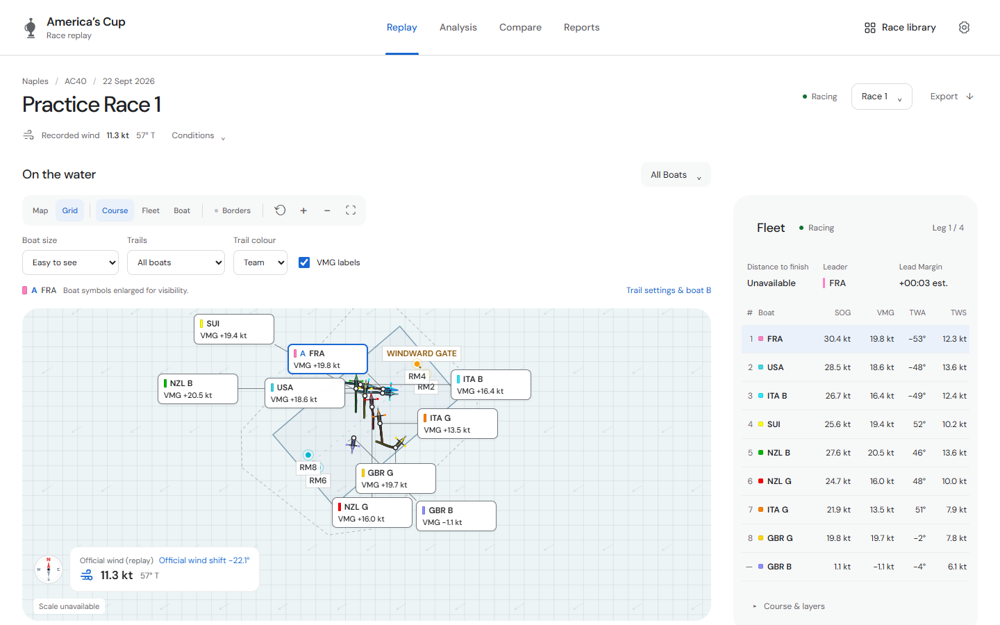
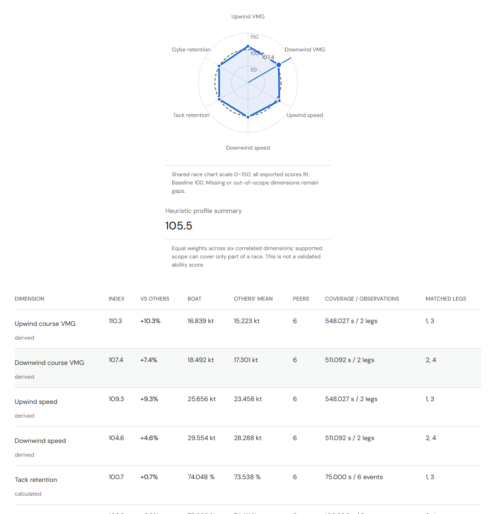
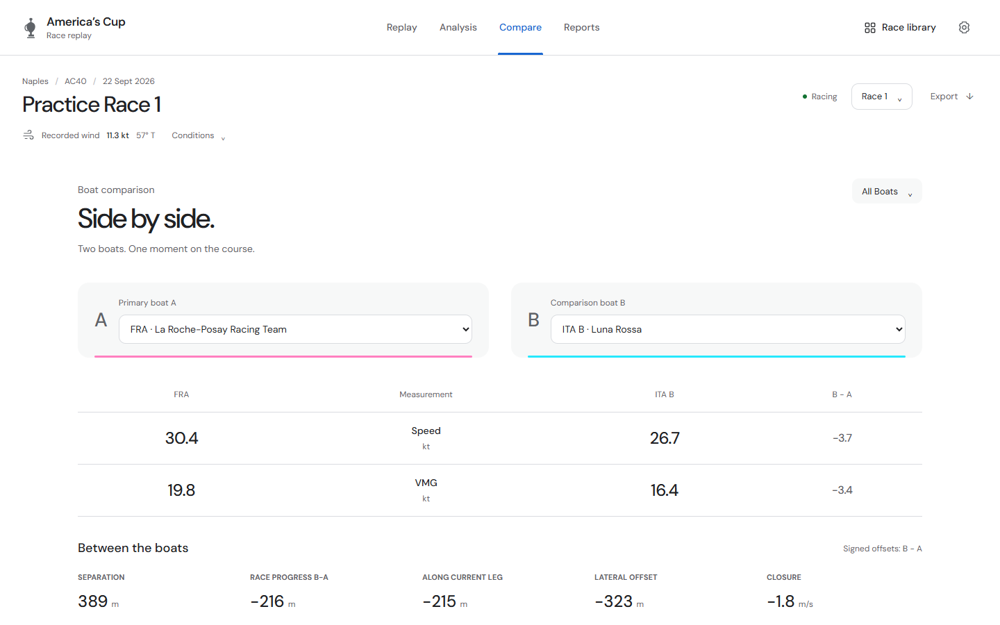
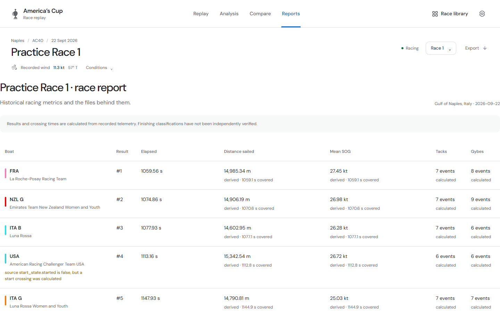
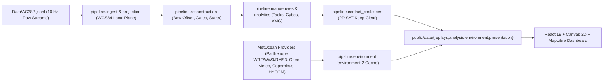

# 38th America's Cup AC40 Telemetry Pipeline & 2D Regatta Replay

A deterministic **data engineering pipeline**, **metocean enrichment system (`environment-2`)**, and **2D tactical replay web application** built for **AC40** regatta telemetry across **28 sessions** (9 Cagliari + 19 Naples races, 224 boat-race tracks) from the **38th America's Cup Preliminary Regattas**.

---

## Dashboard Workspaces

| Replay (10 Hz Tactical Canvas & MapLibre) | Analysis (Peer-Relative Performance Radar) |
| :---: | :---: |
|  |  |
| **Compare (Head-to-Head Dual Boat)** | **Reports (Canonical Metrics & Exports)** |
|  |  |

1. **Replay** — Synchronized 100 ms (10 Hz) playback of all yachts, moving gate marks, dynamic race boundaries, wind vectors, trail colour modes (`team` / `speed` / `vmg`), playhead-locked tactical insights, manoeuvre & gate timeline, and SAT `Keep-Clear` virtual contact windows. Supports offline **250 m metric Grid** and **OpenStreetMap** geographic layers at true metre scale or enhanced visibility.
2. **Analysis** — White analytical workspace presenting Python-computed historical metrics (`historical-2` / `performance-1`), leg-by-leg peer evidence (`peer_count`, matched legs, excluded legs), interactive circular radar comparisons, replay-linked **Team debrief** intervals, and an **Observed Ground-Speed Polar (`polar-1`)** with conditional `p50`/`p90` curves, two-category fixed-effect tack contrast, dual Leave-One-Race-Out + Day-Grouped CV, and 95% leg-cluster bootstrap confidence intervals.
3. **Compare** — Side-by-side playhead-synchronized delta view for any two boats (Speed/SOG, VMG, Euclidean separation, race progress B−A, along-leg distance delta, lateral course offset, and closure rate).
4. **Reports** — Canonical summary and performance CSV/JSON exports plus a searchable technical download inventory with explicit provenance (`reconstructed`, `derived`, `partial`, or `unavailable` — never backfilling missing telemetry with synthetic zeros).

---

## Architecture & Data Flow



### Engineering Highlights

- **Local Geodesic Projection (`pipeline/projection.py`)**: Derives WGS84 meridional and transverse radii of curvature at each race session's median coordinate origin, achieving `< 0.05%` baseline error versus Haversine across the Gulf of Naples (`40.81°N`) and Cagliari (`39.18°N`).
- **Geometric Race Reconstruction (`pipeline/reconstruction.py`)**: Projects AC40 GNSS antennas `+12.963 m` forward to the bowsprit tip, reconciles official Race Committee timestamps (`PENALTY_REASON_OCS`, cleared restarts vs retirements), evaluates live bow-to-line distance at gun time, and chronologically recovers omitted intermediate gate crossings when official feeds drop a rounding message.
- **Virtual Contact Coalescing (`pipeline/contact_coalescer.py`)**: Runs exact 2D Separating Axis Theorem (SAT) overlap checks on oriented yacht `Keep-Clear` hulls across all pairs at 10 Hz, gated by per-frame GNSS `stream_coverage` masks so stationary held coordinates never emit false contacts.
- **Strict Numerical Provenance (`pipeline/historical_analysis.py`, `pipeline/tactical_insights.py`)**: Python owns every metric, sample coverage denominator, and unavailability reason; TypeScript displays exported values verbatim without frontend re-interpolation.
- **Observed Ground-Speed Polar & Residual Modeling (`pipeline/polar_analysis.py`)**: Extracts steady-state 1 Hz samples (`131,620 s` across `987` boat-leg clusters, excluding manoeuvres, gate turns, `> 6°/s` turns, and `< 60 m` close traffic), fits bivariate kernel conditional `mean`/`p50`/`p90` ground-speed curves with a two-category fixed tack effect, evaluates both Leave-One-Race-Out and Day-Grouped CV, and quantifies conditional residual uncertainty via 500-draw leg-cluster bootstrap confidence intervals while keeping surface current, tactics, traffic, and wind-error caveats explicit.
- **Multi-Provider MetOcean Pipeline (`pipeline/env/`)**: Acquires gridded currents, waves, 10 m wind, SST, and air temperature from Parthenope WRF/WW3/RMS3, Open-Meteo (AROME/ICON/IFS), Copernicus Marine (Med & GLORYS/WAVERYS), and HYCOM with SHA-256 content-addressed caching under `.cache/environment/`.

---

## Quickstart

### Prerequisites

- **Node.js 22+** and `npm`
- **Python 3.12**

### 1. Install Dependencies & Verify (Works Out-of-the-Box on Clean Clone)

Raw `.jsonl` race files (`Data/`) and generated telemetry bundles (`public/data/`, `.cache/`) are intentionally excluded from Git to keep the repository lightweight and respect data provenance. When `public/data/` is absent, all unit, frontend, build, and synthetic E2E suites run automatically against deterministic test fixtures in [`tests/fixtures/`](tests/fixtures/).

```powershell
# Frontend dependencies
npm ci

# Python virtual environment & pipeline/dev extras
python -m venv .venv
.\.venv\Scripts\python.exe -m pip install -e ".[pipeline,environment,dev]"

# Full verification suite (Prettier, Ruff, Vitest, Vite production build, Python unit + synthetic E2E, markdown links)
.\.venv\Scripts\python.exe scripts/verify.py --with-format
```

> On Linux/macOS, substitute `.venv/bin/python` for `.\.venv\Scripts\python.exe`. CI runs these exact checks on every push via [`.github/workflows/ci.yml`](.github/workflows/ci.yml).

### 2. Local Data Ingestion & Weather Acquisition (When Local `Data/AC38/` Telemetry Is Available)

Place race `.jsonl` files under `Data/AC38/`. To enable Copernicus Marine ocean current/wave/SST acquisition, copy `.env.example` to `.env` and populate your Copernicus Marine credentials (`COPERNICUSMARINE_SERVICE_USERNAME` / `COPERNICUSMARINE_SERVICE_PASSWORD`; `environment` automatically reads `.env` at runtime without writing credentials into git).

```powershell
# Ingest all races, acquire/export metocean context, refresh team analytics, and build previews
.\run.ps1 ingest
.\.venv\Scripts\python.exe -m pipeline.environment acquire
.\run.ps1 environment
.\run.ps1 analytics

# Or ingest a single race session cleanly
.\.venv\Scripts\python.exe -m pipeline.run_pipeline --input "Data/AC38/26 09 22 NAP IPR PR1.jsonl"

# Start the interactive replay dashboard (http://localhost:5173)
npm run dev
```

When launched without local `public/data/manifests.json`, the dashboard renders an informative empty state explaining how to run local ingestion.

---

## Repository Structure

| Path | Responsibility |
| :--- | :--- |
| [`pipeline/`](pipeline/) | 10 Hz ingestion, WGS84 local projection, bow reconstruction, manoeuvre detection, SAT coalescing, historical metrics, and `env/` (`environment-2`) acquisition/export |
| [`src/`](src/) | React 19 + TypeScript UI, `ReplayEngine`, dual Canvas 2D / MapLibre renderer, vector AC40/AC75 models, Analysis Radar, Compare panel, Reports workspace |
| [`scripts/`](scripts/) | CI verifier (`verify.py`), `refresh_team_analytics.py`, `build_race_previews.py`, `build_artifact_inventory.py`, report CSV exporters, `analysis_snapshot.py` |
| [`tests/`](tests/) | Python unit tests (`tests/unit/`), tiered E2E reconstruction suite (`tests/e2e/`), Tier 5 integrity checks (`tests/tier5_integrity.py`), synthetic fixtures (`tests/fixtures/`), Playwright browser suites (`tests/browser/`) |
| [`docs/`](docs/) | Detailed engineering specifications and workspace screenshots |

---

## Documentation Index

- [Project Architecture & Contracts](PROJECT.md) · [System Architecture](docs/architecture.md)
- [Coordinate Projection & Reconstruction Math](docs/reconstruction_math.md) · [Derived Metrics](docs/derived_metrics.md)
- [Replay & Analysis JSON Schema](docs/data_schema.md) · [Source Audit](docs/source_audit.md)
- [Historical Analysis Contract](docs/historical_analysis.md) · [Team Analytics](docs/team_analytics.md)
- [MetOcean Environment-2 Pipeline](docs/environment_data.md) · [Ingesting New Regattas](docs/ingesting_new_regattas.md)
- [Dashboard Contract](docs/dashboard_contract.md) · [Design System](docs/design-system.md)

---

## Provenance & License

- Reconstructed start times, finish classifications, and virtual contact overlaps are derived purely for tactical telemetry inspection and do not replace official Jury or Umpire decisions.
- Map mode renders OpenStreetMap vector/raster tiles ([© OpenStreetMap contributors](https://www.openstreetmap.org/copyright)). Grid mode operates 100% offline.
- Licensed under the [MIT License](LICENSE).
