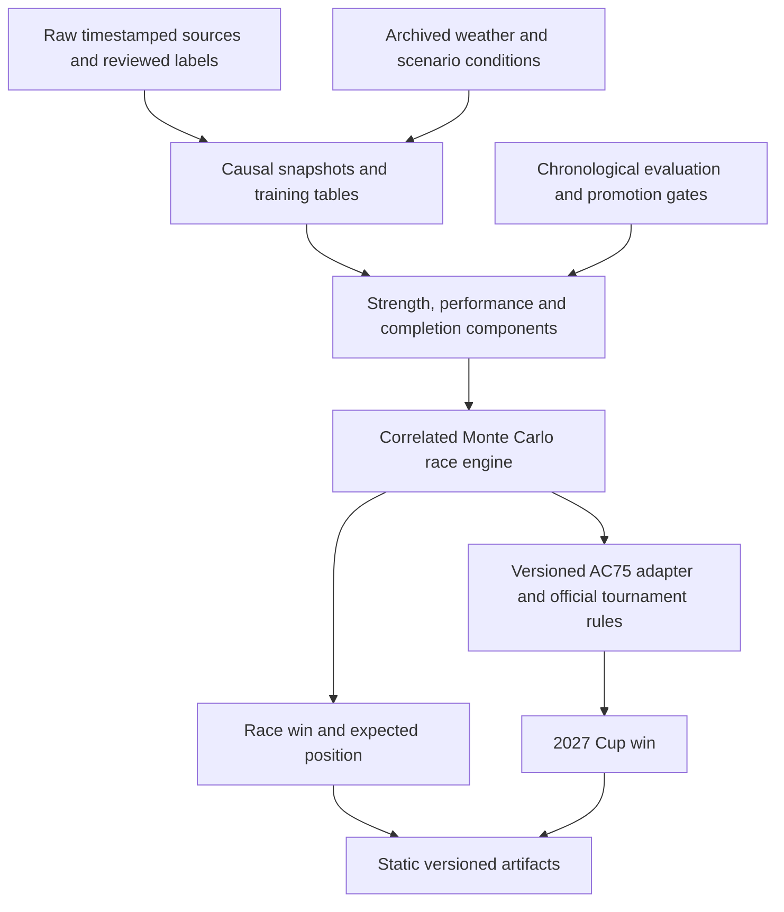

# Execution plan: race and America's Cup probabilities

Version: research revision 2, 15 October 2026; incorporates the user's full engineering/statistical review.

Status: the revised specification is implemented in the core forecasting package and Forecast view; see [implementation, runbook and current evidence gates](forecasting_implementation.md). Unsupported unconditional forecasts remain unavailable and optional Phase 2 research is deferred. This document replaces the earlier conversational model-selection proposal. Its companion [research review](forecasting_research_review.md) records the primary evidence and limitations behind the decisions. The binding [point-by-point review resolution and mathematical annex](forecasting_review_resolution.md) records every critique, the adopted correction or reason for disagreement, and the state-estimation/mixture specifications.

## 1. Fixed product contract

Implement exactly three user-facing outputs:

1. **Race win at time t:** probability of being the first valid on-water finisher, using only information available by the prediction cutoff. Subsequent protests or result changes are outside this target.
2. **Pre-race expected position:** mean simulated on-water finishing position for the entered field and conditions. DNS/DNF/RET receive position **N**, where N is the scheduled field size. Label the card **Expected position · nonfinish scored N**. This deliberately penalized last-place-equivalent metric is not an official points score or mid-rank, and its rank sum need not be conserved. Preserve the user's chosen convention; do not add a fourth finish-probability output. Calculate the mid-rank alternative only in the audit report to show the convention's impact.
3. **2027 America's Cup win:** probability of winning the actual AC75 trophy through the full official competition structure. Apply official scoring and completed results here, separately from the on-water target in output 1.

Keep a static dashboard with Python-generated artifacts. Common pre-race conditions select prebuilt supported presets immediately; off-grid/custom conditions require a build. Include external weather. Do not add podium, advancement, source-regatta winner, or other probability cards. Internal ranking distributions, completion probabilities and advancement states are necessary machinery, not additional products.

Default race forecasts are knowledge-time forecasts, not hindsight reconstructions trained on later races. A current prospective scenario can use all eligible history available at its cutoff. Scenario changes apply prospectively from that cutoff; they cannot rewrite a historical start or legal gate already completed.

## 2. Current evidence and constraints

Verified in this workspace on 15 October 2026:

- 28 source sessions, 6,866,006,601 raw bytes; 28 analysis/replay races and 224 replayed boat-races.
- All 28 are AC40: 26 fleet sessions and two match sessions, on nine dates and two venues.
- Source entries total 227. Registration is not proof of scheduled participation: review the three entries without replay telemetry, retain them if scheduled or unresolved, and exclude them only with participation evidence. Do not automatically use 227 as a prediction denominator.
- The source audit records zero independently verified official finishing orders. Current reconstructed results are not an official training truth table.
- The eight existing `tests.tier5_integrity` checks pass. This establishes archive integrity, not forecast validity.
- There is currently no forecasting implementation under the inspected pipeline, UI, tests or documentation.
- Available signals include GNSS, heading, SOG/COG, local/official wind, moving marks, boundaries, source competitor records and course metadata. Reliable current, waves, water-relative polars, heel/pitch and tactical controls are absent.
- Replay interpolation and retrospective reconstruction are unsafe forecasting inputs without a separate causal path. OCS-derived RET values, final metadata, whole-race wind summaries and future manoeuvre recovery must not leak into time-t features.
- Session identity overrides static boat identity. ITA entries exchange physical assets; crew/team/entry and physical boat require separate keys.

Use `PROJECT.md`, `docs/source_audit.md`, `docs/historical_analysis.md` and the existing snapshot script as the archive contract. Reuse the source audit while the source inventory remains unchanged. Stream raw sources; do not load raw/replay arrays into documentation or prompts. The existing historical metric owner remains `pipeline/historical_analysis.py`.

## 3. Research-backed architecture

Monte Carlo is the common integration and outcome-generation method. It is not a substitute for estimating realistic distributions. Compare a direct ranking sampler with an empirical course simulator using the same evidence, completion model, weather scenarios and evaluation.

The leading generative candidate simulates **next-gate and future-leg times**, not invented future GPS tracks or optimal tactics. The direct yacht simulation paper [R01](forecasting_research_review.md#r01--joint-yacht-race-simulation) motivates joint weather/performance; the missing physical inputs make a full VPP/digital twin an inappropriate v1 dependency.

All displayed outputs for a given class/scenario must derive from the same versioned joint outcome model. Highest win probability does not imply best expected position: even a coherent joint distribution can trade frequent wins against frequent last places. Test internal distributional consistency, not equality of these rankings. If the direct ranking model beats the course simulator, use its Monte Carlo finishing-order sampler and label it accurately. Model complexity is not an acceptance criterion.

## 4. Work packages, deliverables and gates

**MVP order:** P0 → P1 → P2 → P3 → P4 → P5 → P8 → P9. A shallow CatBoost correction in P6 is optional after the core is measured; it is not a shipping prerequisite. SVR/HMM and all P7 foundation/trained-neural work are **Phase 2, post-MVP**. Deferred work must not block a correct small-model release. Keep the research specifications so later experiments remain reproducible.

### P0 — Freeze the contract, source inventory and experiment register

**Work:** record file identities/hashes, source-session IDs, source gun times, venue/class, competitive/practice status, scheduled entrants, telemetry coverage and all exclusions. Pin the definitions in section 1. Capture runtime/dependency versions and seeds. Confirm whether an enclosing Git repository exists before initializing one. None exists at the inspected checkout. During implementation, establish a local repository and baseline source commit using an explicit source/test/docs/config allowlist; do not stage Data, node_modules, dist, environments, model weights or large generated telemetry. No remote or data upload is required. This planning revision does not initialize Git or create commits.

**Dependencies:** use Python 3.12 (the inspected runtime is 3.12.14), a `pyproject.toml` with empty base runtime dependencies, and `forecast-core` extras containing NumPy, SciPy and PyArrow. Add a separate optional `forecast-ml` extra for CatBoost/scikit-learn; isolate Torch/Chronos/TimesFM in the Phase-2 research environment rather than making all ML extras mandatory. Pin the uv tool version, Python version, resolved package versions and distribution hashes. Core/MVP uses `uv.lock` and `uv sync --locked --extra forecast-core`; ordinary verification must neither update the lock nor download models. If research packages cannot share a resolution, give `research/forecast-sequence/` its own pyproject and lock; record both hashes rather than weakening the core lock.

**Provenance:** release model cards record Git SHA and dirty state plus a SHA-256 manifest of exact source/configuration/lock bytes, input manifests and checkpoint weights. Git is the release governance gate; byte hashes remain necessary, and content-addressed experiments are possible before Git exists. A SHA alone does not identify uncommitted code. Require clean tracked source and matching manifests for promoted artifacts, without treating ignored generated files as source changes.

**Deliverables:** repository/ignore policy, pyproject/core lock, compact registry, immutable dataset manifest, experiment configuration, and baseline verification record. Use schema/method versions separate from historical analysis. A fresh core environment runs all ordinary verification against small frozen fixtures; a second legacy-only check confirms the replay pipeline retains standard-library compatibility. Torch/sequence downloads and training stay outside `run.ps1 verify`.

**Gate:** reproducible locked core installation and source provenance pass; inventory reconciles 28 sessions, 227 source entries and 224 replayed boat-races without confusing those denominators. Correct the catalog's hardcoded edition metadata through reviewed identity evidence, preserving replay compatibility. No model training until every session has an explicit inclusion/unknown status. Update stale source-size guidance to the full archive rather than the original two-file subset.

### P1 — Establish labels and identity episodes

**Work:** create separately reviewed on-water and official-result tables. For each boat-race, store scheduled/start status, corrected start evidence, legal gate sequence, on-water crossing order/times, terminal status, official classification/points, evidence URLs/files, availability time, and confidence/conflict reason.

Use source-timed gate records and reviewed geometry to establish on-water comparisons. An official classification can corroborate them but cannot replace on-water order when later rulings differ. For the 12 start conflicts, preserve raw `started=false` and export a separate evidence-backed derived start. A valid observed bow-line crossing may override a stale false flag for the on-water target only after checking source-defined mark endpoints, correct crossing direction, gun/start window, class GNSS-to-bow offset, and any required OCS dip/re-crossing. A line intersection alone is insufficient and cannot override a definitive rule violation or official classification. Use only evidence available at the cutoff; later gate progress may corroborate a later audit, not rewrite an earlier forecast. An OCS that can be corrected is not an automatic permanent retirement.

Resolve parent organization, entry and crew episode per source session; never infer senior/mixed identity from a B/G suffix or asset UUID alone. Unknown crew details remain unknown. Australia is a valid Cup entrant despite lacking these observations. Refactor both ingestion and forecasting to consume one audited, effective-time session identity resolver. The current ingestion already has session-name overrides but still indexes the static asset catalog first; preserve existing behavior through fixtures while removing that unknown-ID failure. Keep unit constants and legacy fallbacks in config, not authoritative team/crew identities or a universal course layout.

**Practice policy:** practice finishing outcomes have zero weight in the primary competitive strength fit and winner-model selection. Practice is excluded from competitive residual scale, jump frequency/delay, failure and start distributions by default. Reviewed steady practice windows may inform only the mean response, with separate practice scale and a competitive-only ablation. Flag possible peel-offs using continuous speed/VMG, acceleration, course departure, turning/recovery and multi-boat context; SOG<5 knots outside a detected turn is a review flag, not proof of deliberate stopping. Do not automatically discard genuine low-wind or severe-loss competitive episodes. Reuse a practice boat-leg as competitive dynamics only after explicit intent/coverage review. This protects variance and tails without selection by convenient fast segments.

**Deliverables:** reviewed result/participation/identity tables and a reconciliation report with counts by evidence tier. Prefer externally corroborated competitive outcomes for release scoring. Source-only reconstructed outcomes may support explicitly experimental development, with separate results; they cannot establish official winner accuracy.

**Gate:** every training outcome has a named target and provenance. Unresolved order, unknown completion and recording termination remain censored/unknown. Do not invent a finishing order or reliability count to meet a sample-size target. Numeric unconditional outputs require audited participation/completion evidence; otherwise export an explicit evidence limitation.

### P2 — Build the causal data path and condition scenarios

**Raw event path:** preserve original record order, source event time, record ordinal, and receipt/publication time when available. Use an event-time reorder buffer of six seconds, matching the observed 5.85-second disorder with a margin. When receipt times are absent, call this an event-time reconstruction with modeled latency, not proof of live information availability. Late events beyond the allowance are flagged; do not silently insert them into earlier published checkpoints.

**Snapshots/state quality:** construct inputs at 1 Hz; publish every ten seconds and on definitive finish/status changes. Two seconds becomes a **fresh-measurement label**, not an automatic fleet-wide failure threshold. A causal position/velocity filter propagates a posterior state during short gaps, with uncertainty increasing under its full dynamics. Sample that uncertainty once in Monte Carlo; mark the input `estimated`, with age and covariance, never measured. Use the filter and certification procedure in annex A. No future interpolation endpoint or smoother is permitted.

Fit noise parameters from earlier data and certify gap horizons using disjoint artificial masks at 2/5/10/20/30/60/90 seconds, including turns, low speed and gate approaches. Select only the largest contiguous horizon passing the preregistered coverage/error/phase tests; 60 or 90 seconds is a ceiling to test, not an assumed safe bridge. Recreate the natural 74.6-second case as a stress test, without promising a valid result. At a possible unconfirmed gate crossing, keep discrete course-state uncertainty; never mark a predicted crossing as observed. MVP only bridges paths whose legal phase remains resolved. For longer/ambiguous gaps, use a missing-state prior only if its own masked-gap end-to-end evaluation passes; otherwise return an explicit unresolved-field-state result. Retain the competitor in all cases; never renormalize it away.

Marks use a separate slow-motion/random-walk model or causal hold with age-dependent covariance, initially capped at 30 seconds and shortened by masked-mark validation. Course changes, relocations and uncertain gate lines stop blind holding. Use trailing windows of 10/30/120 seconds and coverage. A fresh official wind asset can replace unavailable local wind with provenance. First-finisher determinism requires globally resolved chronological finish evidence, not merely the first received crossing while another contender's state is unknown.

**Course state:** consume only revisions known by the cutoff. Derive starts, legal gates and progress online. Use metre geometry, correctly directed leg VMG and actual marks. Add along-wind and cross-wind offsets to both gate endpoints/center using a causal circular trailing wind vector, gate angular width and current tack. Do not hardcode 42°/145° polars or the review's invalid distance formula. These are geometric features, not a verified layline or feasible route. Existing full-race progress/manoeuvre outputs remain retrospective. Add causal SOG, 10-second acceleration, turn-rate/time-since-turn, speed-relative-to-earlier-steady-speed and wrapped 30-versus-120-second wind shift. Threshold flags are explicitly proxies; SOG<11 knots does not establish displacement/foil state.

**Tables:** build one compact table per boat-leg for full-leg targets; a separate ten-second snapshot table for remaining-time and winner targets; a 1 Hz/window table for sequence experiments. Carry race/day/leg IDs and validity masks. Overlapping rows within a boat-leg share total weight one; evaluate at the race/day level. Gate times after the cutoff may be target labels, never predictor inputs.

**Weather:** use Open-Meteo archived ECMWF IFS individual runs for retrospective exogenous forecasts and forecast ensembles where available for prospective scenarios. Cache exact model identifiers, run initialization, conservative/verified availability, valid times, coordinates, height, units and response hashes. Do not substitute reanalysis or realized wind as a past forecast. For dates beyond useful forecast horizons, use 1991–2020 Naples seasonal/daytime weather blocks as a documented climatological scenario, not a dated 2027 prediction. Preserve adjacent-race dependence.

Manual scenarios specify field, class, venue, start time, wind speed/direction and optional course/variability overrides. Manual wind overrides provider wind for that variable; omitted variables retain the named provider baseline. Provider marine waves/current are context until supported effects can be estimated. External 10 m wind is a proxy, not the committee's sensor/current-corrected measurement. Out-of-range joint wind/course/class combinations are flagged as extrapolation; unsupported classes/geometry produce unavailable output.

**Gate:** full-source and source-prefix builds agree for the same knowledge cutoff. Altering/deleting future telemetry, future statuses, final metadata or future results cannot change earlier inputs/forecasts. Raw source measurements and publication assumptions remain traceable. No actual future wind, heading, tack, next-gate choice or revised course is passed as a known-future covariate.

### P3 — Freeze evaluation before comparing models

The nine current dates are May 22–24 and September 22–27, 2026. The September 22–24 sessions are practice; their eligibility must be confirmed in P1. Competitive evaluation is sparse, so requiring three initial training days would remove nearly all development outcomes.

**Development:** fit on all eligible data strictly before each of **May 23, May 24 and September 25**, and evaluate that competitive date. May 22 is the initial competitive training day. Earlier practice may contribute dynamics only. Keep same-day future outcomes out; freeze a model for the evaluated day, with observed race state allowed only as inference input.

**Locked descriptive audit:** September 26–27, seven current sessions, including `26_09_25_nap_ipr_race_3` whose actual gun date is September 26. Do not order by filename. Freeze one candidate and its settings before this audit. These historical outcomes are not a new prospective trial, and two days do not establish statistical superiority.

**Tuning:** current folds use preregistered defaults. Permit hyperparameter selection only when an outer fold has at least three earlier eligible competitive assessment dates for an inner past-only evaluation. Thus v1 has no broad hyperparameter search. All scaling, strengths, feature selection, clusters, representations, residual fitting and calibration are fitted inside the past training data.

**Scoring:** primary winner score is live-checkpoint multiclass log loss, retaining the internal no-valid-finisher category. Report live Brier, normalized pre-race RPS and normalized expected-position squared error separately. Normalize RPS by N-1 and position error by squaring `(predicted-observed)/(N-1)`; single-entry fields are deterministic. For live scores, use ten-second checkpoints within causal progress bands, not fractions of eventual race duration. Score each race in chronological order with the day-frozen model, then publish both race-equal and day-equal summaries. This creates more diagnostic rows, not more independent dates. Same-day result updating is a separate prospective ablation and requires results actually available before the next gun.

For local dynamics, score 10/30/60-second cumulative progress and VMG/speed with CRPS/quantile loss, coverage, gap errors and dependence diagnostics. Score practice and competition separately. Compare time-to-gate distributions on valid targets, with explicit coverage/exclusions.

**Provisional release decision:** remove the previous zero-tolerance/all-delete-one-day veto. Before any comparisons, freeze these engineering risk budgets for mean loss increases: live Brier +0.01 (sum-over-outcomes definition), normalized pre-race RPS +0.02, normalized expected-position squared error +0.02. They are practical policies, not inferred noninferiority margins or research constants. A challenger must improve primary live log loss under both race-equal and day-equal aggregation and remain within the applicable budgets. A live-only conditioner freezes the pre-race distribution by construction, so unrelated pre-race noise cannot veto it. A change to strength/full-leg distributions must pass all applicable pre-race budgets. Keep one coherent model bundle; do not independently splice dashboard percentages.

Evaluate the same predefined races/checkpoints for every candidate, with reference fallback when its prerequisites are unmet. Report component coverage, every paired date/race difference and delete-one-day sensitivity; concentration in one date is a low-evidence flag, not automatic proof of failure. Bootstrap standard errors from three dates cannot establish power or noninferiority; the suggested +0.5-SE rule is not used as an inferential guarantee. Freeze the candidate before the locked audit; require the same primary-improvement direction and the same frozen budgets there for a provisional release. Otherwise keep the reference. No retuning after seeing the audit. Even a passing candidate remains explicitly low-evidence until prospective competitive data accumulate.

Report every scored race/day, paired loss differences, evidence tiers, exclusions and a model-ablation table. Resampling by day is sensitivity analysis, not proof of calibrated 95% coverage. Identity calibration is the v1 default. A future one-parameter calibration may adjust the whole ranking/noise model using earlier out-of-fold data; independently calibrating displayed probabilities would break coherence with rankings/event simulations.

**Gate:** the split and score code passes synthetic grouping/leakage tests before any candidate's comparative results are inspected. Final-audit results are absent from development tuning artifacts.

### P4 — Implement mandatory simple references and completion

**References:** field-aware uniform order sampler; pooled empirical historical order/leg sampler; static regularized strength model; a condition/state-aware conditional logit/Plackett–Luce model with a small penalized additive extension for progress. Use a shared competition normalization, not independent binary win classifiers. Keep a TrueSkill-style rating as a diagnostic benchmark rather than stacking several ratings by default.

The ranking score uses centered organization/entry effects, strongly pooled wind-response differences, recent relative VMG and a small geometry set. Add the diffusion-inspired dimensionless lead feature `lead_fraction / sqrt(max(remaining_fraction,0.01))`, comparing it with raw lead as a fixed ablation. It is motivated by a Brownian remaining-time approximation, not a universal first-passage theorem for foiling boats. Residual persistence, different speeds and shared wind can change the scaling. Known resolved finishes remain deterministic, avoiding a boundary singularity. A shared additive weather term cancels in a softmax. With two match races, pool evidence and do not fit a free matchup matrix.

Use standardized features, ridge penalties and a single preregistered conservative configuration. For the initial regularized ranking fit, use strength SD 0.5, condition-response SD 0.25 and state-coefficient SD 0.25 on standardized inputs; include a zero-condition-effect ablation. These are declared regularization conventions, not measured physical constants. Do not estimate free daily skill paths. Compare a fixed 180-day recency sensitivity only after the static reference is recorded; it is not an automatic learned drift model.

**Completion:** separate scheduled-entry DNS from terminal exogenous noncompletion after starting, such as an audited retirement/capsize/breakdown. Race time limits, finishing windows and administrative abandonment are handled by the rules/time model, not counted again as random reliability failures. An untyped DNF requires review; do not guess its cause. Fit only audited competitive ascertainment; do not include missing streams, practice stopping, or abandonment as failures. Use pooled Beta-Binomial components with a declared Jeffreys reference prior and a Beta(1,19) prior-sensitivity run. If no audited denominator exists, mark unconditional predictions unavailable; do not present a prior mean as empirical reliability. Do not learn per-team failure rates from a handful of incidents.

Reference failure risk uses constant hazard per course fraction, excludes DNS after a known start, and conditions on observed survival. Add a prespecified transition-weighted sensitivity whose phase weights integrate to the same full-race failure probability (annex D). With six raw RETIRED statuses and unaudited timing, do not claim fitted gate-specific hazards. The reliability component is otherwise independent of sampled ability/performance; slowness-induced failure still arises from timing rules. Preserve terminal statuses only from availability time. Legacy `elapsed_s=0` for nonfinishers is a sentinel, never a zero-second finish.

Fit ranking on the established valid finisher order; do not also encode DNF as poor strength. For conditional travel-time learning, retain every observed valid gate transition, including transitions by a boat that later fails to finish; future failure must not delete its earlier physical evidence. Terminal noncompletion remains in the separate completion component. Retain the possibility of no valid finisher internally. Unknown future penalties/rulings are not a fabricated learned hazard: expose the event scenario as conditional on no unmodeled future scoring sanctions.

**Gate:** hand-checkable examples establish coherent ranking probabilities, terminal behavior and the N convention. Confirm no double counting of DNS/DNF, and that win mass plus no-finisher mass equals one. Expected positions lie in [1,N], but need not sum to N(N+1)/2 when nonfinishers tie at N.

### P5 — Build the empirical correlated race simulator

**Positive time models:** compare the small lognormal/additive reference with a pooled positive-delay mixture: `T_leg = T_clean + Z*delay`, where `T_clean` is positive, Z is an episode indicator and delay is positive **seconds**. Fit the mixture jointly against the same baseline; do not append delays to a full-leg model already containing those losses. Audit sustained loss/recovery episodes with retrospective manoeuvre information only as training labels, retaining their detection/availability semantics. The source has no reliable foil-height state: call the component a severe performance-loss episode unless independently validated as touchdown. No fixed 9-knot wind switch, 11-knot foil classifier or 25–60-second delay is adopted as fact. Use the fit/identifiability/fallback specification in annex C.

The current remaining-gate model uses cutoff distance/progress, wind, trailing speed/VMG, acceleration/recovery proxies and observed geometry. Future full legs use only leg attributes, sampled calendar-time weather, hierarchical performance and simulated gate-time gaps, never ungenerated future speed/position. Fit crew effects once on the time scale; do not add an independent copy of ranking worth. An audited time-limit observation may contribute the appropriate censored likelihood; retirement is a separate event. Source-truncated targets remain unknown unless censoring is established.

**Gate consistency:** use one shared leg-level prior and persistent pace/loss variables for full-leg and remaining-leg predictions. A remaining-leg conditional update with zero elapsed progress and no new information must recover the full-leg predictive distribution, including mixture mass, mean, variance and tails. Do not independently redraw a leg's latent loss state at a gate. Test continuity with new observations held fixed, and separately permit justified updates from observed rounding/recovery/conditions. Do not smooth away real information-driven probability jumps or enforce unconditional equal variance after informative observations.

**Starts:** pre-race simulations draw a signed joint gun-time state: distance/position relative to the line, speed, and valid/corrected-start status, using reviewed competitive starts with strong pooling. Include poor legal starts and corrected OCS cases. First-leg arrival time is defined from the gun and conditions on this sampled state; do not add another sampled start delay to an already gun-to-gate duration. DNS remains separate.

**Joint evolution:** for each whole simulated race, draw one persistent crew/entry effect, one race-performance effect, a shared weather trajectory and centered residual innovations. Model a shared fleet/day component plus boat-specific persistence across legs. Estimate dependence with small factors/shrinkage and synchronized residual blocks, not a full unrestricted boat-by-time covariance matrix. Prefer strictly earlier out-of-fold residuals. For early folds without those residuals, use empirical same-phase blocks from earlier training races and flag the dependence estimate as provisional. Do not add an independent second crew effect or a second copy of weather variance already explained by the sampled weather.

**Transitions:** maintain an event queue of sampled gate arrivals and accumulate each boat's calendar time. At a new leg, first compute the deterministic median duration using weather at entry; summarize the shared sampled weather over that baseline window, then draw the conditional duration. Recompute after every gate. Different boats need not encounter the same wind merely because their leg numbers match. Use course revisions only if already known; future course changes belong to explicit scenarios. When a boat arrives, form the time-lead feature at the latest gate already reached by both boats, or use zero plus an unknown flag; never inspect future sampled arrivals as tactical information. Restrict spatial proximity effects to the observed current segment. Test the time-lead effect against a no-interaction ablation. These are empirical effects, not an optimal covering policy or a collision/umpire model.

Sample a terminal-failure course fraction from the assumed hazard, retaining a boat's competitive presence until that fraction rather than revealing its future retirement at the gun. Interpolate event time within its sampled leg solely to schedule that failure; this is an exposure approximation, not a predicted XY track. Apply each race's verified first-gate/race/finishing-window rules separately, retaining reached gates and status for official scoring. Do not apply a time-limit DNF once through reliability and again through the timing rule.

Full-leg times already include ordinary manoeuvre/tactical losses. Do not add a separate tack-cost process on top without decomposing and refitting the baseline. Do not extrapolate precise future XY paths from a gate-time model or animate them as predictions.

**Monte Carlo/build cost:** use common random numbers. Standard live checkpoints use 20,000 continuations, with 100,000 reserved for pre-race final artifacts and explicitly built Cup scenarios. Report numerical precision; worst-case approximate 95% half-width is 0.69 percentage points at 20,000 and 0.31 at 100,000, not model accuracy. Benchmark one complete race and one Cup scenario before bulk generation. Batch/vectorize, cache by full input/model/seed hash, and reuse identical builds. Canonical weather presets initially generate pre-race summaries only, not a Cartesian expansion of every ten-second live trajectory. Build custom live scenarios lazily. Keep simulation counts fixed in each declared build profile; do not spend weeks training models before this cost gate.

**Finite-sample tails:** before scoring or export, define the joint predictive distribution as `(1 - 0.0001) * candidate + 0.0001 * valid_uniform_reference`. The reference uses the same completion component and legal/terminal constraints, with uniform order among possible finishers; calculate its win/place marginals analytically or by exact finisher-subset enumeration. Apply the same mixture to expected positions and tournament outcome sampling. This predeclared small regularization prevents a possible winner receiving a numerical zero solely from finite Monte Carlo counts. Preserve truly impossible/terminal outcomes exactly; never independently clip displayed percentages after observing a surprise.

**Gate:** label swaps, equal-strength symmetry, finish determinism, legal gate order, fixed known results, missing-data behavior, and dependence ablations pass. The simulator is compared with P4 end to end; plausible dynamics alone do not justify promotion.

### P6 — Optional shallow ML; other additions are post-MVP

**Shallow boosting:** one CatBoost residual model, depth 2, 300 iterations, learning rate 0.03, L2 leaf penalty 10, squared-error loss on standardized log-time residuals, seed 42 and no broad tuning. Use explicit past-fitted strength features and avoid target-encoding leakage from team IDs. Compare it with the additive simulator on identical rows/splits/seeds. Nonlinear mean gains do not automatically imply calibrated uncertainty; refit current-segment residuals after the correction and retain the common dependence machinery.

**Phase 2 only — SVR:** one RBF residual comparator, with inputs and log-time target standardized from training data, C=1, epsilon=0.1 and gamma=`scale`, on a deterministic race-balanced subset of at most 20,000 training windows. Do not delay core shipping for this experiment.

**Phase 2 only — unsupervised:** compare no regime model with a two-state HMM on trailing wind/performance summaries. Fit only the training fold and use filtering, never smoothing. Known leg state comes from metadata. Anomalies create review flags, not retirement labels. The MVP uses continuous causal kinematic features from P2; it does not require an HMM to explain obvious turn/recovery patterns.

**Gate:** every addition has a recorded ablation and a bounded experiment. No new feature/model is added merely because the library exposes it. Failure to improve is an acceptable result.

### P7 — Post-MVP deep/foundation research; never a shipping gate

Begin only after P0–P5/P8–P9 pass core verification and error analysis identifies short-horizon residual structure not explained by SOG, acceleration, turn/recovery and wind-shift features. The existing data cannot establish a large model's value in advance. The review's specific claim that 95% of its signal is redundant is also unmeasured; test incremental value rather than assert it. Preserve the bounded experiment below as research, not required MVP work.

**Frozen models first:** compare Chronos-2 grouped multivariate, TimesFM 2.5 univariate/XReg, and the simple persistence/recent-average/AR references. Chronos-2 is the default multivariate local experiment because its official weights are Apache-2.0. TimesFM 3 is a separate research-only candidate unless its production-use route is resolved; do not make noncommercial weights an undeclared release dependency. Moirai and Chronos-Bolt are documented alternatives, not mandatory additional searches.

Use 1 Hz histories, primary context 128 seconds and a descriptive 512-second sensitivity for the foundation models and GRU, forecasting 10/30/60 seconds. The sensitivity does not create an additional promotion candidate. Targets are causal course-progress-rate/performance residuals relative to the baseline; speed and leg-directed VMG are diagnostics. Context availability is explicit; never fill missing history from a later sample. No arbitrary numeric encoding of boat identity. Chronos-2/TimesFM 3 may condition on past-only boat/wind channels and sampled/available future-weather covariates through their documented interfaces. TimesFM 2.5's XReg workflow uses only interface-supported regressors whose future values are available or generated by an explicit scenario; do not invent future opponent positions or headings. Freeze checkpoint hash/version and distinguish model-release availability from source-data availability.

**Small trained models:** one shared GRU (one layer, hidden width 16) and one causal TCN (six residual blocks, two causal convolutions per block, width 16, kernel 3, dilations 1/2/4/8/16/32). The TCN receptive field is 253 observations, supporting the primary 128-second context; do not claim it tests 512 seconds. Use a direct 10/30/60-second cumulative-progress quantile head, mean pinball loss over deciles 0.1–0.9, dropout 0.1, AdamW learning rate 0.001, weight decay 0.0001, batch size 256, gradient clipping at 1, and max 50 epochs. Use race-balanced batches and patience-five early stopping on an earlier validation day. Average forecast summaries from seeds 17/42/101 with equal weights; do not select the best seed. If no earlier eligible validation day exists, the candidate procedure returns the reference predictions for that fold. No large architecture search, full fine-tuning, TFT/GNN/RL requirement or pretrained-weight update in v1.

**Distributional interface:** quantiles are marginal forecasts, not a boat-by-time joint distribution. For optional trajectory diagnostics, use the P5 synchronized residual/factor construction, validating tails beyond the provided quantiles rather than clipping tail mass at endpoints. Reject both independent per-second quantile sampling and one perfectly shared quantile. Evaluate cumulative progress, cross-boat gaps, autocorrelation, CRPS and energy/variogram diagnostics. The gate-time adapter below deliberately avoids adding a second set of sampled foundation-model errors to the race simulator.

**Gate-time adapter:** let `m0` be the baseline predicted log remaining-gate time, `L` the known current-leg length and `D` its causal remaining along-course distance proxy. Set H to the smaller of 30 seconds and `exp(m0)`; define baseline median progress over H as `D * min(H / exp(m0), 1)`. Form `a = (sequence median cumulative progress over H - baseline median cumulative progress over H) / L` and `b = sequence interdecile cumulative-progress width over H / L`. Train on past cross-fitted forecasts to predict `log(T_remaining)` with mean `m0 + gamma*a` and log residual scale `log(sigma0) + zeta*b`, using ridge penalty 10 on standardized a/b, gamma<=0 and zeta>=0. If no eligible adapter-training forecasts exist, return the baseline distribution. Integrate 1 Hz rate forecasts to obtain cumulative progress; interpolate the compact neural head between its known anchors (0,10,30,60 seconds). Do not use actual future gate time to choose H. This is a fitted summary-to-arrival adapter, not integration of a physical future track.

Only the observed current-segment arrival distribution is corrected. Re-estimate its residuals after the adapter, replacing that segment's baseline innovation spread; do not additionally sample foundation quantiles or add the old baseline residual variance. Future full legs use P5 unchanged. No extrapolated sequence policy, future XY path or arbitrary time-to-gate warp is required. Short-horizon effects have value only through this fitted, evaluated adapter.

**Gate:** a telemetry improvement alone is insufficient. The component must improve downstream competitive win/place scores under P3. Keep zero-shot/frozen weights if fine-tuning is unsupported. LoRA/self-supervised TS2Vec is a later work package only after a reproducible failure analysis identifies a need; its preprocessing also stays inside training folds.

### P8 — Implement the AC75 adapter and complete Cup state machine

**Entrants:** Defender Emirates Team New Zealand; Challengers GB1, Luna Rossa, Tudor Team Alinghi, La Roche-Posay Racing Team, ARC Team USA and Team Australia, subject to official roster versions. Do not omit Australia for missing telemetry.

**Transfer:** separate mapped crew/organizational competence from AC75 design, foil/system and changed-crew effects. No fixed coefficient such as 0.5 is learned from this archive. Define the scenario family

`strength_AC75 = rho * mapped_AC40_strength + independent_AC75_effect`.

Use rho in {0,0.5,1} as named assumptions. AC40 scores/scales come from the audited competitive ranking layer, not an unlabelled conversion of log-time coefficients. Draw each team's persistent independent AC75 effect from Normal(0,sigma^2), with sigma in {0.5,1,2} times the pooled AC40 score scale (fallback prior SD 0.5). Australia receives a population prior, not exclusion. Separately define match concentration c in {1,2,3}: `P(i beats j | strengths) = logistic(c * (strength_i-strength_j))`; fleet uses concentration 1. This tests reduced match noise without conflating race noise with persistent boat-design variance. No evidence here establishes a real 2–3x AC75 ratio. Apply completion hazard multipliers k in {0.5,1,2} by `q_k=1-(1-q)^k`.

The manifest lists the exact evaluated cross-product or subset. Standard build uses the nine rho/sigma combinations at k=c=1; k/c sensitivity scenarios are separately cached on demand before their envelope is displayed. A range covers only actually generated scenarios, never the uncomputed full grid. These are stress tests, not confidence bounds. Do not average scenarios with invented evidence weights or silently designate a central scenario as learned truth.

The Cup output initially shows an **AC40-informed scenario envelope**, with scenario-specific estimates available through selection. A single scenario percentage is labelled with its assumptions. It is not called a calibrated AC75 forecast. Until target-class speed data exist, use a dimensionless AC75 ranking prior in the same outcome engine; do not apply AC40 metre/second polars to an AC75. Rank-only scenarios are conditional on completed scored races without unrepresented timing-based stoppages. If scoring a sampled/known state requires unavailable gate/time information, mark that branch unresolved and bound it or return unavailable; do not claim a rank-only kernel supplies a full physical race state. Update the class adapter and select/validate its components prospectively as 2027 AC75 results and telemetry arrive. Current-season data, not a required nonexistent earlier 2027 AC75 event, drive that update.

**Rules:** pin official Protocol AC38.10, LVC/Match Conditions v0 and RRSAC v5.02, with effective dates and hashes, then incorporate later official instructions before publication. Governed precedence is part of the adapter. The initial structure is:

1. Six AC75 fleet races; maintain overall and Challenger-only standings. Fleet carry-over into Challenger round-robin standings is 2.5/2/1.5/1/0.5/0; separately track the overall series' stipulated carry-over.
2. Up to three complete round robins. Defender races here, but its results do not determine Challenger qualification.
3. Top three Challengers advance; sixth faces fifth (fifth starts +1), winner faces fourth (fourth starts +1), each first to three points.
4. Top Challenger chooses a semifinal opponent; semifinals first to five.
5. Challenger final first to seven; winner faces the automatically qualified Defender in the Cup Match, first to seven.

**Observable opponent-selection policy:** within each simulated continuation, retain public round-robin outcomes/points, excluding Defender results where rules require. At the semifinal choice, pick the eligible opponent with the lowest observed Challenger round-robin win fraction; resolve policy ties by weaker pre-tournament predictive match probability, then stable team ID. Respect every actual official selection. This lightweight default responds to simulated competition and never inspects latent strength. Any Bayesian alternative must update from those simulated outcomes using the correct match likelihood; a normal-normal conjugate shortcut for binary wins is not valid. Compare legal choice policies as sensitivity. A stronger Bayesian policy is post-MVP.

Implement points, ties, shared/zero results, penalties, incomplete-series rules, selections, withdrawals, reserve/continuation policy and exact document precedence. Do not hard-cap a first-to-seven series at 13 races when zero/shared results or penalties can extend it. Fix known results and actual selections; simulate only remaining outcomes. Use the observable policy above before a selection is known.

The currently identified six-Challenger qualification/seeding tie ambiguity requires authoritative sailing instructions/clarification. Validator output lists unresolved clauses. For affected paths, branch across permitted completions while retaining consistent known results. A team's lower estimate counts paths where it wins under every completion; its upper counts paths where it wins under at least one completion. Never give unresolved branches equal probability without evidence. Per-team bounds need not sum to one. If no defensible completion set exists, output unavailable for that scenario. Keep these rule bounds distinct from the finite transfer-scenario envelope and Monte Carlo error.

Use shared team-strength draws across the entire tournament and correlated weather across nearby races. The current public schedule begins May 22 and the Match July 10, 2027, but remains versioned and adjustable. AC75 committee wind limits/sensor definitions are not the AC40 prelim limits or raw 10 m API wind. At long range, forecasts are conditional on completion under the configured schedule/raceable-condition scenarios; do not claim to identify committee cancellation/sea-state decisions from absent sensors.

**Gate:** rule fixtures cover every advancement path and scoring branch, including incomplete round robins and unresolved ties. With identical known strengths, no failure/side advantages and complete rules, ETNZ has 1/2 Cup probability and each of six symmetric Challengers has 1/12. With unknown persistent differences, this equality need not hold and is not a valid forced normalization. AC40 performance scores are never reported as AC75/Cup accuracy.

### P9 — Publish static artifacts and complete repository verification

**Python interface:** implement one `pipeline.prediction` package with commands `audit`, `dataset`, `backtest`, `build`, and `verify`. Commands consume named configuration/scenario files and return nonzero on invalid contracts. They are planned interfaces, not commands available today. Models expose `fit`, `predict_distribution`, and `sample_race_outcomes`; sequence components additionally expose marginal forecasts and the named dependence adapter. Rule simulation is deterministic given outcomes and state.

**Storage:** compact local Parquet training tables and JSON manifests/model cards; weights stay outside browser payloads. Use `public/data/predictions/index.json`, columnar baseline race files, lazy scenario summaries and `cup_2027.json`. The baseline race format has one header, one pre-race block and parallel live arrays; the exact shape and budgets are in annex E. Put model hashes, field, method/units, assumptions and rules references once in the header. Timestamp-varying status, source ages and uncertainty summaries remain columns, not incorrectly frozen header values. Add successful atomic exports to Reports; failed builds cannot publish a new index pointing to mismatched artifacts.

Each artifact contains schema/method/model version, hashes, target/units, cutoffs/times, scenario origin, field/class/event, coverage/quality, assumptions/rules and numerical precision without repeating invariants per checkpoint. Per-boat outputs carry race-win probability and pre-race expected position; Cup outputs carry scenario estimates/envelope or rule bounds. Internal rank distributions and no-finisher mass remain auditable. Never replace null with a default probability. Target total uncompressed baseline live payload is 1.5 MiB across 28 races; release hard budget is 3 MiB, with compressed size also reported. These are future measured gates, not an achieved claim. Scenario bundles are lazy and budgeted separately; do not meet size limits by deleting necessary quality information.

**UI:** add Forecast as the fifth view and map key **5** to it, preserving keys 1–4 and the existing input/focus guards. Show only the three outputs. Live win follows the latest published checkpoint; pre-race position explicitly labels the N convention. Cup names the AC75 championship. Generate supported pre-race presets for TWS {8,12,16,20} knots and wind/course offsets {-15,0,+15} degrees, omitting unsupported cells. Use relative offsets, not arbitrary compass quadrants on an unchanged windward/leeward course. Selecting a preset immediately displays its exact generated conditions; do not silently interpolate probabilities or claim a nearby wind is the requested value. Custom requests remain available.

Give each scenario a scope (`pre_race`, `live_from_cutoff` or `cup`) and an exact hash. Prebuilt pre-race presets do not imply counterfactual live/Cup artifacts exist. Each card names its own observed/scenario context; changing inputs hides only dependent stale outputs. Lazy-load selected scenarios and provide readable estimated-state/age/reason labels. Numeric backend work remains in Python.

**Integration tests:** missing JSON, HTML returned instead of JSON, wrong schema/hash/class/field, stale artifacts, invalid conditions, race change, seeking backward, no checkpoint, unresolved rules, missing labels and out-of-support scenarios all fail visibly without fallback percentages. Test browser behavior at the repository's desktop/tablet/mobile sizes. TypeScript consumes Python outputs and never recomputes historical metrics or probabilities.

**MVP final gate:** focused deterministic tests; core forecast audit/backtest report; locked-core `run.ps1 verify`; browser and payload/inventory checks. Keep ordinary verification offline with small frozen fixtures and mocked external/model interfaces. SVR/HMM, foundation weights, neural training, live weather and model downloads are explicitly outside this gate. Record those experiments as deferred, not as silently passed or failed.

## 5. Interface and dataset details to keep synchronized

| Contract | Required contents |
| --- | --- |
| Source registry | Raw file hash, session/event/class, source gun, practice/competition, scheduled entries, source timestamp/arrival semantics. |
| Identity record | Organization, entry, crew episode, physical asset, effective time, evidence; unknown values remain unknown. |
| Outcome record | On-water order and gate evidence; official result/points separately; DNS/DNF/RET/unknown; label availability and review status. |
| Snapshot row | Cutoff/publication, field, source-backed course/position, trailing summaries, legal progress, ages/masks, feature version; no retrospective outcome fields among predictors. |
| Target row | Next-gate/leg-time or horizon outcome, end timestamp, censor/validity, originating race/day/leg; never counted as independent race evidence. |
| Scenario | Class/event/field, cutoff/start/venue, course version, manual/provider conditions and precedence, weather-run availability, AC75 assumptions, seed. |
| Model card | Training IDs/cutoffs, label tiers, feature transforms, model/checkpoint/license, completion assumptions, folds/scores/ablations, support region and unvalidated uses. |
| Forecast artifact | Exactly defined outputs and units, no-finisher bookkeeping, hashes/times, quality/status/reasons, model/rule/scenario versions, uncertainty categories. |

Use UTC milliseconds internally, metres for geometry, knots at the UI boundary and explicit m/s conversions internally where needed. Wind direction is where wind comes from; use vector/sine-cosine representations. A missing value is not zero. Schema changes require synchronized Python exports, TypeScript types, documentation, fixtures and inventory.

## 6. Acceptance and stopping rules

- **Data correctness comes first:** no supervised performance claim without audited target evidence; no new semantic use of existing `official_rank` compatibility fields.
- **Causality:** future perturbation/prefix equivalence passes for features, strengths, completion, exogenous inputs and exported checkpoint selection.
- **Coherence:** complete joint outcomes yield both race metrics and official event scoring; no independently fitted dashboard percentages, no missing-opponent normalization, no doubled failure/manoeuvre risk.
- **Predictive value:** report competitive out-of-time scores and each date's contribution. A simpler model remains a successful release if challengers fail. No invented target accuracy or promised percentage improvement.
- **Uncertainty:** distinguish race randomness, parameter sensitivity, external weather, AC75 transfer, rule ambiguity and numerical Monte Carlo error. Do not label a prior/scenario envelope a calibrated confidence interval.
- **Missing evidence:** unavailable states are a correct implementation result for that input; list the exact evidence that would enable the output. Implement unaffected components rather than filling gaps with constants.
- **Reproducibility:** same sources/configuration/model/seed produce identical artifacts, with deterministic tie handling only where official rules specify it.
- **Release safety:** all existing replay/historical checks pass; only the promoted and correctly licensed model bundle enters production artifacts. Experiments remain discoverable in Reports/model cards without silently changing the model in use.

## 7. Ordered handoff checklist

- [ ] P0 source/experiment manifest frozen; baseline integrity recorded.
- [ ] P1 identities, on-water targets and official statuses reconciled; exclusions reviewed.
- [ ] P2 prefix-safe features, conditions and weather provenance verified.
- [ ] P3 day/race splits, scores and promotion rules frozen before comparison.
- [ ] P4 simple ranking/completion references implemented and hand-checked.
- [ ] P5 correlated event/leg Monte Carlo compared with references.
- [ ] Optional P6 CatBoost ablation completed or deferred; not a core release blocker.
- [ ] Phase-2 SVR/HMM/P7 experiments explicitly recorded as deferred until MVP evidence/error analysis justifies them.
- [ ] P8 AC75 scenario adapter and official Cup state machine tested; rule gaps explicit.
- [ ] P9 static artifacts/UI integrated; focused, full and browser verification passed.
- [ ] Final model card reports actual results, limitations, selected model and remaining evidence gates.

No execution date or guaranteed accuracy is assigned before P0–P3 establish label availability and benchmark cost. The first implementation action is P0/P1, not downloading a large model or adding a probability card.
