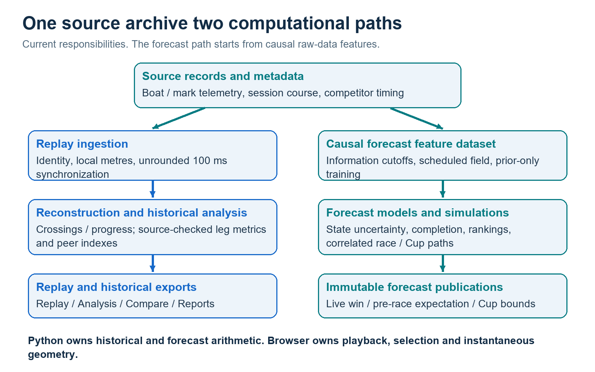
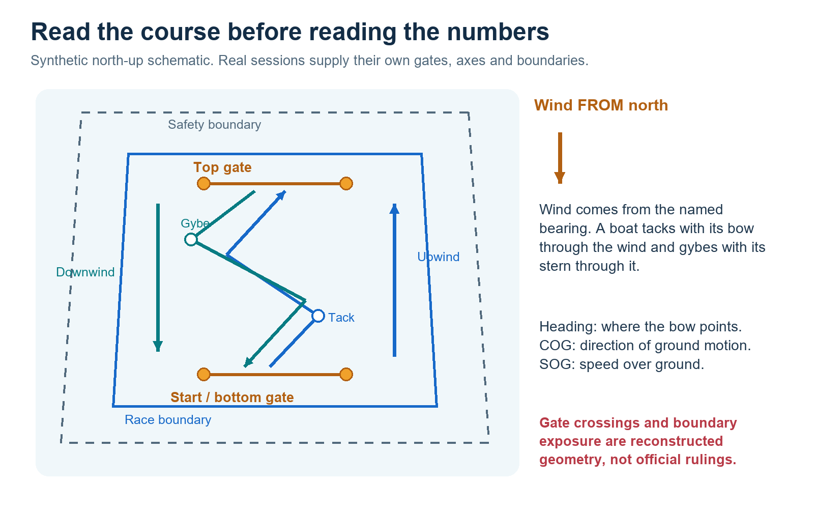
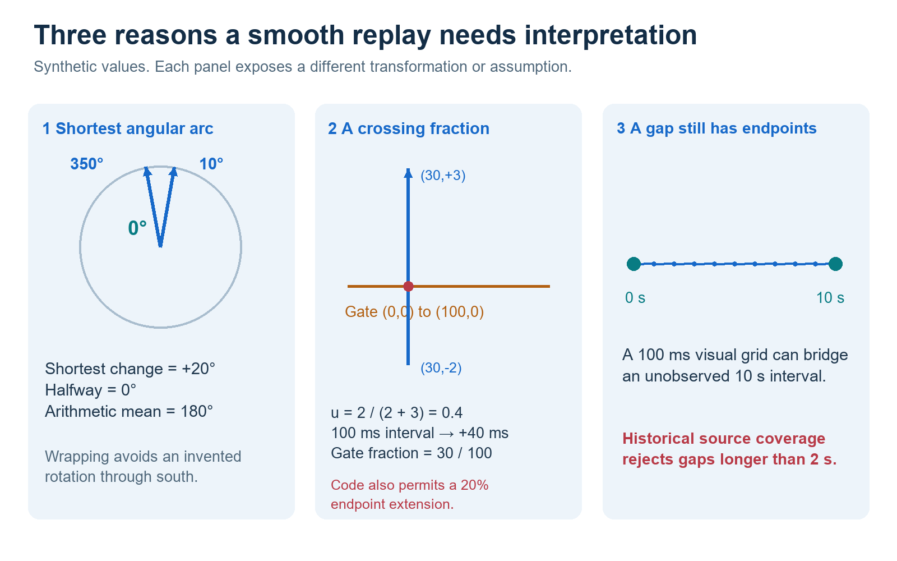
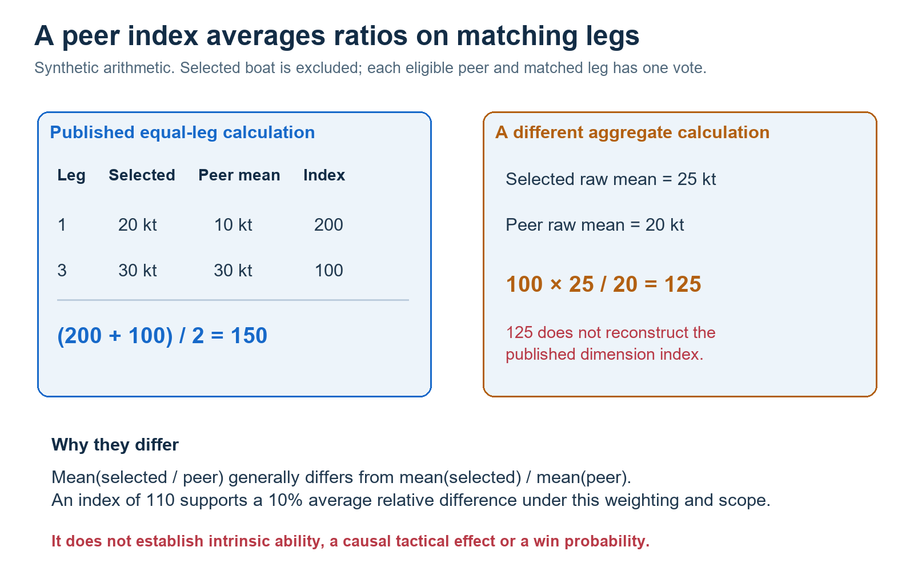
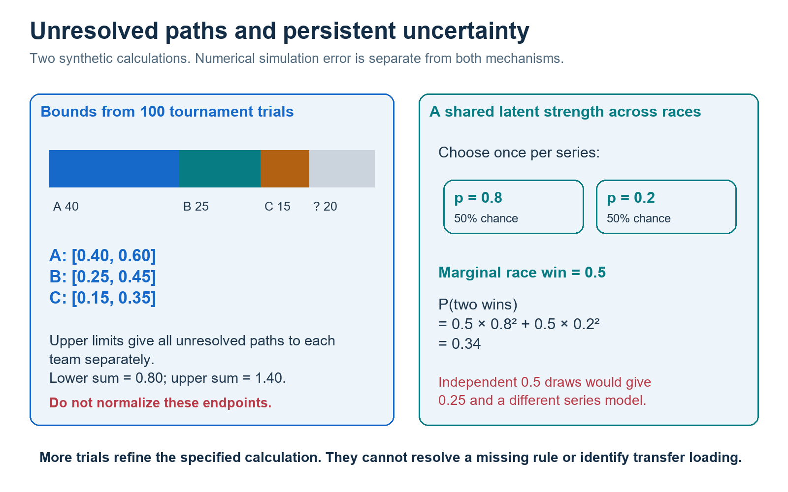
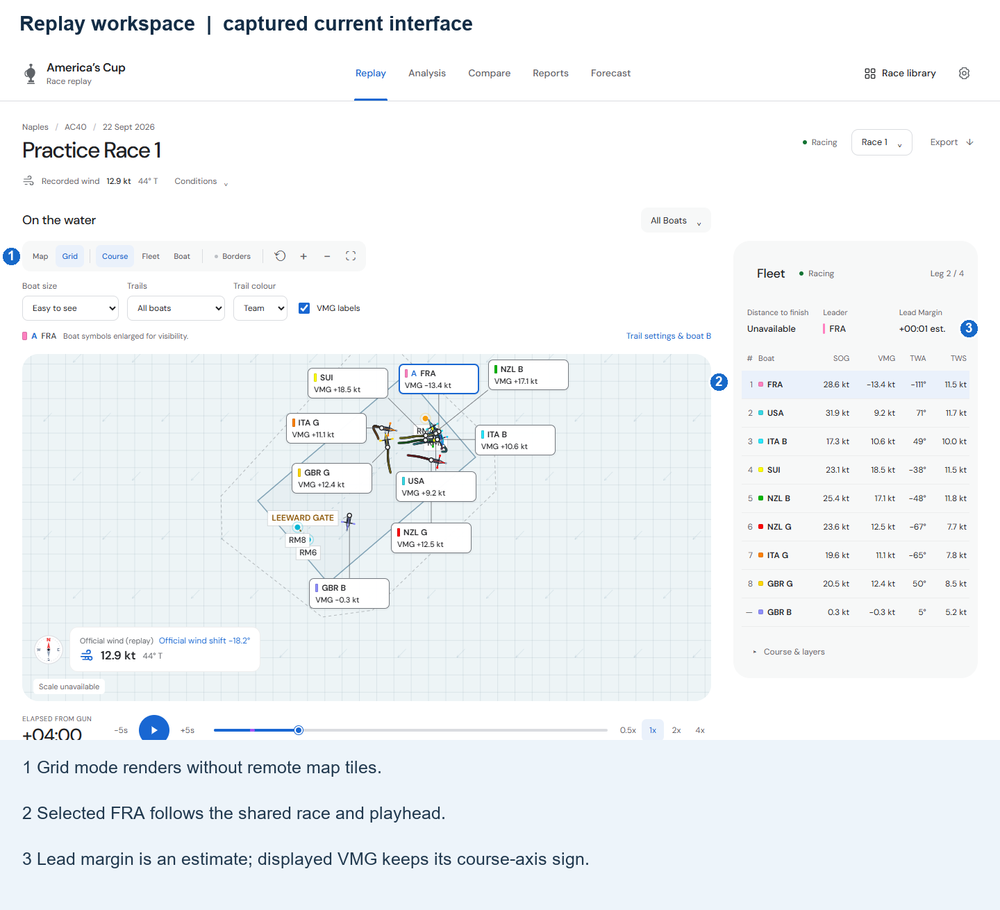
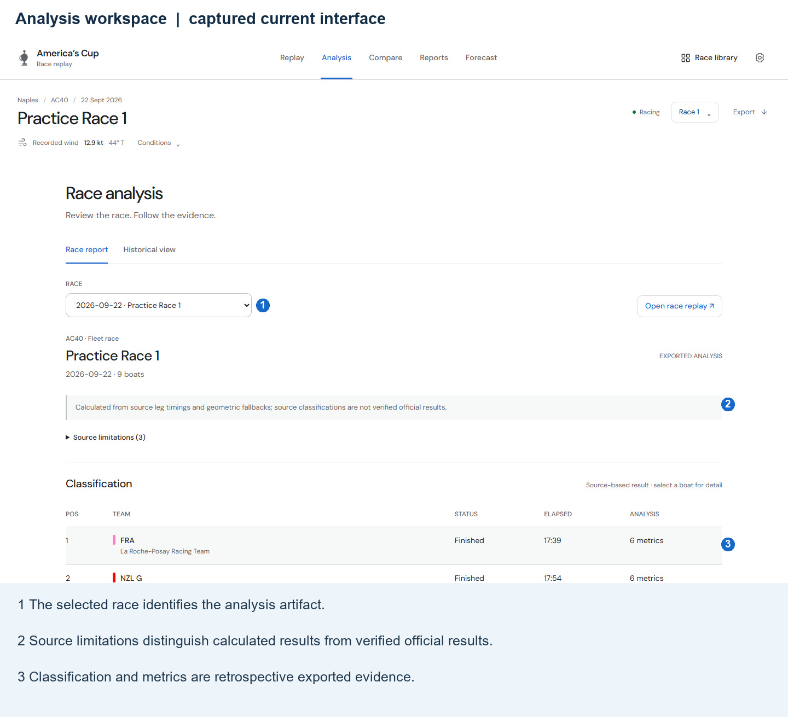
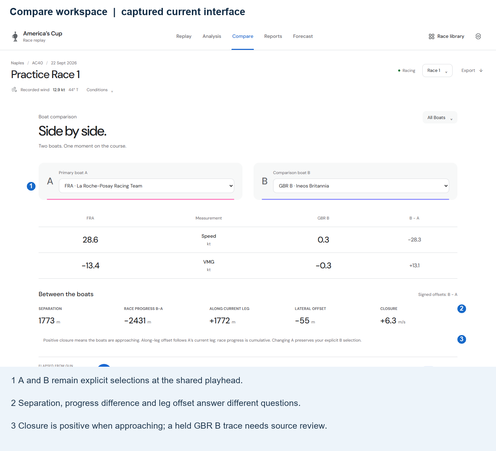
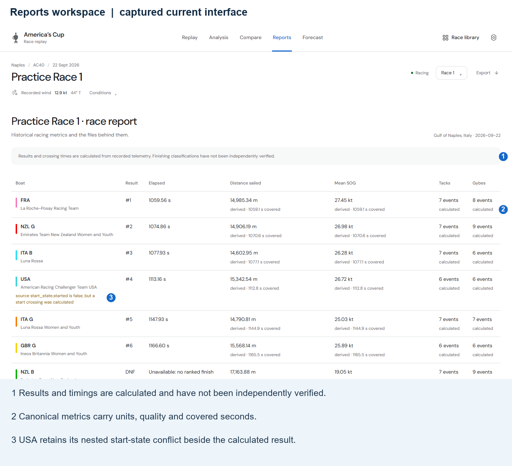
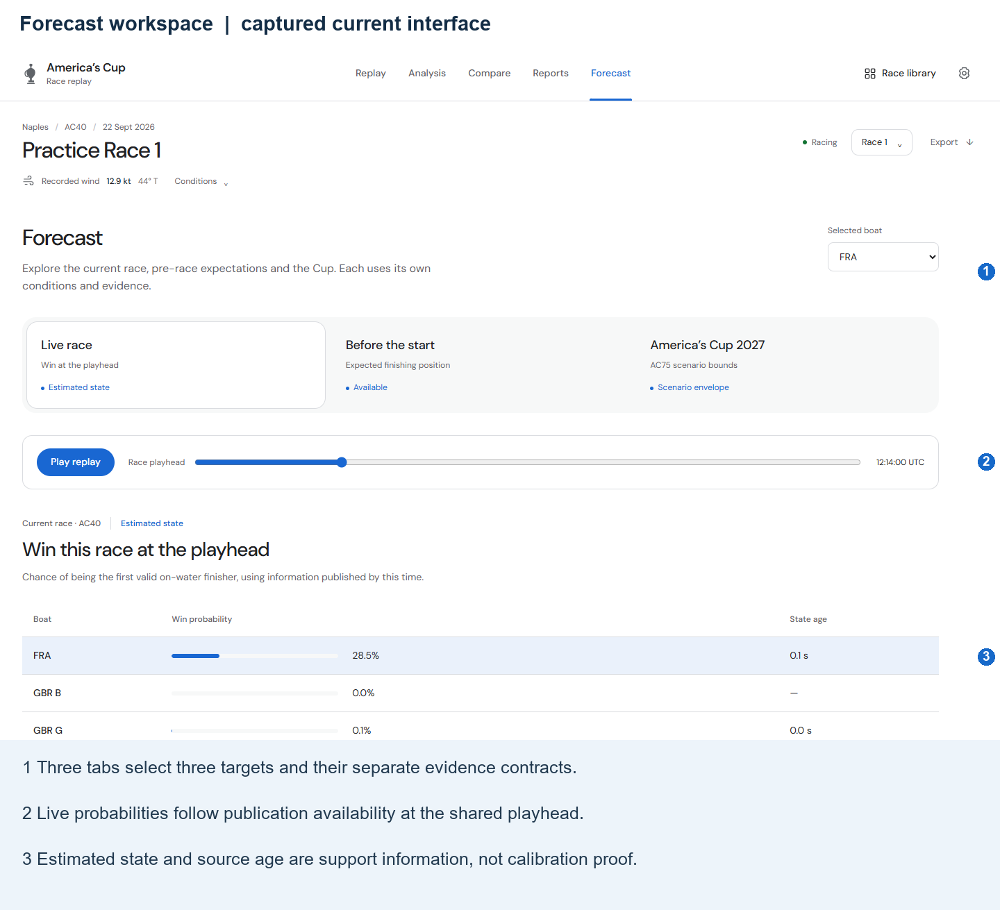

# The regatta repository explained

This textbook explains the specific local repository as reviewed on 4 November 2026. It is intended to help you derive the central quantities, trace their evidence, critique the assumptions and plan improvements independently. It assumes undergraduate mathematics and programming but introduces sailing and telemetry conventions.

## How to use this textbook

Read a chapter's question and worked example before its source-reading route. Use the field guide for recall and the workbook to test yourself. Source citations name frozen files and verified line ranges. HTML links open the local source companion; PDF links may depend on your viewer allowing relative local files, so the same references remain readable as text. Actual evidence and synthetic examples are labelled separately.

The frozen source is a selected first-party reading set with per-file hashes. Git HEAD alone is insufficient because the working tree is dirty. The main text, figures, exercises and source companion work without internet access. Published forecasts are reviewed, not regenerated or improved for this report. No independent official results or new empirical validation are invented.

Notation: x and y are local east/north metres; t is time with explicit seconds or milliseconds; N is scheduled field size; i indexes boats; l indexes legs; I is a performance index, not a probability; p is a probability only where explicitly defined. A source value, reconstructed event, interpolated state, model estimate, scenario assumption and unavailable field occupy different evidence tiers. The glossary in the atlas maps these terms to UI and artifact identifiers.

Use the companion learning routes for one hour, one day or three days. The central conclusion is scoped: this project provides reproducible and inspectable replay, descriptive metrics and provisional conditional forecasts, with material limits from source coverage, small correlated race samples, unverified outcomes, cross-class transfer and unresolved event rules.


# Part I What problem does this project solve

## 1 Three questions that must remain separate

### Learning objectives

After this chapter, explain who can use the dashboard, distinguish replay from retrospective comparison and prediction, and trace a displayed claim to the kind of evidence that could support it.

### Begin with the decision

A sailing analyst asks several different questions. What happened near the third gate? Where did this boat differ from the other boats? What should we expect before the next race, or before the next America's Cup? All three questions involve the same boat names, but they need different inputs and different standards of proof. This repository is useful because it brings them together while retaining their evidence boundaries. Its central achievement is an inspectable route from source records to a replay, historical metrics, and conditional forecasts. That route is more defensible than treating every displayed number as a sensor reading or an official result.

The intended user is an analyst, sailor, coach, researcher, or developer who wants to inspect a race and formulate better questions. Replay supports temporal and spatial inspection. Analysis summarizes selected boats and comparable legs. Compare shows two boats at a shared instant. Reports exposes canonical summaries and source artifacts. Forecast presents three distinct model outputs and their availability. These responsibilities appear in the current project guidance and are connected through application state. They do not imply that a tactical action has a known causal effect, or that a winning forecast has established predictive value. [PROJECT.md:L1-L21] [src/App.tsx:L1-L90]

Observing a past race starts from records that already exist. A reconstructed gate crossing may use samples either side of the crossing. A retrospective leg mean may use the whole completed leg. Neither is a causal live feature merely because the dashboard can move its playhead backward. Comparing performance goes one step further: it selects windows, eligible peers, and denominators. Predicting requires an explicit information cutoff, a target, a model, and independent evaluation. Reusing future finish information as a live feature would answer the wrong question perfectly.

### The ownership boundary

Python owns source ingestion, reconstruction, historical formulas, tactical exports, and forecasting calculations. The browser loads versioned exported quantities. It also performs instantaneous replay interpolation and geometry: positioning boats between frames, calculating separations, projecting into screen coordinates, and detecting modeled contact. It must not rebuild historical performance scores from rounded replay arrays. Those arrays preserve compatibility and sometimes hold or interpolate values across source outages; historical analysis has stronger source-coverage rules. [pipeline/historical_analysis.py:L145-L210] [docs/architecture.md:L3-L7]

An useful mental experiment is to disconnect the browser from Python after exports exist. Replay and historical analysis can still display their published evidence when local assets are served. Creating a new exact forecast scenario needs the local generation service and its runtime. A PDF or this HTML study pack needs neither. The ability to inspect a static artifact is separate from the ability to regenerate it.

### Worked example using synthetic data

Suppose a boat is 100 m behind in reconstructed progress and the leader moves at 10 m/s. The continuous replay estimate is 100 / 10 = 10 s. At a later checkpoint, recorded crossings occur at 12:00:00 and 12:00:13, yielding a 13 s split. Both values can be correct because they answer different questions. The first is a moving estimate using current speed; the second compares actual checkpoint timestamps. Calling the first an observed time loss would confuse an estimator with an event measurement.

A third number, 0.30 probability of winning, is neither of these. It is a model's distribution over future outcomes given its information and assumptions. It requires scoring across multiple independent outcomes to evaluate. It cannot be checked by comparing it with a single 13 s gap.

### What would change if the assumptions failed

If source identity were wrong, a geometrically accurate track could be attributed to the wrong boat. If reconstruction were wrong, historical windows and labels could be wrong together. If a forecasting assumption were wrong, software could produce a valid probability distribution for a poorly specified world. Separate evidence layers allow these failures to be investigated without assuming every other layer is invalid.

### Common mistakes and self test

Do not equate a smooth replay with continuous measurement; a higher radar dimension with intrinsic ability; or a published probability with calibration. Explain aloud why passing all geometry tests cannot establish forecasting value. A satisfactory answer names different targets and evaluation evidence, not simply different files.

Read `PROJECT.md`, then the first sections of `docs/architecture.md`, then one historical detail's definitions and provenance. Locate the producing Python function before opening the React component. This reading order follows the direction of responsibility rather than the directory hierarchy.

## 2 Sailing and coordinate conventions

### Learning objectives

Interpret the course diagram, distinguish heading from course over ground, derive a compass-direction vector, and explain why fast sailing can have modest progress toward a gate.

### A race is a sequence of directed legs

The start line joins two source-identified marks. At the gun, boats must satisfy racing rules about which side of the line they occupy; the software reconstructs bow crossings and preserves conflicts with source start state. A leg runs from the start or a previous gate to the next gate. A gate comprises two marks that boats pass between or round according to the course. The repository obtains the ordered sequence from session metadata. Cagliari sessions include six-leg courses; the original Naples fleet benchmark has four legs. A program that hard-codes four legs can declare a boat finished at an intermediate gate. The current reconstruction checks the final sequence. [pipeline/reconstruction.py:L268-L302] [pipeline/reconstruction.py:L489-L548]

Wind direction means the direction the wind comes from. If true wind direction is north, an upwind leg points approximately north. A sailboat cannot normally sail directly into that wind. It alternates slanting courses, turning its bow through the wind in a tack. Downwind it may alternate broad courses and turn its stern through the wind in a gybe. Port and starboard describe sides of the boat; in this code's signed TWA convention, stable negative TWA is classified port and positive TWA starboard. A negative sign alone does not encode a rules ruling.

The course diagram should be read as a schematic: start/bottom gate below, top gate above, alternating directed legs, and a wind-from arrow entering from above. The race boundary restricts the racing area; the safety boundary is a separate polygon. A modeled Keep Clear envelope is attached to a vessel. These three boundaries have different purposes and must not be substituted.

### Heading and motion

Let east be x and north be y. Compass bearing theta is measured clockwise from north. A unit vector pointing along that bearing is u(theta) = (sin(theta), cos(theta)), with degrees converted to radians before calling trigonometric functions. This order differs from the usual mathematical convention (cos(theta), sin(theta)) measured counterclockwise from the positive x axis. Confusing them rotates or mirrors a result.

Heading describes the direction the bow points. Course over ground, COG, describes the direction of ground-relative motion. SOG is the magnitude of that motion. Current, leeway, and turning can make heading and COG differ. The code uses heading to project the GNSS antenna to the bow and orient modeled hulls. It uses COG to project velocity for VMG and start closing speed. Swapping them changes the physical question. [pipeline/reconstruction.py:L103-L114] [pipeline/historical_analysis.py:L70-L79]

The true wind angle is the signed shortest angular difference from heading to wind-from direction: TWA = wrap(TWD - heading) into [-180, 180). A value near zero means wind near the bow, while magnitude near 180 degrees means wind near the stern. The replay preserves signed TWA. Historical distributions use absolute TWA and stable-side medians to avoid cancellation. Equal time at -45 and +45 degrees has mean signed angle zero but is not head-to-wind sailing.

### Worked example using synthetic data

A boat travels at 20 kt with COG 60 degrees. Its velocity components are east = 20 sin(60) = 17.321 kt and north = 20 cos(60) = 10 kt. With a course axis of 0 degrees, upwind course VMG is 10 kt. If local wind comes from 30 degrees, upwind wind VMG is 20 cos(60 - 30) = 17.321 kt. The boat is moving much more directly into its local wind than along the configured northward course axis. Neither number is an error.

If heading is 50 degrees while COG is 60 degrees, using heading would yield 20 cos(50) = 12.856 kt along north. That is the projection of a hypothetical heading-aligned velocity, not the measured ground-track velocity. SOG/COG must remain paired for this metric.

One knot is 1852 m per hour, or 1852 / 3600 = 0.514444 m/s. A 20 kt boat moves about 10.289 m/s, or 1.029 m per 100 ms replay step. The AC40 bow is projected 12.963 m ahead of the transom GNSS origin, an offset large enough to change a start-crossing timestamp materially.

### Nonfinish states and interpretation

DNS means did not start, DNF means no completed finish in the reconstruction, RET means retired, and OCS concerns being on the course side at the start. These are not interchangeable. The compact replay may display DNF at the end because it lacks a separately timed transition. A zero legacy elapsed field is not a zero-duration race. Historical result/elapsed fields become null when a valid finish is absent.

If the course axis did not correspond to the intended direction of alternate legs, the parity-based VMG signs would be misleading. If the wind instrument had a directional bias, wind VMG and TWA would change while course VMG would not. These are useful diagnostic separations.

Self-test: why can two boats with equal SOG have different VMG? Why can a boat win while having lower average SOG? Answer with route, direction, timing, and eligibility rather than a claim about hull quality. Read `docs/data_schema.md`, the three short angle/VMG helpers in `pipeline/ingest.py`, and the two historical VMG functions before reading larger analytics routines.

# Part II What information actually exists

## 3 The archive and the evidence ladder

### Learning objectives

State the current observation population, distinguish scheduled from replayed entrants, and identify which uncertainty survives even after every source byte is known.

### Current population

The compact current export review contains 28 sessions and 224 replayed boat-races. There are nine Cagliari sessions dated 22-24 May 2026 and nineteen Naples sessions dated 22-27 September 2026. Twenty-six are fleet sessions and two are match sessions. Every exported class is AC40. The archive therefore does not directly supply matched AC75 race observations for learning a measured AC40-to-AC75 transfer correlation. The source audit records 227 source competitor entries: three GBR B practice entries on 22 September have no replay telemetry and do not become historical boat-races. The Cagliari replay total is 63, Naples 161. The historical source audit's Naples 164 is the source-entry count, not the replay total. [docs/source_audit.md:L3-L7] [pipeline/historical_analysis.py:L956-L1008]

The raw archive size recorded in the audit and repository instructions is 6,866,006,601 bytes across 28 files. This pack reuses that streaming audit rather than rescanning gigabytes to reproduce every raw statistic. The current review independently checks the exported catalog and details through `scripts/analysis_snapshot.py`. Raw-size and fine-cadence claims remain dated audit evidence; current exported counts are current snapshot evidence. Source identity hashes in the pack help determine whether the reviewed implementation and artifact set have changed.

One subtle identifier deserves attention: `26_09_25_nap_ipr_race_3` carries exported date 2026-09-26. A filename-like ID is a stable key, not an authoritative date parser. The catalog/date fields own the displayed date. This is a metadata naming discrepancy worth retaining in the reading notes, not silently correcting in a study report.

### Frames are not independent races

The PR1 benchmark has 19,488 100 ms frames for each included boat. Nine boats times 19,488 states is a large number of synchronized observations, but they share one race, weather episode, course, and interacting field. Neighboring states are strongly autocorrelated. A model trained on random frames and tested on other frames from the same race can learn race-specific information instead of generalizable performance. The historical index therefore counts one boat-race at a time and separates fleet and match cohorts.

Even 224 boat-races are not 224 independent environmental experiments: several boats share each session, some sessions share a day, and a team repeats across events. The useful sample size for a claim about a new race or day is governed by those independent units. More frames can improve precision about a trajectory within a race without increasing the number of independent race outcomes for validation.

### Evidence ladder

Measured observations are timestamped GNSS, heading, SOG, COG, and local or official wind messages. Calculated quantities include projection, TWA, VMG, signed boundary distance, and leg means. Interpolated states estimate values between timestamps; held states extend an endpoint. Reconstructed events combine recorded timing with geometry and classification rules. Model estimates include future ranking distributions or tournament outcomes. Assumptions include cross-class transfer and unresolved tournament mechanisms. Unavailable values express insufficient source support for a defined quantity.

This ladder is not a simple ranking from good to bad. A calculated Euclidean distance from sound positions may be reliable; an inconsistent measured message can be unreliable. The point is to name the transformation and its support. Quality `derived` is a source-coverage classification, not a causal-validity or sensor-accuracy certificate. Quality `source_timing` indicates a recorded leg-time field, not independent official verification.

### Worked example using synthetic data

A 100 s leg has 96 s of valid source support. A mean speed can be `derived` because 96 / 100 = 96%, above the 95% threshold. A second boat has 94 s and the same numerical mean; its quality is `partial`, making it ineligible for a performance peer comparison. The difference in score availability follows a rule, not a finding that the second boat sailed worse. Neither boat's 1000 nominal 100 ms frames supplies 1000 independent leg observations.

A useful evidence sentence has four components: value, scope, transformation, and limitation. For example: 'FRA's PR1 upwind course-VMG index is 110.319 over matched legs 1 and 3, using source-covered historical metrics and other eligible boats; changing conditions and routes remain uncontrolled.' Each component prevents a different overclaim.

### Failure implications and reading route

If a raw file changes while its old audit remains in use, the audit is no longer a complete description of that source. If a detail is missing from the catalog, the index builder skips it; a directory file count alone does not establish history membership. If a source competitor lacks telemetry, including it as a zero-speed observed boat would corrupt denominators. These are reasons to inspect the catalog, detail IDs, and source provenance together.

Self-test: can the raw archive have more entrant records than historical observations? Can the same boat produce a valid completed-leg comparison but an unavailable whole-race result? Explain both using explicit denominators. Read `docs/source_audit.md`, run `scripts/analysis_snapshot.py`, then read `build_historical_index` and its catalog-membership checks. Do not begin by opening raw JSONL in an editor.

## 4 Time synchronization and the meaning of missing data

### Learning objectives

Reconstruct a scalar and an angle on a regular timeline, distinguish measurement time from record arrival, and explain why historical coverage cannot be inferred from smooth replay columns.

### A shared clock is a convenience

Raw streams have different cadences. In the original two-source audit, GNSS and heading commonly arrive every 50 ms, while SOG, COG, and local wind commonly arrive every 200-250 ms. Official wind is approximately one observation per second. The replay grid is 100 ms. Consequently, a 10 Hz replay column is not a native 10 Hz sensor stream. It is a synchronized representation built from independently timestamped channels. The original PR1 source window was 12:07:00-12:39:28.700 UTC on 22 September, with 19,488 exported frames. The match final window was 14:17:00-14:42:00 UTC on 27 September, with 15,001 frames. [docs/source_audit.md:L13-L22]

Ingestion sorts each stream by timestamp and overwrites duplicate timestamps with the latest incoming value among duplicates. Sorting resolves temporal order but does not recover when a message first became available to a real observer. The expanded source audit found messages out of timestamp order by up to 5,850 ms. A replay analysis can be causal by measurement timestamp while still lacking arrival-time causality. If a late message is inserted with an earlier timestamp, a regenerated historical snapshot can change. [pipeline/ingest.py:L98-L133]

For scalar readings (t0, v0), (t1, v1), linear interpolation at t uses u = (t - t0)/(t1 - t0) and v(t) = v0 + u(v1 - v0). Position uses that calculation separately on projected x and y. Angles use delta = ((v1 - v0 + 180) mod 360) - 180, then angle(t) = (v0 + u delta) mod 360. A shortest-arc method expresses the assumption that the smaller rotation is the relevant path between observations. It cannot reveal an unobserved full turn.

### Worked example using synthetic data

A speed stream reports 10 kt at 0 s and 14 kt at 0.25 s. At 0.1 s, u = 0.4, so interpolated speed is 10 + 0.4 times 4 = 11.6 kt. At 0.2 s it is 13.2 kt. Both are estimates between measured endpoints.

A heading stream reports 359 degrees and 1 degree at those same times. The shortest delta is +2 degrees. The midpoint is 0 degrees after wrapping, not 180. An arithmetic mean would rotate the boat through south and could invent a turn-rate spike, manoeuvre, or contact orientation. A circular mean for an entire set of headings instead averages sin and cos components and reconstructs their direction with atan2.

Now change the speed timestamps to 0 and 20 s. The resampler still draws a straight bridge. At 10 s its 12 kt value looks ordinary, but the source has not supported that interval. The historical calculation rejects interior timestamps of source gaps longer than two seconds; no amount of numerical smoothness makes the 20 s bridge measured.

### Held and absent streams

The current replay resamplers hold the first reading before its timestamp, hold the last reading after its timestamp, and fill a wholly absent scalar or angular stream with zero. A single reading becomes a constant stream. These are concrete current behaviors, not recommendations. They preserve existing replay compatibility but can make absence look like stillness, northward direction, or zero wind. Historical analysis retains source first/last times and all gaps over 2000 ms before resampling, and rejects unsupported intervals. [pipeline/ingest.py:L136-L235] [pipeline/ingest.py:L697-L712] [pipeline/historical_analysis.py:L160-L179]

The original PR1 audit provides a consequential real example. GBR B's streams stop at 12:23:37.150, while the export runs to 12:39:28.700. Late positions and speeds are held for 15 min 51.55 s. A stationary-looking boat at that location is not evidence that it remained there. USA has an internal 19.05 s gap, NZL G 74.60 s, ITA G 10.85 s, and NZL B 13.90 s. No tracked match-final boat stream had an internal gap over two seconds in that audit. [docs/source_audit.md:L24-L30]

Historical samples require supported endpoints and midpoint, finite state, and plausible SOG between 0 and 80 kt. Coverage seconds sum the accepted intervals; source gaps are excluded rather than assigned zero speed. A partially observed leg can therefore have an available mean but quality `partial`. Missingness changes the eligible population. If high-speed periods were preferentially missing, the remaining mean could be biased even when calculated correctly.

### Failure implications and self test

If a gap contains an actual tack, linear interpolation can suppress it. If it bridges opposite sides of a start line, it can imply a precise crossing unsupported by observations. If an absent wind channel becomes zero, a naive consumer can invent a north wind. The proposed improvement is explicit per-field measured/interpolated/held/unavailable state in replay, with bounded gap policies. That improvement is not implemented merely because historical analysis has coverage checks.

Self-test: why do repeated adjacent values fail to identify an outage? Name measurement rounding, genuinely stable values, interpolation, and held endpoints. Read the three resamplers, then `coverage`, then `_source_valid` and `_samples_between`. This order makes clear why replay compatibility and analytical eligibility differ.

# Part III How raw data becomes a replay

## 5 Identity projection and export

### Learning objectives

Trace a raw asset into a replay boat, convert WGS84 coordinates into local metres, and identify the metadata required to reverse that conversion.

### Identity precedes arithmetic

The source contains session messages, competitor state snapshots, and telemetry observations. An asset ID is the stable routing key; human labels are presentation. Session assets supply competitor identity and dynamic mark membership. Known competitors and class rules still depend on configuration and identity helpers. An unknown future class or asset family needs deliberate ingestion support; a catalog automatically showing successfully exported races does not imply arbitrary raw files can be understood without configuration. [pipeline/ingest.py:L44-L48] [pipeline/ingest.py:L474-L497] [pipeline/ingest.py:L566-L591]

The streaming parser routes one telemetry channel at a time, collects relevant boat and mark series, records boundary changes, and retains competitor state snapshots for reconstruction. It does not load the entire archive as one enormous JSON object. Each file's source SHA-256 is updated while streaming. A study reader should follow the session and a few routed fields rather than print millions of records.

Source competitor records are often cumulative snapshots. Counting every appearance of the same penalty as a new incident would multiply one event. Similarly, a source `classification` field may remain unspecified while timing fields contain enough information for reconstructed ranks. The labels in output must preserve that distinction.

### Local metric coordinates

Raw latitude and longitude are WGS84 degrees. Local x is east and y north. With origin (lat0, lon0) and coefficients in metres per degree,

x = (longitude - lon0) times k_lon

y = (latitude - lat0) times k_lat.

The projection helpers implement this affine local approximation and its inverse. The coefficients represent local WGS84 curvature at the chosen origin; they should not be replaced with one global metres-per-degree constant. At local course scales, this gives convenient metre geometry while preserving a reversible mapping for Map mode. Projection validation compares gate-pair Euclidean distances against a Haversine reference. It checks numerical plausibility at known distances; it does not prove the whole Earth is flat or that raw GNSS is error-free. [pipeline/projection.py:L20-L50] [pipeline/projection.py:L84-L149]

### Worked example using synthetic data

Take a simplified origin at 40 degrees north and 14 degrees east, k_lat = 111,000 m/degree and k_lon = 85,000 m/degree. A point at latitude 40.001, longitude 14.002 becomes x = 0.002 times 85,000 = 170 m, y = 0.001 times 111,000 = 111 m. Its distance from the origin is sqrt(170 squared + 111 squared) = approximately 203.1 m. These illustrative coefficients are not a replacement for a race's exported coefficients.

To invert, longitude = lon0 + x/k_lon and latitude = lat0 + y/k_lat. Knowing only x and y is insufficient; the origin and coefficients are part of the artifact contract. Feeding raw degrees into metre-space contact or camera geometry would produce physically meaningless dimensions.

### Marks move and boundaries change

Gate marks have source IDs, target coordinates, and sometimes measured position streams. Ingestion resamples moving marks; without telemetry it falls back to a static target. Course sequences name port and starboard assets for each gate. The current renderer can therefore handle RM3/RM7 starts in Cagliari and varying Naples pairs. It must not infer a gate by choosing whichever two symbols look nearest on screen. [pipeline/ingest.py:L805-L834] [docs/data_schema.md:L29-L35]

Session messages can update race and safety polygons. The exporter preserves boundary timelines so analytical exposure can use the polygon active at a timestamp. A single final boundary drawn over all earlier frames would rewrite the context of earlier positions. This is an instance of a broader principle: metadata can be time-dependent evidence too.

The export is column-oriented: a shared timestamp array and parallel x, y, heading, COG, SOG, wind, leg, and progress columns. This is efficient for animation and avoids repeating timestamps in every object. Array-length integrity matters because a one-index shift associates a plausible value with the wrong time. Replay schema is separate from historical schema 2.0/method historical-2, and additive performance/tactical/debrief extensions have their own versions. Schema changes, method changes, and additions answer different compatibility questions.

### Failure implications and reading route

If identity fails, every later value may be numerically correct but attached to the wrong team. If the projection origin fails, boats and marks can be translated or distorted relative to the map. If a static mark fallback is treated as a measured position, crossing precision is overstated. Improving source-state flags is a better response than hiding these distinctions behind extra decimal places.

Self-test: identify the inputs needed to put a replay point back on a geographic map. Explain why a correct position transform does not validate a finish classification. Read `identity.py`, selected parsing routes in `ingest.py`, `projection.py`, then `export_replay.py` and `src/types/replay.ts` together. Verify one field's unit across producer and consumer.

## 6 Crossings progress manoeuvres and contact

### Learning objectives

Derive a crossing time, distinguish directed crossing detection from a race ruling, and explain why monotonic progress and detected manoeuvres are designed summaries rather than new measurements.

### Bow crossings

For transom GNSS point (x, y), heading h, and bow offset b = 12.963 m for AC40, the reconstructed bow is (x + b sin(h), y + b cos(h)). A crossing calculation solves the intersection between adjacent bow positions P0 + u(P1 - P0) and gate line A + s(B - A). The trajectory fraction u estimates the crossing time t0 + u(t1 - t0). Parallel lines with near-zero determinant are rejected. Direction must agree with the required upwind/downwind course direction. The current routine uses gate marks at the earlier frame, not an exact swept intersection of two moving segments. [pipeline/reconstruction.py:L103-L151] [pipeline/reconstruction.py:L318-L355]

There is also a material geometric tolerance: u must be in [0,1], but gate parameter s is allowed in [-0.20,1.20]. The 0.20 is a dimensionless fraction of line length. For a 200 m gate, it accepts crossings up to 40 m beyond each endpoint in the geometric helper. The concise reconstruction document's phrase 'segments intersect' omits this extension. A reader should trust the explicit executable condition and treat the tolerance as a reconstruction assumption, not an official gate-validity rule. Consecutive geometric crossings must be at least 60 s apart; start detection begins no earlier than 30 s before the gun. [pipeline/reconstruction.py:L122-L147] [pipeline/reconstruction.py:L315-L355]

### Worked example using synthetic data

Let a horizontal gate run from A = (0,0) to B = (100,0). A bow moves from (30,-2) at t0 to (30,3) 100 ms later. Solving -2 + 5u = 0 gives u = 0.4; x = 30 gives s = 0.3. The crossing time is t0 + 40 ms. The PORT half is chosen because s < 0.5. That label is a geometric nearest-half choice, not proof of a legally chosen rounding side.

A bow moving from (110,-2) to (110,3) yields s = 1.1. It lies beyond the strict gate segment but passes the current helper's tolerance. The example demonstrates why a function name is insufficient evidence for its exact contract.

If those positions are the endpoints of a 20 s source outage, solving the same equations still yields a precise number. The arithmetic is well defined while the event evidence is weak. Historical coverage may prevent derived leg metrics from treating the interval as measured, but reconstruction currently uses synchronized arrays. This residual difference should be investigated before claiming official timing precision.

### Timings and classification

Reconstruction prefers supplied leg timing records, adds geometric mark-choice information, and uses geometric fallbacks where timings are missing. A valid finish requires the final course gate. It sorts finish timestamps into ranked classifications. DNF ordering and the historical GBR B OCS/RET special case are reconstruction logic. The raw parser checks a top-level `started` field; historical analysis separately inspects nested `start_state.started` and flags a conflict when all nested states are false but a crossing exists. PR1 USA is the concrete example. The conflict should be adjudicated, not erased by choosing the more convenient source. [pipeline/reconstruction.py:L211-L250] [pipeline/reconstruction.py:L423-L446] [pipeline/historical_analysis.py:L743-L759]

### Monotonic progress

Instantaneous leg progress projects the bow onto the alternating course direction from a gate midpoint, clamps it to a nominal leg distance, and adds completed nominal legs. A running maximum prevents apparent progress decreasing during turns or excursions. This is useful for stable replay ordering but is not distance sailed or signed physical velocity. A boat temporarily moving backward can retain its previous progress. The leader gap is a difference between these constructed progress values, not Euclidean separation. [pipeline/analytics.py:L130-L176]

### Manoeuvres and contacts

The detector requires stable TWA sign transition, at least 50 degrees heading change, peak turn rate of at least 5 degrees/s, at least 2.5 kt entry-to-minimum speed loss, and 8 s minimum separation. Tacks cross near the bow wind direction; gybes cross near the stern. Its search uses 60 samples each side, with entry speed reaching five samples farther back. An efficient low-loss tack can be absent from the event population precisely because it fails the loss threshold. The legacy detector computes a 90% recovery convention, whereas historical analysis recomputes 95% recovery and null when not recovered in its window. Read field ownership before comparing those outputs. [pipeline/manoeuvres.py:L53-L68] [pipeline/manoeuvres.py:L114-L206] [pipeline/historical_analysis.py:L289-L313]

Contacts use overlapping modeled metre-space polygons, including Keep Clear envelopes. Enlargement in the display is separate from physical contact geometry. A geometric overlap establishes only overlap under those polygons, sampled positions, and orientation assumptions. It does not establish a collision, penalty, protest, right-of-way breach, or umpire decision.

Self-test: name three ways a visually convincing crossing can be misleading. Then explain why removing monotonic progress would change replay ordering without changing sailed distance. Read the intersection helper, directed crossing loop, progress routine, detector thresholds, and contact detector in that order. Look for thresholds and fallbacks, not only happy-path equations.

# Part IV What the historical metrics mean

## 7 Speed VMG distance and route geometry

### Learning objectives

Derive the three VMG conventions, calculate a time-weighted mean and percentile, and state why a geometric route ratio is not polar efficiency.

### Start with the denominator

A historical scalar is not just a value. Its definition specifies formula, unit, window, denominator, and source. Its instance adds quality and coverage seconds. The same label at race and leg scope can use different weighting. The canonical definitions are exported from Python. The browser displays them rather than reconstructing them. [pipeline/historical_analysis.py:L31-L62]

An active race window begins at the maximum of reconstructed start crossing, gun, and replay start. It ends at the minimum of finish when available, source window end, and replay end. OCS, retirement, or absent start makes the window unavailable. Completed legs use exact preceding/current crossing timestamps; endpoints need not land on the 100 ms grid. The sample iterator inserts exact endpoints and weights each resulting interval by its actual duration. A 37 ms clipped interval receives 0.037 s weight, not one full frame vote. [pipeline/historical_analysis.py:L194-L210]

Within a leg, define accepted interval durations w_i seconds and midpoint SOG v_i knots. Mean SOG is sum(w_i v_i) / sum(w_i). The denominator is valid seconds. It is not elapsed leg seconds if coverage is incomplete. Acceptable coverage C = sum(w_i) is compared with total elapsed leg duration T. Quality is `derived` when C >= 0.95T, otherwise `partial`. This quality threshold is an eligibility convention, not a standard error or confidence interval.

### Three VMG quantities

The retained replay field `vmg` is SOG times cos(COG minus configured course axis). It is a signed fixed-axis trace. A northbound upwind leg and southbound downwind leg can cancel if averaged together. Such an average is not an overall performance score.

Historical leg-directed course VMG changes target bearing with leg parity. For odd legs bearing a is the course axis; for even legs it is a + 180 degrees. Course VMG = SOG cos(COG - a_leg). The target direction is positive on each active leg. Historical wind VMG instead projects onto local boat wind-from bearing d, positive upwind and sign-reversed downwind. Wind VMG = SOG cos(COG - d) on odd legs, and its negative on even legs. It requires supported local TWD in addition to ordinary state support. [pipeline/historical_analysis.py:L70-L79] [pipeline/historical_analysis.py:L230-L280]

These definitions can diverge under a wind shift. Course VMG answers how rapidly ground motion advances along the configured leg direction. Wind VMG answers how directly ground motion points into or away from the local reported wind. Neither incorporates a measured polar target because no such target exists here. A higher wind VMG is not automatically evidence of more efficient foil settings or sail trim.

### Worked example using synthetic data

For 2 s a boat has 10 kt SOG and for 1 s 16 kt. Mean = (2 times 10 + 1 times 16) / 3 = 12 kt. An unweighted mean of the two values would be 13 kt, answering a sample-count question rather than a duration question. For the same accepted intervals, course VMG values of 8 and 12 kt give mean (16 + 12)/3 = 9.333 kt.

Time-weighted quantiles sort values, sum durations, and select the first value whose cumulative duration reaches the chosen fraction of total weight. In this tiny example the 10th percentile is 8 kt and the 90th percentile is 12 kt. The code uses an observed-value step quantile, not interpolation between quantile ranks. Percentile differences can therefore reflect implementation convention when samples are few. [pipeline/historical_analysis.py:L120-L130]

Suppose projected path segments have lengths 30, 40, and 50 m: sailed distance is 120 m. The straight endpoint distance is 90 m, so route ratio = 90/120 = 0.75. The straight chord may cut outside legal boundaries, point directly into the wind, or ignore required marks. It is a geometric reference only. Calling the remaining 25% avoidable wasted distance is unsupported.

### Distances and whole-race aggregation

Distance sums supported projected GNSS segment lengths, clipped at crossing boundaries. It is not computed by multiplying mean sensor SOG by elapsed time; those sources can differ through smoothing, noise, and missingness. Route ratio requires valid endpoints, positive path, direct distance no greater than path within tolerance, and derived-quality path. Missing endpoints produce null rather than a conveniently favorable ratio.

Whole-race means weight leg means by their valid coverage seconds. By contrast, performance indexes average matched-leg ratios with equal leg votes. A long downwind leg contributes more seconds to race mean SOG but no more than another comparable leg to a dimension index. Different aggregations serve different questions; one should not be used to recompute the other. A whole-race metric for a nonfinisher remains partial even if completed legs are well covered. [pipeline/historical_analysis.py:L264-L285] [pipeline/historical_analysis.py:L810-L820]

Absolute TWA distributions and stable port/starboard medians use supported wind seconds. Stable allocation excludes ±3 s around detected manoeuvres and |TWA| <= 15 degrees. Port time plus starboard time can be less than elapsed time because exclusions are intentional. No missing seconds are silently assigned to the other tack.

If missing data were concentrated during slow turns, the observed mean would be optimistic. If course axis were wrong, leg VMG would be systematically wrong while SOG remained intact. Self-test: derive all three VMG quantities for SOG 20 kt, COG 180 degrees, course axis 0, local wind 350, downwind leg. Explain the sign change. Read definitions, `_leg_metrics`, and race aggregation; compare the same scalar in a detail and its summary CSV.

## 8 Starts checkpoints and mark approaches

### Learning objectives

Calculate signed start distance and along-line fraction, distinguish checkpoint splits from continuous estimates, and identify which mark-approach quantities remain unavailable by design.

### A start is an instant and an event

At the gun the historical analysis samples the boat's supported GNSS, heading, COG, and SOG and the actual sequence-zero mark pair. The bow offset uses heading. Let port mark A and starboard mark B define d = B - A with length L. The normalized along-line fraction is f = ((bow - A) dot d)/L squared. The unit normal n is chosen perpendicular to the line and oriented toward the configured course axis. Signed distance is (bow - A) dot n, positive on the course side. Fraction zero is port, one starboard; the fraction is not clamped, so -0.1 means beyond port and 1.1 beyond starboard. A zero-length line raises an error rather than returning invented geometry. [pipeline/historical_analysis.py:L106-L117]

Gun closing speed is ground velocity dot n, converted back to knots. Positive means toward the course side. It does not mean the boat will cross legally, nor that it will retain that speed. Start delta is crossing timestamp minus gun timestamp; negative is before gun. Start order ranks valid reconstructed crossings and excludes OCS. A source start-state conflict can coexist with a geometric start observation and should be reported.

### Worked example using synthetic data

Take port A = (0,0), starboard B = (100,0), course axis north. Then n = (0,1). A bow at (25,-5) has f = 0.25 and signed distance -5 m: it is behind the line, a quarter of the way from port. If its SOG is 20 kt with COG 60 degrees, closing speed is 20 cos(60) = 10 kt. The simplest constant-velocity arrival estimate would be 5 / (10 times 0.514444) = 0.972 s. That estimate is not the reconstructed crossing time, which instead uses actual subsequent positions.

At (125,2), f = 1.25 and distance +2 m. Clamping f to one would hide the fact that this bow is beyond an endpoint. This is why the raw fraction is analytically useful even when a UI diagram must fit within a fixed panel.

### Checkpoint arithmetic

For checkpoint j let t_bj be boat b's completed crossing time and m_j the earliest valid crossing time. Split s_bj = (t_bj - m_j)/1000 seconds. A positive split is later than the earliest crossing. Split change is s_bj - s_b,j-1; positive means the delay grew. Rank change is current checkpoint rank minus previous checkpoint rank; positive means a numerically worse rank. The first completed gate has no previous comparison and therefore null change. [pipeline/historical_analysis.py:L861-L879]

These differences compare event times, not a continuous race-progress model. The earliest crossing boat at gate 2 need not be the same boat as at gate 1, and the boats may cross under different wind. A split growing by 8 s is an observed relative timing change, not proof that a particular tack cost 8 s. A pairwise progress gap divided by leader speed can disagree with these splits for sound reasons.

A limited edge case deserves thought: the current checkpoint rank map is keyed by timestamp. Equal timestamps are mapped through an enumerated sorted list, rather than a documented competition/dense-tie rank policy. No claim here relies on a tie occurring in the current artifacts. It is a testable boundary-policy question before treating all possible tied checkpoint ranks as resolved.

### Actual PR1 example

In the reviewed detail FRA's gun bow distance is -4.979608 m, along-line fraction 0.678562, SOG 33.551249 kt, and closing component 14.194847 kt. Its reconstructed crossing timestamp is 1790079000436 ms, 0.436 s after the gun, second in start order. The first-leg endpoint is 1790079233827 ms, so elapsed leg time is (1790079233827 - 1790079000436)/1000 = 233.391 s. The first checkpoint split is 0 s and rank 1. These are actual exported numbers, not a synthetic fixture. Their precision describes the calculation and timestamp format; it is not independent proof of millisecond timing accuracy. [public/data/analysis/naples_pr1.json:L1-L1]

Mark approach is sampled 20 s before the selected gate crossing using that mark's moving position at the same time. It reports distance and absolute angular difference between COG and bearing to the mark. Entry and exit SOG are observations at crossing minus/plus 5 s. There is no stable rounding-start and rounding-end definition, so rounding time remains null. FRA's first gate has approach distance 254.51 m, approach angle 14.82 degrees, entry SOG 30.35 kt, exit SOG 26.75 kt, and unavailable rounding duration. Those speeds do not define a lost-time integral. [pipeline/historical_analysis.py:L316-L338]

If a mark moved during a gap, using a static target could bias approach angle. If gate timing were inconsistent, leg durations could be non-increasing and become ineligible downstream. If the boat were held at the gun, visually readable start geometry would need a source-support check. Self-test: explain how a boat could start later yet lead at the first gate without invoking a defect. Read `start_line_geometry`, gun metrics, `_gate_analysis`, and checkpoint deltas. Inspect the corresponding debrief timestamp only after the timing semantics are clear.

## 9 Manoeuvre and boundary metrics

### Learning objectives

Explain the selected event population behind retention, calculate recovery under the historical convention, and distinguish sampled boundary exposure from a rule violation.

### Detection selects the population

Historical manoeuvre counts and loss distributions reuse detected tacks and gybes. Count is the number of selected events, not an independently annotated inventory of every turn. Speed loss is entry SOG minus minimum SOG, in knots. Median loss and median recovery have event denominators; race SOG has a seconds denominator. Pooling them without naming these units obscures the question.

Historical recovery searches supported SOG around the event to locate a minimum, then finds the first sampled SOG at least 95% of entry speed before event timestamp plus 15 s. Recovery is measured from that local minimum. This is a discrete sampled threshold time, not a fitted acceleration curve. If no qualifying reading is reached, recovery is null with a reason. Acceleration is (0.95 times entry - local minimum)/recovery seconds, in kt/s, when a positive recovery exists. An event within 5 s of a gate is flagged ambiguous rounding. [pipeline/historical_analysis.py:L289-L313]

The detector's legacy recovery field uses 90% and a different timeout representation; historical recovery is recomputed. Thus importing a field because its name contains `recovery_time_s` without checking the producing path can mix conventions. The coexistence is compatibility, not two interchangeable estimates of a single defined metric.

### Worked example using synthetic data

Entry speed 30 kt and minimum 24 kt imply loss 6 kt and retention 100 times 24/30 = 80%. The historical recovery target is 28.5 kt. Suppose the local minimum occurs at 10.0 s and valid SOG first reaches 28.5 at 14.0 s. Recovery is 4 s and the threshold-based acceleration is (28.5 - 24)/4 = 1.125 kt/s. A 90% target would be 27 kt and could be reached earlier. Without specifying the target, two recovery numbers cannot be compared.

An event with entry 30, minimum 29 has retention 96.667%, but its 1 kt loss fails the detector's 2.5 kt requirement. It is not in the selected retention population. Concluding that all real manoeuvres retain only 80% because observed detector events do would be selection bias. Good low-loss manoeuvres can be systematically absent.

### Retention eligibility and coverage

Performance retention requires reconstructed, non-rounding events with finite entry/minimum speeds, loss at least 2.5 kt, and fully supported SOG, heading, and local TWD across the detector support window. That support is 65 samples before and 60 after the event. At 100 ms cadence this is [-6.5,+6.0] s, 12.5 s total. At 200 ms it is [-13,+12] s, 25 s. It must lie within a completed leg. It is not sufficient that only the event timestamp is covered. [pipeline/historical_analysis.py:L476-L527]

Overlapping support windows merge before coverage seconds are added. Two isolated default-cadence windows give 25 s support; two such windows overlapping by 4 s give 21 s, not 25. `sample_count` still counts two events. Each boat's events are averaged within a leg before it enters a peer mean. A boat with ten events does not get ten votes against a boat with one event.

### Boundary exposure

The signed distance is the minimum Euclidean distance from the boat center to the active race polygon's edges, positive inside and negative outside. Inside/outside uses a ray-crossing polygon test. The historical scalar `boundary_nearest_m` is the minimum signed value over valid active samples; a negative minimum indicates that at least some sampled positions were outside. Buffer time counts 0 <= distance <= 25 m; outside time counts distance < 0. It uses center position, not bow, hull, safety polygon, or Keep Clear envelope. [pipeline/historical_analysis.py:L82-L103] [pipeline/historical_analysis.py:L821-L855]

For synthetic signed distances +10, +30, -2, -4 each lasting 0.1 s, buffer exposure is 0.1 s, outside exposure 0.2 s, and nearest signed value -4 m. These are sampled exposures. They do not integrate exact continuous entry/exit geometry. Outside periods lasting at least 1 s become replay-linked intervals; a shorter episode can contribute outside seconds without becoming a linkable period.

Boundary coverage requires usable state and a race polygon at the relevant time. Missing intervals terminate the currently accumulated outside episode instead of claiming continuity through unobserved time. This avoids one form of overstatement but does not propagate GNSS uncertainty into a probability of being outside. A position 0.1 m outside is not automatically conclusive under metre-scale sensor uncertainty.

### Tradeoffs and self test

A conservative retention support window excludes more questionable events but leaves fewer comparisons. A permissive detector may count more genuine turns while admitting wind shifts or roundings; a strict detector can miss smooth turns. These are measurable precision/recall tradeoffs requiring independent annotation. Software thresholds alone cannot establish detector accuracy.

Self-test: can two boats have identical median selected-event loss but different tack counts, coverage, and intrinsic skill? Yes; list the selection, maneuver-entry conditions, and contextual differences. Read the detector first, `_event_analysis` second, `_retention_by_leg` third, then boundary sampling. Keep every denominator attached to its unit.

## 10 Peer indexes and what 110 supports

### Learning objectives

Recalculate a dimension index, distinguish equal-leg mean ratios from aggregate-value ratios, and give an accurate verbal interpretation of a score of 110.

### A descriptive comparison on matched legs

The six profile dimensions are upwind course VMG, downwind course VMG, upwind SOG, downwind SOG, tack retention, and gybe retention. The first four use covered historical leg metrics. Retention uses the selected-event population described in Chapter 9. Every dimension is higher-is-better under its definition, but that does not mean maximizing SOG independently of route always maximizes winning probability.

Let v_bj be selected boat b's qualifying value on completed leg j. Let P_bj be the other eligible boats with a positive qualifying value on exactly that leg. The peer baseline m_bj is sum(v_pj for p in P_bj) / number of peers. The leg index is I_bj = 100 v_bj / m_bj. The dimension index is I_b = sum(I_bj)/number of matched legs. Each peer has one vote on a given leg; each matched leg has one vote in the dimension. This is a mean of ratios. [pipeline/historical_analysis.py:L531-L609]

The selected boat is explicitly excluded from its baseline. Including it would pull the baseline toward its own value and compress differences. Peer membership can change between legs because source support and completion change. A dimension's `peer_count` is the number of distinct contributing other boats across its matched legs, not necessarily the number on every leg. Inspect `leg_evidence` for the exact denominator.

Eligibility excludes OCS, RET, DNS/nonstarting boats, missing start crossings, and source-state conflicts. A directional leg must be completed with positive finite metric, quality derived, and source coverage at least 95% of its elapsed interval. A DNF may contribute valid completed legs. A missing whole-race finish does not retroactively erase a sound earlier leg. Fleet and match peers are confined to the same race; no archive strength model is fitted in this comparison. [pipeline/historical_analysis.py:L425-L472]

### Worked example using synthetic data

On leg 1 a selected boat has 22 kt against peer mean 20, giving 110. On leg 3 it has 18 against 15, giving 120. The equal-leg dimension is (110 + 120)/2 = 115. The displayed raw selected mean is (22 + 18)/2 = 20 and peer mean (20 + 15)/2 = 17.5. Their ratio times 100 is 114.286, not 115. That difference is expected: average(v/m) generally differs from average(v)/average(m).

If leg 1 lasted 100 s and leg 3 300 s, the dimension would still be 115. A duration-weighted ratio would answer another question. The repository deliberately defines this profile with equal completed-leg votes. An inferred rationale is that each comparable leg is treated as one opportunity rather than allowing a long leg to dominate. That is an interpretation of the rule, not evidence of the author's historical motivation.

For the peer mean, suppose selected value is 24 and other values are 20 and 22. Correct baseline is 21 and index 114.286. Including the selected boat gives baseline 22 and index 109.091. The selected boat would partly benchmark itself, which is why exclusion matters.

### Actual PR1 arithmetic

FRA's leg 1 upwind course VMG is 18.7345278 kt and other-boats mean 15.7411106, giving 119.016556. Leg 3 values are 14.9440212 and 14.7054982, giving 101.621998. Their arithmetic mean is 110.319277. The dimension raw means are 16.8392745 kt and 15.2233044 kt. Both legs have six eligible peers; covered seconds sum to 548.027 and `sample_count` is two completed legs. This actual evidence is preserved in `evidence/data_metrics_review.json` under the FRA PR1 dimension. [public/data/analysis/naples_pr1.json:L1-L1]

An accurate statement is: 'Across FRA's two qualifying matched upwind legs in PR1, its leg-directed course VMG averaged 10.319% above the other eligible boats' mean when each leg's ratio receives equal weight.' It does not mean FRA sailed 10.319% faster in every instant, has 10.319% better intrinsic ability, would win 10.319% more races, or would retain that advantage under AC75 equipment. It does not isolate crew, boat, wind, traffic, route, or tactics.

A generic 110 supports a 10% larger defined quantity relative to that explicit peer construction over that scope. For retention, it compares percentages through a ratio: selected 88% retention versus peer 80% produces index 110. It is an 8 percentage-point absolute retention difference and a 10% relative difference, not a 10 percentage-point retention advantage.

### Overall index and scope

Overall index is the equal-weight arithmetic mean of all six dimension indexes only when all six are available. It is a heuristic profile summary. Dropping missing dimensions would change the weighting between boats; the implementation instead returns null. All six available does not imply all course legs are represented. The match-final winner has six available dimensions from four of six matched legs. Scope explicitly records expected and matched legs, excluded reasons, minimum peer support, and covered seconds. [pipeline/historical_analysis.py:L623-L643]

The radar drawing uses a shared range and can expand beyond its initial scale. Visual limits do not cap exported arithmetic. A shape is a presentation, not the full evidence. The useful habit is to select an axis, inspect its matched legs and peers, then review the interval in Replay.

If weak peers become ineligible, a score can fall even if selected performance stays identical; if strong peers disappear, it can rise. That is a denominator change, not necessarily improvement. A small peer set gives fragile descriptive support. Self-test: design two sets of leg values with the same raw means but different mean-ratio indexes. Then explain why no confidence interval for intrinsic ability follows from this radar. Read `_performance_eligible`, `_performance_leg`, and `attach_performance_analysis`, followed by the exported per-peer evidence and Reports performance CSV.

## 11 Wind observations tactical insights and historical cohorts

### Learning objectives

Separate three wind contexts, reconstruct a trailing observation and conditional trend projection, and explain what the historical cohort summaries count.

### Three wind contexts

Boat-local true wind is a measured input used for TWA and wind-relative VMG. Official wind is a separate source asset used for shared recorded-wind summaries and tactical snapshots. Historical environment data such as sea height or air temperature is external model context, not additional measured yacht telemetry. It must not silently replace either wind source or imply forecast conditioning. [pipeline/ingest.py:L837-L871] [docs/environment_data.md:L1-L15]

Historical wind summaries use active-window official samples. Direction shift is shortest circular difference from the first active official reading, not from the whole-race circular mean. Boat-local direction is aligned at official sample times during valid active windows; deviations over 60 degrees are excluded as outliers. Fleet spread requires at least two valid active boats and measures the range of their local-minus-official deviations. It describes reported exposure differences, not the causal reason a boat gained. [pipeline/historical_analysis.py:L881-L918]

The event feed emits wind-shift events when a shortest circular change of at least 10 degrees from the last emitted reference occurs and at least 30 s have elapsed. These are descriptive events at selected official sample times. Tacks, gates, finish, and gun events have distinct source/quality codes. Missing crossings are omitted rather than given fake fallback timestamps. Event IDs and time ordering make them stable navigation targets. [pipeline/historical_analysis.py:L340-L423]

### Tactical snapshots are trailing calculations

Tactical insights is a separately versioned extension, tactical-1/schema 1.0. Every 10 s from gun through replay-window end it examines the preceding 120 s of independent raw official-wind observations. Each one-second grid instant takes the most recent source reading at or before it, with maximum age 2 s. A direction or speed window requires every grid instant covered, at least 60 source observations, and no actual source interval over 2 s. Availability is evaluated separately for direction and speed. [pipeline/tactical_insights.py:L12-L18] [pipeline/tactical_insights.py:L78-L98] [pipeline/tactical_insights.py:L133-L176]

Direction is unwrapped by shortest circular differences. Net change is last minus first. Rate is ordinary least-squares slope on one-second grid values, converted to degrees per minute. With grid times t_i, centered time x_i, and directions y_i, slope per second = sum(x_i(y_i - mean(y))) / sum(x_i squared). Positive change is clockwise veering; negative counterclockwise backing. Net endpoint change and fitted slope can have opposite signs in a curved or oscillating window. They summarize different aspects of a path.

### Worked example using synthetic data

Suppose a complete window increases steadily from 350 degrees to 352 over 120 s. After unwrapping, net change is +2 degrees and slope +1 degree/minute. A five-minute linear continuation would be +5 degrees. It passes the basic magnitude gates: net >=1, absolute slope >=0.2, and projected change <=30. It still needs both half-window slopes to agree in sign and magnitude, residual RMS within the limit, and no one-second jump greater than 3 degrees.

By contrast, readings of 359 then 1 represent +2 degrees, not -358. A window that rises then falls may have near-zero net change despite a large local trend; a linear continuation would be unjustified. A missing direction stream is unavailable, not a constant zero-degree wind. Speed endpoints can remain available independently.

The projection gates require matching nonzero signs in the two one-minute halves, half-window rates within max(0.25 degrees/minute, 50% of the full rate), residual RMS <= max(1 degree, 20% of net change), and one-second jumps <=3 degrees. These deterministic suppression rules do not constitute statistical validation. A displayed projection states the assumption that the recent trend persists; it has no calibrated probability or interval. In the current published archive no window passes the projection gates. Absence of a projection is the correct current result, not a broken prediction button. [pipeline/tactical_insights.py:L108-L130]

### Playhead and information availability

The browser chooses the latest matching-race snapshot at or before the playhead and expires it after 12 s. Rewinding must select earlier evidence, never retain a future snapshot. The underlying causality statement is measurement-time retrospective causality. Arrival-time information is not established: raw out-of-order records with earlier timestamps can revise an earlier historical snapshot after refresh. The extension states that limit explicitly. [pipeline/tactical_insights.py:L181-L188]

At the PR1 gun, the actual first tactical snapshot has 120 s direction and speed coverage with 117 source observations for each. Net direction change is -23.15 degrees, while fitted rate is +1.603 degrees/minute; projection is unavailable. This is an instructive actual example of net change and regression slope describing a non-linear recent history differently. A rate is not an endpoint-change divided by two unless the underlying path supports that equality.

### Historical cohorts and debriefs

The historical index groups by team code, boat class, and race type. Summary medians and ranges exclude partial/unavailable scalar observations and count one boat-race per available scalar. Completed-leg summaries remain leg-number-specific. Manoeuvre distributions use event counts and record originating race counts, so one can see that many events may come from few races. Event-level precision should not be sold as a large independent race sample. [pipeline/historical_analysis.py:L995-L1049]

Team debriefs choose up to three largest positive completed-leg duration deficits relative to eligible other boats, and up to two largest covered non-rounding detector speed reductions. They are review priorities. A leg deficit in seconds is not a causal decomposition of lost time; a speed reduction in knots is not seconds or metres lost. Replay links are invitations to inspect evidence, not verdicts. [pipeline/historical_analysis.py:L648-L688]

If missingness or eligibility tracks difficult conditions, the historical cohort can describe an easier subset. If trends are unstable, suppression protects interpretation but does not solve weather prediction. Self-test: explain why a 0-degree direction value is different from unavailable; why 100 manoeuvres from two races are not 100 independent races; and why the PR1 net change can disagree with slope. Read tactical window and slope functions, then index cohort aggregation, then the debrief selection routine.

## 12 Three complete evidence journeys

### Learning objectives

Follow a real observation through reconstruction, historical analysis, forecast availability, and UI interpretation. Distinguish a missing observation from a negative finding. These case studies use actual reviewed exports; their numerical values are not synthetic.

### Case A PR1 fleet richness and source conflict

`naples_pr1` is Practice Race 1 at Naples on 22 September 2026. It has nine replayed boats, 19,488 synchronized frames, four course legs, six modeled contact incidents, and 1,722 active official-wind samples in historical analysis. The compact review finds 28 pairwise historical records, representing eligible overlapping boat pairs, not all nine choose two combinations. GBR B has no valid active racing window and is absent from eligible pairwise comparisons. FRA, NZL G, ITA B, USA, ITA G, and GBR G have reconstructed ranked results. NZL B and SUI are DNF with three completed legs; GBR B is RET with none.

Begin with FRA's supported motion. Ingestion projects measured GNSS and synchronizes it with heading, SOG, COG, and wind. Reconstruction places the bow forward of GNSS, uses source timing and fallback geometry, and obtains start crossing 0.436 s after the gun. Leg 1 ends 233.391 s after that crossing. Historical analysis integrates accepted intervals and yields distance 3216.7044 m, mean SOG 26.73817 kt, course VMG 18.73453 kt, wind VMG 16.15098 kt, and geometric route ratio 0.701979. All those leg scalars have derived quality and 233.391 s source coverage, except elapsed time's reconstructed quality. The unequal VMG values are expected because configured course direction and local wind direction differ.

Next follow the performance comparison. FRA's leg 1 course VMG divided by its six-peer mean gives 119.01656. Leg 3 gives 101.62200. Equal weighting yields the 110.31928 upwind index. That score is available because these completed legs and peers pass coverage and source-state checks. FRA's overall performance scope matches all four expected legs with 1059.119 source-covered seconds. Its reconstructed elapsed result is 1059.555 s from the gun. These two durations differ because scope sums source-covered active intervals and the result is gun-to-finish timing; neither should overwrite the other.

The UI journey is: choose PR1 in the library, select FRA, open Analysis, select the upwind VMG dimension, expand legs 1 and 3, inspect peers, and review a leg interval in Replay. Reports' summary and performance CSVs expose the same canonical metrics. A prose claim about FRA should survive comparison with that evidence table. A separate Compare view can show physical separation or continuous progress at an instant, but those values cannot replace the historical leg denominator.

PR1 also demonstrates disagreement between evidence layers. USA has four reconstructed completed legs and a derived whole-race SOG around 26.72399 kt. Yet all nested source start states are false while a crossing is reconstructed. Historical analysis preserves the source conflict and performance excludes USA both as subject and peer. The correct conclusion is not that every USA number is false, nor that the conflict is harmless because the line appears crossed. It is that a source-state adjudication is needed before making a clean performance comparison. [pipeline/historical_analysis.py:L755-L759] [pipeline/historical_analysis.py:L425-L430]

GBR B's late replay track is held after the source ends and its active metrics are unavailable. NZL B and SUI can still contribute supported completed legs, although their race metrics remain partial and no finish elapsed time exists. Six virtual contacts are geometric incident records, not six official infringements.

The forecast artifact offers a separate lesson. Its pre-race output is `estimated`. Its live publication has 198 states: 84 estimated and 114 gate-ambiguous. Of the latter, 113 carry `start_not_validated` and one `position_uncertainty_exceeds_gate`. Availability changes are evidence gates, not necessarily loading errors. A static available number at one time must not be carried forward through later gate ambiguity. The header labels identity calibration and experimental source timings, so even estimated live probabilities are not established calibrated probabilities. The exact current artifact path is retained in the bounded case companion.

### Case B Match-final winner and incomplete comparison scope

`naples_mr_final` is the Naples match final on 27 September. It contains ITA B and NZL B, six course legs, 15,001 frames, zero modeled contacts, one historical pair record, and 1,284 active official-wind samples. The source audit found no internal boat-stream gaps over two seconds in the original inspected streams. Nevertheless, source timing completeness is a different condition from continuous sensor coverage.

ITA B is reconstructed RANK_1 with gun-to-finish elapsed 1252.050 s. Its first leg lasts 256.620 s, with mean SOG 25.57288 kt, course VMG 18.25831 kt, wind VMG 18.15258 kt, and distance 3388.4459 m. The first crossing is 0.530 s after the gun. The close course/wind VMGs here indicate similar target axes during the accepted interval; they do not prove identical wind everywhere.

ITA B's upwind index is 101.62943, the equal-leg mean of 102.81711 on leg 1 and 100.44175 on leg 3. There is exactly one peer, NZL B. All six performance dimensions are available, but scope matches only legs 1-4 of six and 847.085 covered seconds. Leg 5 is excluded for missing/incomplete crossing and leg 6 for missing previous crossing. A recorded final-gate timestamp can support a finish while an absent intermediate checkpoint prevents forming a completed leg interval. This is why winner status and complete analytical coverage are separate claims.

The UI journey is to select the match final and ITA B, open its profile, read scope before interpreting the radar, then inspect excluded leg reasons. Switching to a single leg changes the evidence scope. It does not fabricate missing leg 5 by subtracting an estimated time from the finish. A two-boat peer baseline is transparent but context-specific; it cannot establish superiority over the entire fleet or intrinsic talent.

The actual live forecast has 136 published states: 133 estimated and three unavailable. The unavailable reason says the first received finish is not a globally resolved first finisher. This correctly distinguishes local information about a finish from global resolution of the winner. The pre-race expected positions are approximately 1.38508 for ITA B and 1.62262 for NZL B under nonfinish score N. They do not sum to exactly 3 because this score includes nonfinish probability; they are not simply a probability vector dressed as ranks. The forecasting chapters derive that convention.

### Case C A window that ends before its gun

`26_09_23_nap_ipr_pr1` is a Naples practice session dated 23 September. It contains nine replayed boats and 5,411 frames. Exported window end is 1790165761000 ms and gun is 1790166120000 ms. The difference is (1790166120000 - 1790165761000)/1000 = 359 s. The observed replay ends 5 min 59 s before the source gun. There is no post-gun race interval in these records.

Historical analysis accordingly has no completed legs, no valid active performance, no pair records, and no active wind summary. Tactical insights has an empty snapshot grid with an explicit reason. Every boat's eleven summary metrics reported by the snapshot tool are unavailable. A UI that displays an empty chart with a reason is communicating the evidence accurately. Filling the chart with zeros would falsely suggest nine boats raced without speed or distance.

The reconstructed status labels include RET and DNF, but the key scientific conclusion is limited observation, not a complete account of the event after the window ends. The source does not let this pack decide what happened later. A pre-race forecast can nevertheless be estimated from prior history: the publication contains pre-race expectations while its live state list is empty. Prediction before an event and observation of the event are different data problems.

The user journey is to select the session, notice the replay window relative to the gun, open Analysis to read missing reasons, and open Forecast to distinguish prior expectation from absent live evidence. In Reports, an artifact's existence means an export was produced, not that every quantity inside it is available. Do not count this session's thousands of prestart frames as a successfully observed race outcome for model evaluation.

### What to carry across all three cases

Richness is multidimensional: track continuity, checkpoint completeness, source-state consistency, field membership, and model support can vary independently. A fixed rule saying 'use the richest race' hides these differences. Instead, begin each claim by naming target and window; follow the source and transformation; read coverage and exclusion reasons; state what would change the conclusion.

Self-test: defend these three statements without a running dashboard. FRA has a strong observed PR1 upwind comparison; ITA B's match win does not imply six-leg profile coverage; the pregun session has a prior forecast but no observed race performance. Then challenge each statement with the strongest relevant limitation. Use `evidence/data_metrics_review.json`, selected source modules, and the relevant exported field names as the reading route. No complete telemetry array is needed to make the argument.


# Part V How forecasting works

## 13 Three targets three different questions

### Learning objectives

After this chapter you should be able to name the random variable in each forecast card, explain why the same boat can have a reasonable pre-race expectation and no live forecast, and distinguish a conditional Cup scenario from a calibrated prediction. You should also be able to trace a published number to its complete scheduled field, model card, and source manifest.

### Begin with the question rather than the algorithm

A replay asks what the archive records about an already sailed race. A forecast asks what outcomes a model considered possible using information available at a specified cutoff. Moving the replay slider into the past does not, by itself, turn retrospective analysis into a causal forecast. A later crossing, an interpolated position supported by a future fix, or a result published after the gun can make a historical display more complete while making a purported historical forecast invalid.

The current Forecast workspace presents three targets. The first is the chance that each entry becomes the first valid on-water finisher of the selected race, conditional on the causal state at a checkpoint. This target includes a possible no-finisher outcome. The second is the expected finishing position before the race, using the entire scheduled field and assigning every nonfinisher rank N. The third is the 2027 AC75 America's Cup trophy winner across an event format. These targets differ in time horizon, class, information, denominator, and evidence quality. They cannot be inferred from one another by relabeling a percentage.

| Output | Random quantity | Information boundary | Current central limitation |
| --- | --- | --- | --- |
| Live race win | Indicator that entry i is first valid on-water finisher | Causal checkpoint plus modeled publication delay | Entire scheduled field and legal phase must be resolved enough to simulate |
| Before the start | R_i in {1,...,N}, with nonfinish scored N | Earlier-day training and pre-gun available conditions | Numerical expectation is provisional, with source-reconstructed completion evidence |
| Cup outcome | Indicator that team i wins the AC75 trophy | Pinned AC40 ranking model, configured rules and transfer assumptions | Unresolved rule paths and unvalidated cross-class transfer produce scenario bounds |

Python owns these calculations. TypeScript selects and verifies already exported artifacts. The browser is allowed to choose which checkpoint or exact scenario to show; it is not allowed to fit a ranking model or invent a probability for a missing entry. This ownership makes model lineage inspectable and protects the distinction between interface state and statistical evidence. [pipeline/prediction/build.py:L133-L225] [pipeline/prediction/contracts.py:L206-L286]

### The scheduled field is part of the estimand

Let N be the number of scheduled entries. The reviewed archive has 227 scheduled boat-races and 224 replayed boat-races. Exactly three practice entries have no legacy replay track: GBR B in the second, third, and fourth Naples practice sessions of 22 September. Forecast headers bind both `boat_ids`, the complete scheduled field, and `replay_boat_ids`, the replay subset. Missing XY telemetry must not remove a competitor from the denominator. Otherwise the remaining boats receive inflated win probabilities merely because a feed failed.

An absence can have different consequences before and during a race. Before the start, an earlier fitted model can express uncertain performance for a scheduled entry. During the race, missing information about that entry's current legal phase can prevent a coherent joint race forecast. The archive therefore contains a legitimate combination: a numerical pre-race expectation, a visible source-only scheduled entrant, and unavailable live probabilities. This is not a contradiction. The two calculations condition on different information.

The current `26_09_22_nap_ipr_pr2` publication illustrates this. Its field contains nine entries but the replay subset contains eight. The pre-race block is `estimated`. Its 121 live checkpoints comprise 100 `gate_ambiguous` and 21 `unavailable` states, with no usable live numerical checkpoint. A reader should not replace those unavailable values by the pre-race probabilities. That would silently change the question. These are actual published counts, saved in the pack's forecast evidence summary.

### Worked example synthetic field with a missing track

Suppose A, B, and C are scheduled. Before the gun a symmetric model assigns each a one-third conditional win chance if all finish. During the race A and B have visible tracks, while C's track disappears. Renormalizing the visible pair to one-half each asserts that C cannot win. The observation only says that C's state is unknown. A careful model can integrate uncertainty over C if it has a validated missing-state model. This repository suppresses joint output when a required state or legal phase is unresolved. That is an explicit availability policy, not evidence that C's true chance is zero.

### Current method status

| Method or component | Reviewed status and role |
| --- | --- |
| Correlated leg-time Monte Carlo | Selected for current baseline race publications, with `provisional_low_evidence` promotion status |
| Ridge Plackett-Luce | Implemented ranking reference, input to Cup mapping, and current exact custom pre-race scenario model |
| Uniform order | Implemented reference and coherent small tail-mixture component |
| Race-equal empirical order | Implemented diagnostic comparator, not current publication model |
| Conditional ranking response | Implemented experimental comparator; custom scenario publication retains zero wind response |
| Constant-velocity Kalman state | Active causal state estimator, subject to age, uncertainty and phase gates |
| Positive delay mixture | Implemented fitter with strict label/promotion requirements; not enabled in current leg-time publication |
| Foundation models GRU TCN SVR HMM | Research-plan alternatives; no claim that they produced current publications |
| AC75 transfer and Cup engine | Active conditional scenario analysis; no established AC75 calibration |

This table is more reliable than a phrase such as the project uses machine learning. Different parts of the system use different statistical models for different reasons. Selection is not proof of general predictive superiority. A reference can remain appropriate for a scenario while a more complex candidate is provisionally selected for live physical-state conditioning. [pipeline/prediction/build.py:L228-L267] [pipeline/prediction/build.py:L387-L416] [pipeline/prediction/models.py:L668-L702]

### If an assumption fails

If the scheduled roster is incomplete, an unconditional winner vector is not well defined for the intended field. If the legal finishing target differs from an official scoring target, a model can correctly predict its own target while appearing wrong against a different result table. If AC40 strength does not transfer to AC75, an internally reproducible Cup scenario can still be practically misleading. Always state the target and conditioning assumptions before defending the calculation.

### Common mistakes and self-test

A probability marked estimated is not a measured frequency. Expected position 2.4 is not a prediction that a boat can physically finish between second and third. A conditional scenario envelope is not a collection of seven independently calibrated confidence intervals. Try explaining, in three sentences, why a nine-entry race with eight tracks cannot be reduced to an eight-entry forecast. Then explain why a Cup card can display intervals while its `probabilities` fields remain null.

Source-reading route: start with `build_race`, compare `simulate_race` and `simulate_order_reference`, inspect `scheduled_entries` in a current race header, then read the availability validator. [pipeline/prediction/build.py:L133-L225] [pipeline/prediction/simulation.py:L177-L226] [pipeline/prediction/simulation.py:L414-L428]

## 14 Causal clocks and state estimation

### Learning objectives

You should be able to distinguish observation time, bucket closure, modeled availability, state time, publication time, and training cutoff. You should understand why a forward filter is appropriate for historical forecasting and why a smooth replay is not automatically an admissible predictor. You should also be able to describe the uncertainty represented by the position ellipse and the limits of its certification.

### A model of what could have been known

The archive has source event timestamps but no actual receipt clock. The implemented contract is therefore event-time reconstruction with modeled latency. It does not reconstruct a measured end-to-end network delay. Source telemetry is reduced to the last observed sample for each asset, channel and one-second bucket. Its original timestamp and ordinal are retained. The bucket cannot be consumed before its second closes. The model then adds a six-second reorder/publication buffer.

For a sample recorded at 12:00:03.750, bucket closure is 12:00:04.000 and modeled availability is 12:00:10.000. A state checkpoint at 12:00:04 may use that closed bucket and is published at 12:00:10. A checkpoint at 12:00:03.500 may not use it, despite the sample lying in the same second. This prevents a future sample within a bucket from rewriting an earlier subsecond forecast. The six-second delay is a declared approximation. Passing its implementation tests does not establish that it matches the original broadcaster's actual receipt behavior. [pipeline/prediction/source.py:L1-L19] [pipeline/prediction/source.py:L80-L129]

The source reader also measures out-of-order timestamps. A source stream whose disorder exceeds the modeled buffer fails the live reorder contract. That gate is conceptually different from an individual boat's telemetry gap. Disorder concerns when samples can be ordered consistently; a gap concerns how long a boat has gone unobserved. Both can invalidate a causal checkpoint for different reasons.

Training uses a stricter chronological boundary. `before_day` requires both a row's race date to precede the training day and its recorded result or evidence availability to precede that day's UTC midnight. A race sailed earlier but whose outcome was available later is excluded until usable. For reviewed audit days, baseline fits are frozen before 26 September; the second audit day does not train on the first audit day. This is a deliberate frozen-candidate test, not rolling within-day adaptation. [pipeline/prediction/labels.py:L194-L196] [pipeline/prediction/build.py:L248-L260]

### Constant velocity means a local approximation

The filter state is the four-dimensional vector x = (east position, north position, east velocity, north velocity). Positions are metres in a local projection, velocities are metres per second, and time increments are seconds. With time increment dt, the transition predicts position by adding velocity times dt and leaves velocity unchanged in expectation. A process-noise covariance allows acceleration and model mismatch.

```
mean_next = F(dt) mean_now
P_next = F(dt) P_now F(dt)^T + Q(dt)
F(dt) = [[I, dt I], [0, I]]
Q(dt) = q [[dt^3 I / 3, dt^2 I / 2],
            [dt^2 I / 2, dt I]]
```

The parameter q controls how quickly uncertainty grows when motion departs from constant velocity. The measurement variance r describes position-observation noise in square metres. They have different jobs. Raising r makes the filter trust an individual fix less; raising q makes its motion prediction less persistent. Neither creates evidence about a future tack. Earlier-date observations fit the parameters. The update uses the Joseph covariance form, a numerically stable expression that helps preserve positive covariance under finite precision. [pipeline/prediction/state.py:L8-L38]

A filter moves forward from past observations. A smoother can use future observations to revise a past state. Smoothing is useful for reconstructing a past race, but a future-dependent smoothed state cannot be used as if known at the forecast cutoff. This implementation stores forward-filter states and queries only the latest state whose bucket was closed by the checkpoint. A subsequent projection carries that state to the checkpoint time. Thus a small source age can still coexist with a nonzero uncertainty radius.

### The ellipse is conditional on a model

The reported radius is the major-axis radius of a nominal 95 percent two-dimensional position ellipse:

```
radius_95_m = sqrt(5.991 * largest_eigenvalue(P_position))
```

The constant 5.991 is the 95 percent chi-square threshold for two dimensions under the Gaussian model. It is not a universal guarantee that 95 percent of every real turn or outage lies inside the ellipse. The source code separately evaluates hidden-block errors against raw observations. Its certification checks steady, turn, recovery-proxy and gate strata, with nonoverlapping masks and earlier-date parameter fitting. A horizon passes only if it has at least 50 masks across two dates, at least 90 percent ellipse containment, and median position error below one tenth of the current leg length. Only a contiguous passing prefix is certified. A failed five-second horizon cannot be skipped in order to claim a passing ten-second horizon. [pipeline/prediction/state.py:L77-L87] [pipeline/prediction/state.py:L248-L313]

This distinction is worth rehearsing. A nominal ellipse comes from a probability model. Empirical containment comes from a particular test population. An outage certificate permits a bounded operational use in particular strata. None establishes exact uncertainty calibration across future regattas.

### Phase is not just position

The model requires a valid start and a complete, increasing gate chain. It does not promote a boat into the next leg merely because its projected XY position crosses a line. That crossing could be a turn, an offset mark, a stale endpoint, or a noisy extrapolation. A predicted state near a gate can be `gate_ambiguous` even if the boat is clearly visible on the replay.

Current source constructs course axes from the previous and next gate midpoints. It projects position onto that axis, obtains remaining fraction, and combines boat-position covariance with mark variance. The mark variance increases with fix age. The reviewed source allows mark fixes up to 30,000 ms old. This differs from the documentation sentence describing a two-second current cap. The executable threshold is 30 seconds in this snapshot. This is a documentation discrepancy and a useful review question: the cap itself is an engineering policy, while empirical support for such mark holds must be established separately. Do not quote the older two-second statement as current executable behavior. [pipeline/prediction/state.py:L164-L206]

Boat position is fresh through two seconds; beyond that it is estimated, with age limits controlled by the relevant outage certificate. A separate radius gate suppresses a state if the major radius exceeds the smaller of 50 metres and ten percent of leg length. Forecast headers also declare a maximum published-state age for frontend selection. The UI's latest-checkpoint rule, the raw position-age gate, and the mark-fix gate are three different rules. Combining them into one generic freshness number loses important information.

### Worked example synthetic gap near a gate

Suppose a 1,000 m leg has 40 m remaining along its axis. The boat's extrapolated 95 percent radius is 35 m and the gate midpoint's allowance is 8 m. Their combined geometric ambiguity reaches 43 m, more than the apparent distance to the gate. A predicted crossing is not robust enough to establish phase. The safe result is an ambiguous checkpoint. On the same leg, a boat 400 m from the gate with the same uncertainty may pass this particular phase gate, but it still needs an age certificate and a valid source gate chain.

If a boat is moving 10 m/s east at a cutoff and no new fix arrives for three seconds, constant-velocity prediction adds 30 m east. It does not infer a new heading or tactical choice. Process covariance grows throughout the gap. If the boat actually tacks, the error can be much larger than a naive distance equals speed times elapsed calculation suggests. That is why turn and gate strata are not allowed to inherit the steady-motion certificate.

### If an assumption fails

If actual source delivery exceeds the modeled latency, a historical replay experiment can overstate real operational availability even while obeying its declared event-time reconstruction. If missing telemetry is more likely during extreme manoeuvres, artificial masks in intact tracks may underrepresent natural outage difficulty. If mark positions are stale during course movement, an apparently precise boat state can still have the wrong course geometry. These are empirical questions that need receipt logs, outage labels and moving-mark comparisons, not merely extra Monte Carlo draws.

### Common mistakes and self-test

Do not call COG a measured heading: COG is direction of ground motion. Do not call the ellipse a boat's physical footprint. Do not treat all time channels as interchangeable UTC timestamps with the same meaning. Explain why a sample at 3.750 seconds cannot support a state published from a 3.500-second cutoff. Then describe the two independent reasons a projected boat can be unavailable: its location may be too uncertain, or its legal gate phase may be unresolved.

Source-reading route: follow `read_source` bucket fields, `CausalRace.position`, `CausalRace.features`, and `certify_outages`, in that order. Then inspect the model card's actual certificate rather than assuming every listed candidate horizon is certified. [pipeline/prediction/source.py:L80-L129] [pipeline/prediction/state.py:L72-L206] [pipeline/prediction/build.py:L85-L100]

## 15 Ranking strength and the meaning of expected position

### Learning objectives

You should be able to derive a simple Plackett-Luce order probability, explain shrinkage and posterior parameter uncertainty, and calculate an expected tied-N rank. You should understand why rank sums can exceed the familiar permutation sum, why unseen entrants need uncertainty, and why source-reconstructed noncompletion is not a mechanical reliability label.

### Ranking is about relative worth

A Plackett-Luce model gives each entry a positive worth w_i. It selects first place in proportion to worth, removes that entry, and repeats among the remaining entries. Writing w_i = exp(theta_i) makes theta_i an unconstrained log-worth. For a complete order A then B then C,

```
P(A,B,C) = w_A/(w_A+w_B+w_C) * w_B/(w_B+w_C)
```

Only differences in log-worth matter. Adding the same constant to every theta multiplies every worth by the same factor and cancels from every selection ratio. The implementation centers fitted entry effects to zero. A discrimination scale multiplies relative effects before probabilities or orders are sampled. The current fit uses scale 1.8, with strength prior standard deviation 1.2 and half weight for eligible practice rows. These are model settings, not measurements of intrinsic crew ability. A doc sentence describing calibration of these settings should not be confused with empirically established probability calibration; the published model card explicitly disclaims the latter. [pipeline/prediction/models.py:L46-L153] [pipeline/prediction/build.py:L79-L82]

The fitted objective combines the negative log-likelihood of valid finisher orders and a quadratic ridge penalty. The ridge term discourages unsupported extreme strengths. It also makes the Hessian invertible. The inverse Hessian supplies a local Gaussian, or Laplace, approximation to parameter uncertainty. This is an approximation near the fitted optimum. It is not a nonparametric confidence guarantee and does not account for every possible model mismatch.

Practices can contribute only when their rows meet the fit's validity and competitive eligibility rules. The configured practice weight is 0.5, not a universal assertion that every practice is half as informative as a competitive race. It is an explicit modeling choice. The fit excludes invalid orders and does not append nonfinishers to a finisher order as weak finishers. A boat may retire after completing a valid timed leg: that earlier physical interval can still train the leg-time model without pretending that its final result was a finish.

### A complete numerical order example

This example is synthetic and fixes known worths to isolate the arithmetic. Let w_A = 4, w_B = 2 and w_C = 1, with all three guaranteed to finish. A's chance of first is 4/7, about 0.5714. The chance of order A,B,C is (4/7)(2/3) = 8/21, about 0.3810. A's chance of beating B in the pairwise comparison is 4/(4+2) = 2/3. The full three-entry winner probability and the pairwise probability answer different questions.

Expected rank can be found by counting rivals ahead. If all finish,

```
E[R_i] = 1 + sum over j != i of w_j/(w_i+w_j)
```

For A this is 1 + 2/6 + 1/5 = 1.5333. This expected value averages many complete orders; it is not the rank obtained by simply sorting estimated worths. The difference matters when comparing two closely matched entries. A model can rank A above B while giving both a wide range of possible finishing places.

### Nonfinish is part of the target

Let s_i be entry i's probability of completing. Under fixed worths and independent completion events, a hand-checkable benchmark is

```
E[R_i] = N(1-s_i) + s_i [1 + sum over j != i of s_j w_j/(w_i+w_j)]
```

The first term scores i as N if it does not finish. The bracket scores it among finishers if it does finish. A rival only counts ahead if that rival also finishes. This exact benchmark appears in `analytic_plackett_luce_expected_ranks`; it validates a particular mathematical model, not every possible dependence structure. The actual simulation also samples common posterior failure risks, so unconditional independence need not hold after those risks are integrated out. [pipeline/prediction/simulation.py:L141-L174]

Using N = 3, the same worths, and s_A = 0.9, s_B = 0.8, s_C = 0.7 gives

```
E[R_A] = 3(0.1) + 0.9[1 + 0.8(2/6) + 0.7(1/5)] = 1.5660
E[R_B] = 3(0.2) + 0.8[1 + 0.9(4/6) + 0.7(1/3)] = 2.0667
E[R_C] = 3(0.3) + 0.7[1 + 0.9(4/5) + 0.8(2/3)] = 2.4773
```

The sum is approximately 6.1100 rather than 6. Nothing has gone wrong. When multiple entries fail, all are scored N. If M entries fail, the realized rank sum is N(N+1)/2 + M(M-1)/2. With three entries and two failures, the ranks are 1,3,3 and sum to 7. In expectation, the excess reflects the chance of multiple failures. For the independent synthetic example the expected excess is 0.1100. A check that forces every expected-rank vector to sum to N(N+1)/2 would reject valid tied-N results.

The same rule explains an actual published example. The Naples match pre-race expectations are 1.3850819 for the entry labelled ITA B in that session and 1.6226181 for NZL B. Their sum is about 3.0077. In a two-entry field, both nonfinishers score 2, so the small excess over 3 is compatible with some both-nonfinish probability. These are model outputs, not observations of fractional finishes. Asset identifiers must be interpreted using the selected session's identity mapping; the same identifier is not a timeless team label.

### Completion evidence has two tiers

The implementation separates independent reviewed completion records from source reconstructions. An independent reviewed started record must establish completion or an exogenous failure. Unknown and time-rule-censored reviewed outcomes block the pooled denominator because no approved exposure treatment is supplied. Source reconstruction is different: a started entry without a valid finish can count as a noncompletion of the first-valid-on-water-finisher target, with its source cause retained as retired, disqualified or unresolved. It does not claim that every noncompletion is an exogenous technical breakdown.

The field name `scheduled_audited` is therefore potentially misleading when read alone. Current model cards also expose `evidence_tier`, `source_records`, `source_failure_types` and `unresolved_audited_starters`. The pinned late-September card used by the current Cup publication contains 81 scheduled records, all 81 source-reconstructed, with 77 ascertained starters, four DNS events and two started noncompletion events. Its stored source failure types are one disqualified and one unresolved. These counts describe the earlier training population; they are not a claim that the entire archive has only two noncompletions. [pipeline/prediction/models.py:L427-L515] [pipeline/prediction/labels.py:L79-L116]

With the Jeffreys Beta(0.5,0.5) prior, the DNS posterior mean in that card is (4+0.5)/(81+1) = 0.0548780. The started noncompletion posterior mean is (2+0.5)/(77+1) = 0.0320513. These are pooled probabilities. A Beta prior regularizes small counts; it does not independently validate the source labels or identify their causes. The simulator samples risks from these posterior distributions rather than treating the means as known constants. Conditional on a sampled shared risk, entry failures can be independent; unconditionally, common risk uncertainty induces dependence. [pipeline/prediction/models.py:L486-L541]

For live forecasting, an observed start excludes DNS for that entry. Observed survival also updates uncertainty about the common failure parameter without counting a partial race as a complete success. This is a subtle distinction: surviving half a course is information, but it is not one additional full-course success in the historical denominator.

### Unknown entries and contrast uncertainty

An unseen entry receives a draw from the population prior rather than a fixed zero effect with certainty. For seen entries, correlated posterior draws preserve information about pairwise contrasts. The sampler centers seen-entry shifts on their zero-sum subspace. Centering removes an arbitrary common shift while retaining pairwise differences. The contrast variance is Var(theta_i - theta_j) = Sigma_ii + Sigma_jj - 2 Sigma_ij. Ignoring covariance can distort how uncertain a matchup is even if both individual marginal variances look plausible. [pipeline/prediction/models.py:L155-L192]

### If an assumption fails

If the finish-order process violates Plackett-Luce's relative-worth assumptions, an exact PL calculation is still mathematically correct for its assumed model but can be empirically poor. If completion differs strongly by crew, class or condition, one pooled Beta process may be inadequate. If practice and competition represent different effort or rules, a fixed half weight may transfer the wrong information. These are reasons to test alternatives on separate days, not reasons to silently reinterpret the fitted effects as intrinsic skill.

### Common mistakes and self-test

Do not equate higher log-worth with a measured faster boat in metres per second. Do not score a DNF as ordinary last among known finishers while claiming tied-N semantics. Do not interpret `available=True` in a completion model as independent audit approval. Explain why N = 4 with ranks 1,2,4,4 sums to 11, and derive the one-unit excess from M = 2. Then explain why adding an unseen entry changes other entries' expected positions even if it has no telemetry history.

Source-reading route: read `StrengthModel.fit`, `sample_log_worth`, `CompletionModel.fit`, `_ranks_and_winners`, and the analytic rank benchmark. Compare the model card's evidence tier with the variable names in the producer. [pipeline/prediction/models.py:L46-L217] [pipeline/prediction/models.py:L427-L541] [pipeline/prediction/simulation.py:L141-L174]

## 16 Simulating a race with shared uncertainty

### Learning objectives

You should be able to describe one Monte Carlo trial as a coherent possible race, explain why correlated factors matter, and separate physical gate-time uncertainty from outcome randomness. You should be able to identify where current simulation is deliberately simplified and why a small uniform-reference mixture must operate on a joint outcome distribution.

### A race is a joint outcome

Independently guessing a win percentage for each boat can produce incoherent outputs: probabilities that do not sum properly, rankings that imply mutually incompatible races, or a boat that simultaneously receives high win probability and an impossible rank distribution. This implementation samples complete races and derives multiple summaries from the same draws. Each draw provides gate times, completion or noncompletion, a winner or no-finisher state, and tied-N ranks. Race-win probability is the fraction of draws won, while expected position is the average of the corresponding ranks.

The model does not simulate detailed future XY tracks or decide a future tacking policy. It simulates positive times for course segments. Leg distances and categories come from the causal known course. A vectorized queue advances boats through those segments. With tactical interaction coefficients pooled to zero, the implementation can evaluate boats in a vectorized manner without treating opponents' future simulated arrivals as observed information. This is an engineering simplification with an explicit statistical boundary, not a claim to model every tactical interaction. [pipeline/prediction/simulation.py:L177-L226] [pipeline/prediction/simulation.py:L319-L342]

### The leg-time model

For duration T in seconds and positive segment distance D in metres, the reference fits log duration using an intercept, log relative distance, log relative wind speed, entry effects, and segment-kind effects. Distances and winds are divided by training reference values before taking logarithms, so the predictors are dimensionless.

```
log median(T_i,k) = b0 + bD log(D_k/D_ref)
                   + bW log(W_k/W_ref) + crew_i + kind_k
```

The distance coefficient has a ridge prior centered at one: doubling length initially tends to double time. Other nonintercept effects are pooled toward zero, with stronger shrinkage on wind. A lognormal residual keeps sampled times positive. The fitted median is not the arithmetic mean: if log T has variance sigma squared, then E[T] = median(T) times exp(sigma squared / 2). Confusing these can make a seemingly unbiased median systematically low as a mean-time prediction. [pipeline/prediction/models.py:L581-L657]

The first interval runs from the gun to the first course gate and already includes start loss. Full observed durations already include manoeuvre and performance losses. Adding an extra generic start penalty or tack penalty would double-count some of that loss. The positive-delay mixture is disabled unless independently reviewed labels and held-out promotion evidence exist. It is not legitimate to interpret the disabled mixture as a measured foil-loss detector.

### Persistent and shared factors

A conceptual version of the sampled log residual is

```
residual_i,k = crew_form_i + shared_race
               + shared_weather(at entry time and median exit time)
               + innovation_i,k
```

Crew form is sampled once per boat for a trial and persists across its legs. A common race factor affects all boats. The weather process is evaluated at each boat's own simulated calendar time, so nearby boats can share conditions without pretending that the same leg number occurs simultaneously. Innovations supply remaining entry/leg variation. Earlier synchronized residual moments estimate factor magnitudes, with shrinkage and variance caps. The innovation autoregression coefficient is currently pooled to zero without certified out-of-fold lag evidence. These dependence estimates are provisional in-sample residual summaries; they are not a fully validated environmental model. [pipeline/prediction/models.py:L610-L643] [pipeline/prediction/simulation.py:L237-L257] [pipeline/prediction/simulation.py:L300-L342]

A simple covariance calculation explains why this matters. Let two synthetic log times be 100-second baseline times multiplied by exp(U+e_A) and exp(U+e_B), with independent zero-mean terms. If Var(U) = 0.04 and Var(e_A) = Var(e_B) = 0.01, each log time has variance 0.05 and their covariance is 0.04, giving correlation 0.8. Yet their log-time difference is e_A-e_B, with variance 0.02. Treating their full 0.05 variances as independent would assign difference variance 0.10 and greatly exaggerate relative uncertainty. A common slow-weather factor changes absolute time while largely cancelling in the gap.

Correlation can also persist within one boat across legs. If a crew is slower today than its historical mean, a persistent form factor makes several slow legs plausible together. Resampling form independently every leg would average that uncertainty away. Conversely, making every shock perfectly persistent would exaggerate long-run variation. The implemented decomposition is one proposed compromise, with empirical limitations made explicit.

### Conditioning on progress and survival

The current partial segment uses its remaining fraction and an uncertainty term projected along the course axis. An observed pace ratio updates the same persistent crew-form factor. It does not add a second ability effect on top of the one already fitted into leg times. Future full segments retain their ordinary generative prior. The boundary identity between zero remaining progress and a full future segment is a useful software invariant: moving the cutoff across a segment boundary should not invent an unrelated prior.

Failure exposure is normalized to the race. Under a constant exposure hazard with full-race failure probability q and survived fraction h, the remaining failure probability is 1 - (1-q)^(1-h). For q = 0.10 and h = 0.5, this gives 1 - sqrt(0.9), about 0.05132, rather than the original 0.10. A transition-weighted hazard is implemented as an alternative shape. The shape and multiplier are assumptions unless separately validated. Timing limits, where supplied, are separate rules applied to simulated arrivals, not a mechanical-failure cause. [pipeline/prediction/simulation.py:L22-L51] [pipeline/prediction/simulation.py:L258-L299]

### No finisher is a real internal category

The winner is the earliest finite valid finish. A trailing nonfinisher does not erase another boat's valid win. The internal no-finisher state occurs only when every scheduled entry has an infinite or otherwise nonfinite finish time. Thus the sum of boat win probabilities plus no-finisher probability is one. If the boat probabilities alone sum below one, the missing mass can be a modeled all-fail event, not a normalization error. Rounding six decimal places can add a very small additional display discrepancy, which is bounded by export validation tolerances.

The simulator uses a fixed 0.0001 mixture with a legally valid uniform-order reference. This regularizes extreme tails while respecting completion and fixed observed order. The same mixture changes winner probabilities, no-finisher mass, expected ranks and sampled outcomes. Adding epsilon independently to displayed probabilities would break this coherence. Terminal impossibilities remain exact when legally known; the mixture is not permission to assign positive chance to an entry already definitively retired. [pipeline/prediction/simulation.py:L141-L151] [pipeline/prediction/simulation.py:L367-L411]

### Numerical error is the smallest uncertainty category

For n independent simulation trials and a probability p, the Monte Carlo standard error is approximately sqrt(p(1-p)/n). The implementation reports the conservative normal-approximation half-width 1.96 sqrt(0.25/n), using the worst case p = 0.5. With 20,000 live draws this is about 0.00693, or 0.693 percentage points. With 100,000 draws it is about 0.00310. These figures describe finite-draw integration noise under the model. They exclude uncertainty about the model, labels, transfer, legal rules and input availability. Doubling decimal precision cannot reduce those other uncertainties.

### If an assumption fails

If tactical interactions substantially alter gate times, a zero interaction coefficient can miss mechanisms such as covering or mark contention. If dependence moments are estimated from too few synchronized races, apparent correlations can be noise. If remaining along-course distance is a poor proxy near a gate, a positive gate-time distribution can still have the wrong median. Resolve these with targeted held-out residual and outcome tests, not an attractive simulated track animation.

### Common mistakes and self-test

Do not call the simulator a full sailing physics engine. Do not add a detected-manoeuvre loss to a duration that already contains manoeuvres. Do not interpret a 0.7 percentage-point Monte Carlo interval as the entire uncertainty in a 60 percent race-win estimate. Explain how a common weather factor can increase uncertainty in absolute finishing time while reducing uncertainty in the difference between two boats. Then explain why a single trailing DNF must not create a no-finisher outcome.

Source-reading route: inspect the median-time fit, factor variance construction, random-array allocation, calendar-time weather function, partial-leg scaling, and joint outcome mixture. [pipeline/prediction/models.py:L550-L657] [pipeline/prediction/simulation.py:L237-L411]

## 17 Evaluation without false confidence

### Learning objectives

You should be able to calculate a Brier score and a log loss, explain chronological evaluation and paired coverage, and distinguish provisional promotion from calibration. You should be able to state the current numerical result with its exact baseline and evaluation population, including the weaker pre-race finding.

### A prediction needs a test population

Software tests establish properties such as deterministic replay, correct mass, valid schemas and safe publication. They do not establish that probabilities predict real outcomes better than a simpler model. A simulator can satisfy every probability identity and still assign the wrong distribution to future races. Empirical evaluation requires outcomes unavailable when predictions were made, a predeclared comparison, and an honest count of independent evidence.

The current procedure uses expanding earlier-day fits on development dates 23 May, 24 May and 25 September 2026. The audit dates are 26 and 27 September. Audit fits remain frozen before 26 September. Practice rows are excluded from scoring, although eligible earlier practice orders may contribute to the configured strength fit. The primary targets use the complete scheduled field and no-finisher outcome. Separate diagnostic comparisons condition on retrospectively observed finishers and are explicitly not unconditional promotion evidence. [pipeline/prediction/evaluation.py:L9-L11] [pipeline/prediction/backtest.py:L15-L82]

The distinction between a diagnostic and a primary score is essential. A model evaluated only among eventual finishers is handed information about which entries will complete. That can be useful for studying ranking conditional on completion. It does not answer the practical pre-race question, where future completion is unknown. Mixing the two populations can make an apparently impressive improvement largely a change in the target.

### Scores and intermediate arithmetic

For a winner vector p and one-hot realized outcome y, the multiclass Brier score is sum_i (p_i-y_i)^2. Smaller is better. The implementation sums over categories; it does not average by the number of categories. Log loss is -log p_winner. A confidently wrong probability is heavily penalized. If a possible winner gets zero probability, its log loss is infinite, which is one reason to regularize valid tails coherently before scoring rather than patching the score afterward.

For a synthetic three-outcome forecast p = (0.6,0.3,0.1) with A winning, the Brier score is (0.6-1)^2 + 0.3^2 + 0.1^2 = 0.16 + 0.09 + 0.01 = 0.26. Log loss is -log(0.6), about 0.510826. If C wins, the same forecast has Brier 0.6^2 + 0.3^2 + (0.1-1)^2 = 1.26 and log loss about 2.302585. The distribution is judged against what happened, not against whether its most likely entry looked plausible.

For expected rank, normalized MSE averages squared rank error after dividing by N-1. A rank error of two places in a nine-entry fleet is scaled by eight; a one-place error in a match is scaled by one. The rank probability score compares cumulative probabilities at each threshold 1 through N-1, then normalizes by N-1. Two distributions can share the same expected rank while having different cumulative distributions, so expected-rank MSE alone does not evaluate the full uncertainty distribution. [pipeline/prediction/evaluation.py:L14-L43]

### Frames do not buy independent evidence

The aggregate first averages all eligible checkpoints within a race. It then computes both equal-race and equal-day averages. A long race does not become more important merely because it has more checkpoints. Equal-day averaging also prevents a day with more races from automatically dominating the summary. It does not make the days statistically independent in a strong scientific sense: boats, crews, venue and conditions can still persist across days. The field `independent_days` is a grouped evidence count, not proof of complete independence.

Paired coverage signatures ensure that candidate and reference use identical races and checkpoints for a metric. A model cannot win merely by declining to predict hard checkpoints while its reference is scored there. Fully resolved terminal checkpoints are excluded from predictive scores so that a long post-finish recording tail does not dilute loss with repeated already-known outcomes. Terminal correctness is tested separately. [pipeline/prediction/evaluation.py:L46-L87] [pipeline/prediction/backtest.py:L83-L113]

A further nuance is the candidate procedure's fallback: if the correlated simulator is unavailable at an otherwise eligible checkpoint, the backtest uses the reference for that candidate row. The scored object is therefore the operational candidate-with-fallback procedure. It is not solely the subset where the complex simulator produced its own prediction. A future evaluation should report both operational coverage and model-only coverage to clarify the source of any gain. This does not invalidate the paired comparison; it defines what was actually compared.

### Current exact results

The pack saves the current `.forecast/backtest.json` so these values can be checked offline. They are existing evaluation artifacts inspected for this book, not a newly executed backtest. The report generation does not retrain the forecast. Do not confuse these results with older ablation values in the prose documentation, which differ slightly and describe separate diagnostic comparisons.

| Population | Candidate race-equal Brier | Reference race-equal Brier | Independent grouping |
| --- | --- | --- | --- |
| Live development | 0.45240196 | 0.83553410 | 8 races on 3 dates |
| Live descriptive audit | 0.50109523 | 0.75890232 | 7 races on 2 dates |
| Pre-race descriptive audit | 0.80243198 | 0.76892734 | 7 races on 2 dates |

The live reference is the joint Plackett-Luce reference with the same scheduled-field/completion framework and a conservative live state extension. The candidate is the correlated leg-time simulation procedure. On the seven-race audit, relative live Brier reduction is 1 - 0.50109523/0.75890232 = 0.3397105, about 33.97 percent. Audit race-equal log loss is 1.11632249 for the candidate and 1.72690091 for the reference. These are preliminary chronological results across only two audit dates, with source-reconstructed outcome and completion evidence. They do not establish future production performance or calibrated probabilities.

The audit is heterogeneous. Candidate daily Brier is about 0.7152 on 26 September and 0.2156 on 27 September. Their equal-day average is about 0.4654, whereas the equal-race average is about 0.5011 because the dates contain different numbers of races. This is a concrete example of why the weighting rule belongs beside the score.

The pre-race result is weaker. Candidate audit normalized MSE is 0.11098385 versus reference 0.10695272; normalized RPS is 0.18012605 versus 0.17822320. Both are worse, though within the procedure's absolute 0.02 guard budgets. Pre-race Brier and log loss are also worse. Promotion does not require every pre-race score to improve. It requires live log-loss improvement and practical Brier guardrails under race/day averages, while separately checking rank MSE/RPS budgets. The code labels the whole result `provisional_low_evidence`. Describing it as a broad improvement of all three forecasting targets would be unsupported. [pipeline/prediction/backtest.py:L114-L145] [pipeline/prediction/evaluation.py:L90-L130]

### Why available does not mean calibrated

Calibration asks whether events assigned probability p occur about fraction p in an appropriate repeated population. A model may improve average Brier or log loss while still being too confident in some ranges. Two audit dates do not support detailed reliability diagrams across boats, winds and progress bands. The current cards use identity calibration and explicitly state that empirical calibration is unestablished. Identity here means the system reports its model probabilities directly; it is not evidence that the identity map has been empirically confirmed.

Promotion gates are operational choices. Their tolerances protect against selected regressions under a small evaluation population. Passing them is not a significance test, a guarantee of positive expected value, or an estimate of accuracy against independently official classifications. Synthetic tests for the gates prove that their Boolean logic works on defined examples; only new eligible races can increase the empirical evidence base.

### Leakage and pseudoreplication thought experiment

Imagine fitting and testing on randomly split telemetry frames. Two adjacent frames share almost the same course, crew, position and outcome. A model could memorize race identity indirectly and appear excellent on held-out frames from the same race. That experiment estimates interpolation within known races, not forecasting a new race. Now imagine using a later finish classification to remove a competitor from every earlier winner denominator. The predictor has learned future completion. Both mistakes can improve scores while reducing practical validity.

The repository counters these risks with day-based cutoffs, explicit availability timestamps, source-prefix tests, complete fields, and paired aggregation. Remaining risks include imperfect source labels, modeling receipt latency, choosing settings after seeing diagnostic data, and inferring natural-outage performance from artificial masks. A careful reviewer asks which of these were controlled prospectively and which remain assumptions.

### If an assumption fails

If later race days differ in crew composition or telemetry quality, the small audit's improvement may not transfer. If the reference is weak in a particular progress band, an aggregate gain may hide regressions elsewhere. If source classifications do not match an independently reviewed target, an internally consistent score can still measure the wrong task. The right next step is a frozen future-race evaluation with explicit abstention coverage and independent label review, not a larger random sample of the same frames.

### Common mistakes and self-test

Do not quote the older roughly 45 percent diagnostic reduction as the current seven-race audit result. Do not translate lower Brier into percent of races correctly predicted. Do not say promotion proves calibration. Calculate the relative improvement from the live audit table and then state, in one sentence, its exact population and baseline. Explain how a model can pass pre-race guardrails while having worse pre-race scores.

Source-reading route: start with `scores`, `aggregate`, `guardrails`, and `promotion`; then follow the primary and diagnostic branches in `run_backtest`. Compare `diagnostic_scope` and `calibration` with the saved evaluation snapshot. [pipeline/prediction/evaluation.py:L14-L130] [pipeline/prediction/backtest.py:L15-L145]

## 18 Cup scenarios transfer and unresolved paths

### Learning objectives

You should be able to explain the tournament adapter, distinguish persistent team uncertainty from race noise, derive why a transfer loading is not a measured correlation, and calculate conservative rule bounds. You should know why interval endpoints can come from different scenarios and why normalizing them is invalid.

### A configured event format rather than a verified future

The Cup engine translates sampled race outcomes into an event winner. It includes seven entrants, six fleet races, Challenger-only qualification, up to three complete round robins, two repechages with initial points, semifinals, a Challenger final and the Cup Match. Defender ETNZ is automatically in the Cup Match, while a Challenger must survive qualification. The asymmetry of the format alone changes trophy probabilities even when per-race teams are symmetric.

This chapter explains the rules configured in the reviewed repository and the pinned document versions recorded there. It does not independently certify that those documents remain the latest external rules on the day you read this. The source manifest records Protocol AC38.10, LVC/Match Conditions v0, and RRSAC v5.02 with hashes. The configured seven-boat fleet points are 10,9,8,7,6,5,4. Overall carry points are 3,2.5,2,1.5,1,0.5,0; Challenger carry is 2.5,2,1.5,1,0.5,0. Earlier plans contained different scoring details, so use the actual adapter and current pinned evidence, not an unqualified recollection of the plan. [pipeline/prediction/cup.py:L92-L155]

The engine separates observed fixed outcomes from future sampled continuations. Known results and official selections override simulated values. A first-to-seven series is not artificially capped at 13 races when zero points, shared results or penalties could extend it. A large safety budget prevents an infinite computation; exhaustion marks a path unresolved instead of silently inventing a tournament winner. These are software semantics for incomplete legal information, not official adjudications. [pipeline/prediction/cup.py:L348-L394]

The top Challenger's default semifinal opponent policy uses observable simulated round-robin win fraction, followed by pre-tournament predicted matchup strength and stable team-name tie handling. It does not inspect the hidden latent ability draws to choose the easiest true opponent. This avoids granting a simulated decision-maker information it could not observe. A policy tie is distinct from an official standings tie: the former defines a modeled decision rule, while the latter requires an authoritative competition rule.

### From AC40 entry effects to AC75 team capability

The mapping averages observed entry effects within a Cup team. For example, the reviewed model has NZL B effect 0.23418897 and NZL G effect -0.08539237, giving ETNZ mapped mean (0.23418897-0.08539237)/2 = 0.07439830. That arithmetic is reproducible. Its interpretation as useful organizational information for an AC75 campaign is an assumption. Crew changes, boat design, foils, control systems, energy constraints and differing competition can all weaken transfer.

Australia is included even though the archive supplies no mapped AC40 entry. It receives a population prior rather than a fixed known-zero effect. A present effect of zero and an absent effect are different: the former is an observed estimate centered at zero, while the latter is missing history. The current mapping preserves that distinction. [pipeline/prediction/cup.py:L508-L541]

For an observed team the transfer construction is

```
theta_AC75 = rho * mapped_AC40_effect + independent_AC75_effect
independent_AC75_effect ~ Normal(0, (sigma_multiplier * pooled_scale)^2)
```

For an unobserved team, the base AC40-like effect is itself sampled from a population distribution. One theta is drawn per team per tournament trial and held persistent through all races. Standard scenarios use rho in {0,0.5,1} and sigma multiplier in {0.5,1,2}, with pooled scale 0.5, match concentration 1 and hazard multiplier 1. These are nine actually evaluated assumptions. They are not nine equally probable worlds. The envelope does not cover an uncomputed full grid of every possible weather, concentration and hazard setting. [pipeline/prediction/cup.py:L157-L159] [pipeline/prediction/cup.py:L185-L217]

### Loading is not correlation

Suppose across a hypothetical population theta_40 has standard deviation s, and independent AC75 residual has standard deviation t. Then theta_75 = rho theta_40 + residual gives

```
Corr(theta_40, theta_75) = rho*s / sqrt(rho^2*s^2 + t^2)
```

Even with rho = 1, positive residual variance makes the correlation less than one. If s = t = 0.5 and rho = 0.5, correlation is 0.25/sqrt(0.0625+0.25) = about 0.4472, not 0.5. This synthetic population derivation explains the parameter's meaning; the repository has not measured such a cross-class population correlation. For observed teams the current simulation treats mapped means as inputs rather than sampling a full estimated joint cross-class posterior, which further limits any literal correlation interpretation.

Match concentration c changes per-race sensitivity to a strength difference through logistic(c times difference). Increasing c reduces match noise conditional on the same capability difference. Increasing persistent AC75 residual variance changes how uncertain the capability itself is. These are different mechanisms. Calling both stronger AC75 performance would hide whether the assumed uncertainty sits between teams or within repeated races.

### Why series uncertainty persists

With known per-race win probability p and independent decisive races conditional on p, a first-to-seven series win chance equals the probability of at least seven wins in thirteen Bernoulli trials:

```
f(p) = sum from k=7 to 13 of choose(13,k) p^k (1-p)^(13-k)
```

For uncertain but persistent p, the series chance is E[f(p)], not f(E[p]). In a synthetic 50/50 mixture with p either 0.5 or 0.9, persistent uncertainty gives 0.5 f(0.5)+0.5 f(0.9) = 0.74995036. Redrawing the latent regime independently every race produces effective p = 0.7 and f(0.7) = 0.93762479. The second calculation averages away the risk that a supposedly favored team is actually in its weaker regime throughout the series. The repository deliberately uses the persistent construction. These values are hand-checkable binomial arithmetic, not observed America's Cup frequencies.

This also explains a symmetry subtlety. With identical known strengths, complete symmetric rules and no failures, ETNZ's direct place in the final gives it one-half trophy probability, while each of six symmetric Challengers has one-twelfth. With uncertain persistent strengths, surviving Challenger selection can favor an unusually strong latent team, so the same equality need not hold. Forcing the equality under all uncertainty configurations would erase the selection effect rather than validate the model.

### What the current public Cup object says

The active index references `cup/5cae98e1c3856cd6885831d0b876d6ae048d0d005d5fc373ab7d0651a8f9a6b5.json`. The publication is method `cup-ac38-conditional-2`, status `estimated`, with a `cup-scenarios-1` evidence extension. Unconditional `probabilities` and `win_prob_by_team` remain null. The saved study-pack copy is small enough to inspect without telemetry. It pins a chronological model trained before 26 September 2026, the source manifest, mapping, simulation inputs and generation-code hashes.

All nine scenarios use 5,000 trials and seed 2027. The named baseline is `rho0.5_sigma1_c1_k1`. Its 3,277 resolved trials and 1,723 unresolved trials give unresolved fraction 0.3446. The first unresolved stage is Challenger round-robin standings. Every unresolved path is retained conservatively rather than assigned an invented tie lottery. Reliability conditions on completed, scored races; failures and timing stoppages are not sampled in this public scenario family. Configured weather response slopes are zero. Thus these are conditional rank-based continuations, not AC75 speed predictions or forecasts of committee raceability decisions.

For ETNZ, 843 of 5,000 trials are resolved wins. Lower bound is 843/5000 = 0.1686. The upper bound gives every unresolved trial to ETNZ as a conservative possibility: (843+1723)/5000 = 0.5132. Luna Rossa's corresponding baseline interval is [0.1660,0.5106]. These are outer rule bounds under one transfer scenario. They are not Bayesian credible intervals or calibrated uncertainty intervals. [pipeline/prediction/cup.py:L395-L448]

### Why the bounds cannot be normalized

For each team, lower counts resolved wins and upper adds all unresolved paths. The lower bounds sum to 3277/5000 = 0.6554. The seven upper bounds sum to 0.6554 + 7(0.3446) = 3.0676. They are not mutually exclusive probability masses. Their widths record ignorance about legal continuation. Dividing lower bounds by 0.6554 instead estimates a conditional distribution among resolved trials and discards unresolved cases, which may be systematically different. Dividing upper bounds by their sum invents an allocation rule. Neither transformation answers the original uncertain-rule question.

The implementation is especially conservative: once any unresolved standings tie affects a trial, it discards the provisional stable-order winner and allows the entire unresolved path [0,1] for every team. It does not enumerate a tight feasible champion set and claim that every team is legally reachable in that path. The bounds are defensible outer bounds precisely because they retain more possibilities than might ultimately be feasible. Narrower bounds require authoritative completion rules or a proven feasible-path analysis; a preference for a more decisive chart is not evidence.

The transfer envelope adds another layer. For each team it takes the smallest lower bound and largest upper bound across the nine generated scenarios. ETNZ's lower endpoint comes from `rho1_sigma2_c1_k1`; its upper comes from `rho0_sigma0.5_c1_k1`. Those endpoints need not occur together in one world. The envelope is not a simultaneous probability vector or a confidence region with known coverage. Scenario IDs beside extrema make that distinction auditable. [pipeline/prediction/cup.py:L582-L631]

### Monte Carlo noise and structural ignorance

At 5,000 trials the reported worst-case 95 percent integration half-width is 0.0138593, about 1.386 percentage points. The baseline unresolved fraction is 34.46 percentage points. Running more trials shrinks finite simulation noise; it cannot resolve missing official tie rules, validate AC40 transfer, or measure AC75 reliability. First-unresolved-stage counts are mutually exclusive. Overlapping reason counts may refer to the same trial and must not be summed. The current baseline happens to have one reason, but the schema supports multiple reasons.

### If an assumption fails

If transfer is weak, scenarios with high rho can overstate the relevance of AC40 history. If the official tie policy is supplied, outer bounds may tighten substantially without changing a single boat's capability assumption. If AC75 failures depend on design, conditional completed-race scenarios can differ greatly from unconditional trophy forecasts. If opponent choice responds differently to public results, sensitivity should compare legal observable policies. These changes belong in separately versioned inputs and publications, not undocumented edits to a favored percentage.

### Common mistakes and self-test

Do not read rho as an observed cross-class correlation. Do not average the nine scenarios using equal weights and call the result a consensus forecast. Do not equate a nonzero lower bound with guaranteed future success. Recalculate ETNZ's baseline bounds from 843,1723,5000. Then explain why both the lower and upper endpoints across all teams can fail to sum to one without a bug. Finally, explain why a 1.386-point Monte Carlo half-width does not make the 34.46-point rule ambiguity disappear.

Source-reading route: inspect `CupScenario`, `CupRules`, persistent theta construction, standings ties, series continuation, and bounds; then compare mapping provenance, baseline record, extrema IDs and conditioning in the saved publication. [pipeline/prediction/cup.py:L44-L155] [pipeline/prediction/cup.py:L185-L263] [pipeline/prediction/cup.py:L348-L448] [pipeline/prediction/cup.py:L508-L657]

## 19 Exact scenarios immutable publications and offline limits

### Learning objectives

You should be able to follow an exact wind request from support checking to a new immutable object, explain why supported wind speeds can produce identical values, and distinguish object identity from factual truth. You should know what a static study pack can provide without a server and what generating a new forecast requires.

### Exact means the requested input

A preset is not permission to borrow the nearest weather scenario. A request for 12 knots and zero offset must either find that exact artifact or generate an artifact explicitly labelled with those inputs. A request for 12 knots and 17 degrees cannot display the zero-degree result as if it answered the request. The local service currently rejects nonzero direction offsets because no validated direction-response model has been promoted. The Python support function additionally checks finite inputs and earlier competitive observations: at least two dates and three races with recorded winds within two knots of the requested speed. [pipeline/prediction/weather.py:L40-L54] [scripts/forecastScenarios.ts:L71-L77]

Support and response are different. Support says the requested condition has enough declared nearby training evidence for this operational rule. It does not prove that the model has learned a weather effect. The exact custom exporter deliberately retains the conservative joint Plackett-Luce reference with empty wind-effect coefficients and seed 42. As a result, two supported speeds for the same race can produce identical expected positions. Their scenario hashes and input labels differ because the requested conditions differ, while the current model's numerical response is zero. This is honest if the card discloses it. It is misleading only if described as a measured sensitivity to wind.

Baseline race artifacts currently select `correlated_mc`; custom pre-race scenarios explicitly select `joint_pl_reference`. Therefore a custom zero-offset scenario can also differ from the recorded-conditions baseline for reasons other than the requested wind. It is a different declared model path, not an isolated one-variable counterfactual experiment. To study a causal wind effect, hold the model family, field and randomization fixed and validate a conditional response on held-out data. The existing scenario controls do not establish that causal effect. [pipeline/prediction/build.py:L387-L437]

A synthetic support example makes the distinction clear. Suppose earlier competitive races at 11,12,13 knots span three races and two dates. A 12-knot request meets the declared speed-neighborhood rule. If all entry-specific wind coefficients are zero, changing the request to another supported speed leaves relative worth unchanged. Softmax or PL order probabilities therefore remain unchanged. Nothing in the support check can manufacture a nonzero response coefficient.

### Publication is a transaction

The prediction directory contains an index, immutable content-addressed race and Cup objects, model cards and source manifests. The index is a small routing document; it is not the entire evidence. A reader holding an older index can still retrieve its immutable references. Builds write immutable objects first, validate the staged graph, and replace the index last. A failure before the final index replacement leaves the previous publication usable. The stable `cup_2027.json` alias is convenient, while the index's hashed Cup path identifies the pinned publication.

A canonical JSON representation sorts keys, removes unnecessary whitespace and rejects nonfinite numbers. Its SHA-256 is the content identity. `atomic_json` writes canonical bytes plus a newline to a unique temporary file in the destination directory, flushes them, synchronizes the file, then atomically replaces the target with bounded retries for transient Windows readers. The object filename's digest is a canonical-content digest; a manifest's raw-file SHA can differ because the stored trailing newline is part of raw bytes. When checking an object, use the same hash definition as its producer. This pack records both provenance and ordinary raw file hashes where appropriate. [pipeline/prediction/contracts.py:L16-L45]

`verify_public` checks actual parsed contents against referenced hashes, model/source lineage, complete scheduled and replay fields, class and scope, exact scenario conditions, probability validity and payload budgets. It does not merely check that a claimed digest has 64 characters. This catches an edited model card whose name still claims the old digest. It also catches an index pointing to a race artifact for the wrong field or a scenario whose metadata does not match its preset. The checks establish integrity and contract consistency. A cryptographic hash cannot establish that the source was truthful, the official interpretation correct, or the model calibrated. [pipeline/prediction/contracts.py:L206-L286]

### Local generation has an operating boundary

The local development and preview servers install a same-origin loopback scenario endpoint. It validates a catalog race ID and bounded inputs, launches Python with fixed arguments without shell interpretation, and returns progress for polling. A workspace lock prevents concurrent publishers. The child PID is recorded before a startup handshake lets the exporter run. Recovery checks both owner and child liveness. A ten-minute watchdog bounds an abandoned child. These mechanisms protect an existing publication from operational collisions; they do not create the required dataset or Python libraries. [scripts/forecastScenarios.ts:L15-L65] [scripts/forecastScenarios.ts:L81-L127]

The scenario exporter writes only a pre-race object with empty live arrays, adds that exact condition to the matching race's presets, validates the staged index and publishes the index last. It preserves the race baseline and Cup references. The browser's input matching and cancellation prevent an old completed request from being displayed under newly edited wind conditions. Canceling polling is not the same as proving the server child stopped; publication locking and the child watchdog cover the server lifecycle separately. [pipeline/prediction/build.py:L404-L437] [src/engine/forecastScenarios.ts:L16-L40]

Static hosting can read previously exported JSON. It cannot execute Python or serve an operating endpoint merely by opening a file. New generation requires the local dataset/cache, source provenance checks, an appropriate Python 3.12 environment with NumPy, SciPy and PyArrow, and the local service. Optional machine-learning packages and downloaded foundation-model weights are not needed for the current core verification path. The study pack's PDFs, HTML, evidence excerpts and synthetic examples remain useful without any of those dependencies.

The forecast artifact middleware reads current files directly and closes their handles before replying. It returns JSON errors for missing objects rather than the application's HTML fallback. This matters because a frontend receiving a 200 HTML page where JSON was expected can otherwise misdiagnose a missing publication. Browser raw-body hash checking also depends on preserving bytes through middleware. A visible loading spinner, a JSON error, a scope mismatch and an unavailable forecast are distinct states with different remedies. [scripts/forecastArtifacts.ts:L21-L55]

### If an assumption fails

If a copied index omits a referenced immutable object, hashes cannot restore it; the pack or installation needs the actual bytes. If a dataset cache has changed, generation should fail rather than reuse an unsealed table. If two server processes publish without a common lock, individually atomic file replacement is insufficient to coordinate their multi-object transactions. If an input edit leaves the old scenario visible, the user may attribute its numbers to the wrong condition even though each artifact is internally valid. Integrity, transactionality and interface freshness need separate checks.

### Common mistakes and self-test

Do not call support validation a learned weather response. Do not assume a static HTML study book supplies a forecasting backend. Do not treat a matching hash as proof of scientific validity. Describe the steps that make a newly generated 12-knot scenario reviewable before it becomes an index entry. Then explain why comparing that scenario with the baseline may change more than wind alone. Finally, explain why raw-file SHA and canonical-object SHA can differ without tampering.

Source-reading route: read `condition_support`, `export_pre_race_scenario`, `canonical`, `atomic_json`, and `verify_public`; then follow the local runner handshake and frontend exact-input validation. [pipeline/prediction/weather.py:L40-L54] [pipeline/prediction/build.py:L387-L437] [pipeline/prediction/contracts.py:L16-L45] [scripts/forecastScenarios.ts:L81-L127] [src/engine/forecastScenarios.ts:L16-L40]


# Part VI How the application turns evidence into an interface

## Chapter 20 Shared context and the meaning of a screen

**Learning objectives.** Explain which state belongs to the whole application; trace a selected boat to the values displayed beside the course; distinguish a retrospective aggregate from an instantaneous reading; identify the protections against a result arriving for the wrong race.

### Begin with one race and one clock

A useful first model of the application is a desk with several documents about one race. The Replay view is the animated chart on the desk. Analysis is the retrospective dossier. Compare places two boats at the same moment beside one another. Reports provides canonical tables and the underlying files. Forecast asks three separate questions about outcomes. Changing the document does not create a different race or an independent replay clock.

`App` owns the selected replay, current frame, playback state, primary boat A, comparison boat B, visibility filter, active workspace and course-display settings. It passes these down as values and callbacks. The five views are conditional children of `TacticalDashboard`, which receives the same replay and frame. Replay and Compare therefore agree about time because they receive one parent-owned frame, not because they happen to synchronize separate clocks. Forecast's live card receives that same playhead. Its pre-race conditions and Cup assumptions have different meanings and do not advance with the replay. [src/App.tsx:L24-L53] [src/components/dashboard/TacticalDashboard.tsx:L76-L113]

This distinction matters when explaining the project. “The selected boat is ITA G at 240 seconds after the gun” is a context for a replay reading. “ITA G has a downwind course-VMG index near 110 on its eligible matching completed legs” is a retrospective comparison over exported intervals. A single selection connects the two; it does not make their denominators equal. Selecting a different playhead changes instantaneous SOG. It does not recalculate a historical all-leg index from the fragment currently visible on the course.

The initial boat choice is a temporary convenience. Competitors are sorted by team code and the first two supply A and B. This is not an inferred favorite, a forecast ranking or a performance recommendation. Changing race clears the old frame and replay, pauses playback, resets review intervals and visibility, then chooses defaults from the newly loaded competitor list. Selecting A later does not silently choose a new B. An explicit comparison selection enables B's highlighting. [src/App.tsx:L68-L85] [src/App.tsx:L120-L139] [src/App.tsx:L189-L202]

The visibility filter is another kind of state. It can restrict the course and telemetry traces to one boat, but the race leaderboard continues to represent the complete replay field. Trail scope is independent: “Highlighted boats” selects trails for A plus explicitly highlighted B, while “No trails” removes track history without removing the yachts. Do not infer that an absent trail means absent telemetry, disqualification or a smaller forecast field. [src/components/dashboard/TacticalDashboard.tsx:L87-L108] [src/components/canvas/boatPresentation.ts:L62-L66] [src/components/canvas/DynamicVesselLayer.ts:L549-L613]

### From wall time to a replay frame

The replay clock uses browser animation callbacks. Let t be replay time in milliseconds, delta_w the elapsed browser wall time since the preceding callback, and s the chosen playback-speed multiplier. While playing, the engine updates

`t_new = min(window_end, t_old + s * delta_w)`.

The first callback establishes the wall-time reference rather than inventing an initial elapsed interval. Pausing cancels the scheduled callback and clears that reference. A seek clamps its input into the exported replay window and emits a new frame immediately. These are clock-adapter operations; they do not reconstruct a race from raw telemetry. [src/engine/ReplayEngine.ts:L25-L36]

To sample a frame, the engine finds the greatest exported timestamp t_i no later than the requested t, using binary search. Between t_i and the next timestamp t_j, its interpolation fraction is

`f = clamp((t - t_i)/(t_j - t_i), 0, 1)`.

At a repeated endpoint, f is zero. Linear channels use `a + f(b-a)`; bearings take the shortest circular route. The browser is smoothing an already synchronized export. It is not recovering a newly measured observation at every animation frame. The raw timestamp-coverage rules that decide historical availability remain Python's responsibility. [src/engine/ReplayEngine.ts:L37-L53] [src/engine/interpolate.ts:L3-L15]

**Worked example using deliberately synthetic data.** Suppose the synchronized export contains x positions 100 m at 1,000 ms and 102 m at 1,100 ms. At a display time of 1,025 ms, f = 25/100 = 0.25, giving x = 100 + 0.25(2) = 100.5 m. Headings of 359 and 1 degrees interpolate through 0 degrees, not through 180 degrees. At 4-times playback, a 16 ms browser interval advances the replay by 64 ms. None of these arithmetic steps increases the number of independent source observations.

The sampled `leg` field deserves care. `sampleBoat` linearly interpolates the exported leg numbers and rounds to the nearest integer. At the display level, the leg can therefore change around the middle of a replay interval. A reconstructed crossing timestamp in the event feed remains the appropriate reference for a historical checkpoint. Do not use the precise instant a rounded display label changes as an independent crossing measurement. [src/engine/interpolate.ts:L12-L15]

### Loading only the required evidence

The catalog is small routing metadata. Loading a race fetches its replay file and checks the race ID, competitor list, timestamps and required column lengths. It does not validate every scientific assumption in the export. Catalog parsing accepts both the present grouped `regattas` structure and an older flat `races` form; path restrictions confine the replay files to the expected family. This is an explicit compatibility path, not evidence that old and new schemas are identical. [src/engine/catalog.ts:L8-L46]

Documentation describes lazy analysis loading, but the executable detail is more specific: `App` fetches one analysis detail whenever the selected replay changes, even while Replay is open. That detail supplies tactical insights, events and Reports. Opening Analysis additionally loads the historical index and uses its own per-race detail cache. The application avoids loading all replay arrays up front, but “only after opening Analysis” would be an inaccurate description of current behavior. [src/App.tsx:L87-L94] [src/components/modals/AnalysisModal.tsx:L270-L298]

Race changes abort the preceding replay request. Each asynchronous continuation checks whether its controller was aborted before publishing state. The selected-race analysis request has the same check and clears its previous value first. Analysis clears an old detail while a new one loads, caches successful details by race ID, and exposes a loading or error state. These protections implement a simple invariant: a response about race X must not overwrite a screen that has moved to race Y. The use of an ID guard in Reports provides another barrier: a detail is accepted only if `analysisDetail.race.id === replay.id`. [src/App.tsx:L87-L94] [src/App.tsx:L120-L139] [src/components/modals/AnalysisModal.tsx:L278-L298] [src/components/dashboard/ReportsWorkspace.tsx:L39-L64]

There is a tradeoff in error presentation. `App` deliberately swallows failure of the optional analysis-detail request, preserving replay operation. Reports then says that matching historical analysis is unavailable or still loading; it does not borrow a legacy average to fill the cell. Analysis's own loader can show a specific detail error. A future improvement could preserve the optional-load failure reason for Reports and tactical panels. This is an operational diagnosis, not a claim that the current screen fabricates a value. [src/App.tsx:L89-L93] [src/components/dashboard/ReportsWorkspace.tsx:L19-L22] [src/components/dashboard/ReportsWorkspace.tsx:L43-L69]

### Journey one Selecting a boat

1. Click a course label, a fleet row or a selected-boat control. Course labels call `onSelectBoat(label.id)`; the fleet table retains every competitor.
2. The callback in `App` updates `selectedId`. If a one-boat visibility filter is active, its ID follows the new A, keeping the selection visible. The callback does not replace `comparisonId`.
3. `TacticalDashboard` resolves A from the current replay's competitors, passes its ID to the KPI card, telemetry workspace and course, and passes the actual competitor record to Compare.
4. The KPI card and comparison receive the current frame. Historical panels resolve the same boat ID inside the matching analysis export. Forecast can select the same A, but probabilities still use their own complete field.
5. Follow the value to its evidence: instantaneous x, y, SOG and angles come from sampled replay columns; a historical mean or performance index comes from the analysis detail. The fact that the UI highlights both in blue does not merge their evidence classes. [src/components/canvas/CourseCanvas.tsx:L486-L510] [src/components/canvas/CourseCanvas.tsx:L579-L581] [src/App.tsx:L180-L205] [src/components/dashboard/TacticalDashboard.tsx:L76-L113]

**If an assumption failed.** A stale race response without cancellation could make a valid-looking number belong to the wrong field. A shared selection that silently replaced B would make comparisons change meaning after every A click. Current abort guards and explicit A/B callbacks address these engineering risks; they cannot establish that a source boat's identity mapping is historically correct.

**Common mistakes.** Treating a default alphabetical selection as a ranking; equating “visible boats” with scheduled entrants; treating smooth motion as source sampling frequency; expecting the historical report to change as the playhead moves.

**Self-test.** Explain why pausing Replay also stops Compare's moment-to-moment readings. Which object would you inspect to prove that a historical value belongs to the selected race? Why can a displayed leg transition differ slightly from an exported event time?

**Source-reading route.** Read `App` state and callbacks, `TacticalDashboard` workspace wiring, `ReplayEngine`, `interpolate`, then the catalog validators. The compact route is [src/App.tsx:L24-L53], [src/App.tsx:L120-L155], [src/components/dashboard/TacticalDashboard.tsx:L76-L113], [src/engine/ReplayEngine.ts:L25-L84], [src/engine/catalog.ts:L27-L46].

## Chapter 21 Drawing metres on a screen

**Learning objectives.** Derive the Grid transform; explain how Map mode aligns a Canvas overlay; distinguish physical geometry, enlarged display geometry and screen-space labels; explain which parts remain useful when tiles cannot load.

### A boat has a position before it has a pixel

The exported replay uses local projected coordinates in metres. This is the world in which distances, boundaries and contact polygons make sense. A screen position adds a camera choice: its center, rotation, scale and pixel dimensions. Moving the camera changes a boat's pixels but should not change its physical separation from another boat. Enlarging a boat for visibility should not change whether the metre-space envelopes overlap.

Grid mode applies this idea directly. Write world coordinates as p = (x,y), camera center as c = (c_x,c_y), screen width and height as W,H, scale k in pixels per metre, and rotation angle theta in radians. Define dx = x-c_x and dy = y-c_y. The implemented transform is

`X = W/2 + k(cos(theta) dx - sin(theta) dy)`

`Y = H/2 - k(sin(theta) dx + cos(theta) dy)`.

The minus sign in the second equation converts north/up into a screen coordinate that grows downward. The origin of screen coordinates is the upper left. In North mode theta = 0; in Course mode it is the exported course-axis angle. The inverse first removes the screen translation and scale, reverses the screen-y sign, then applies the inverse rotation. [src/components/canvas/ViewportMatrix.ts:L3-L22]

**Worked example using deliberately synthetic coordinates.** Let W = 800 px, H = 600 px, camera center = (1000,2000) m and k = 0.2 px/m. A boat at (1100,2050) m has dx = 100 m, dy = 50 m. With theta = 0, X = 400+20 = 420 px and Y = 300-10 = 290 px. At theta = 90 degrees, X = 400-10 = 390 px and Y = 300-20 = 280 px. In either view, its displacement from the center has length sqrt(100^2+50^2) = 111.80 m, represented by 22.36 px. Rotation changes direction, not length.

The same inverse transform supports panning and hit testing. Dragging converts the original and current pointer positions to world coordinates and shifts the center by their difference. Selection finds a nearby vessel and uses a threshold corresponding to a pixel radius divided by viewport scale. The clickable target is a usability choice; it is not the hull or contact envelope. [src/components/canvas/CourseCanvas.tsx:L402-L438] [src/components/canvas/CourseCanvas.tsx:L445-L482]

Fitting the course is also geometry. `fitViewport` rotates the polygon at unit scale, measures its screen-aligned extents and chooses the smaller of the width and height scale limits, with padding. `fitViewportWithBottomClearance` fits into the available region above an overlay and shifts the center accordingly. A full-course fit can make an actual AC40 extremely small. This is the reason, inferred from the code and visual requirement, for an explicit enhanced rendering mode. It is not evidence that larger screen yachts are more capable or more dangerous. [src/components/canvas/ViewportMatrix.ts:L24-L47]

### Map mode and three anchors

Map mode adds a geographic surface supplied by MapLibre. The browser converts local metres back to longitude and latitude with the race's origin and projection coefficients:

`longitude = origin_longitude + x/k_lon`

`latitude = origin_latitude + y/k_lat`.

The order returned is longitude first, latitude second, matching MapLibre and GeoJSON conventions. Swapping the two is not a harmless formatting change: it maps the course to another place. The coefficients are exported by the pipeline; the browser does not choose a new geographic origin. [src/utils/geoProjection.ts:L44-L77]

To align Canvas with the map camera, `computeAffineScreenTransform` samples the projected screen location of three world anchors: (0,0), (D,0), and (0,D), with D normally 1000 m. Their differences give the two columns of a 2-by-2 matrix A, while the origin anchor supplies translation b. Thus `screen = A * world + b`. A point uses both A and b; a displacement vector uses only A. The determinant supports the inverse transform. A nearly singular transform returns a defensive fallback rather than dividing by an unstable determinant. [src/utils/geoProjection.ts:L80-L174]

This affine approximation is appropriate to the flat, unpitched course overlay used here. A comment in the helper asserts subpixel accuracy; that should be read within the tested geometry and camera assumptions, not as a universal theorem about arbitrary map pitches or global geographic spans. The map is created with pitch zero. Source and stress tests of the transform are more relevant evidence than repeating the comment as a general guarantee. [src/components/canvas/CourseCanvas.tsx:L185-L197] [src/utils/geoProjectionStress.test.ts:L1-L24]

The camera has a continuity requirement when switching Map and Grid. On entry to Map after a camera has been established, the code converts the current metric center back to geographic coordinates and derives the map zoom adjustment from the ratio of desired pixels per metre to actual map scale. It adds `log2(desired_scale/current_scale)` to map zoom. A doubling of scale therefore adds one zoom unit. This avoids restoring an old Map zoom that no longer represents the user's Grid zoom. Map movement, rotation and resize resample the transform and update the shared viewport. [src/components/canvas/CourseCanvas.tsx:L170-L255]

### Physical size and enhanced size

The AC40 model specifies a total length of 13.178 m, including a forward extent of 12.963 m and 0.215 m aft, plus a foil half-span of 5.415 m. Enhanced rendering has a minimum 22 px total length. If k is the camera scale, the yacht render scale is

`k_render = max(k, 22/13.178)` for this AC40 enhanced display,

while True mode uses `k_render = k`. The minimum is approximately 1.66945 px/m. At k = 0.1 px/m, the true model length is 1.3178 px; enhanced mode makes it 22 px. These are the repository's modeled display dimensions, not measurements of every asset in the archive. [src/components/canvas/boatModels.ts:L22-L35] [src/components/canvas/boatModels.ts:L208-L230]

The hull, foils and displayed safety borders share the same render scale. `projectSafetyBorderToScreen` scales each border displacement from the vessel anchor consistently with the yacht model. The contact detector continues to transform metre-space envelopes using the boat heading and test their overlap. It does not receive the enhanced pixel scale as a physical input. Hence changing Enhanced to True can change how close the vessels look without changing a contact result. A virtual contact remains a modeled geometric overlap, not an umpire's ruling. [src/components/canvas/DynamicVesselLayer.ts:L360-L372] [src/components/canvas/DynamicVesselLayer.ts:L438-L476] [src/engine/contactDetector.ts:L71-L118] [src/engine/contactDetector.ts:L309-L369]

Labels constitute a third space. A label is a rectangular screen object attached to a vessel anchor by a leader line. The layout function tries candidate offsets, penalizes overlap with previously placed labels, course labels, vessel anchors and a reserved HUD region, then uses a grid fallback for crowded fleets. Primary A receives higher placement priority than other boats. Only label rectangles move; world positions do not. This solves readability by displacing text rather than by moving the evidence. As a greedy finite-candidate procedure, it should not be interpreted as proving a globally optimal label layout for every conceivable viewport. [src/components/canvas/boatPresentation.ts:L13-L59] [src/components/canvas/CourseCanvas.tsx:L486-L510]

### What remains offline

In Grid mode the map is not mounted. The static layer draws the water background, world-anchored grid and active boundary polygons; the dynamic layer adds yachts, marks, tracks and course geometry. It has no need to request map tiles. In Map mode a tile failure can activate the Grid fallback and display a visible “Map tiles offline” status. Geographic imagery and course evidence have different availability: losing a geographic background does not erase exported coordinates. [src/components/canvas/CourseCanvas.tsx:L170-L172] [src/components/canvas/CourseCanvas.tsx:L257-L268] [src/components/canvas/CourseCanvas.tsx:L543-L586]

The optional running dashboard still needs its JavaScript, fonts and data served locally. This study pack's HTML is a different product: it is authored to open as local files without that server. Opening a static textbook does not create a Vite service or a Python process.

**If an assumption failed.** A missing or wrong projection origin would misalign yachts with geography while a Grid view could still look internally plausible. A contact calculation that reused enhanced pixels would turn a display preference into false collisions. A stale camera zoom would cause a visible jump during view changes. Use round-trip transform tests, independent metre-space contact checks and browser continuity checks to distinguish these cases.

**Common mistakes.** Reading a label's rectangle as the yacht's exact location; measuring enhanced boat lengths against the grid; treating a missing map tile as missing telemetry; assuming a contact is an official penalty; quoting an affine helper's comment as a worldwide accuracy guarantee.

**Self-test.** Why is translation absent when transforming a velocity vector? At 0.1 px/m, what is an AC40's true displayed length? Which code would have to change before Enhanced mode could alter a physical contact? Explain why Grid can operate without an OSM tile request.

**Source-reading route.** Start with [src/components/canvas/ViewportMatrix.ts:L3-L47], then [src/utils/geoProjection.ts:L44-L174], [src/components/canvas/CourseCanvas.tsx:L170-L277], [src/components/canvas/boatModels.ts:L208-L230], [src/components/canvas/DynamicVesselLayer.ts:L360-L476], and [src/components/canvas/boatPresentation.ts:L13-L66].

## Chapter 22 Inspecting a claim and returning to its evidence

**Learning objectives.** Trace a scope change without recomputing a metric; follow a debrief item back to an exported time; explain why Reports keeps a missing metric unavailable; use an artifact index without confusing current and retained objects.

### The graph is a selector over an export

The performance chart can display all comparable legs or a selected leg. Its `performanceView` function implements that switch by selecting a Python-exported `leg_evidence` entry. If none exists, it returns null values and an exclusion reason. It does not average replay samples, reconstruct peer eligibility or divide the displayed aggregate raw means to manufacture an index. The difference rows calculate only a presentation difference, exported index minus 100. Their shared display scale is selected from the race's exported values. [src/components/dashboard/BoatPerformanceRadar.tsx:L18-L35] [src/components/dashboard/BoatPerformanceRadar.tsx:L49-L66]

This is the ownership boundary in a form the user can inspect. Python owns which boats and legs qualify and how their ratios are averaged. TypeScript owns which of those valid exported records is selected, how a null is explained and how the score is drawn. Display arithmetic such as “110 is 10 above 100” is not a second implementation of the performance formula.

### Journey two Changing leg scope

1. In Analysis, choose a race and boat, then select a dimension such as downwind course VMG.
2. Change the “Performance leg scope” control from all comparable legs to a numbered leg. The component stores scope alongside a context string containing the race and boat IDs.
3. `performanceView` finds that exact leg in each axis's exported evidence. A nonapplicable or excluded axis stays unavailable, even if another leg has a number.
4. The evidence panel shows own value, other-boats mean, exported index, peer count, coverage, observation count and matched leg. It explicitly warns that the all-leg aggregate is a mean of per-leg ratios; its arithmetic need not equal the ratio of aggregate raw means.
5. Expand the contributing leg to see named peers, intervals, exclusions and qualifying manoeuvre events. “Review leg” passes the exported start and end together with race and boat IDs to replay navigation. [src/components/dashboard/BoatPerformanceRadar.tsx:L36-L78] [src/components/dashboard/BoatPerformanceRadar.tsx:L105-L115]

**Worked example using deliberately synthetic export values.** Suppose one axis has leg indexes 120 and 100, giving all-comparable index 110. Selecting leg 2 must show 100, its own coverage and its peer list. If a tack-retention axis has no eligible event on that leg, it stays null. It must not inherit the all-leg retention score or become zero. The exercise is about selecting evidence; the production eligibility formula is explained in Part IV.

Race/boat context protects the inspector from retaining a nonsensical scope when the selected yacht changes. `AnalysisModal` also keys the radar by race and boat. A useful diagnostic is to inspect the new context before blaming a formula when a leg selection disappears. [src/components/dashboard/BoatPerformanceRadar.tsx:L40-L44] [src/components/modals/AnalysisModal.tsx:L180-L184]

### Journey three Following a debrief replay link

A debrief item is a retrospective review priority, not a causal verdict. The producer has already chosen an observed leg-time deficit or detected speed-loss episode and exported its value, units, source, quality and timestamp. `TeamDebrief` prints those fields and sends `raceId` and `item.timestamp_ms` to `onOpenReplay`. It does not detect a new manoeuvre or infer “bad tactics” in the browser. [src/components/dashboard/TeamDebrief.tsx:L4-L20]

`App.openAnalysisReplay` resolves the race against the trusted catalog. It switches the active view to Replay and pauses the current engine. For the same race it seeks immediately. For another race it stores a pending seek and starts a race load; once the new engine exists, that pending timestamp is applied. A supported boat ID and interval can accompany a performance-leg review, in which case A and the visible filter are updated appropriately and the interval banner retains the exported limits. A simple debrief moment carries a timestamp only; it does not claim to supply a complete causal-analysis interval. [src/App.tsx:L98-L106] [src/App.tsx:L141-L155]

Seeking clamps to the replay window. Thus navigation cannot display data outside the available export merely because an item contains an extreme timestamp. The correct conclusion on returning to a debrief moment is “this is the recorded/reconstructed context worth inspecting.” It is not “the link proves this action cost exactly that much time.” Wind, traffic, timing, coverage and alternatives remain interpretation questions.

### Playhead-aware insights and events

Tactical insights select the latest exported snapshot no later than the playhead, using binary search. They reject a mismatched race, nonfinite time, a missing earlier snapshot or a stale snapshot. They also check that the snapshot window ends no later than the displayed time. Expiry uses the exported maximum age. The panel prints independent direction and speed coverage and reasons. This supports retrospective measurement-time causality while preserving the important limitation that original arrival-time ordering is unavailable. [src/components/dashboard/TacticalInsightsPanel.tsx:L4-L23] [src/components/dashboard/TacticalInsightsPanel.tsx:L27-L44]

Timeline and event-list behavior use the same optional historical event feed supplied through `analysisDetail`. Rewinding should change which result states and events have been reached, not reveal a future final classification as a current on-water fact. The shared frame timestamp is the reference. The historical Analysis report remains retrospective and can legitimately show the end-of-race result. A causal replay screen and a retrospective report should not be forced to have identical visibility rules.

### Journey four Opening a report artifact

Reports first accepts only matching historical analysis, then looks up each competitor's canonical metrics. It displays null values as unavailable with reasons. The replay's older `competitor.summary` is deliberately not a fallback. This avoids printing an apparently complete number with a different racing window, weighting or source-coverage rule. The output is a table of the canonical historical meanings, not merely whatever value happens to exist in the replay. [src/components/dashboard/ReportsWorkspace.tsx:L19-L25] [src/components/dashboard/ReportsWorkspace.tsx:L43-L69]

Separately, Reports loads `/data/artifacts.json`, checks its recognized schema and artifact fields, then separates curated current-race downloads from the complete explorer. The primary group selects `race_id`, `primary_download` and `status === current`; the technical explorer can search all published files and retained forecasts. Status metadata comes from the inventory producer, not from a browser guess based on filename recency. [src/components/dashboard/ReportsWorkspace.tsx:L8-L17] [src/components/dashboard/ReportsWorkspace.tsx:L44-L60]

Choosing a Download link retrieves the published object at its inventory URL. Choosing an Open workspace button navigates to the object's race and indicated view. These are distinct actions. The archive explorer retains old immutable versions so an old source reference remains meaningful, but a retained object is not automatically the active forecast. An analysis JSON contains metrics, definitions, coverage and optional extensions; the summary and performance CSVs reorganize canonical exported values for a spreadsheet. A replay JSON instead contains the large synchronized telemetry columns. [src/components/dashboard/ReportsWorkspace.tsx:L70-L83] [scripts/build_report_exports.py:L35-L71]

**If an assumption failed.** If a graph recomputed indexes from its rounded means, it could disagree with the exported mean of ratios. If Reports substituted a replay average, a gap could quietly change the denominator. If an artifact explorer hid all retained versions, a historical forecast reference could become impossible to trace. The current selector/export boundary and inventory status system address these risks.

**Common mistakes.** Treating an unavailable leg as zero; reading a debrief item as proof of tactical causation; assuming all displayed timestamps are measured gate crossings; opening a retained forecast and calling it current; using a CSV without carrying along its unit and reason columns.

**Self-test.** Explain what changes when a leg scope changes, and name three things that do not get recalculated. What does a debrief link prove? Why is it safer for Reports to show “Unavailable” than to use `summary.avg_speed_kt`? Which artifact metadata tells you that an object is retained?

**Source-reading route.** Read [src/components/dashboard/BoatPerformanceRadar.tsx:L18-L25], [src/components/dashboard/BoatPerformanceRadar.tsx:L105-L115], [src/components/dashboard/TeamDebrief.tsx:L4-L20], [src/App.tsx:L141-L155], [src/components/dashboard/TacticalInsightsPanel.tsx:L4-L23], and [src/components/dashboard/ReportsWorkspace.tsx:L39-L83].

## Chapter 23 Exact forecast requests and the boundary of static hosting

**Learning objectives.** Trace an exact custom request from a form to Python and back; distinguish browser cancellation from server termination; explain the workspace publication lock; recognize integrity checks and recoverable failure states.

### A published answer and a request to calculate one

The Forecast workspace normally reads immutable JSON. The index points to the active race forecast and Cup publication and can list exact pre-race condition presets. A browser can display these with static hosting. Creating a new exact custom scenario requires a local service, a prepared forecasting dataset and an appropriate Python environment. The model is not trained in the browser. [src/components/dashboard/ForecastWorkspace.tsx:L136-L161] [scripts/forecastScenarios.ts:L91-L99]

Inputs are exact numbers: race ID, true-wind speed in knots and direction offset in degrees. The form accepts wind speeds from 0 to 80 kt and offsets from -180 to +180 degrees as numeric domain checks. The current service additionally rejects every nonzero direction offset because a direction response has not passed validation. A visible “Use 0 degrees offset” action requires the user to change that condition; the service does not silently rewrite it. Passing these syntax/range checks is not the same as having sufficient historical support. A valid exact request can produce an explicit unavailable artifact. [src/components/dashboard/ForecastWorkspace.tsx:L119-L124] [src/components/dashboard/ForecastWorkspace.tsx:L209-L210] [scripts/forecastScenarios.ts:L70-L78]

### Journey five Requesting an exact custom forecast

1. Select the pre-race question, choose entered conditions, and enter a speed and zero direction offset. The browser checks the local service's readiness and searches the index for an exact preset.
2. On Generate, `ForecastWorkspace` snapshots the current race and input values, creates an abort controller, and records a generation key containing race/speed/offset. A change of conditions clears a running display belonging to the old key and aborts its browser request lifecycle.
3. `prepareScenario` POSTs JSON to `/api/forecast-scenarios`. Every returned job must have a valid ID/status, the identical input triple and, on completion, an immutable `scenarios/<64 hex>.json` path.
4. While queued or running, the client reports progress and polls the job every 750 ms. Aborting cancels the timer/fetch cycle. A failed job returns a reason suitable for retry.
5. On completion the browser reloads the index, finds the exact preset again and requires its path to equal the completed job's path. It then loads and validates that object with the intended race, class, field, model/source references, pre-race scope and exact conditions. Only after those checks does it publish the result into the current keyed display. [src/components/dashboard/ForecastWorkspace.tsx:L126-L183] [src/engine/forecastScenarios.ts:L20-L42]

**Worked example using synthetic requests.** Imagine a request for race R at 13.25 kt and 0 degrees. A completed job for 13 kt is invalid even if it looks close. A completed job for the right wind but a different race is also invalid. If the user changes the input to 14 kt while the 13.25 kt job runs, the old completion must not appear as the answer to 14 kt. The key, abort guards and fresh-index equality check exist to preserve this semantic invariant. They do not imply that 13.25 kt necessarily produces different expected positions from 13 kt: the active zero-effect wind reference can yield identical expectations at supported speeds.

### A single publisher in a shared workspace

The server route is restricted to localhost-style hosts and same-origin requests. It rejects unexpected keys, unsafe race IDs, invalid numeric values, unsupported direction offsets, overly large bodies, missing index data and races absent from the publication index. If the same exact job is already running, it returns that job. A competing input receives a busy response rather than starting another writer. An already published exact preset can be reused. [scripts/forecastScenarios.ts:L141-L188]

In-memory job ownership alone would be insufficient if a development server and a preview server shared the repository. The middleware therefore acquires `.forecast/scenario-generation.lock` using exclusive file creation. Its record contains a token and server process ID. Before Python may publish, the parent writes the child's process ID durably and acknowledges a start handshake through standard input. If the server disappears while a publisher child remains alive, another service must not steal that lock. Recovery requires both server and publisher to have exited; release checks the token so one job cannot remove another job's lock. [scripts/forecastScenarios.ts:L24-L67] [scripts/forecastScenarios.ts:L81-L107]

The Python child uses separate validated arguments with `shell: false`. A ten-minute timeout and a child watchdog limit a stuck operation. Error output is bounded and translated into user-facing distinctions such as stale local forecasting data, inability to start the service or timeout. This design makes the operation concrete and recoverable without exposing internal implementation text in every product message. It is software-operation evidence, not empirical forecast validation. [scripts/forecastScenarios.ts:L91-L127]

Canceling a browser request does not, by itself, prove that an already launched Python publisher has stopped. The workspace lock remains the authority for competing generation. The UI can abandon its old waiting state while the server continues safely. A retry may attach to the same running exact input, reuse a completed publication, or receive a busy response for another input. This explains why deleting lock files manually is a poor first troubleshooting step: a living child may still own publication.

### Reading bytes rather than trusting a name

`predictionCatalog.readJson` recognizes a content hash in an immutable filename, obtains the response as text and strips one optional platform newline. It hashes the exact UTF-8 canonical body rather than parsing and reserializing JSON, because Python escaping and serialization choices would otherwise change bytes. A mismatch makes the forecast unavailable. The parsed header is then checked against expected model, source and scenario references and the selected race context. A valid hash proves identity with the named content, not truth of its assumptions or calibration. [src/engine/predictionCatalog.ts:L14-L43] [src/engine/predictionCatalog.ts:L70-L124]

Generated JSON is served independently of Vite's watched public-file inventory. The middleware reads each request with closed file handles, uses JSON responses for missing files, rejects traversal, and disables caching for the index and generated objects. It is wired into both development and local preview. The Vite watcher excludes forecast/environment folders to avoid Windows handles blocking atomic publication replacement. A plain static server has none of this generation service, although it can still serve already copied public objects. [scripts/forecastArtifacts.ts:L7-L78] [vite.config.ts:L1-L18]

**If an assumption failed.** A nearby-preset fallback could answer a question the user never asked. A stale response could label old conditions as new. An untracked publisher child could race another publication after the server dies. Hashing reserialized JSON could reject correct bytes or miss the intended identity contract. The exact-match, keyed-display, child-ownership and byte-hash checks each address a separate failure mode.

**Common mistakes.** Treating job completion as forecast accuracy; expecting static HTML to start Python; assuming changing the form cancels the server process; deleting a lock while its child is alive; interpreting a hash as a certificate of scientific validity; treating unsupported direction as zero without an explicit input change.

**Self-test.** Name the checks between a completed job and a visible expected position. Why does the lock record a child process as well as the server? What can work on static hosting? Why do two supported wind speeds sometimes give identical positions? What evidence would you need before claiming that exact scenario generation improves prediction?

**Source-reading route.** Follow [src/components/dashboard/ForecastWorkspace.tsx:L119-L183], [src/engine/forecastScenarios.ts:L6-L42], [scripts/forecastScenarios.ts:L24-L127], [scripts/forecastScenarios.ts:L141-L196], [src/engine/predictionCatalog.ts:L14-L43], and [scripts/forecastArtifacts.ts:L66-L78]. For test interpretation, compare the executable service cases in `forecastScenarioService.test.ts` with browser interaction tests and with source-text wiring checks; they answer different questions.


# Part VII How much should you trust it

## 24 Verification establishes a chain of narrower claims

### Learning objectives and intuition

After this chapter you should be able to name the claim supported by a test, distinguish an independent calculation from a repeated implementation, and explain why a green test suite does not certify a forecast. Think of verification as a sequence of gates. The first gate asks whether the program represents the intended calculation. The second asks whether its inputs describe the world. The third asks whether the calculation is useful for the decision. Passing one gate does not open the others.

This review froze a selected first-party source reading set on 4 November 2026, Europe/Rome. The Git commit is `f956f8a14feb3d6bfa483b91ea10384f3bcb84d4`, but the checkout is dirty. Many current features are modified or untracked relative to that commit. Consequently the commit is a historical base, not a complete identifier of the reviewed implementation. `evidence/snapshot.json` records each included source file's SHA-256 and size and the working-tree status excluding this pack. The browsable source companion preserves those bytes, including current uncommitted work. It is a selected reading set, not a Git clone or full operational backup. No credentials, dependency trees or raw telemetry are included.

The useful trust question is specific: “Can I trace the ITA G downwind course-VMG index in this publication to matched source-supported legs?” is answerable. “Is the dashboard accurate?” combines numerous different questions and is too broad to test.

### What the verification layers actually do

The repository gate is `run.ps1 verify`. Its execution order is frontend tests, production build, Python unit tests, replay test tiers, generated-data integrity, public forecast verification, environment verification and team-analytics verification. The gate was run afresh for this pack. It passed 406 frontend tests in 39 files, 291 Python units, 123 replay checks and eight generated-data checks: 828 deterministic test cases in those four counted groups. This total does not include the separate integrity commands or browser groups. The focused preflight passed 66 tests, overlapping the full suite; adding them would double-count coverage. The logs are local in `verification/`. [run.ps1:L37-L45]

Frontend tests cover engine geometry, interpolation, data catalogs, prediction validation and component contracts. Vite's configuration uses a Node test environment and includes `src/**/*.test.ts`; much component coverage therefore checks exported helpers, rendered representations or source contracts rather than exercising an actual browser DOM. Read the test body before treating the filename as evidence of an interaction. The production TypeScript/build step catches a different class of defects: invalid types, broken imports or bundling errors can fail even when a numerical fixture passes. [vite.config.ts:L13-L17]

The Python units exercise source coverage, metrics, reconstruction, forecasting state, ranking, tournament rules and publication. The replay tiers include fast mathematical cases and whole-export workload checks. Some “end-to-end” tier names refer to Python workload tests, not a person clicking through a browser. Generated-data checks traverse the real 28 exported races, reconcile catalog fields, count 224 boat-races, check event sorting and identifiers, and ensure every published download is discoverable. These tests use real artifacts, but much of the expected answer was generated by the same pipeline. They establish consistency and protect against regressions; they are not independent certification of an official finish. [tests/tier5_integrity.py:L20-L105]

Browser suites complement this with accessible controls, keyboard interactions, shared playhead behavior, responsive layout, requests and downloads. The offline pack adds its own fresh-browser checks with the network blocked, which test the study materials rather than the regatta model. Browser fixtures that intercept a generated forecast are evidence about interface state transitions. They cannot establish that Python can generate a real archive scenario in the current environment. Earlier real-generation results are preserved as dated historical evidence in the source documentation; this pack does not silently replay those workflows and alter the publication.

### Three especially meaningful invariants

First, a performance peer baseline excludes the selected boat, weights eligible boats equally within each leg and averages eligible leg indexes equally. The synthetic test has boat A at 20 kt, B at 10 kt and C at 30 kt: A's peer mean is 20 kt, so A's index is 100. A second fixture makes two selected/peer ratios 2 and 1. Their mean index is 150 even though the ratio of the displayed raw aggregate means is 125. That disagreement is deliberate and catches an easy implementation error. The tests check 94.99% coverage excluded and 95% admitted; they are more informative than simply checking that an index exists. [tests/unit/test_performance_analysis.py:L39-L79]

Second, a published object must survive a failed attempt to replace it. `atomic_json` writes a unique temporary file in the destination directory, flushes and synchronizes it, then replaces the target. Permission failures retry eight times with capped delays. On permanent failure the old file survives and the temporary file is cleaned. The test deliberately denies the first two replacements and inspects the old content during the retries; another denies all replacements. This establishes an important failure behavior without requiring a live Windows antivirus to reproduce it. It does not prove immunity to disk failure or power loss in every filesystem. [pipeline/prediction/contracts.py:L24-L47] [tests/unit/test_prediction_atomic.py:L12-L42]

Third, evaluation checkpoints must match between candidate and reference. The evaluator aggregates checkpoints inside each race before constructing race-equal and day-equal summaries. A test rejects a candidate evaluated at checkpoint 20 against a reference at checkpoint 10, even when the race ID is the same. Another prevents a candidate from dropping a difficult race's missing score. Such tests protect the meaning of “improvement,” not merely numeric execution. [tests/unit/test_prediction_evaluation.py:L34-L49] [tests/unit/test_prediction_evaluation.py:L130-L146]

### Hashes and determinism are precise but limited

A byte SHA-256 describes exactly one file. The forecast content hash instead describes sorted, compact canonical JSON with nonfinite numbers forbidden; the disk file has a trailing newline. These can differ without inconsistency. Model references, source-manifest references and race-object names use the canonical content hash; the study-pack manifest uses actual file bytes. Do not compare these two hashes and declare corruption without checking the contract. [pipeline/prediction/contracts.py:L15-L22]

Public forecast verification resolves paths within the allowed directory, checks schemas, scheduled rosters, model and source references, canonical hashes, exact scenario conditions and Cup evidence. A valid object under the wrong race or roster is rejected. This is stronger than trusting a filename. However, validating a source manifest's content hash does not itself re-read every original 6.87 GB source file. Likewise, the analytics verify command explicitly reports an existence, size and recorded-hash-format source check; raw contents are hashed during refresh. This review reused the source audit and did not rehash the raw archive. Distinguish “the file says it came from hash h” from “I independently read the source and obtained h today.” [pipeline/prediction/contracts.py:L206-L281]

Deterministic seeds make simulations reproducible conditional on the same code, numeric libraries, inputs and draw conventions. Reproducibility does not make the assumptions correct. A deterministic coin with probability 0.9 is still a poor model if the event happens half the time. A model can be reproducibly miscalibrated.

### Worked example and failed assumption

Synthetic example: a forecast returns probabilities (0.7, 0.2, 0.1). They are finite, nonnegative and sum to one. A schema test passes. If boat C wins, the summed multiclass Brier score is 0.7² + 0.2² + (0.1 - 1)² = 1.34. That is a valid score from a valid distribution, but an unfavorable result. A large independent test set could then assess average quality. A one-race defeat cannot prove the forecast is wrong in the calibration sense; even a calibrated 10% event occurs. Conversely, many correlated frames from that race cannot create many independent tests of its winner.

If the test's expected answer copied the same mistaken formula, both implementation and fixture could agree. An independent hand calculation, dimensional analysis, or comparison to a separately derived algorithm reduces that risk. The correct response to a green suite is to inspect what its assertions hold fixed and what they vary.

### Common mistakes and self-test

Do not turn 828 passing cases into “828 independently validated races.” Do not call a synthetic browser response a real model run. Do not treat “ground truth incident frames” in a collision test name as an official umpire decision; the fixture can establish geometric overlap under the model. Do not infer data refresh from a validation-only command.

Self-test: What extra evidence is needed beyond a hash to establish an official finish? Why can a test with a synthetic gap be more diagnostic than one that loads a large race? Which count should change when a test is added: the number of races or the number of software checks? Explain the canonical-hash/newline distinction to another programmer.

Source-reading route: read `run.ps1`, the four performance tests cited above, both atomic publication tests, evaluation pairing tests and `tests/tier5_integrity.py`; then compare their assertions with the broader wording in dated verification reports.

# Part VIII Weaknesses and next decisions

## 25 An evidence weighted assessment

### Learning objectives and framing

You should leave this chapter able to separate a defect from an assumption, prioritize a missing observation over a cosmetic change, and name an experiment that could overturn your judgment. A weakness is consequential when it can change a user's interpretation or decision. A missing decorative feature and a missing independent outcome label are not equally important simply because each is an unfinished item.

No application repair is included in this pack. The purpose is to understand and critique the actual current system. The review found specific differences between simplified documentation and executable behavior, as well as constraints already explicitly acknowledged by the implementation. None should be flattened into “the project is unreliable.” Each has a scope.

### Data limitations that dominate interpretation

The 28 sessions contain 224 replayed boat-races, all in AC40. They span only a limited set of sailing days and two venues. Boats within a race share course, wind and interactions; races within a day share conditions and operational context. The independent information available for cross-class Cup forecasting is therefore far smaller than the telemetry row count suggests. Gathering more frames from the same races does little to resolve AC75 transfer uncertainty.

Scheduled entries and replayed entries differ by three across the archive. This is not a reason to silently shrink a forecast field. It is a reason to preserve the scheduled denominator, keep missing telemetry visible and propagate uncertain state. The source-based completion review remains reconstructed evidence rather than independent official verification. The next useful observation is a complete, timestamped, independently checked entry/result record, including nonstarters, retirements, disqualifications and publication availability. Another model architecture cannot supply that fact.

Some apparent completed profiles compare only a subset of a course. In the Naples match final, ITA B has four of six comparable legs and 847.085 covered seconds. A six-axis radar can be numerically complete while representing incomplete course support. The interface now discloses this, which is an engineering strength, but readers still need to understand the distinction. A complete missing-crossing audit has already found endpoint and chronology problems; inventing an endpoint would trade visible uncertainty for a hidden assumption.

Recorded wind, projected course geometry and weather-model context also have different provenance. Historical model wave height is not a sea sensor. A course-axis performance advantage is not automatically a wind-relative sailing advantage. Useful improvement starts by retaining these labels across exports and presentations.

### Statistical and model limitations

The correlated model's live descriptive audit is seven races over two days, with several checkpoints per race. This is too little independent support to establish reliable calibration, subgroup quality, behavior in rare nonfinish states, or generalization across venues and classes. The selected status is explicitly provisional. The pre-race audit does not uniformly beat its reference; passing a deterioration tolerance is not a demonstrated improvement. The forecasting chapters preserve the exact metrics and evaluation populations so that a favorable live comparison is not allowed to stand in for all three targets.

The weather support gate answers whether conditions fall inside a defined historical-support envelope. It does not establish a learned conditional response. The current zero-effect speed reference can give identical expected positions at supported speeds. Nonzero direction offsets have no validated response and remain unavailable. This is a sensible conservative tradeoff when conditional evidence is weak, but a user seeking tactical wind optimization should not mistake a successful scenario request for such a capability.

The AC40-to-AC75 loading is a scenario assumption, not a measured cross-class correlation. No joint dataset in this archive can identify it. Event-rule ambiguity adds structural uncertainty: in the current baseline 1,723 of 5,000 paths are unresolved. A team-specific interval obtained by allocating that mass is a bound, not a calibrated confidence interval. More trials can reduce Monte Carlo noise around the resolved calculation; they cannot decide the missing tournament rule or create cross-class observations.

### Documentation discrepancies and compatibility choices

The architecture document describes analysis artifacts as panel-demand lazy loading, but `App` requests a selected race's analysis detail for replay-linked information too. This affects the mental model of startup traffic; it does not change who owns historical formulas. A useful documentation improvement would describe catalog, selected-race detail and workspace-specific loading separately.

The reconstruction documentation's segment-crossing intuition omits the current gate-parameter tolerance of 20% beyond each end. That tolerance is dimensionless: for a 100 m gate it permits a 20 m extension, not 0.20 m. Gates are evaluated at a sampled mark position, rather than solving an exact intersection with a continuously moving line. These are reconstruction approximations and deserve sensitivity analysis, especially near endpoints or moving marks. They do not justify changing historical classifications without reviewing evidence.

The replay's regularized streams can interpolate across gaps much longer than the historical metrics' source-support tolerance. Some empty legacy numeric streams become zero arrays. Replay smoothness therefore does not certify observation coverage. Retaining replay compatibility while using explicit source coverage for analytics is defensible, but the difference should be taught and, where practical, visually annotated. A future UI change should distinguish a visually interpolated path from a directly supported historical window without attempting to calculate historical availability in TypeScript.

The current forecast mark-state hold in executable code is 30 seconds with growing uncertainty; an earlier documentation statement describes two seconds. This discrepancy matters when reasoning about gap support. Resolve it in a dedicated code/document review; the pack reports executable behavior and preserves the mismatch as evidence. Manoeuvre replay recovery also retains a legacy 90% convention while historical analysis recomputes recovery at 95%. These are distinct fields with distinct purposes, not interchangeable spellings of the same number.

### Operational constraints and tradeoffs

Static published forecasts and exact local generation have different requirements. Opening the study HTML needs no runtime. Running the dashboard requires its built files served locally. Generating a new scenario requires Python, the prepared feature dataset, model inputs, local API middleware and publication permissions. An index that lists a scenario does not itself contain every required backend dependency.

Publication locks, child-process ownership checks and replacement retries address real failure modes, but operational correctness remains conditional on the prepared environment. Do not delete an active lock merely because generation seems slow; inspect job ownership and documented recovery. Regenerating all telemetry to learn a concept is unnecessary and expensive. The selected source companion and synthetic executable examples support conceptual work at a small fraction of the archive size.

The optional compiled dashboard and public data were measured separately in `evidence/storage.json`. They are not included in the core study ZIP. The study pack needs neither map tiles nor a backend. This is an editorial and size decision, not a claim that the application cannot run offline. Grid can render without map tiles when application assets and data are locally served; Map's geographic surface needs tiles that the default pack does not supply.

### Worked prioritization example

Suppose you have one week. Candidate A changes the live model and gains 0.01 Brier on the same seven races after several tuning attempts. Candidate B independently verifies scheduled fields, result times and completion states on ten new race-days. Candidate C makes intervals look narrower by renormalizing their endpoints. B supplies new independent information, A risks development reuse, and C is mathematically invalid. A sensible decision is to acquire B first, predefine how A will be evaluated on a held-out future cohort and reject C. This ranking follows the current uncertainty budget, not a general preference against complex models.

If independent labels reveal systematic source errors, model comparisons need to be rerun under the revised target. If the labels agree, the next uncertainty is still cross-day predictive quality. Either outcome is useful; neither licenses retroactive cherry-picking of evaluation populations.

### Self-test and reading route

Classify each statement as data limitation, statistical limitation, model assumption, operational constraint or confirmed documentation discrepancy: missing source crossings; seven audit races; transfer loading 0.5; absent Python backend; two-second prose versus 30-second code. For each, name the observation that could resolve it. Explain why a missing crossing is not automatically a software defect. Explain why identical supported wind predictions can be an intentional conservative model.

Source-reading route: compare `docs/architecture.md` with `src/App.tsx`, `docs/reconstruction_math.md` with `pipeline/reconstruction.py`, and the mark hold prose with `pipeline/prediction/state.py`. Read the actual bounded case and forecast evidence JSON alongside the corresponding chapters. These comparisons are the review's evidence, not an attribution of the original author's historical motivation.

## 26 Falsifiable next experiments and a method for independent critique

### Learning objectives and design principle

You should be able to write an experiment that can fail, decide its unit of evaluation before seeing the result, and separate a model change from a data correction. “Improve the forecast” is a goal, not an experiment. An experiment names a population, an intervention, a baseline, an outcome and a decision rule. It also names what is held fixed.

The following are proposed research directions. They are not implemented results and are not promises of improvement. Their numerical thresholds are proposed decision rules for discussion, not statistically established properties of the existing archive.

### Experiment A Independent result and completion audit

Question: do reconstructed completion and checkpoint records agree with independent result/timing evidence? Freeze the current source-reconstructed labels before review. Obtain result documents or independently timed video for complete scheduled fields, preserving source URL or local capture, observation time, publication time and review identity. Review at least ten additional race-days if available, with two reviewers blind to model output on disputed cases. If only the current archive can be audited, label that as a retrospective measurement audit and reserve a later day for predictive evaluation.

Baseline: the current frozen source-reconstructed labels. Unit: boat-race for label agreement, race-day for uncertainty summaries. Report missing/ambiguous cases separately rather than treating them as agreement. Primary outcome: scheduled-field completeness and agreement by finish/nonfinish category; secondary outcome: endpoint timing differences on explicitly matched checkpoints. Proposed success: every evaluated scheduled entry has an attributable reviewed label, unresolved disagreements are explicit and no silent denominator changes remain. Failure: independent evidence cannot establish complete fields or disagreements exceed the predeclared tolerance. Failure does not justify fabricating labels; it changes the available target.

The result can overturn a model conclusion if its outcome labels change. Archive old labels and rerun paired metrics under the new version rather than overwriting the historical evidence. A model that wins only under incorrect source labels should not retain its claimed advantage.

### Experiment B Future race day forecast comparison

Question: does the provisional correlated model improve proper scores on genuinely new race-days? Freeze feature code, hyperparameters, promotion rules, training cutoffs and baselines before collecting the next cohort. Retain Plackett-Luce, a simple progress/remaining-distance reference for live prediction and an equal-strength reference. Specify fixed causal checkpoints and preserve unavailable counts. Score only information that was published by each prediction time.

Unit: first average checkpoints within each race, then report both race-equal and day-equal summaries. Keep entire days together in resampling; splitting frames randomly would leak common conditions and future race context. Primary outcome: mean log loss; guardrails: summed multiclass Brier and predeclared rank/position errors when applicable. Report confidence intervals over days and paired score differences, not over frames. Proposed success: at least 20 new competitive race-days, improvement in both weightings with a day-resampled 95% interval below zero for the primary loss difference, no material guardrail deterioration and no worse abstention coverage than the declared threshold. If obtaining 20 days is infeasible, report a descriptive pilot and leave calibration unestablished.

Failure: the primary interval includes zero, improvement depends on a single day, model loses to a simple baseline or missing predictions exclude difficult races. A fair failure outcome is to retain the reference, simplify the candidate or collect more evidence. It is not to search another checkpoint subset until a favorable percentage appears.

### Experiment C Gap and gate sensitivity

Question: how much of reconstruction and forecast availability depends on interpolation and mark-hold conventions? Use source intervals with good coverage as a reference, then deliberately remove contiguous telemetry windows of 0.5, 2, 5, 15 and 30 seconds. Separately perturb gate endpoints and compare strict segment intersection with the current 20% extension. Preserve source identity and evaluate event time changes, false/missed crossings, leg assignment and availability outcomes.

Baseline: unmasked source-supported reconstruction under the frozen implementation. Unit: masked event interval, aggregated within race and day. This is a synthetic missingness experiment on actual observations; it is not evidence that real missingness is random. Proposed success for a gap-aware method: lower event-time error than straight interpolation while marking uncertain windows unavailable or bounded at the predeclared rate; no invented finish in cases without supporting endpoints. Proposed failure: apparent accuracy comes from retaining the hidden original endpoint, or interpolation appears confident while errors grow. The result could justify annotations, a more careful state model or a smaller allowed hold. It cannot establish what actually happened inside an unobserved historical gap.

### Experiment D Transfer and persistent uncertainty

Question: does including AC40 information improve AC75 prediction over an AC75-only or no-transfer baseline? Required data: attributable team/crew/design mappings and independent AC75 race-days observed before prediction. Fit transfer weights inside training folds only. Hold out entire events and compare no transfer, fixed scenario loadings and a partially pooled model. Include a negative-transfer check: a transferred ranking can be worse than ignoring AC40 entirely.

Primary outcome: proper predictive loss on held-out AC75 races; secondary: calibration and uncertainty coverage on predeclared team/event groups. Success: improvement over no transfer across multiple independent events with compatible uncertainty statements and no evidence that a single team drives the result. Failure: benefit disappears after event-level splitting or posterior uncertainty spans the entire plausible loading range. Without AC75 observations this is an unidentifiable scenario exercise, not a fit to be completed by increasing trials.

### Worked example A sampling unit changes the claim

Synthetic score differences (candidate minus reference) on four race-days are -0.10, -0.08, +0.04 and +0.02. Their mean is -0.03. Suppose the first day has 100 checkpoints and the others 10 each. Averaging all checkpoints would overweight the first day and give (-10 - 0.8 + 0.4 + 0.2)/130 = -0.07846. Day-equal averaging gives -0.03. Neither number alone is a confidence interval. The difference shows why the unit and weighting belong in the claim, not in a footnote after a headline percentage.

If day independence fails because all four days belong to one closely related event, even a day bootstrap may understate uncertainty. Consider event-level blocks or leave-event-out analysis and say that the event count is small. The correct unit follows the mechanism of dependence and deployment, not the largest count the dataset can supply.

### A reusable critique protocol

Before defending a result aloud, state the target, evidence tier, information cutoff, field denominator and unit of evaluation. Trace one number to a producer, an export field and an interface location. Recalculate a small example without the producer. Change one assumption and predict how the result would move. Name a baseline and an observation that would make you abandon the interpretation. Finally distinguish whether your statement is descriptive, predictive or causal.

Common mistake: evaluating an improvement proposal by whether it sounds sophisticated. A simpler method with a stronger independent test is more informative than a complex method with a convenient retrospective fit. Another mistake is demanding certainty before using descriptive analytics. One can use a supported peer-relative index for review while explicitly declining to infer intrinsic ability or tactical causation.

Self-test: design a failure criterion for a proposed wind-response model. Why should supported-wind coverage and score quality both be reported? What outcome would make no-transfer the preferred AC75 method? Explain to a teammate why a successful publication lock test cannot answer any of these questions.

Reading route: `pipeline/prediction/evaluation.py`, `backtest.py`, `state.py` and `simulation.py`; inspect the independent evidence proposals in the forecast review/resolution documents and compare the current conservative publication with the questions those proposals leave open.


# Appendix Visual reading companion

## A1 Two computational paths from the source archive



This conceptual diagram describes current responsibilities. The branches share raw source evidence, while the forecasting branch constructs causal features with information cutoffs. Historical peer indexes are retrospective outputs; they are not the pipeline input for live forecasting. Python owns historical and forecasting arithmetic. The browser reads those exports and handles instantaneous replay geometry and presentation. Boxes group substantial modules and do not imply that one command always executes every box. Sources: [pipeline/run_pipeline.py:L1-L110] [pipeline/historical_analysis.py:L691-L718] [pipeline/prediction/build.py:L1-L90] [PROJECT.md:L5-L21].

## A2 Sailing course and direction conventions



Synthetic north-up course schematic, not a recovered course from a specific race. Orange mark pairs identify gates. Blue and teal paths illustrate upwind tacks and downwind gybes; the arrows show direction of travel. Wind FROM north blows toward the course from its upper side. The race boundary, safety boundary and gate line have distinct meanings. Real sessions supply moving marks, course sequences and time-dependent boundaries. The current historical analysis evaluates boat-center exposure to the active race polygon; geometric contact envelopes are a separate model. Sources: [pipeline/reconstruction.py:L268-L302] [pipeline/historical_analysis.py:L82-L117] [docs/data_schema.md:L29-L35].

## A3 Interpolation crossing geometry and source gaps



All three panels use deliberately simplified synthetic numbers. Left: the shortest arc from 350 to 10 degrees has change +20 degrees and midpoint 0, while an arithmetic mean incorrectly gives 180. Center: bow positions (30,-2) and (30,+3) cross a stationary gate at trajectory fraction 0.4 and gate fraction 0.3; over 100 ms, the interpolated crossing is 40 ms after the earlier sample. The implementation additionally allows a dimensionless 20% line extension and samples moving marks. Right: regular visual states are estimates between source readings; they do not establish measurement coverage inside a ten-second outage. Historical analysis rejects source gaps longer than two seconds. Sources: [pipeline/ingest.py:L136-L235] [pipeline/reconstruction.py:L117-L151] [pipeline/reconstruction.py:L324-L355] [pipeline/historical_analysis.py:L160-L179].

## A4 Mean of ratios and ratio of means



Synthetic values reproduce a meaningful repository test. On two matched legs, selected values 20 and 30 kt against peer means 10 and 30 give leg indexes 200 and 100, whose equal-leg mean is 150. The displayed raw means are 25 and 20 kt; their ratio times 100 gives 125, answering a different question. An index of 110 supports a 10% mean relative difference under the explicit weighting and scope, not intrinsic ability or a win probability. Sources: [pipeline/historical_analysis.py:L531-L609] [tests/unit/test_performance_analysis.py:L53-L65].

## A5 Bounds and persistent uncertainty



Synthetic left panel: 40 A wins, 25 B wins, 15 C wins and 20 unresolved paths produce coordinatewise bounds A [0.40,0.60], B [0.25,0.45], C [0.15,0.35]. Upper endpoints assign the same unresolved mass to different teams separately; they cannot form a joint probability vector. Synthetic right panel: select p=0.8 or p=0.2 with equal chance once per series. Each race has marginal win probability 0.5, but two wins have probability 0.34 rather than 0.25 from independent marginal draws. This illustrates persistent latent uncertainty, not the complete tournament adapter. Sources: [pipeline/prediction/cup.py:L1-L100] [pipeline/prediction/simulation.py:L1-L90].

## A6 Replay with interpretation markers



Actual captured interface from this review, with explanatory numbers added in margins and a new lower banner. The original screenshot content is retained. Marker 1 identifies Grid, which can render without remote map tiles. Marker 2 identifies the selected FRA at the shared playhead. Marker 3 connects the estimated lead margin and signed replay VMG with their interpretation limits. The screenshot's smooth paths do not certify continuous source measurement. Source: current captured Replay workspace; [src/components/dashboard/TacticalDashboard.tsx:L1-L90] [docs/derived_metrics.md:L3-L15].

## A7 Analysis with source limitations visible



Actual captured Analysis workspace. Marker 1 identifies the selected race. Marker 2 points to the calculated-result disclaimer and expandable source limitations. Marker 3 identifies retrospective classification and exported metrics. This screenshot is an entry view, not evidence that all profile dimensions or all course legs are available. Follow the selected boat's scope and per-leg evidence before interpreting its profile. Sources: current captured Analysis workspace; [src/components/modals/AnalysisModal.tsx:L1-L90] [pipeline/historical_analysis.py:L743-L759].

## A8 Compare with different geometrical questions



Actual captured Compare workspace at the shared playhead. Marker 1 identifies explicit A and B selections. Marker 2 connects spatial separation, cumulative race-progress delta and along-leg offset: these are different quantities and can disagree without a defect. Marker 3 connects positive closure to approaching boats. GBR B's held late stream means the picture cannot establish continued measured motion or stillness. Sources: current captured Compare workspace; [src/components/panels/ComparisonPanel.tsx:L1-L20] [docs/source_audit.md:L24-L30].

## A9 Reports with provenance alongside canonical values



Actual captured Reports workspace. Marker 1 identifies the result/timing disclaimer. Marker 2 highlights the presence of units, quality and covered seconds beside canonical historical metrics. Marker 3 preserves USA's source start-state conflict beside its calculated result. A file download supplies inspectable evidence; its existence does not mean every field inside is available or independently verified. Sources: current captured Reports workspace; [src/components/dashboard/ReportsWorkspace.tsx:L1-L86] [pipeline/historical_analysis.py:L755-L759].

## A10 Forecast with separate targets and support metadata



Actual captured Forecast workspace, showing current live output at the recorded playhead. Marker 1 identifies the three prediction targets. Marker 2 identifies the shared playhead and its publication-time contract. Marker 3 connects estimated-state status and source age to support information. Numerical availability does not establish calibration. The screenshot is one published checkpoint, not an empirical validation result. Sources: current captured Forecast workspace; [src/components/dashboard/ForecastWorkspace.tsx:L1-L90] [pipeline/prediction/contracts.py:L151-L197].
