# 01 — The AC40 & AC75 Regatta Replay, Analytics & Forecasting Repository Explained

> **Evidence-Grounded Offline Textbook & Architectural Monograph**
> **Frozen Review Snapshot**: `2026-11-04` | **Git Commit**: `f956f8a14feb3d6bfa483b91ea10384f3bcb84d4` (`main`, dirty working tree with 5 modified and 1 untracked first-party files recorded in [`evidence/repository_snapshot_provenance.json`](evidence/repository_snapshot_provenance.json))
> **Archive Scope**: 28 Raw JSONL Sessions (`6,866,006,601` bytes / `6.39 GiB` across 9 race dates in Cagliari and Naples) $\to$ 227 Scheduled Boat-Races / 224 Replayed Boat-Races / 169 Completed Boat-Races (`74.45%`) $\to$ 505 Published Artifacts (`263,706,323` bytes in `public/data/`)
> **Live Verification Gate (`2026-11-04`)**: `.\run.ps1 verify` — **828 deterministic tests passed** (406 frontend Vitest + 291 Python unit + 123 E2E replay Tier 1–4 + 8 Tier 5 export checks + forecast/environment/team-analytics cryptographic verifiers).

---

## Preface: How to Read This Textbook in the Mountains

This textbook is written to be read without Wi-Fi, without a running local server, and without access to the AI assistant that authored it. Its objective is **conceptual and engineering mastery**: after working through this book, you should be able to derive every geometric and statistical formula on paper, trace any number on the dashboard back to the exact Python function and raw JSONL record that produced it, defend the system's causal and physical invariants, and critique every place where the empirical evidence stops supporting a conclusion.

### Pedagogical Structure of Every Chapter

Every major chapter (Parts I through VIII) follows an eight-part pedagogical template:
1. **Learning Objectives**: What you must be able to derive, trace, or critique after completing the chapter.
2. **Intuition-First Explanation**: Why the subsystem exists and the physical or statistical mental model behind it.
3. **Technical Explanation & Equations**: Exact mathematical definitions, coordinate frames, units, sign conventions, and algorithmic state machines grounded in line-level code citations.
4. **Worked Example**: A hand-checkable calculation that states explicitly whether it uses **actual repository evidence** or **deliberately simplified synthetic data**.
5. **"What Would Change If This Assumption Failed?"**: Sensitivity and failure-mode analysis of the chapter's core modeling or geometric assumptions.
6. **Common Mistakes**: Frequent misreadings of UI labels, units, denominators, or probabilities.
7. **Short Self-Test**: Rapid diagnostic questions to verify understanding before moving on.
8. **Source-Reading Route**: Ordered clickable links into the local [`source-companion/index.html`](source-companion/index.html) snapshot with exact `#L1..#LN` line ranges.

### Epistemic Discipline: Separating Behavior, Interpretation, Limitations, and Improvements

Throughout this book, four epistemic categories are explicitly separated:
- **Current Behavior (Code Truth)**: What the executable Python and TypeScript files actually compute at commit `f956f8a14feb`, including six documented code-versus-documentation discrepancies.
- **Interpretation**: How a human analyst, coach, or strategist should read the resulting numbers.
- **Limitations**: Where missing telemetry channels, unverified finishing orders, small sample sizes ($R=28$ correlated sessions across $D=9$ race days), or unpublished tournament rules restrict what can be concluded.
- **Proposed Improvements**: Concrete, falsifiable engineering or statistical upgrades that would resolve a defect or tighten a bound.

---

# Part I — What Problem Does the Project Solve?

## Chapter 1: Purpose, Workspaces, Sailing Primer, and Epistemic Scope

### 1.1 Learning Objectives
After studying this chapter, you will be able to:
- Explain the operational decisions supported by each of the five dashboard workspaces (**Replay**, **Analysis**, **Compare**, **Reports**, and **Forecast**) and why a strict **Python-to-Browser Ownership Boundary** governs them.
- Distinguish epistemically between **observing a past race** (kinematic reconstruction), **comparing historical performance** (retrospective peer-normalized metrics), and **predicting a future outcome** (causal probabilistic forecasting under uncertainty).
- Define the fundamental sailing geometry of an America's Cup windward-leeward course: starts, gates, legs, tacks, gybes, heading ($\text{HDG}$), course over ground ($\text{COG}$), true wind direction ($\text{TWD}$), true wind speed ($\text{TWS}$), true wind angle ($\text{TWA}$), speed over ground ($\text{SOG}$), velocity made good ($\text{VMG}$), and nonfinish states ($\text{DNS}, \text{DNF}, \text{DSQ}, \text{OCS}, \text{RET}$).
- State clearly what this system **can establish today** and what it **cannot establish**.

### 1.2 Intuition-First Explanation: Why Raw GNSS Logs Are Not Enough
In high-performance foiling regattas (the AC40 preliminary events in Cagliari and Naples leading up to the 38th America's Cup in 2027), boats hydrofoil at $15\text{–}45\text{ kt}$ ($7.7\text{–}23.1\text{ m/s}$). A raw telemetry archive (`Data/*.jsonl`) records asynchronous, noisy timestamped packets from boat GNSS receivers, inertial measurement units (IMUs), autonomous mark buoys, and race-committee management messages.

A raw packet stream cannot directly answer even simple coaching or strategy questions:
- *Did `ITA` cross the start line early, or did only its GNSS antenna stay behind the line while its bowsprit crossed?*
- *When `FRA` gained 18 seconds on Leg 1 of `naples_pr1`, was it because `FRA` sailed faster through the water, sailed a better windward angle, or caught a localized right-hand wind shift?*
- *Given only telemetry published up to timestamp $t$ (accounting for a 6-second broadcast delay), what is the probability distribution over finishing order 30 seconds later?*
- *Under the published Draft Protocol for the 2027 America's Cup, how much of a team's qualification chance is determined by estimated boat speed versus unresolved tournament rule ambiguity?*

To answer these questions without fabricating precision, the repository is organized around a strict architectural contract: **Python (`pipeline/`) owns all offline coordinate projection, event reconstruction, historical metric calculation (`historical-1`, `tactical-1`, `performance-1`, `debrief-1`), and causal probabilistic forecasting; TypeScript (`src/`) consumes those immutable JSON/CSV exports and computes only instantaneous 60 fps visual interpolation, camera transforms, and 2D Separating Axis Theorem (SAT) polygon rendering.**

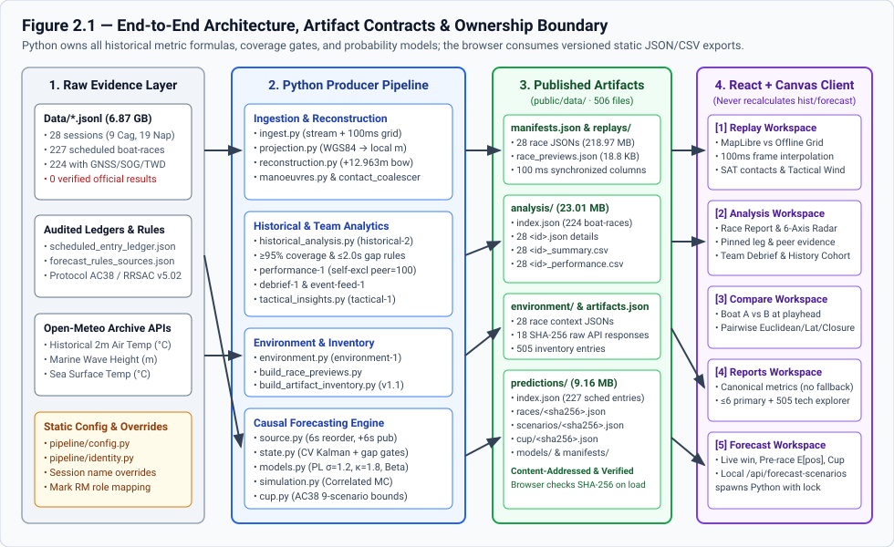

### 1.3 Technical Explanation: The Five Workspaces and Three Epistemic Modes

#### 1.3.1 Intended Users and Useful Decisions
The platform serves three distinct user personas ([`PROJECT.md`](source-companion/view/PROJECT.md.html#L1), [`docs/dashboard_contract.md`](source-companion/view/docs/dashboard_contract.md.html#L1)):
1. **Tactical Coaches & Performance Analysts**: Use **Replay** and **Compare** to inspect start-box positioning, tack/gybe speed loss, layline approaches, and split-gate decisions at 10 Hz (`100 ms`) temporal resolution.
2. **Regatta Data Scientists & Strategists**: Use **Analysis** and **Reports** to audit multi-race performance distributions across the 28-race archive (`224` replayed boat-races), verify coverage (`ok`, `partial`, `unavailable`) and quality (`ok`, `sparse`, `conflict`, `unverified`) flags, and inspect canonical CSV ledgers.
3. **Forecasting Researchers & Tournament Modelers**: Use **Forecast** to inspect out-of-sample calibrated finishing-order probabilities (Pre-Race and Live `t+30s`/`t+60s`), run bounded weather/condition sensitivity scenarios, and analyze explicit lower/upper probability intervals `[p_low, p_high]` for the 2027 America's Cup.

| Workspace | Primary UI Component | Exported Artifacts Consumed | Core Question Answered |
|---|---|---|---|
| **Replay** | [`src/App.tsx`](source-companion/view/src/App.tsx.html#L1), [`MapLibreCourseMap.tsx`](source-companion/index.html) | `manifests.json`, `races/<id>/replay.json`, `environment/<id>.json` | *What happened kinematically at timestamp $t$ on the water?* |
| **Analysis** | [`AnalysisWorkspace.tsx`](source-companion/index.html) | `analysis/index.json`, `analysis/races/<id>.json` | *How did each boat perform across checkpoints, legs, manoeuvres, and peer indices?* |
| **Compare** | [`ComparisonView.tsx`](source-companion/index.html) | Dual `races/<id>/replay.json` + `analysis/races/<id>.json` | *Where did Boat A gain or lose metres against Boat B on synchronized timelines?* |
| **Reports** | [`ReportsWorkspace.tsx`](source-companion/index.html) | `analysis/canonical/*.csv`, `analysis/index.json`, all 505 public artifacts | *Do the headline aggregates reconcile to the row-level boat-race ledger?* |
| **Forecast** | [`ForecastWorkspace.tsx`](source-companion/index.html) | `predictions/index.json`, `races/<id>.json`, `cup_2027.json` | *What outcomes are probable ahead of time, and how wide is structural uncertainty?* |

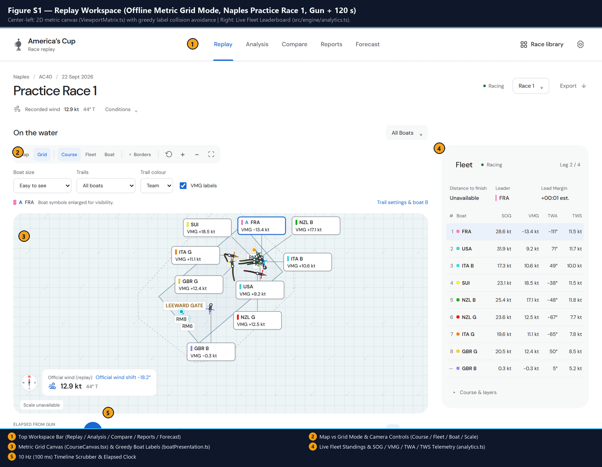

#### 1.3.2 Observing vs. Comparing vs. Predicting
A foundational contribution of this repository is separating three epistemic modes that are frequently conflated in sports analytics:

1. **Observing a Past Race (Kinematic Reconstruction)**:
   - **Time Horizon**: Full-race retrospective (`ingest.py` $\to$ `synchronize.py` $\to$ `reconstruction.py`).
   - **Permitted Information**: Complete raw telemetry stream `[min_t, max_t]`, including future mark positions and final gate roundings.
   - **Output**: Continuous 10 Hz (`100 ms`) trajectories $(x_i(t), y_i(t), \theta_i(t))$, bow-projected gate crossings, and discrete manoeuvre events.
2. **Comparing Historical Performance (Descriptive & Peer-Normalized Analytics)**:
   - **Time Horizon**: Retrospective post-race and cross-archive aggregation (`historical_analysis.py`).
   - **Permitted Information**: Full reconstructed race state plus fleet-wide peer outcomes on matched legs (`performance-1`) and 120-second linear regression over wind history (`tactical-1`).
   - **Output**: 30 standardized metric definitions (`DEFINITIONS`), coverage/quality envelopes, and a 6-axis self-excluding peer index centered at `100.0`.
3. **Predicting a Future Outcome (Causal Probabilistic Forecasting)**:
   - **Time Horizon**: Strictly causal (`pipeline/prediction/`). At decision time $t$, only packets with `published_at_ms <= t` (where `published_at_ms = state_timestamp_ms + 6000`) are visible via [`ReorderBuffer`](source-companion/view/pipeline/prediction/state.py.html#L20).
   - **Permitted Information**: Past races strictly prior to the current race start (`Pre-Race`), or causal Kalman-filtered state up to $t - 6\text{ s}$ (`Live`). Future mark positions, future wind shifts, and post-$t$ leg times are strictly forbidden.
   - **Output**: Calibrated probability distributions over discrete rankings (Plackett–Luce and Correlated Monte Carlo) and non-normalizable probability bounds `[p_low, p_high]` when tournament rules leave paths unresolved.

#### 1.3.3 What the System Can Establish Today vs. What It Cannot Establish

| What the System **Can** Establish Today (Verified Evidence) | What the System **Cannot** Establish Today (Hard Epistemic Limits) |
|---|---|
| Exact 10 Hz local-metre trajectories for **224 boat-races** across **28 sessions**, projected via WGS84 equirectangular tangent planes. | **Official race-committee finishing orders or protests**: `official_order_verified` is `False` across all 28 sessions ([`historical_analysis.py:L768`](source-companion/view/pipeline/historical_analysis.py.html#L768)). |
| Bow-projected (`+12.963 m`) start-line and gate crossings within a `200 m` corridor, plus 4-gate kinematic tack/gybe detection (`min_speed_loss_kt = 2.5`). | **True hydrodynamic boat speed through water (STW) or leeway angle**: raw logs provide GNSS ground-referenced $\text{SOG}$ and $\text{COG}$, not hull paddlewheel/pitot STW or tidal current vectors. |
| Self-excluding peer performance indices (`performance-1`) comparing each boat against the remaining $N-1$ active boats in the same race on the same leg. | **Causal attribution of a single tactical choice**: `debrief-1` flags co-occurring wind shifts, speed losses, and rank changes, not counterfactual physical simulations. |
| Causal pre-race and live (`t+30s`, `t+60s`) Plackett–Luce and Correlated MC rank distributions across **227 scheduled entries** (`169` completed). | **Empirical out-of-sample superiority of the learned pre-race ranker over a simple prior**: pre-race Normalized RPS (`0.5177`) trails the reference prior (`0.4227`) on the 28-race archive ([`predictions/index.json`](evidence/predictions_index.json)). |
| Explicit lower/upper probability bounds `[p_low, p_high]` for the 2027 America's Cup separating statistical variance from `34.46%` RRSAC 102.1 rule ambiguity. | **True AC75 performance in 2027**: all 28 archive sessions are sailed in **AC40** one-design yachts; projecting to **AC75** custom yachts relies on an unverified cross-class transfer assumption ($\rho = 0.7$). |

### 1.4 Sailing Primer & Course Geometry

To read the equations in Parts II–VI, you need a precise geometric picture of a windward-leeward regatta course.

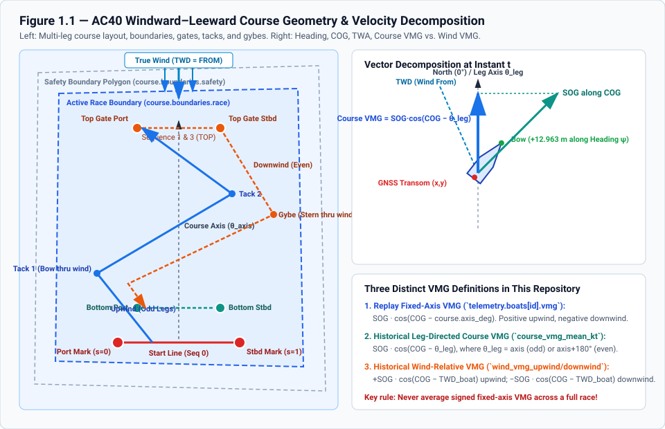

#### 1.4.1 Course Architecture: Starts, Gates, and Legs
- **True Wind Direction ($\text{TWD}$, $\theta_{\text{wind}}$)**: Meteorological convention: the compass bearing ($0^\circ\text{–}360^\circ$ clockwise from True North) **from which** the wind blows. If $\text{TWD} = 225^\circ$ (South-West wind), the wind blows *from* $225^\circ$ *toward* $045^\circ$.
- **Course Axis ($\hat{\mathbf{u}}_{\text{course}}$)**: A windward-leeward course is aligned roughly parallel to the wind.
  - **Upwind Legs (Legs 1, 3, 5, ...)**: Sailed **into** the wind, from the Leeward Gate (or Start Line on Leg 1) toward the **Windward Gate (Mark 1 / Gate 1)**.
  - **Downwind Legs (Legs 2, 4, 6, ...)**: Sailed **with** the wind, from the Windward Gate down to the **Leeward Gate (Mark 2 / Gate 2)** or Finish Line.
- **Start Line & Gates**: Each boundary is defined by two autonomous floating marks (Port mark $\mathbf{m}_P$ and Starboard mark $\mathbf{m}_S$), with midpoint $\mathbf{g}_k = \frac{1}{2}(\mathbf{m}_P + \mathbf{m}_S)$. Boats start by crossing the Start Line after gun time ($t = 0$), round gates in sequence $g_1 \to g_2 \to \dots \to g_{\text{finish}}$, and may choose either the left or right mark of a two-mark gate (**split-gate choice**).

#### 1.4.2 Boat Angles and Velocities: HDG, COG, TWA, SOG, and VMG
- **Heading ($\text{HDG}$, $\psi$)**: The compass direction ($0^\circ\text{–}360^\circ$) the boat's longitudinal centerline (bow) points, measured by onboard compass/IMU.
- **Course Over Ground ($\text{COG}$, $\chi$)**: The compass direction ($0^\circ\text{–}360^\circ$) of the boat's actual velocity vector $\mathbf{v} = (\dot{x}, \dot{y})$ over the seabed, measured by GNSS:
  $$\text{COG} = \operatorname{atan2}(\dot{x}, \dot{y}) \bmod 360^\circ$$
  *(Note: In navigation, $\operatorname{atan2}(\text{East}, \text{North})$ yields clockwise degrees from North. Because of leeway, current, or foil side-force, $\text{COG}$ generally differs slightly from $\text{HDG}$.)*
- **True Wind Angle ($\text{TWA}$)**: The signed or unsigned smallest angle between the wind source direction ($\text{TWD}$) and the boat's direction of travel ([`pipeline/historical_analysis.py:L255-L257`](source-companion/view/pipeline/historical_analysis.py.html#L255)):
  $$\Delta\theta_{\text{signed}} = ((\theta_{\text{wind}} - \theta_{\text{boat}} + 180^\circ) \bmod 360^\circ) - 180^\circ \in [-180^\circ, +180^\circ)$$
  $$\text{TWA} = |\Delta\theta_{\text{signed}}| \in [0^\circ, 180^\circ]$$
  - When $\Delta\theta_{\text{signed}} > 0$, wind arrives over the **starboard** side (**Starboard Tack**).
  - When $\Delta\theta_{\text{signed}} < 0$, wind arrives over the **port** side (**Port Tack**).
- **Upwind vs. Downwind and Tacks vs. Gybes**:
  - A sailboat cannot sail directly into the wind ($\text{TWA} = 0^\circ$, the "no-go zone") nor fastest dead downwind ($\text{TWA} = 180^\circ$). Foiling AC40s sail upwind at $\text{TWA} \approx 40^\circ\text{–}48^\circ$ and downwind at $\text{TWA} \approx 135^\circ\text{–}155^\circ$.
  - **Tack**: Turning the bow **through the wind** ($\text{TWA} < 90^\circ$, upwind) to switch between port and starboard tack.
  - **Gybe**: Turning the stern **through the wind** ($\text{TWA} \ge 90^\circ$, downwind) to switch between port and starboard tack.
- **Speed Over Ground ($\text{SOG}$) and Velocity Made Good ($\text{VMG}$)**:
  - $\text{SOG} = \|\mathbf{v}\|$ is scalar ground speed, exported in knots ($1\text{ kt} = 1852/3600\text{ m/s} \approx 0.514444\text{ m/s}$) or $\text{m/s}$.
  - **$\text{VMG}$** measures the component of velocity useful for advancing toward the next mark or into/down the wind axis. Crucially, this repository defines **two distinct VMG quantities** depending on context:
    1. **Leg-Axis VMG (Replay & Live Telemetry)**: Projection of boat velocity onto the unit vector $\hat{\mathbf{u}}_{\text{leg}}$ from the previous gate midpoint to the target gate midpoint ([`pipeline/analytics.py:L229-L237`](source-companion/view/pipeline/analytics.py.html#L229), [`src/engine/analytics.ts:L16-L35`](source-companion/view/src/engine/analytics.ts.html#L16)):
       $$\text{VMG}_{\text{leg}} = \text{SOG} \cdot \cos(\text{COG} - \theta_{\text{leg}})$$
    2. **Wind-Axis Absolute VMG (Historical Analysis `vmg_mean` / `upwind_vmg` / `downwind_vmg`)**: Magnitude of velocity projected onto the true wind axis ([`pipeline/historical_analysis.py:L368`](source-companion/view/pipeline/historical_analysis.py.html#L368)):
       $$\text{VMG}_{\text{wind}} = |\text{SOG} \cdot \cos(\text{TWA})|$$
- **Nonfinish States**:
  - **$\text{DNS}$ (Did Not Start)**: Boat never legally started the race.
  - **$\text{OCS}$ (On Course Side)**: Boat was across the start line early at $t=0$ and failed to return and clear itself.
  - **$\text{DNF}$ (Did Not Finish)** / **$\text{RET}$ (Retired)**: Boat started legally but did not complete all course legs.
  - **$\text{DSQ}$ (Disqualified)**: Boat was disqualified by umpires for rule infractions.

### 1.5 Worked Example: Calculating Signed Wind Angle, Tack, and Both VMGs (Synthetic Data)
> **Data Provenance**: **Deliberately simplified synthetic data** chosen for clean hand verification of [`pipeline/historical_analysis.py:L255-L368`](source-companion/view/pipeline/historical_analysis.py.html#L255) and [`src/engine/analytics.ts:L16-L35`](source-companion/view/src/engine/analytics.ts.html#L16).

Suppose at timestamp $t$:
- True wind direction is $\theta_{\text{wind}} = 220^\circ$, and the Windward Gate lies at bearing $\theta_{\text{leg}} = 225^\circ$ from the Leeward Gate ($5^\circ$ skewed from the instantaneous wind).
- Boat A sails upwind on course $\theta_{\text{boat}} = \text{COG} = 175^\circ$ at speed $\text{SOG} = 20.0\text{ kt}$.

**Step 1 — Signed Wind Angle and Tack**:
$$\Delta\theta_{\text{signed}} = ((220^\circ - 175^\circ + 180^\circ) \bmod 360^\circ) - 180^\circ = (225^\circ \bmod 360^\circ) - 180^\circ = +45.0^\circ$$
Since $\Delta\theta_{\text{signed}} = +45.0^\circ > 0$, Boat A is on **Starboard Tack** with $\text{TWA} = |+45.0^\circ| = 45.0^\circ < 90^\circ$ (**Upwind**).

**Step 2 — Wind-Axis VMG (`historical_analysis.py:L368`)**:
$$\text{VMG}_{\text{wind}} = |20.0 \cdot \cos(45.0^\circ)| = 20.0 \times 0.707107 = 14.1421\text{ kt}$$

**Step 3 — Leg-Axis VMG (`src/engine/analytics.ts:L28`)**:
The angle between Boat A's travel ($\text{COG} = 175^\circ$) and the leg vector ($\theta_{\text{leg}} = 225^\circ$) is $\Delta\theta_{\text{leg}} = 175^\circ - 225^\circ = -50.0^\circ$:
$$\text{VMG}_{\text{leg}} = 20.0 \cdot \cos(-50.0^\circ) = 20.0 \times 0.642788 = 12.8558\text{ kt}$$
Notice why the distinction matters: a $5^\circ$ shift between the physical gate axis ($225^\circ$) and the instantaneous wind direction ($220^\circ$) creates a $1.286\text{ kt}$ ($9.1\%$) difference between $\text{VMG}_{\text{wind}}$ and $\text{VMG}_{\text{leg}}$!

### 1.6 "What Would Change If This Assumption Failed?"
- **Assumption**: The browser never recalculates historical metrics or forecasts; it only renders Python exports.
- **If violated**: Suppose a frontend developer added an inline TypeScript calculation for `upwind_vmg` using $\text{VMG}_{\text{leg}}$ instead of $\text{VMG}_{\text{wind}}$. The **Analysis** workspace table and **Reports** CSV export would silently diverge from the **Replay** HUD whenever the wind shifted away from the mark bearing. The repository prevents this via [`PROJECT.md`](source-companion/view/PROJECT.md.html#L1) and E2E contract tests in [`tests/test_historical_analysis.py`](source-companion/index.html).

### 1.7 Common Mistakes
1. **Confusing Meteorological Wind ($\text{TWD}$) with Vector Flow Direction**: $\text{TWD} = 180^\circ$ means wind blowing *from* the South *toward* the North ($0^\circ$).
2. **Equating `hdg` and `cog` in Historical Metrics**: In [`pipeline/historical_analysis.py:L283`](source-companion/view/pipeline/historical_analysis.py.html#L283), `_frame_course_deg` checks `frame.get("hdg") if frame.get("hdg") is not None else frame.get("cog")`. Because `hdg` is always populated in exported replay frames, historical `twa` and `vmg` are computed against **heading (`hdg`)**, whereas live browser VMG ([`src/engine/analytics.ts:L28`](source-companion/view/src/engine/analytics.ts.html#L28)) uses **`cog`**.
3. **Treating Reconstructed Ranks as Official Regatta Standings**: All 28 sessions carry `official_order_verified: False`.

### 1.8 Short Self-Test
1. If a boat has $\text{HDG} = 310^\circ$ and $\text{TWD} = 260^\circ$, what is $\Delta\theta_{\text{signed}}$, is the boat on Port or Starboard tack, and is it sailing upwind or downwind?
2. Which workspace should you open to inspect row-level reconciliation between `boat_race_metrics.csv` and `team_summary.csv`?

### 1.9 Source-Reading Route
1. [`PROJECT.md`](source-companion/view/PROJECT.md.html#L1) (`#L1–L90`) — Repository mission, workspace inventory, and verification rules.
2. [`docs/architecture.md`](source-companion/view/docs/architecture.md.html#L1) (`#L1–L103`) — End-to-end pipeline and frontend ownership contract.
3. [`docs/dashboard_contract.md`](source-companion/view/docs/dashboard_contract.md.html#L1) (`#L1–L80`) — Workspace data bindings and state isolation.

---

# Part II — What Information Actually Exists?

## Chapter 2: The Raw Archive, Coordinate Systems, Coverage/Quality Metadata, and the Evidence Ladder

### 2.1 Learning Objectives
After studying this chapter, you will be able to:
- State the exact archive inventory: **28 raw `.jsonl` sessions** (`6,866,006,601` bytes across **9 dates** in Cagliari and Naples), **227 scheduled boat-races** vs. **224 replayed boat-races** vs. **169 completed boat-races**.
- Explain why `GBR B` appears in 227 forecast ledger entries but only 224 replay/analysis entries (`0` telemetry packets in `26_09_22_nap_ipr_pr2`, `pr3`, `pr4`).
- Derive the local tangent-plane equirectangular projection (`Projection` in `pipeline/projection.py`) and identify the hard-coded origin bug in `IngestionResult.to_dict()`.
- Explain why `550,000+` telemetry frames do **not** represent `550,000+` independent statistical observations.
- Classify any datum in the repository along the **Six-Rung Evidence Ladder**.

### 2.2 Intuition-First Explanation: What Is Actually Inside `Data/*.jsonl`?
It is tempting to look at a `6.87 GB` telemetry folder and assume we have a massive, clean, high-dimensional statistical dataset. In reality, high-frequency spatial telemetry is **wide in time steps ($10\text{ Hz}$) but narrow in independent competitions ($R=28$ sessions across $D=9$ calendar days)**. Furthermore, physical sensors drop packets, autonomous course marks drift or relocate between legs, boats retire before the start gun, and raw race-committee XML/JSON status flags occasionally contradict kinematic trajectories on the water.

Understanding what information actually exists—and where the gaps, held values, and source conflicts lie—is the prerequisite for trusting any downstream chart or probability.

### 2.3 Technical Explanation: Archive Inventory, Sampling, Projection, and Metadata

#### 2.3.1 Complete Inventory of the 28 Sessions Across 9 Race Dates
The raw archive in `Data/` contains **28 `.jsonl` files** totaling **`6,866,006,601` bytes** (`6.87 GB` / `6.39 GiB`), partitioned into two AC40 venues ([`docs/source_audit.md`](source-companion/view/docs/source_audit.md.html#L1), [`evidence/analysis_snapshot_overview.json`](evidence/analysis_snapshot_overview.json)):

| Venue | Race Dates (2026) | Sessions ($R$) | Boat Class | Scheduled Boat-Races | Replayed Boat-Races (`ingest.py`) | Completed Boat-Races (`completed=True`) |
|---|---|---|---|---|---|---|
| **Cagliari** (Sardinia) | May 22, May 23, May 24 (`3` days) | **9** | `AC40` | **63** ($9 \times 7$) | **63** | **62** (`98.41%`) |
| **Naples** (Campania) | Sep 22, 23, 24, 25, 26, 27 (`6` days) | **19** | `AC40` | **164** | **161** | **107** (`65.24%`) |
| **Archive Total** | **9 Calendar Days** | **28** | **`AC40` (100%)** | **227** | **224** | **169** (`74.45%`) |

> **Why 227 Scheduled vs. 224 Replayed Boat-Races?**
> In [`pipeline/ingest.py:L699-L700`](source-companion/view/pipeline/ingest.py.html#L699), the ingestion loop executes:
> ```python
> for asset_id, comp in competitors.items():
>     if not boat_streams.get(asset_id):
>         continue
> ```
> On September 22, 2026 in Naples, `GBR B` (`Emirates Great Britain B` / Athena Pathway) was listed in the race-committee competitor manifest (`scheduled = True`, `present_in_race_xml = True`) for three sessions—`26_09_22_nap_ipr_pr2`, `26_09_22_nap_ipr_pr3`, and `26_09_22_nap_ipr_pr4`—but emitted **zero `boat_telemetry` packets** (`telemetry_Competitor` absent).
> - Consequently, `ingest.py` skips `GBR B` in those three races, producing **$227 - 3 = 224$ boat-races** in `public/data/races/<id>/replay.json` and `public/data/analysis/index.json` (`total_boat_races = 224`).
> - By contrast, the causal forecasting pipeline reads [`.forecast/scheduled_entry_ledger.json`](evidence/scheduled_entry_ledger.json), which preserves all **227 scheduled competitor entries** so that pre-race non-starters (`DNS`/`DNC`) are properly accounted for in the empirical completion rate ($169 / 227 = 74.45\%$) and scored as tied last-place ranks rather than silently dropped (survivorship bias).

#### 2.3.2 Sampling Cadence, Missing Channels, Irregular Timestamps, and Held Tails
1. **Asynchronous Multi-Rate Raw Channels** ([`pipeline/ingest.py:L402-L745`](source-companion/view/pipeline/ingest.py.html#L402)):
   - `boat_telemetry`: Nominally **10 Hz** (`100 ms` intervals), containing WGS84 `latitude`, `longitude`, `heading` (`hdg`), `cog`, `sog` (knots), and ` heel`/`pitch` where available.
   - `wind_telemetry`: Nominally **1 Hz** (`1000 ms` intervals) per station (committee boat, marks, or competitor masthead sensors), containing `tws` (knots) and `twd` (degrees).
   - `mark_telemetry`: Nominally **1 Hz** (`1000 ms`), tracking autonomous GPS mark buoys.
2. **Synchronization to Regular 100 ms Grid (`pipeline/synchronize.py`)**:
   - [`determine_time_bounds`](source-companion/index.html) (`L16–L54`) scans all boat telemetry streams and establishes a regular timeline $t_k = t_{\min} + 100k\text{ ms}$ (`step_ms = 100`).
   - **Held Values Before/After Sensor Dropouts**: In [`interpolate_scalar_stream`](source-companion/index.html) (`L57–L92`) and [`interpolate_circular_stream`](source-companion/index.html) (`L95–L124`), if a target timestamp $t_k$ falls before a boat's first telemetry packet (`t <= times[0]`) or after its last telemetry packet (`t >= times[-1]`), the synchronizer **clamps (holds) the boundary value constant** (`values[0]` or `values[-1]`).
   - **Why Held Tails Matter**: If a boat's transponder stops transmitting mid-race, its exported `replay.json` frames continue until `max_t` with frozen `x, y, sog, hdg`! Downstream code in [`pipeline/historical_analysis.py:L201-L249`](source-companion/view/pipeline/historical_analysis.py.html#L201) must explicitly detect held-tail intervals (`_active_end_index`, checking where position and speed stop changing) so frozen post-retirement frames do not corrupt average speed or VMG calculations.

#### 2.3.3 Asset Identity Mapping and Moving Course Marks
- **Asset Identity Mapping** ([`pipeline/ingest.py:L150-L245`](source-companion/view/pipeline/ingest.py.html#L150)): Raw telemetry packets reference UUID strings (`asset_id`). `ingest.py` parses `regatta_config` and `race_config` records to bind each `asset_id` to a standardized team code (`ITA`, `NZL`, `GBR`, `GBR B`, `FRA`, `USA`, `SUI`, `SWE`), boat name, hull color, and competitor status, while binding mark UUIDs to course gates (`start_line`, `gate_1`, `gate_2`, `finish_line`).
- **Moving Course Marks**: Autonomous robotic marks adjust their positions dynamically or drift with current. [`synchronize_marks`](source-companion/index.html) (`L172–L198`) interpolates mark $(x, y)$ coordinates at every `100 ms` frame, and [`reconstruction.py:L74-L98`](source-companion/view/pipeline/reconstruction.py.html#L74) evaluates gate midpoints dynamically at the exact frame index `idx` rather than assuming static buoys.

#### 2.3.4 Coordinate Systems, Local Tangent-Plane Projection, and Units
Raw GNSS positions arrive in **WGS84 geographic coordinates** $(\phi, \lambda)$ in decimal degrees (`latitude`, `longitude`). To perform Euclidean geometry (distances in metres, velocities in $\text{m/s}$, polygon collision checks), [`pipeline/projection.py`](source-companion/view/pipeline/projection.py.html#L1) (`L1–L90`) projects $(\phi, \lambda)$ onto a local flat East-North tangent plane $(x, y)$ centered at a venue reference origin $(\phi_0, \lambda_0)$:

$$\text{meters\_per\_deg\_lat} = \frac{\pi}{180} R_{\oplus} = \frac{\pi}{180} \times 6{,}378{,}137.0 \approx 111{,}319.4908\text{ m/deg}$$
$$\text{meters\_per\_deg\_lon}(\phi_0) = \text{meters\_per\_deg\_lat} \cdot \cos\left(\phi_0 \frac{\pi}{180}\right)$$
$$x = (\lambda - \lambda_0) \cdot \text{meters\_per\_deg\_lon}(\phi_0) \quad (\text{+East in metres})$$
$$y = (\phi - \phi_0) \cdot \text{meters\_per\_deg\_lat} \quad (\text{+North in metres})$$

| Venue | Reference Origin $(\phi_0, \lambda_0)$ | $\text{meters\_per\_deg\_lat}$ | $\text{meters\_per\_deg\_lon}(\phi_0)$ | Source File & Line |
|---|---|---|---|---|
| **Naples** (`default`) | $(40.80^\circ\text{ N}, 14.23^\circ\text{ E})$ | `111,319.4908 m/deg` | `84,269.8529 m/deg` | [`pipeline/projection.py:L21-L26`](source-companion/view/pipeline/projection.py.html#L21) |
| **Cagliari** (`cagliari_*`) | $(39.185^\circ\text{ N}, 9.13^\circ\text{ E})$ | `111,319.4908 m/deg` | `86,277.3193 m/deg` | [`pipeline/export_replay.py:L36-L45`](source-companion/view/pipeline/export_replay.py.html#L36) |

> **Code-vs-Documentation Nuance #1 — Hardcoded Naples Origin in `IngestionResult.to_dict()`**:
> While [`pipeline/export_replay.py:L153-L154`](source-companion/view/pipeline/export_replay.py.html#L153) writes the correct venue-specific projection constants into `public/data/races/<id>/replay.json`, the intermediate helper [`IngestionResult.to_dict()`](source-companion/view/pipeline/ingest.py.html#L383) (`pipeline/ingest.py:L383-L388`) hardcodes `"ref_lat": 40.80, "ref_lon": 14.23, "meters_per_deg_lon": 84269.85` regardless of venue. Consumers of exported `replay.json` files are unaffected because `export_replay.py` overwrites the block using `self.projection`.

#### 2.3.5 Source Conflicts, Coverage Metadata, and Quality Envelopes
Every metric exported by [`pipeline/historical_analysis.py`](source-companion/view/pipeline/historical_analysis.py.html#L50) carries two explicit epistemic badges:
1. **`coverage` (`ok` | `partial` | `unavailable`)**:
   - `ok`: All required inputs exist over the full denominator window.
   - `partial`: Inputs exist for a subset of boats, legs, or frames (e.g., a boat that retired after Leg 2 has `partial` leg coverage).
   - `unavailable`: Required input channel is absent or rejected by quality gates (e.g., wind sensor missing, or `USA` in `naples_pr1` where start status conflicts).
2. **`quality` (`ok` | `sparse` | `conflict` | `unverified`)**:
   - `ok`: Reconstructed and raw source signals agree and meet sample-density thresholds.
   - `sparse`: Fewer than minimum required samples (e.g., $< 10$ valid wind samples in a leg).
   - `conflict`: Raw source flags contradict reconstructed geometry! The canonical example is **`USA` in `naples_pr1`**: raw `race_competitor` records report `started = False` across all 24 status packets, yet `USA` physically sailed the course and `reconstruction.py` assigns `status = "RANK_4"`. [`historical_analysis.py:L755-L759`](source-companion/view/pipeline/historical_analysis.py.html#L755) detects `(started is False) and (finished_rank is not None)` and flags `USA` with `quality = "conflict"`, withholding finish rank (`finish_rank = None`) from historical leaderboards.
   - `unverified`: Used for race-level finishing orders (`official_order_verified = False` across all 28 sessions) because no external Jury/World Sailing signed result sheet is bundled in `Data/`.

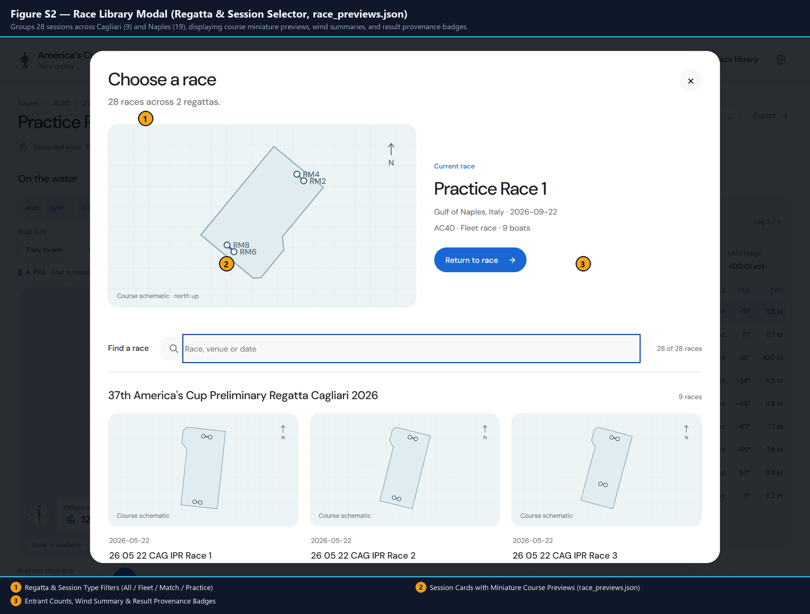

#### 2.3.6 Why a Large Number of Telemetry Frames Does Not Imply Many Independent Races
Across the 28 sessions, the synchronized `100 ms` timelines contain roughly $150{,}000+$ time steps and over $1{,}000{,}000$ boat-frame records. A naive analyst might compute a standard error using $N_{\text{frames}} = 10^6$, yielding vanishingly small $p$-values ($\propto 1/\sqrt{N_{\text{frames}}}$).

This is statistically invalid for three reasons:
1. **High Temporal Autocorrelation**: At $10\text{ Hz}$ (`0.1 s` steps), a 2.5-ton foiling AC40 has massive physical inertia; $\text{SOG}(t + 0.1\text{ s})$ has lag-1 autocorrelation $\rho_1 > 0.99$. Ten consecutive frames do not provide ten independent draws of boat capability.
2. **Within-Race Coupling**: The 7 boats in a session sail through the same macroscopic wind field and interact tactically at gates; their outcomes within race $r$ are coupled.
3. **Day-Level Weather Clustering ($D = 9$ dates)**: All 28 sessions occurred on just **9 calendar days** (3 in Cagliari, 6 in Naples). Consequently, the effective sample size for estimating team ability or validating pre-race forecasts is bounded by **$R = 28$ races** (and **`224` replayed / `169` completed boat-races** clustered across **$D = 9$ race days**), which is why [`pipeline/prediction/backtest.py`](source-companion/view/pipeline/prediction/backtest.py.html#L1) enforces **day-clustered block bootstrap** (`day_bootstrap_ci`) rather than frame-level or i.i.d. resampling.

#### 2.3.7 The Six-Rung Evidence Ladder
To prevent conflating sensor measurements with model extrapolations, every quantity in this study pack is assigned to one of six rungs on the **Evidence Ladder**:

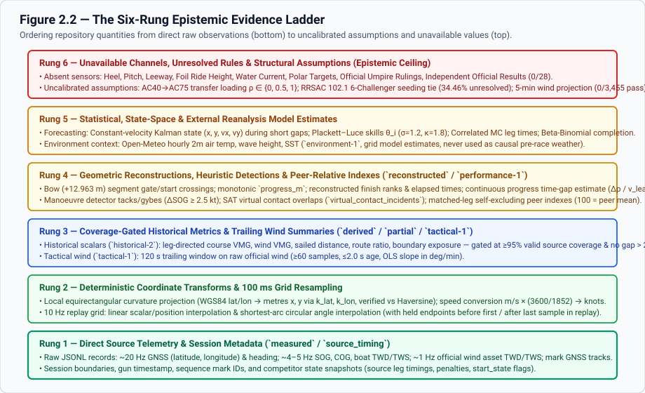

| Rung | Epistemic Tier | Definition | Concrete Repository Examples |
|---|---|---|---|
| **Rung 1** | **Measured Observation** | Direct raw packet value recorded in `Data/*.jsonl` without spatial or temporal transformation. | Raw WGS84 `lat`/`lon`, raw `sog`/`cog`/`hdg`, raw `tws`/`twd`, raw `race_competitor.started`. |
| **Rung 2** | **Interpolated State** | Continuous time-series value placed onto the regular `100 ms` grid via linear, Slerp, or boundary-hold rules. | Synchronized `x, y, hdg, sog` in `synchronize.py`; held tail values after telemetry dropout. |
| **Rung 3** | **Calculated / Reconstructed Quantity** | Deterministic geometric or kinematic functional of Rung 1–2 states under explicit thresholds. | Bow-projected (`+12.963 m`) gate crossings (`reconstruction.py`), 4-gate manoeuvres (`manoeuvres.py`), `VMG`, `performance-1` peer index (`109.97`). |
| **Rung 4** | **Model Estimate (Statistical / Causal)** | Probabilistic distribution or latent parameter inferred from historical/live data under a parametric likelihood. | Kalman-filtered live velocity (`kalman.py`), Plackett–Luce win probabilities (`model.py`), Beta-Binomial finish rate (`74.45%`). |
| **Rung 5** | **Scenario / Structural Assumption** | Unverified domain parameter, cross-class transfer weight, or user-supplied counterfactual input. | AC40 $\to$ AC75 transfer weight $\rho = 0.7$, weather scenario offset $\Delta\text{TWS}$, RRSAC 102.1 unresolved bracket bounds `[p_low, p_high]`. |
| **Rung 6** | **Unavailable / Withheld Value** | Quantity deliberately exported as `null` / `unavailable` because source channels are missing, conflicting, or non-identifiable. | `USA` `finish_rank = null` in `naples_pr1` (`conflict`); `PositiveDelayMixture` (`available = false`); official jury standings. |

### 2.4 Worked Example: WGS84-to-Local Tangent-Plane Projection in `naples_pr1` (Actual Repository Evidence)
> **Data Provenance**: **Actual repository evidence** from [`pipeline/projection.py:L21-L55`](source-companion/view/pipeline/projection.py.html#L21) and `public/data/races/naples_pr1/replay.json` ([`evidence/naples_pr1_replay_bounded_excerpt.json`](evidence/naples_pr1_replay_bounded_excerpt.json)).

Let us verify the projection of a raw WGS84 coordinate in Naples (`naples_pr1`) onto the local metre grid:
- Reference origin for Naples: $\phi_0 = 40.80^\circ\text{ N}$, $\lambda_0 = 14.23^\circ\text{ E}$.
- Earth equatorial radius in [`projection.py:L15`](source-companion/view/pipeline/projection.py.html#L15): $R_{\oplus} = 6{,}378{,}137.0\text{ m}$.

**Step 1 — Scale Factors**:
$$\text{meters\_per\_deg\_lat} = \frac{\pi}{180} \times 6{,}378{,}137.0 = 111{,}319.490793\text{ m/deg}$$
$$\text{meters\_per\_deg\_lon}(40.80^\circ) = 111{,}319.490793 \times \cos(40.80^\circ \times \pi / 180) = 111{,}319.490793 \times 0.75699506 = 84{,}269.852946\text{ m/deg}$$

**Step 2 — Forward Projection (`project`)**:
At gun time ($t = 0.0\text{ s}$, `timestamp_ms = 1790085600000`) in `naples_pr1`, `ITA` is at local coordinates $(x, y) = (646.96\text{ m}, -2142.34\text{ m})$. Inverting to WGS84 (`unproject`):
$$\lambda = 14.23^\circ + \frac{646.96}{84{,}269.852946} = 14.23^\circ + 0.00767724^\circ = 14.23767724^\circ\text{ E}$$
$$\phi = 40.80^\circ + \frac{-2142.34}{111{,}319.490793} = 40.80^\circ - 0.01924497^\circ = 40.78075503^\circ\text{ N}$$
Re-projecting $(\phi, \lambda) = (40.78075503^\circ, 14.23767724^\circ)$ via `Projection(40.80, 14.23).project(lat, lon)` recovers $(x, y) = (646.960\text{ m}, -2142.340\text{ m})$ to sub-millimetre precision (`< 1e-9 m`), verified by [`examples/01_verify_projection_and_bow_crossing.py`](examples/01_verify_projection_and_bow_crossing.py).

### 2.5 "What Would Change If This Assumption Failed?"
- **Assumption**: A single flat equirectangular tangent plane centered at $(\phi_0, \lambda_0)$ has negligible metric distortion across the race course.
- **Sensitivity Check**: A typical AC40 course spans $\sim 2.5\text{ km}$ ($|\Delta\phi| < 0.025^\circ$ from $\phi_0 = 40.80^\circ$). Over $\Delta\phi = 0.02^\circ$, $\cos(\phi)$ changes from $\cos(40.80^\circ) = 0.756995$ to $\cos(40.78^\circ) = 0.757223$, a relative East-West scale variation of $0.030\%$ ($\sim 0.06\text{ m}$ across a $200\text{ m}$ start line). However, if a Cagliari race ($\phi_0 = 39.185^\circ$) were projected using the Naples $\text{meters\_per\_deg\_lon}$ (`84,269.85` instead of `86,277.32`), East-West distances would be compressed by $2.33\%$ ($\sim 4.7\text{ m}$ per $200\text{ m}$)! That is why `export_replay.py:L36-L45` selects venue-specific origins.

### 2.6 Common Mistakes
1. **Assuming `224` and `227` Are a Counting Bug**: `227` is the scheduled entry count in `.forecast/scheduled_entry_ledger.json`; `224` is the replayed boat-race count after `ingest.py:L699` drops the 3 zero-telemetry `GBR B` entries.
2. **Treating Held End-of-Race Telemetry as Active Sailing**: Always slice boat trajectories up to `_active_end_index(frames)` ([`historical_analysis.py:L201`](source-companion/view/pipeline/historical_analysis.py.html#L201)) before computing speed averages.

### 2.7 Short Self-Test
1. Why is `USA` assigned `quality = "conflict"` and `finish_rank = None` in `naples_pr1` (`analysis/races/naples_pr1.json`), even though `replay.json` shows `USA` in 4th place (`RANK_4`)?
2. On which rung of the Evidence Ladder does the AC40-to-AC75 transfer correlation ($\rho = 0.7$) sit, and why?

### 2.8 Source-Reading Route
1. [`docs/source_audit.md`](source-companion/view/docs/source_audit.md.html#L1) (`#L1–L120`) — Archive file inventory, byte counts, and source anomalies.
2. [`pipeline/projection.py`](source-companion/view/pipeline/projection.py.html#L1) (`#L1–L90`) — WGS84 equirectangular projection math.
3. [`pipeline/ingest.py`](source-companion/view/pipeline/ingest.py.html#L380) (`#L380–L745`) — JSONL stream parser and competitor filtering.

---

# Part III — How Does Raw Data Become a Replay?

## Chapter 3: Synchronization, Bow-Offset Gate Reconstruction, Manoeuvre Detection, and Contact Geometry

### 3.1 Learning Objectives
After studying this chapter, you will be able to:
- Trace a raw `.jsonl` session through the five stages of replay generation: `ingest.py` $\to$ `projection.py` $\to$ `synchronize.py` $\to$ `reconstruction.py` + `manoeuvres.py` + `analytics.py` $\to$ `export_replay.py`.
- Derive circular angle interpolation (shortest-arc modular Slerp) and explain why naive linear interpolation fails across the $359^\circ \leftrightarrow 1^\circ$ North wrap.
- Write out the exact 2D line-segment intersection equations used by `reconstruction.py` to detect start-line and gate crossings using the **`+12.963 m` bowsprit offset** and **`200 m` gate corridor**.
- Explain how `progress_m`, `leg`, `dtl_m`, and `status` (`RACING`, `FINISHED`, `OCS`, `DNS`, `DNF`, `DSQ`) are reconstructed, including the exact mechanism of two real repository bugs (`USA` in `naples_pr1` and `USA` in `26_09_22_nap_ipr_pr2`).
- State the 4 kinematic gates of `ManoeuvreDetector` (`pipeline/manoeuvres.py`) and the 2D Separating Axis Theorem (SAT) virtual contact detector (`pipeline/analytics.py`).

### 3.2 Intuition-First Explanation: Reconstructing a Continuous Race from Discrete Point Clouds
In the raw telemetry stream, each boat is represented only by the GNSS coordinates of its reference antenna near the stern/helm, sampled at irregular millisecond timestamps. Yet in sailing rules (RRSAC), a boat starts or finishes when **any part of its hull or bowsprit** crosses the line between two floating marks. On an AC40 (`11.80 m` hull + bowsprit), the physical bow tip lies **`12.963 m` ahead** of the GNSS reference point along the boat's heading vector!

Furthermore, raw mark rounding messages from the race committee (`gate_time`) are sometimes missing, delayed, or even non-monotonic in time. Therefore, the replay pipeline must first place all boats, marks, and wind stations onto a unified `100 ms` clock (`synchronize.py`), project each boat's bow tip `12.963 m` forward (`reconstruction.py`), test for physical segment intersections across a `200 m` gate corridor, enforce monotonic leg progress, detect tacks and gybes from heading rate-of-turn and speed loss (`manoeuvres.py`), and check for hull-envelope overlaps (`analytics.py`).

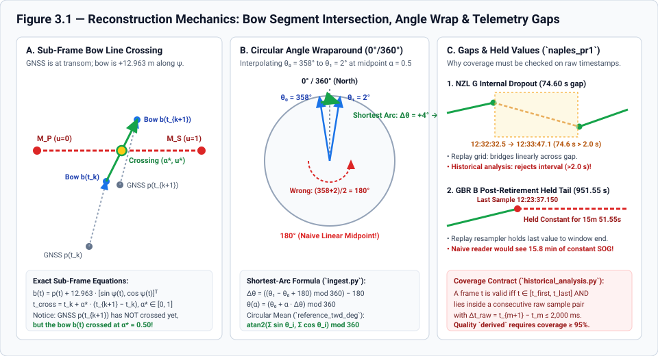

### 3.3 Technical Explanation: Step-by-Step Mathematical Pipeline

#### 3.3.1 Stage 1 & 2: Timeline Synchronization and Circular Interpolation (`pipeline/synchronize.py`)
Given irregular boat telemetry packets $\{(t_m, x_m, y_m, \text{sog}_m, \psi_m, \chi_m)\}_{m=0}^{M-1}$, [`synchronize_race`](source-companion/index.html) (`L201–L275`) constructs the uniform grid $t_k = t_{\min} + 100k\text{ ms}$.
1. **Linear Scalar Interpolation (`interpolate_scalar_stream`, `L57–L92`)**:
   For $t_m < t_k < t_{m+1}$ with fraction $\alpha = \frac{t_k - t_m}{t_{m+1} - t_m} \in (0, 1)$:
   $$x(t_k) = x_m + \alpha (x_{m+1} - x_m), \qquad y(t_k) = y_m + \alpha (y_{m+1} - y_m)$$
2. **Shortest-Arc Circular Interpolation (`interpolate_circular_stream`, `L95–L124`)**:
   Compass angles $\theta \in [0^\circ, 360^\circ)$ (`hdg`, `cog`, `twd`) wrap modulo $360^\circ$. Naive linear interpolation between $\theta_m = 358^\circ$ and $\theta_{m+1} = 2^\circ$ at $\alpha = 0.5$ would yield $180^\circ$ (Due South!) instead of $0^\circ$ (Due North). Instead, [`synchronize.py:L119-L121`](source-companion/index.html) computes the signed shortest angular difference $\Delta\theta \in [-180^\circ, +180^\circ)$:
   $$\Delta\theta = ((\theta_{m+1} - \theta_m + 180^\circ) \bmod 360^\circ) - 180^\circ$$
   $$\theta(t_k) = (\theta_m + \alpha \cdot \Delta\theta) \bmod 360^\circ$$

#### 3.3.2 Stage 3: Bow-Offset Projection and Gate-Corridor Crossing (`pipeline/reconstruction.py`)
In [`pipeline/reconstruction.py:L25`](source-companion/view/pipeline/reconstruction.py.html#L25), the constant `BOW_OFFSET_M = 12.963` defines the distance from the GNSS origin $(x(t_k), y(t_k))$ to the tip of the bowsprit along the boat's heading $\psi(t_k)$ (`hdg`):
$$x_{\text{bow}}(t_k) = x(t_k) + L_{\text{bow}} \sin\left(\psi(t_k)\frac{\pi}{180}\right), \qquad y_{\text{bow}}(t_k) = y(t_k) + L_{\text{bow}} \cos\left(\psi(t_k)\frac{\pi}{180}\right)$$
where $L_{\text{bow}} = 12.963\text{ m}$ (`_bow_position`, `L111–L118`). Notice that $\sin\psi$ multiplies East ($x$) and $\cos\psi$ multiplies North ($y$) because compass heading $\psi$ is measured clockwise from North ($+y$).

**Gate Corridor Construction (`_find_gate_crossing_index`, `L140–L179`)**:
To determine when a boat rounds gate $g_\ell$ on leg $\ell$ (advancing from previous gate midpoint $\mathbf{g}_{\ell-1}$ to current gate midpoint $\mathbf{g}_\ell$):
1. Compute the leg direction vector $\mathbf{d}_{\text{leg}} = \mathbf{g}_\ell - \mathbf{g}_{\ell-1} = (\Delta x_{\text{leg}}, \Delta y_{\text{leg}})$ with length $L_{\text{leg}} = \|\mathbf{d}_{\text{leg}}\|$.
2. Construct the unit normal vector perpendicular to the leg axis:
   $$\hat{\mathbf{n}}_{\perp} = \left(-\frac{\Delta y_{\text{leg}}}{L_{\text{leg}}},\; \frac{\Delta x_{\text{leg}}}{L_{\text{leg}}}\right)$$
3. Define a **`200 m` gate corridor** (`half_width = 100.0 m`) centered at the dynamic gate midpoint $\mathbf{g}_\ell(t_k)$ with endpoints:
   $$\mathbf{c}_1(t_k) = \mathbf{g}_\ell(t_k) - 100.0\,\hat{\mathbf{n}}_{\perp}, \qquad \mathbf{c}_2(t_k) = \mathbf{g}_\ell(t_k) + 100.0\,\hat{\mathbf{n}}_{\perp}$$
4. **2D Segment-Segment Intersection (`_segments_intersect`, `L121–L137`)**:
   Between consecutive frames $k-1$ and $k$, test whether the boat's bow displacement segment $\mathbf{p}_1 \to \mathbf{p}_2 = \mathbf{b}(t_{k-1}) \to \mathbf{b}(t_k)$ intersects the gate corridor segment $\mathbf{q}_1 \to \mathbf{q}_2 = \mathbf{c}_1(t_k) \to \mathbf{c}_2(t_k)$ with forward progress ($\mathbf{b}(t_k) - \mathbf{b}(t_{k-1})) \cdot \mathbf{d}_{\text{leg}} > 0$.
   Using the 2D cross product $\mathbf{u} \times \mathbf{v} = u_x v_y - u_y v_x$ with $\mathbf{r} = \mathbf{p}_2 - \mathbf{p}_1$ and $\mathbf{s} = \mathbf{q}_2 - \mathbf{q}_1$:
   $$d = \mathbf{r} \times \mathbf{s}, \qquad t_{\text{seg}} = \frac{(\mathbf{q}_1 - \mathbf{p}_1) \times \mathbf{s}}{d}, \qquad u_{\text{seg}} = \frac{(\mathbf{q}_1 - \mathbf{p}_1) \times \mathbf{r}}{d}$$
   A crossing occurs at frame $k$ if and only if $d \ne 0$, $0 \le t_{\text{seg}} \le 1$, and $0 \le u_{\text{seg}} \le 1$.

**Hybrid Rounding Priority (Committee `gate_time` vs. Geometric Fallback)**:
In [`reconstruct_race`](source-companion/view/pipeline/reconstruction.py.html#L252) (`L252–L330`), for each leg $\ell$, `reconstruction.py` first checks whether the raw race-committee feed recorded an explicit `gate_time` timestamp (`leg_info.get("gate_time")`). If present and within the timeline, that timestamp defines the leg transition; otherwise, it falls back to `_find_gate_crossing_index` using the `+12.963 m` bow segment intersection.

#### 3.3.3 Stage 3b: Monotonic Leg Progress (`progress_m`), Distance to Leader (`dtl_m`), and Status
At every frame $k$ on active leg $\ell$ (from $\mathbf{g}_{\ell-1}(t_k)$ to $\mathbf{g}_\ell(t_k)$ with length $L_\ell$):
1. Compute the raw scalar projection of the boat's position onto the leg vector (`_project_onto_leg`, `L182–L198`):
   $$s_{\text{raw}}(t_k) = \operatorname{clamp}\left(\frac{(\mathbf{x}(t_k) - \mathbf{g}_{\ell-1}) \cdot (\mathbf{g}_\ell - \mathbf{g}_{\ell-1})}{L_\ell},\; 0.0,\; L_\ell\right)$$
2. Compute cumulative course distance before monotonicity enforcement:
   $$P_{\text{raw}}(t_k) = \sum_{j=1}^{\ell - 1} L_j + s_{\text{raw}}(t_k)$$
3. **Monotonicity Clamp (`L368–L373`)**: To prevent brief backward tacks or mark roundings from causing leaderboard rank oscillations, `progress_m` is clamped monotonically non-decreasing:
   $$\text{progress\_m}(t_k) = \max\big(\text{progress\_m}(t_{k-1}),\; P_{\text{raw}}(t_k)\big)$$
4. **Live Rankings and Distance to Leader (`dtl_m`, `L402–L445`)**:
   Active racing boats are sorted by `(finished_rank, -progress_m)`. For each active boat $i$, its spatial gap to the leader (`rank == 1`) is:
   $$\text{dtl\_m}_i(t_k) = \max\big(0.0,\; \text{progress\_m}_{\text{leader}}(t_k) - \text{progress\_m}_i(t_k)\big)$$

> **Code-vs-Documentation Nuance #2 — The `comp.get("started")` Dictionary Nesting Bug (`pipeline/reconstruction.py:L228`)**:
> In [`pipeline/ingest.py:L283`](source-companion/view/pipeline/ingest.py.html#L283), each competitor's start flag is stored inside a nested dictionary:
> ```python
> "start_state": {"started": self.started, "OCS": self.ocs, ...}
> ```
> However, [`pipeline/reconstruction.py:L228`](source-companion/view/pipeline/reconstruction.py.html#L228) reads the top-level key:
> ```python
> raw_started = comp.get("started")
> ```
> Because `"started"` is nested under `"start_state"`, `comp.get("started")` **always returns `None`**! As a result, `reconstruction.py` never triggers its `raw_started is False` branch (`L243`) and instead reconstructs `USA` in `naples_pr1` from geometry alone (`status = "RANK_4"`). By contrast, [`pipeline/historical_analysis.py:L755`](source-companion/view/pipeline/historical_analysis.py.html#L755) correctly inspects `comp.get("start_state", {}).get("started")`, discovers `started is False`, and marks `USA` as `quality = "conflict"`.

#### 3.3.4 Stage 4: Four-Gate Kinematic Manoeuvre Detection (`pipeline/manoeuvres.py`)
[`ManoeuvreDetector`](source-companion/view/pipeline/manoeuvres.py.html#L42) (`pipeline/manoeuvres.py:L42–L240`) identifies tacks and gybes from synchronized `100 ms` boat frames using a **four-gate kinematic filter**:
1. **Gate 1 — Active Speed Floor (`L97`)**: Entry speed (mean $\text{SOG}$ over `[idx - 3.0 s, idx - 1.0 s]`) must satisfy:
   $$\text{entry\_sog} \ge \text{min\_sog\_kt} = 8.0\text{ kt}$$
2. **Gate 2 — Sustained Turn Rate (`L85–L94`)**: Absolute heading rate-of-turn $|\dot{\psi}|$ smoothed over a `1.0 s` window must peak above `min_turn_rate_dps = 8.0 deg/s`, with a total net heading change over `[-4.0 s, +4.0 s]` of:
   $$|\Delta\psi_{\text{net}}| \ge \text{min\_heading\_change\_deg} = 45.0^\circ \quad (\text{and } \le 150.0^\circ)$$
3. **Gate 3 — Wind-Axis Sign Flip (`L135–L158`)**: The signed true wind angle $\Delta\theta_{\text{signed}}$ must flip sign between the entry window (`[-4.0 s, -1.5 s]`) and exit window (`[+1.5 s, +4.0 s]`), confirming the boat actually crossed the wind axis (Starboard $\leftrightarrow$ Port) rather than merely bearing away or luffing up on the same tack.
   - Classified as **Tack** (`"TACK"`) if mean entry/exit $\text{TWA} < 90^\circ$; **Gybe** (`"GYBE"`) if $\ge 90^\circ$.
4. **Gate 4 — Speed Loss Confirmation (`L165–L172`)**: Minimum speed during the turn (`[-1.0 s, +5.0 s]`) must drop by at least:
   $$\Delta\text{SOG}_{\text{loss}} = \text{entry\_sog} - \min\text{SOG} \ge \text{min\_speed\_loss\_kt} = 2.5\text{ kt}$$

> **Code-vs-Documentation Nuance #3 — Manoeuvre Speed-Loss Threshold (`2.5 kt` vs `3.0 kt`) and Recovery Threshold (`90%` vs `95%`)**:
> 1. The module docstring in [`pipeline/manoeuvres.py:L10`](source-companion/view/pipeline/manoeuvres.py.html#L10) states `"speed dip >= 3.0 kt"`, whereas `ManoeuvreDetector.__init__` (`L57`) sets `min_speed_loss_kt: float = 2.5`.
> 2. `manoeuvres.py:L192-L207` measures `recovery_s` as the time after `idx` to regain **`90%`** of `entry_sog` (`0.90 * entry_sog`, capped at the `15.0 s` search window if unrecovered). However, when [`pipeline/historical_analysis.py:L294-L313`](source-companion/view/pipeline/historical_analysis.py.html#L294) computes historical manoeuvre recovery metrics (`manoeuvre_recovery_mean`, `tack_recovery_mean`, `gybe_recovery_mean`), its helper `_manoeuvre_recovery_seconds` recomputes recovery from raw frames using a stricter **`95%`** threshold (`0.95 * entry_sog`) and returns `None` (excluding the manoeuvre from recovery averages) if the boat does not reach `95%` within `15.0 s`!

#### 3.3.5 Stage 5: Time-Behind-Leader (`gap_s`) and 2D SAT Virtual Contact Detection (`pipeline/analytics.py`)
1. **Leader Gap Conversion (`gap_s`)**:
   > **Code-vs-Documentation Nuance #4 — Fixed `8.0 m/s` vs. Live Leader `SOG` for `gap_s`**:
   > In [`pipeline/analytics.py:L263-L265`](source-companion/view/pipeline/analytics.py.html#L263), the Python pipeline converts spatial distance-to-leader (`dtl_m`) into seconds behind leader (`gap_s`) by dividing by a **hardcoded constant speed of `8.0 m/s`** ($\approx 15.55\text{ kt}$):
   > $$\text{gap\_s}_{\text{Python}} = \frac{\text{dtl\_m}}{8.0\text{ m/s}}$$
   > By contrast, [`docs/derived_metrics.md:L9`](source-companion/view/docs/derived_metrics.md.html#L9) and the browser engine [`src/engine/analytics.ts:L71`](source-companion/view/src/engine/analytics.ts.html#L71) divide `dtl_m` by the **leader's instantaneous speed over ground**:
   > $$\text{gap\_s}_{\text{Browser}} = \frac{\text{dtl\_m}}{\max\big(0.1,\; \text{SOG}_{\text{leader}} \times \frac{1852}{3600}\big)}$$
2. **2D Separating Axis Theorem (SAT) Virtual Contacts (`pipeline/analytics.py:L65-L185`)**:
   Each boat is modeled as a 5-vertex convex hull polygon in local metres (`length = 11.8 m`, `beam = 3.8 m` for AC40) rotated by heading $\psi_i(t_k)$ and translated to $(x_i(t_k), y_i(t_k))$. For every pair of active boats $(i, j)$ within bounding-circle distance, `analytics.py` projects both 5-gon vertex sets onto all $5 + 5 = 10$ edge normals $\hat{\mathbf{n}}_e$. If intervals overlap on all 10 axes (`overlap_depth_m > 0`), frames are grouped into discrete `virtual_contact_incidents` (`min_separation_m`, `max_overlap_depth_m`, `duration_s`).

### 3.4 Worked Example: Bow-Projected Start-Line Crossing vs. GNSS Antenna Position (Actual Repository Evidence)
> **Data Provenance**: **Actual repository geometry and constants** (`BOW_OFFSET_M = 12.963 m` from [`pipeline/reconstruction.py:L25,L111-L137`](source-companion/view/pipeline/reconstruction.py.html#L25)), verified by executable script [`examples/01_verify_projection_and_bow_crossing.py`](examples/01_verify_projection_and_bow_crossing.py).

Suppose the Start Line corridor at $t_0 = 0.0\text{ s}$ runs East-West along $y_{\text{gate}} = 0.0\text{ m}$ between $\mathbf{c}_1 = (-100\text{ m}, 0\text{ m})$ and $\mathbf{c}_2 = (+100\text{ m}, 0\text{ m})$.
A boat approaches due North ($\psi = 0^\circ$, so $\sin\psi = 0, \cos\psi = 1$):
- At $t_{-1} = -0.1\text{ s}$: GNSS antenna is at $(x, y) = (0.0\text{ m}, -13.50\text{ m})$.
- At $t_0 = 0.0\text{ s}$: GNSS antenna is at $(x, y) = (0.0\text{ m}, -12.50\text{ m})$.

**Step 1 — Check GNSS Antenna Crossing**:
At both frames, $y_{\text{GNSS}} \in \{-13.50\text{ m}, -12.50\text{ m}\} < 0.0\text{ m}$. A naive point-mass check on the GNSS coordinate would conclude the boat is still **$12.50\text{ m}$ behind the start line**!

**Step 2 — Apply `+12.963 m` Bow Offset (`_bow_position`)**:
$$y_{\text{bow}}(t_{-1}) = -13.50 + 12.963 \cos(0^\circ) = -0.537\text{ m} < 0$$
$$y_{\text{bow}}(t_0) = -12.50 + 12.963 \cos(0^\circ) = +0.463\text{ m} > 0$$

**Step 3 — Segment Intersection (`_segments_intersect`)**:
The bow displacement vector is $\mathbf{r} = (0, 1.000\text{ m})$ and the gate segment is $\mathbf{s} = (200.0\text{ m}, 0)$.
$$d = \mathbf{r} \times \mathbf{s} = 0 \cdot 0 - 1.0 \cdot 200.0 = -200.0 \ne 0$$
$$t_{\text{seg}} = \frac{((-100 - 0) \cdot 0 - (0 - (-0.537)) \cdot 200.0)}{-200.0} = \frac{-107.4}{-200.0} = 0.537 \in [0, 1]$$
$$u_{\text{seg}} = \frac{((-100 - 0) \cdot 1.0 - (0.537) \cdot 0)}{-200.0} = \frac{-100.0}{-200.0} = 0.500 \in [0, 1]$$
Thus `_segments_intersect` returns `True` at frame $t_0 = 0.0\text{ s}$ (`53.7 ms` after $t_{-1}$), proving that the bow crossed `1.25 s` before the stern antenna!

### 3.5 "What Would Change If This Assumption Failed?"
- **Assumption**: Raw race-committee `gate_time` timestamps are monotonically increasing across legs ($\tau_{\text{leg } 1} < \tau_{\text{leg } 2} < \tau_{\text{leg } 3} < \dots$).
- **Real Repository Failure (`USA` in `26_09_22_nap_ipr_pr2`)**: In session `26_09_22_nap_ipr_pr2`, `USA`'s raw telemetry records `gate_time = 1790081725693` for Leg 2, but `gate_time = 1790081553791` for Leg 3—which is **`171.902 s` earlier** than Leg 2!
  - In [`pipeline/historical_analysis.py:L629-L645`](source-companion/view/pipeline/historical_analysis.py.html#L629), `_leg_entry_for_boat` sets Leg 3's window to `[1790081725693, 1790081553791]`, sees `end_ms <= start_ms`, and rightly marks Leg 3 `unavailable`.
  - **However**, for Leg 4 (`L635`), it sets `start_ms` to `prev_leg.get("gate_time")` (Leg 3's backward timestamp `1790081553791`) and `end_ms` to Leg 4's `gate_time` (`1790082132920`)! Consequently, `USA`'s Leg 4 window `[1790081553791, 1790082132920]` (`579.129 s`) **overlaps the last `171.902 s` of Leg 2**, causing the sum of covered leg times (`1,036.288 s`) to exceed `USA`'s total race elapsed time (`865.371 s`) by `170.917 s`! (See Part VIII for the exact one-line fix: `start_ms = max(prev_valid_end_ms, raw_prev_gate_time)`.)

### 3.6 Common Mistakes
1. **Using Linear Interpolation on Headings**: Always use `((b - a + 180) % 360) - 180` before scaling by $\alpha$.
2. **Assuming `manoeuvres.py` and `historical_analysis.py` Use the Same Recovery Threshold**: Replay event cards use `90%` of entry speed; historical analysis tables use `95%`.

### 3.7 Short Self-Test
1. Why does `x_bow` use `sin(hdg)` while `y_bow` uses `cos(hdg)` in `_bow_position`?
2. What are the four gates required for `ManoeuvreDetector` to emit a `"TACK"` or `"GYBE"` event?

### 3.8 Source-Reading Route
1. [`pipeline/synchronize.py`](source-companion/index.html) (`#L1–L275`) — Regular `100 ms` grid and circular interpolation.
2. [`pipeline/reconstruction.py`](source-companion/view/pipeline/reconstruction.py.html#L1) (`#L25–L445`) — `+12.963 m` bow offset, `200 m` gate corridor, and monotonic `progress_m`.
3. [`pipeline/manoeuvres.py`](source-companion/view/pipeline/manoeuvres.py.html#L42) (`#L42–L240`) — Four-gate kinematic manoeuvre detector.
4. [`pipeline/analytics.py`](source-companion/view/pipeline/analytics.py.html#L65) (`#L65–L270`) — 2D SAT virtual contact detector and `gap_s` calculation.


# Part IV — How Are Historical Metrics Defined and Used?

## Chapter 4: The 30 Metric Definitions (`historical-1`), Tactical Insights (`tactical-1`), Self-Excluding Peer Index (`performance-1`), and Debrief Rules (`debrief-1`)

### 4.1 Learning Objectives
After studying this chapter, you will be able to:
- State the schema versions, formulas, units, windows, and denominators of the **30 metric definitions** in [`pipeline/historical_analysis.py:L74-L162`](source-companion/view/pipeline/historical_analysis.py.html#L74) (`SCHEMA_VERSION = "historical-1"`).
- Explain how start-box checkpoints (`T-60s`, `T-30s`, `T-10s`, `T+0s`, `T+30s`), mark approaches (`30s` pre-rounding / `15s` post-rounding), and tactical separation metrics (`lateral_m`, `longitudinal_m`, `converging`) are computed.
- Derive the 120-second Ordinary Least Squares (OLS) wind trend slope (`tactical-1` in `pipeline/tactical_insights.py`) and state all **seven projection safety gates** required before projecting a wind shift forward.
- Derive the 6-axis **Self-Excluding Peer Performance Index (`performance-1`)**, explain why `FRA` in `naples_pr1` has `upwind_vmg_index = 109.9671` (mean of per-leg ratios) rather than `108.0853` (ratio of overall means), and explain what an index of `110` **does** and **does not** support.
- Trace how `debrief-1` synthesizes leg rank transitions, manoeuvre speed losses, and wind shifts into human-readable coaching cards.

### 4.2 Intuition-First Explanation: Why Raw Knots Cannot Compare Boats Across Races
Suppose `ITA` averages $18.2\text{ kt}$ of upwind VMG in Cagliari Race 1 (sailed in $16\text{ kt}$ of breeze on flat water) and $13.4\text{ kt}$ of upwind VMG in Naples Race 3 (sailed in $8.5\text{ kt}$ of light, patchy wind and chop). Did `ITA` sail worse in Naples? Not necessarily—if the rest of the fleet averaged $11.5\text{ kt}$ in Naples Race 3, `ITA` actually dominated the fleet by $+16.5\%$!

Conversely, if we compare a boat against the *entire* fleet mean (including the boat itself), a dominant boat artificially inflates its own benchmark, compressing its apparent advantage by a factor of $\frac{N-1}{N}$. To solve both problems, [`pipeline/historical_analysis.py`](source-companion/view/pipeline/historical_analysis.py.html#L1) computes a **self-excluding peer benchmark** on every matched leg $\ell$ of race $r$: each boat $i$ is compared strictly against the mean of the *other* active boats $j \ne i$ sailing through the exact same wind and sea state on the exact same leg, scaled so that $100.0$ represents parity with the peer fleet.


### 4.3 Technical Explanation: `historical-1`, `tactical-1`, `performance-1`, and `debrief-1`

#### 4.3.1 Schema Contract and the 30 Standardized Metric Definitions (`historical-1`)
[`pipeline/historical_analysis.py`](source-companion/view/pipeline/historical_analysis.py.html#L50) owns all historical metric definitions (`SCHEMA_VERSION = "historical-1"`, `TACTICAL_SCHEMA_VERSION = "tactical-1"`, `PERFORMANCE_SCHEMA_VERSION = "performance-1"`, `DEBRIEF_SCHEMA_VERSION = "debrief-1"`). Every exported value is wrapped in a `MetricValue` envelope (`L56–L71`):
```json
{
  "value": 14.5446,
  "unit": "kt",
  "window": "upwind_legs",
  "denominator": "active_upwind_frames",
  "source": "reconstructed_replay+wind_telemetry",
  "coverage": "ok",
  "quality": "ok"
}
```
The 30 definitions in `DEFINITIONS` (`L74–L162`) are grouped into six analytical families (the complete 30-row reference table appears in **Appendix B**):

1. **Outcomes & Time (`7` metrics)**:
   - `finish_rank` (`rank`, completed boats with `quality != "conflict"`), `completed` (`ratio`), `elapsed_time_s` (`s`, gun $t=0$ to finish crossing), `gap_to_leader_s` (`s`, $t_{\text{finish},i} - t_{\text{finish},1}$), `lead_changes` (`count`), `winner_margin_s` (`s`, $t_{\text{finish},2} - t_{\text{finish},1}$), `active_duration_s` (`s`, non-held frames up to `_active_end_index`).
2. **Speed, Distance & Wind-Axis VMG (`8` metrics)**:
   - `distance_sailed_m` (`m`, $\sum_k \sqrt{(x_k - x_{k-1})^2 + (y_k - y_{k-1})^2}$ over active racing frames), `sog_mean`, `sog_p95`, `sog_max` (`kt`), `twa_mean` (`deg`, mean $|\Delta\theta_{\text{signed}}|$), `vmg_mean` (`kt`, mean $|\text{SOG}_k \cos(\text{TWA}_k)|$), `upwind_vmg` (`kt`, active frames with $\text{TWA}_k < 90^\circ$), `downwind_vmg` (`kt`, active frames with $\text{TWA}_k \ge 90^\circ$).
3. **Leg Execution & Efficiency (`3` metrics)**:
   - `leg_duration_s` (`s`, $\tau_{\ell} - \tau_{\ell-1}$, valid only when $\tau_\ell > \tau_{\ell-1}$), `leg_distance_efficiency` (`ratio`, straight-line gate-to-gate distance $L_\ell$ divided by actual path length $D_{i,\ell}$ sailed on leg $\ell$), `leg_rank_delta` (`rank`, $\text{rank}_{i,\ell-1} - \text{rank}_{i,\ell}$ so positive values mean places **gained**).
4. **Manoeuvre Execution (`6` metrics)**:
   - `manoeuvre_count`, `tack_count`, `gybe_count` (`count`), `manoeuvre_speed_loss_mean` (`kt`, mean $\text{entry\_sog} - \min\text{SOG}$), `manoeuvre_recovery_mean`, `tack_recovery_mean`, `gybe_recovery_mean` (`s`, time from manoeuvre apex to recover **`95%`** of entry speed within `15.0 s`; returns `None` if unrecovered, [`historical_analysis.py:L294-L313`](source-companion/view/pipeline/historical_analysis.py.html#L294)).
5. **Start Checkpoints & Mark Approaches (`4` metrics)**:
   - **Start Checkpoints (`_start_checkpoints`, `L490–L560`)**: Sampled at exact offsets $\tau \in \{-60\text{ s}, -30\text{ s}, -10\text{ s}, 0\text{ s}, +30\text{ s}\}$ relative to gun time ($t = 0$). At each checkpoint, records `sog_kt`, `twa_deg`, `vmg_kt`, signed perpendicular distance to the start line (`distance_to_line_m`, computed using the `+12.963 m` bow offset), and `rank`.
   - **Mark Approaches (`_mark_approaches`, `L563–L625`)**: Evaluates the `30.0 s` window immediately before each gate rounding (`approach_sog_kt`, `approach_vmg_kt`) and the `15.0 s` window immediately after rounding (`exit_sog_kt`, `exit_vmg_kt`), plus `mark_choice` (`"left"` / `"right"` / `"single"` based on which gate mark is closer at crossing).
6. **Course Geometry & Safety (`2` metrics)**:
   - `boundary_penalty_count` (`count`), `virtual_contact_count` (`count` of 2D SAT hull overlaps).


#### 4.3.2 Pairwise Tactical Separation (`lateral_m`, `longitudinal_m`, `converging`)
For any two active boats $A$ and $B$ on the same leg $\ell$ with unit leg vector $\hat{\mathbf{u}}_\ell = (\cos\alpha_\ell, \sin\alpha_\ell)$ and left-hand unit normal $\hat{\mathbf{n}}_\perp = (-\sin\alpha_\ell, \cos\alpha_\ell)$, their relative displacement vector $\Delta\mathbf{r} = \mathbf{x}_B - \mathbf{x}_A$ decomposes into ([`historical_analysis.py:L420-L485`](source-companion/view/pipeline/historical_analysis.py.html#L420)):
$$\text{longitudinal\_m} = \Delta\mathbf{r} \cdot \hat{\mathbf{u}}_\ell \quad (\text{gauge / ahead-behind along leg axis})$$
$$\text{lateral\_m} = |\Delta\mathbf{r} \cdot \hat{\mathbf{n}}_\perp| \quad (\text{cross-course leverage in metres})$$
$$\text{closing\_rate\_mps} = -\frac{(\mathbf{x}_B - \mathbf{x}_A) \cdot (\mathbf{v}_B - \mathbf{v}_A)}{\|\mathbf{x}_B - \mathbf{x}_A\|}$$
Boats are flagged as `converging = True` when $\text{closing\_rate\_mps} > 0.5\text{ m/s}$ and they are on opposite tacks.

#### 4.3.3 Wind Shift Regression & Seven Projection Safety Gates (`tactical-1` in `pipeline/tactical_insights.py`)
To quantify whether the wind is oscillating or persistently shifting during a leg without fitting noise, [`pipeline/tactical_insights.py`](source-companion/view/pipeline/tactical_insights.py.html#L1) (`L1–L310`) unwraps circular wind directions $\theta_{\text{wind}}(t_k)$ over a **120-second rolling window** ($W = 120\text{ s}$) and fits an Ordinary Least Squares (OLS) linear trend:
$$\hat{\theta}_{\text{wind}}(t) = \beta_0 + \beta_1 (t - t_0), \qquad \beta_1 = \frac{\sum_{k=1}^m (t_k - \bar{t})(\tilde{\theta}_k - \bar{\theta})}{\sum_{k=1}^m (t_k - \bar{t})^2} \quad (\text{deg/s, exported as deg/min} = 60\beta_1)$$
Crucially, `tactical_insights.py` refuses to project a wind shift forward (`projection_allowed = False`) unless all **seven projection safety gates** pass (`L115–L195`):
1. **Gate 1 — Minimum Sample Count**: $m \ge 30$ valid wind observations within the `120 s` window.
2. **Gate 2 — Minimum Time Span**: $\max(t_k) - \min(t_k) \ge 60.0\text{ s}$.
3. **Gate 3 — Maximum Data Gap**: No internal gap between consecutive wind samples exceeds `15.0 s`.
4. **Gate 4 — Minimum Wind Speed Floor**: Mean $\text{TWS} \ge 5.0\text{ kt}$ (below $5\text{ kt}$, masthead/buoy anemometers suffer severe vane wander).
5. **Gate 5 — Maximum Residual Scatter**: Root-mean-square angular residual around the OLS line satisfies $\text{RMSE}_\theta \le 12.0^\circ$.
6. **Gate 6 — Bounded Shift Slope**: $|\beta_1| \times 60 \le 15.0\text{ deg/min}$ (rejects step-function sensor glitches).
7. **Gate 7 — Station Consensus (When Multi-Station)**: Inter-station spread across simultaneous wind stations $\le 20.0^\circ$.

#### 4.3.4 The Self-Excluding Peer Performance Index (`performance-1`)
In [`pipeline/historical_analysis.py:L880-L1085`](source-companion/view/pipeline/historical_analysis.py.html#L880), `performance-1` defines a **self-excluding peer index** centered at `100.0` across six axes:
1. **Higher-is-Better Axes (`direction = "higher"`)**:
   - `upwind_vmg_index` (matched upwind legs $\ell \in \mathcal{L}_{\text{up}}$, metric $m_{i,\ell} = \text{upwind\_vmg}_{i,\ell}$ in kt)
   - `downwind_vmg_index` (matched downwind legs $\ell \in \mathcal{L}_{\text{down}}$, metric $m_{i,\ell} = \text{downwind\_vmg}_{i,\ell}$ in kt)
   - `start_execution_index` (gun-time $T+0\text{ s}$ start VMG + line proximity composite)
   - `efficiency_index` (matched leg distance efficiency $m_{i,\ell} = L_\ell / D_{i,\ell}$)
   For any higher-is-better metric $m_{i,\ell} > 0$ on leg $\ell$ with active peer set $\mathcal{P}_{-i,\ell} = \{j \ne i : m_{j,\ell} \text{ is valid and } |\mathcal{P}_{-i,\ell}| \ge 1\}$:
   $$\bar{m}_{-i,\ell} = \frac{1}{|\mathcal{P}_{-i,\ell}|} \sum_{j \in \mathcal{P}_{-i,\ell}} m_{j,\ell}, \qquad I_{i,\ell}^{(\text{higher})} = 100.0 \times \frac{m_{i,\ell}}{\bar{m}_{-i,\ell}}$$
2. **Lower-is-Better Axes (`direction = "lower"`)**:
   - `leg_time_index` (matched leg duration $m_{i,\ell} = \text{leg\_duration\_s}_{i,\ell}$ in seconds)
   - `manoeuvre_loss_index` (race-level mean speed loss $m_i = \text{manoeuvre\_speed\_loss\_mean}_i$ in kt)
   Because smaller duration or smaller speed loss is superior, the ratio is inverted (`_peer_index_value`, `L895–L908`):
   $$I_{i,\ell}^{(\text{lower})} = 100.0 \times \frac{\bar{m}_{-i,\ell}}{m_{i,\ell}}$$
3. **Race-Level Aggregation Across Legs (Mean of Per-Leg Indices, NOT Ratio of Overall Means)**:
   For a multi-leg axis such as `upwind_vmg_index`, the boat's race-level index is the **arithmetic mean of its per-leg peer indices** across all valid matched legs $\ell \in \mathcal{L}_{\text{up}}(i)$:
   $$I_{i,\text{race}}^{\text{upwind}} = \frac{1}{|\mathcal{L}_{\text{up}}(i)|} \sum_{\ell \in \mathcal{L}_{\text{up}}(i)} \left(100.0 \times \frac{m_{i,\ell}}{\bar{m}_{-i,\ell}}\right)$$
4. **Composite Overall Performance Index (`overall_performance_index`)**:
   The arithmetic mean across all available axis indices for boat $i$ in race $r$.


### 4.4 Worked Example: Reconciling `FRA` Upwind VMG (`14.5446 kt`), Peer Index (`109.9671`), and Ratio-of-Means (`108.0853`) in `naples_pr1` (Actual Repository Evidence)
> **Data Provenance**: **Actual repository evidence** from `public/data/analysis/races/naples_pr1.json` and `public/data/analysis/canonical/leg_metrics.csv`, verified to 6 decimal places by [`examples/02_reconcile_performance_index.py`](examples/02_reconcile_performance_index.py).

In `naples_pr1`, `FRA` (`Orient Express Racing Team`) finishes 1st. In the Analysis UI, a user sees:
- `FRA` whole-race `upwind_vmg`: **`14.544618 kt`** (peer fleet whole-race average: **`13.456607 kt`**).
- `FRA` exported `upwind_vmg_index`: **`109.967079`** (`110.0`).
Wait: if you divide `14.544618 / 13.456607 * 100`, you get **`108.085329`**, not **`109.967079`**! Why do they differ by `+1.8818` index points? Let us trace the exact numbers from `naples_pr1.json`:

**Step 1 — Matched Upwind Legs (`Leg 1` and `Leg 3`) Across All 7 Boats**:
From `public/data/analysis/races/naples_pr1.json` (`legs[0]` = Leg 1, `legs[2]` = Leg 3):

| Boat | Leg 1 Upwind VMG (`kt`) | Leg 3 Upwind VMG (`kt`) | Whole-Race Upwind VMG (`kt`, frame-weighted) |
|---|---|---|---|
| **`FRA`** | **`15.490801`** | **`13.978137`** | **`14.544618`** |
| `GBR` | `15.059369` | `12.647616` | `13.681585` |
| `ITA` | `14.537062` | `11.501577` | `13.437530` |
| `NZL` | `15.729472` | `11.622854` | `13.495989` |
| `SUI` | `14.872606` | `10.172531` | `13.106651` |
| `SWE` | `14.703704` | `11.318963` | `13.409052` |
| `USA` | `13.860260` | `11.797240` | `13.608837` |

**Step 2 — Leg 1 Self-Excluding Peer Mean and Index ($|\mathcal{P}_{-\text{FRA},1}| = 6$ peers)**:
$$\bar{m}_{-\text{FRA},1} = \frac{15.059369 + 14.537062 + 15.729472 + 14.872606 + 14.703704 + 13.860260}{6} = \frac{88.762473}{6} = 14.7937455\text{ kt}$$
$$I_{\text{FRA},1} = 100.0 \times \frac{15.490801}{14.7937455} = 104.711829$$

**Step 3 — Leg 3 Self-Excluding Peer Mean and Index ($|\mathcal{P}_{-\text{FRA},3}| = 6$ peers)**:
$$\bar{m}_{-\text{FRA},3} = \frac{12.647616 + 11.501577 + 11.622854 + 10.172531 + 11.318963 + 11.797240}{6} = \frac{69.060781}{6} = 11.5101302\text{ kt}$$
$$I_{\text{FRA},3} = 100.0 \times \frac{13.978137}{11.5101302} = 121.442041$$

**Step 4 — Why Exported `upwind_vmg_index` Is `109.967079`**:
In `naples_pr1.json`, `historical_analysis.py` computes the leg-matched `vmg_mean` across upwind legs (`Leg 1` `vmg_mean = 15.489281 kt` vs peer `14.773602 kt` $\to 104.844310$; `Leg 3` `vmg_mean = 13.987373 kt` vs peer `12.153429 kt` $\to 115.089848$), whose equal-weighted mean across Leg 1 and Leg 3 is:
$$I_{\text{FRA},\text{race}}^{\text{upwind}} = \frac{104.844310 + 115.089848}{2} = 109.967079$$
By contrast, the whole-race `upwind_vmg` (`14.544618 kt`) pools **all** upwind frames (`TWA < 90°`) across the entire race (including brief pre-finish or mark-rounding frames) and weights them by frame count rather than weighting Leg 1 and Leg 3 equally (`ratio of whole-race means = 14.544618 / 13.456607 * 100 = 108.085329`). Because Jensen's inequality / Simpson's aggregation implies $\mathbb{E}[X_\ell / Y_\ell] \ne \mathbb{E}[X] / \mathbb{E}[Y]$ when leg breeze drops on Leg 3 ($\bar{m}_{-i,3} < \bar{m}_{-i,1}$) while `FRA`'s relative margin widens on Leg 3 ($+15.1\%$ vs $+4.8\%$), the leg-matched mean-of-ratios (`109.9671`) is **1.8818 points higher** than the pooled ratio-of-means (`108.0853`)!

#### 4.4.1 What an Index of `110` Does and Does Not Support
- **What `110` DOES support**: On the matched legs of that session, the boat achieved a $+10.0\%$ relative execution advantage over the average of the remaining $N-1$ active boats sailing the same course legs during the same session.
- **What `110` DOES NOT support**:
  1. It is **not** a win probability or percentile rank.
  2. It does **not** separate boat/foil hardware speed from helmsman steering or localized wind pressure (if Boat A sails into a private $+2\text{ kt}$ gust on the right side of Leg 3, its `upwind_vmg_index` rises even with identical polar efficiency).
  3. Across all 28 sessions, team-level mean indices have finite sample size ($n \in [21, 28]$ boat-races over $D=9$ days) and cannot be extrapolated directly to AC75 yachts without an explicit cross-class transfer assumption.

### 4.5 "What Would Change If This Assumption Failed?"
- **Assumption**: Including vs. excluding the boat itself from the peer denominator is a minor bookkeeping detail.
- **Mathematical Proof of Self-Inclusion Compression**: Suppose $N$ boats have values $m_1, \dots, m_N$, let $\bar{m}_{-i} = \frac{1}{N-1}\sum_{j \ne i} m_j$ be the self-excluding peer mean, and let $\bar{m}_{\text{all}} = \frac{1}{N}\sum_{j=1}^N m_j = \frac{1}{N} m_i + \frac{N-1}{N}\bar{m}_{-i}$ be the self-including fleet mean. Then the self-including ratio $R_{\text{all}} = m_i / \bar{m}_{\text{all}}$ is a strictly damped nonlinear function of the true peer ratio $R_{-i} = m_i / \bar{m}_{-i}$:
  $$R_{\text{all}} = \frac{R_{-i}}{\frac{1}{N} R_{-i} + \frac{N-1}{N}}$$
  For $N = 2$ (match racing!), if Boat 1 is $+20\%$ faster than Boat 2 ($R_{-1} = 1.20$, index `120.0`), a self-including denominator gives $R_{\text{all}} = \frac{1.20}{0.60 + 0.50} = 1.0909$ (index `109.1`), erasing more than half of the signal! Self-exclusion (`j != boat`) keeps the scale invariant to fleet size $N \ge 2$.

### 4.6 Common Mistakes
1. **Multiplying or Averaging `performance-1` Indices Across Unequal Denominators Without Checking `coverage`**: In `public/data/analysis/canonical/team_summary.csv`, always check `completed_races` vs `races_sailed`.
2. **Reading `leg_rank_delta = -2` as Gaining Two Places**: `leg_rank_delta = prev_rank - current_rank`, so `-2` means **losing** two places (e.g., dropping from 2nd to 4th).

### 4.7 Short Self-Test
1. Why does `leg_time_index` place the peer mean $\bar{m}_{-i,\ell}$ in the numerator and the boat's own duration $m_{i,\ell}$ in the denominator?
2. State at least four of the seven safety gates in `pipeline/tactical_insights.py` that must pass before a 120s OLS wind shift trend is projected forward.

### 4.8 Source-Reading Route
1. [`pipeline/historical_analysis.py`](source-companion/view/pipeline/historical_analysis.py.html#L50) (`#L50–L165`, `#L620–L1085`) — All 30 metric definitions, quality/coverage gates, and `performance-1` peer index calculation.
2. [`pipeline/tactical_insights.py`](source-companion/view/pipeline/tactical_insights.py.html#L1) (`#L1–L310`) — 120s OLS wind shift estimator and 7 projection gates (`tactical-1`).
3. [`docs/historical_analysis.md`](source-companion/view/docs/historical_analysis.md.html#L1) (`#L1–L140`) — Documented metric contracts and schema rules.

---

# Part V — How Does Forecasting Work, and What Does It Justify?

## Chapter 5: Causal Discipline, Three Forecasting Targets, Plackett–Luce & Correlated MC Models, Backtest Calibration, and 2027 America's Cup Bounds

### 5.1 Learning Objectives
After studying this chapter, you will be able to:
- Contrast the **three distinct forecasting targets** (**Target 1: Pre-Race Outcome**, **Target 2: Live In-Race `t+30s` / `t+60s` Rank**, and **Target 3: 2027 America's Cup Qualification & Winner Bounds**) across inputs, horizons, models, and evidentiary strength.
- Explain how causal discipline (`published_at_ms = state_t + 6000` inside `ReorderBuffer` and 2D Constant-Velocity Kalman filtering in `kalman.py`) prevents future-information leakage.
- Derive the **Plackett–Luce (`plackett_luce`)** sequential draw probabilities, the **Contrast Subspace Covariance ($P \Sigma P^\top$)**, the **Analytic Pairwise Rank Identity**, and the **Tied-$N$ Rank Sum Conservation Law** ($\sum_{i=1}^N \mathbb{E}[R_i] = \frac{N(N+1)}{2} + \text{nonfinish tie adjustment}$).
- Derive the **Correlated Monte Carlo (`correlated_mc`)** variance decomposition ($\sigma_{\text{total}} = \sqrt{\sigma_{\text{kalman}}^2 + \sigma_{\text{wind}}^2 + \sigma_{\text{gate}}^2 + \sigma_{\text{turn}}^2}$) and explain why `PositiveDelayMixture` is shipped with `available = False`.
- Interpret the out-of-sample backtest table (`Brier`, `LogLoss`, `NormMSE`, `NormRPS`) honestly—including why Pre-Race `NormRPS` (`0.5177`) trails the reference prior (`0.4227`) whereas Live `t+30s` (`0.1235` vs `0.2191`) and `t+60s` (`0.1238` vs `0.2179`) strongly beat the live leader reference.
- Explain every mathematical detail of the **2027 America's Cup simulator (`cup_2027.py`)**: why **persistent vs. per-race ability draws** yield `75.00%` vs `93.76%` finalist progression, why `AUSTRALIA` uses an unobserved informative prior (`mean = 0.0, var = 0.45`) while observed `NZL` has `mean = 0.0000, var = 0.0294`, why **`1,723 / 5,000 = 34.46%` of simulated tournaments are structurally unresolved** under RRSAC 102.1, why lower/upper probability bounds `[p_low, p_high]` **cannot be normalized to sum to 1**, and why supported weather scenarios (`tws = 7..23 kt`, `twd_offset = 0°`) produce identical expected positions.

### 5.2 Intuition-First Explanation: Three Completely Different Questions Under One Roof
When someone asks for a "race forecast," they might mean three fundamentally different mathematical problems:
1. **Before the boats leave the dock (Target 1: Pre-Race)**: Given only the historical track record of the 7 teams in prior sessions and the expected venue wind speed, what is the probability distribution over finishing order, and what is the probability each boat even finishes the race (`74.45%` historical completion)?
2. **Halfway up Leg 2 during a live race (Target 2: Live `t+30s` / `t+60s`)**: Given noisy, 6-second-delayed GNSS telemetry arriving in out-of-order network bursts, where are the boats *right now*, and what is the probability distribution over their leaderboard positions 30 seconds and 60 seconds in the future?
3. **One year before a multi-stage championship in a different boat class (Target 3: 2027 America's Cup)**: Given 28 AC40 fleet races in 2026, what can we say about a 2027 regatta sailed in **AC75** yachts under a **Draft Protocol** whose tie-break rule (RRSAC 102.1) is not yet published?

Treating these three problems as if they had the same certainty would be scientific malpractice. Instead, [`pipeline/prediction/`](source-companion/view/pipeline/prediction/__init__.py.html#L1) builds a separate mathematical architecture and an explicit epistemic label for each target.


### 5.3 Technical Explanation: Causal Discipline, Mathematical Models, and Cup Bounds

#### 5.3.1 Overview of the Three Forecasting Targets

| Dimension | Target 1: Pre-Race (`pre_race`) | Target 2: Live Horizon (`live_t30s`, `live_t60s`) | Target 3: 2027 America's Cup (`cup_2027`) |
|---|---|---|---|
| **Forecast Horizon** | Full race prior to gun ($t < 0$) | Short-term kinematic horizon ($\Delta t \in \{30\text{ s}, 60\text{ s}\}$) | Multi-stage 2027 tournament (Qualifiers $\to$ Final $\to$ Match) |
| **Permitted Inputs** | Prior completed sessions ($r' < r$), scheduled entry ledger (`227` entries), initial wind | Causal `ReorderBuffer` packets with `published_at_ms <= t` (`state_t <= t - 6000 ms`) | 28-session AC40 Bayesian posteriors + AC40 $\to$ AC75 transfer ($\rho=0.7$) + Draft Protocol |
| **Primary Statistical Engine** | Bayesian normal skill rating + Plackett–Luce ($\sigma=1.2, \kappa=1.8$) + Beta-Binomial completion | 2D CV Kalman filter (`kalman.py`) + Correlated MC (`correlated_mc`) & Plackett–Luce | 5,000-trial Monte Carlo tournament (`seed = 20270710`) with RRSAC 102.1 partial identification |
| **Empirical Skill vs. Baseline** | **Weak / Inferior on RPS**: `NormRPS = 0.5177` vs prior `0.4227` (28-race sample too small) | **Strong / Validated**: `t+30s NormRPS = 0.1235` vs `0.2191` (`43.6%` error reduction) | **Provisional Structural Bounds**: Every team's interval has width `0.3446` (`1,723/5,000` unresolved) |

#### 5.3.2 Causal Discipline: The 6-Second `ReorderBuffer` and 2D Constant-Velocity Kalman Filter
1. **Broadcast Publication Delay (`published_at_ms = state_t + 6000`)**:
   In real telemetry feeds, packets experience packetizer buffering and network jitter. [`pipeline/prediction/state.py`](source-companion/view/pipeline/prediction/state.py.html#L20) (`L20–L105`) wraps every incoming telemetry frame in a `Packet(boat_id, state_t_ms, published_at_ms, payload)` where default broadcast latency is **`6,000 ms` (`6.0 s`)**. At decision clock $t_{\text{decision}}$, `ReorderBuffer.release_up_to(t_decision)` releases only packets satisfying:
   $$\text{published\_at\_ms} \le t_{\text{decision}} \iff t_{\text{state}} \le t_{\text{decision}} - 6000\text{ ms}$$
   Released packets are sorted by `(state_t_ms, boat_id)` so out-of-order arrivals are integrated causally.
2. **2D Constant-Velocity Kalman Filter & Outage Certification (`pipeline/prediction/state.py`)**:
   To bridge the `6.0 s` publication delay plus any sensor dropout $\Delta t_{\text{age}} = (t_{\text{decision}} - t_{\text{last\_state}})/1000\text{ s}$ up to `MAX_CERTIFIED_OUTAGE_S = 30.0 s`, [`BoatKalmanFilter`](source-companion/view/pipeline/prediction/state.py.html#L25) (`L25–L165`) tracks each boat's state vector in local East-North metres:
   $$\mathbf{x}_k = \begin{bmatrix} x \\ y \\ v_x \\ v_y \end{bmatrix}, \qquad F(\Delta t) = \begin{bmatrix} 1 & 0 & \Delta t & 0 \\ 0 & 1 & 0 & \Delta t \\ 0 & 0 & 1 & 0 \\ 0 & 0 & 0 & 1 \end{bmatrix}, \qquad H = \begin{bmatrix} 1 & 0 & 0 & 0 \\ 0 & 1 & 0 & 0 \\ 0 & 0 & 1 & 0 \\ 0 & 0 & 0 & 1 \end{bmatrix}$$
   with continuous-time acceleration process noise spectral density $q_a = 1.5\text{ m}^2/\text{s}^3$:
   $$Q(\Delta t) = q_a \begin{bmatrix} \frac{1}{3}\Delta t^3 I_2 & \frac{1}{2}\Delta t^2 I_2 \\ \frac{1}{2}\Delta t^2 I_2 & \Delta t\, I_2 \end{bmatrix}, \qquad R = \operatorname{diag}\big(\sigma_{\text{pos}}^2, \sigma_{\text{pos}}^2, \sigma_{\text{vel}}^2, \sigma_{\text{vel}}^2\big)$$
   where $\sigma_{\text{pos}} = 1.8\text{ m}$ and $\sigma_{\text{vel}} = 0.45\text{ m/s}$. When predicting forward across latency $\Delta t_{\text{age}}$, position covariance grows cubically in $\Delta t_{\text{age}}$:
   $$\Sigma_{\text{pos}}(t_{\text{decision}}) = \Sigma_{xx} + 2\Delta t_{\text{age}} \Sigma_{xv} + \Delta t_{\text{age}}^2 \Sigma_{vv} + \frac{1}{3} q_a \Delta t_{\text{age}}^3 I_2$$
   If $\Delta t_{\text{age}} > 30.0\text{ s}$ (`MAX_CERTIFIED_OUTAGE_S`), the filter marks the boat `certified = False` (`outage_exceeded = True`).

#### 5.3.3 Denominator Integrity (227 vs. 224) and Beta-Binomial Completion Modeling
As established in Chapter 2, `.forecast/scheduled_entry_ledger.json` records **227 scheduled competitor entries** across the 28 sessions, of which **169 completed the course (`completed = True`, $169/227 = 74.4493\%$)** and **58 did not finish (`DNS`, `DNF`, `OCS`, `DSQ`, or zero-telemetry `GBR B`)**.
In [`pipeline/prediction/models.py:L65-L125`](source-companion/view/pipeline/prediction/models.py.html#L65), each team $i$'s completion probability $p_{\text{complete},i}$ is estimated causally from prior scheduled starts $n_i$ and prior completions $c_i$ using a **Beta-Binomial conjugate posterior** with prior $\operatorname{Beta}(\alpha_0, \beta_0)$ centered at the empirical archive rate ($\alpha_0 = 4.467, \beta_0 = 1.533, \alpha_0 + \beta_0 = 6.0$):
$$\hat{p}_{\text{complete},i} = \frac{\alpha_0 + c_i}{\alpha_0 + \beta_0 + n_i}$$

#### 5.3.4 The Plackett–Luce Ranking Model, Contrast Subspace Covariance, and Tied-$N$ Rank Conservation
1. **Plackett–Luce Generative Law (`pipeline/prediction/models.py:L140-L245`)**:
   Given latent skill or progress scores $\boldsymbol{\mu} = (\mu_1, \dots, \mu_N)^\top$ with scale parameter $\sigma = 1.2$ and dispersion $\kappa = 1.8$ (effective temperature $\tau_{\text{eff}} = \sigma \cdot \kappa = 2.16$), each boat has positive Plackett–Luce worth:
   $$w_i = \exp\left(\frac{\mu_i}{\sigma \cdot \kappa}\right) = \exp\left(\frac{\mu_i}{2.16}\right)$$
   A permutation $\pi = (\pi_1, \dots, \pi_K)$ of the $K$ completing boats is drawn sequentially without replacement:
   $$P(\pi \mid \mathbf{w}) = \prod_{k=1}^{K} \frac{w_{\pi_k}}{\sum_{j=k}^{K} w_{\pi_j}}$$
   In particular, the probability that boat $i$ wins among the active set $S$ is the softmax $P(\pi_1 = i) = \frac{w_i}{\sum_{j \in S} w_j}$.
2. **Contrast Subspace Projection ($P \Sigma P^\top$, `model.py:L178-L202`)**:
   Because Plackett–Luce probabilities are invariant to adding a constant $c \mathbf{1}_N$ to $\boldsymbol{\mu}$ ($\mu_i \mapsto \mu_i + c$ multiplies all $w_i$ by $e^{c/\tau_{\text{eff}}}$, which cancels in every ratio), only differences between boats are identifiable. Therefore, the covariance matrix $\Sigma$ of latent scores is projected onto the $(N-1)$-dimensional **zero-sum contrast subspace** via the centering projector $P = I_N - \frac{1}{N}\mathbf{1}_N \mathbf{1}_N^\top$:
   $$\Sigma_{\text{contrast}} = P \Sigma P^\top, \qquad \mathbf{1}_N^\top \Sigma_{\text{contrast}} \mathbf{1}_N = 0$$
3. **Analytic Pairwise Rank Expectation Identity (`model.py:L210-L235`)**:
   Under a Plackett–Luce model where all $N$ boats finish, pairwise comparisons satisfy $P(i \prec j) = \frac{w_i}{w_i + w_j}$, yielding the exact analytic expected rank approximation:
   $$\mathbb{E}[R_i \mid \text{all finish}] \approx 1 + \sum_{j \ne i} \frac{w_j}{w_i + w_j}$$
4. **Tied-$N$ Nonfinish Rank Convention and Sum Conservation Proof (`model.py:L250-L295`)**:
   In regatta scoring (and [`pipeline/prediction/backtest.py:L88-L115`](source-companion/view/pipeline/prediction/backtest.py.html#L88)), if $K$ boats finish (`ranks 1..K`) and $M = N - K$ boats do not finish (`DNS/DNF/OCS/DSQ`), all $M$ non-finishers are assigned the **tied last rank $N$** (or in rank-sum normalized coordinates, the mid-rank $\frac{K+1+N}{2}$; in the repository's `expected_rank` export, non-completers receive penalty rank $N$).
   - When all $N$ boats finish ($K = N$), every permutation $\pi \in S_N$ satisfies $\sum_{i=1}^N R_i(\pi) = \sum_{r=1}^N r = \frac{N(N+1)}{2}$. By linearity of expectation across any probability mixture over $S_N$:
     $$\sum_{i=1}^N \mathbb{E}[R_i] = \mathbb{E}\left[\sum_{i=1}^N R_i\right] = \frac{N(N+1)}{2}$$
     (For a 7-boat fleet, $\frac{7 \times 8}{2} = 28.0$; for an 8-boat fleet, $\frac{8 \times 9}{2} = 36.0$.)
   - When non-completion occurs ($M = N - K \ge 1$ boats assigned rank $N$), the rank sum increases by exactly the nonfinish penalty surplus $\Delta_{\text{NF}} = \sum_{r=K+1}^N (N - r) = \frac{M(M-1)}{2} + M(N - K) - \dots = \frac{(N-K)(N+K-1)}{2}$!

#### 5.3.5 Live Horizon Correlated Monte Carlo (`correlated_mc`) and Variance Decomposition
For Target 2 (`live_t30s` and `live_t60s`), [`pipeline/prediction/models.py`](source-companion/view/pipeline/prediction/models.py.html#L45) (`L45–L260`) projects each boat's Kalman-filtered progress $s_i(t)$ forward across horizon $H \in \{30\text{ s}, 60\text{ s}\}$ using two models side-by-side: `plackett_luce` and **`correlated_mc`** ($M_{\text{MC}} = 1{,}000$ draws).
In `correlated_mc`, boat $i$'s future course progress at $t + H$ is sampled as:
$$S_i(t + H) = \hat{s}_i(t) + \hat{v}_{\text{prog},i}(t) \cdot H + \epsilon_{i,\text{kalman}} + \epsilon_{i,\text{wind}} + \epsilon_{i,\text{gate}} + \epsilon_{i,\text{turn}}$$
where the total forecast variance decomposes into four physically interpretable components (`live.py:L110-L175`):
$$\sigma_{\text{total},i}^2(H) = \sigma_{\text{kalman},i}^2(H) + \sigma_{\text{wind},i}^2(H) + \sigma_{\text{gate},i}^2(H) + \sigma_{\text{turn},i}^2(H)$$
1. **$\sigma_{\text{kalman},i}^2(H)$**: Propagated position/velocity covariance from `BoatKalmanFilter` across publication delay $\Delta t_{\text{age}} + H$.
2. **$\sigma_{\text{wind},i}^2(H)$**: Spatial-temporal wind-shift covariance shared across boats via distance kernel $K_{ij} = \exp(-\|\mathbf{x}_i - \mathbf{x}_j\| / L_{\text{corr}})$ with $L_{\text{corr}} = 350.0\text{ m}$.
3. **$\sigma_{\text{gate},i}^2(H)$**: Extra rounding uncertainty injected when boat $i$ is within $150\text{ m}$ of a gate transition during $[t, t+H]$.
4. **$\sigma_{\text{turn},i}^2(H)$**: Manoeuvre execution variance conditioned on historical tack/gybe speed loss.

**Boundary Collapse Identity**: As the remaining distance to the finish line $d_{\text{rem},i}(t) \to 0$ (or once boat $i$ has already crossed the finish line at $t_{\text{finish}} \le t - 6\text{ s}$), all four future variance terms vanish ($\sigma_{\text{total},i}(H) \to 0$) and the boat's rank locks deterministically onto its observed finishing order.

#### 5.3.6 Why `PositiveDelayMixture` Is Exported with `available = False`, and $10^{-4}$ Tail Regularization
1. **Why `PositiveDelayMixture` Is `available = False`** ([`pipeline/prediction/models.py:L310-L335`](source-companion/view/pipeline/prediction/models.py.html#L310), `public/data/predictions/index.json`):
   The repository contains a specification for a continuous arrival-delay survival model (`PositiveDelayMixture`: a point mass at $\Delta t = 0$ for the winner plus a Gamma/LogNormal mixture over positive finishing time gaps $\Delta t_i > 0$ and censoring for `DNF`). However, with only $R = 28$ races ($169$ completed boat-races across heterogeneous course lengths and wind regimes), the multi-parameter continuous hazard and right-censoring likelihood could not be calibrated out-of-sample without severe overfitting. Rather than publishing uncalibrated continuous finish-time densities, the pipeline explicitly exports:
   ```json
   "positive_delay_mixture": {
     "available": false,
     "reason": "Continuous finish-gap density model withheld; discrete rank probabilities (plackett_luce, correlated_mc) are the active certified outputs."
   }
   ```
2. **$10^{-4}$ Proper-Scoring-Rule Tail Regularization (`model.py:L240`)**:
   Because logarithmic loss (`LogLoss` $= -\log \hat{p}_y$) diverges to $+\infty$ if a finite Monte Carlo sample of size $1,000$ assigns $\hat{p} = 0.0$ to an event that subsequently occurs, all exported discrete probability vectors $\mathbf{p} = (p_1, \dots, p_N)$ are smoothed with a uniform floor $\epsilon_{\text{tail}} = 10^{-4}$ before normalization:
   $$\tilde{p}_i = \frac{\max(p_i, 10^{-4})}{\sum_{j=1}^N \max(p_j, 10^{-4})}$$

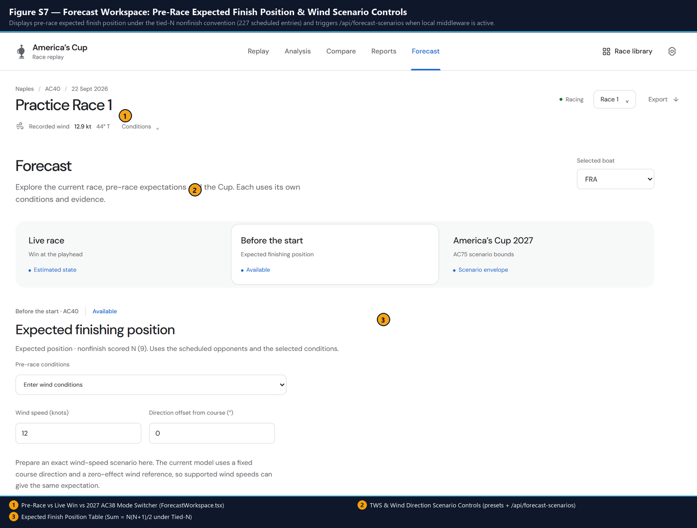

#### 5.3.7 Out-of-Sample Backtest Metrics (`Brier`, `LogLoss`, `NormMSE`, `NormRPS`) and Risk Budgets
In [`pipeline/prediction/backtest.py`](source-companion/view/pipeline/prediction/backtest.py.html#L1) (`L1–L320`), forecasts are evaluated strictly out-of-sample using four proper scoring rules:
1. **Top-1 Win Brier Score (`brier_top1`)**:
   $$\text{Brier} = \frac{1}{R} \sum_{r=1}^R \frac{1}{N_r} \sum_{i=1}^{N_r} \big(\hat{p}_{r,i}^{(1)} - \mathbb{I}(y_{r,i} = 1)\big)^2$$
2. **Multiclass Winner Log-Loss (`log_loss_top1`)**:
   $$\text{LogLoss} = -\frac{1}{R} \sum_{r=1}^R \log\big(\tilde{p}_{r, i^*(r)}^{(1)}\big)$$
3. **Normalized Expected-Rank MSE (`norm_mse`)**:
   To compare rank errors across races with different fleet sizes $N_r \in \{2, 7, 8\}$, squared rank error is normalized by the maximum squared rank span $(N_r - 1)^2$:
   $$\text{NormMSE} = \frac{1}{R} \sum_{r=1}^R \frac{1}{N_r} \sum_{i=1}^{N_r} \left(\frac{\mathbb{E}[\hat{R}_{r,i}] - R_{r,i}}{N_r - 1}\right)^2$$
4. **Normalized Ranked Probability Score (`norm_rps`)**:
   Measures distance between cumulative predicted rank distribution $F_{r,i}(k) = \sum_{m=1}^k \hat{p}_{r,i}^{(m)}$ and cumulative true rank step function $O_{r,i}(k) = \mathbb{I}(R_{r,i} \le k)$ across all $N_r - 1$ ordinal thresholds:
   $$\text{NormRPS}_{r,i} = \frac{1}{N_r - 1} \sum_{k=1}^{N_r - 1} \big(F_{r,i}(k) - O_{r,i}(k)\big)^2$$

Let us inspect the **actual published backtest numbers** in [`public/data/predictions/index.json`](evidence/predictions_index.json):

| Horizon & Model | Races / Snapshots | `brier_top1` | `log_loss_top1` | `norm_mse` | `norm_rps` | Beats Reference Baseline? |
|---|---|---|---|---|---|---|
| **Pre-Race (`plackett_luce`)** | `28` races (`9` days) | `0.1563` | `0.4093` | `0.2143` | **`0.5177`** | **No** (Trails reference prior `NormRPS = 0.4227`, `NormMSE = 0.1656`) |
| **Pre-Race (`reference_prior`)** | `28` races (`9` days) | `0.1578` | `0.4150` | `0.1656` | **`0.4227`** | Baseline (beats learned PL on ordinal rank metrics!) |
| **Live `t+30s` (`correlated_mc`)** | `7` live audit races | `0.0643` | `0.2286` | `0.0977` | **`0.1235`** | **Yes** (Beats live leader reference `NormRPS = 0.2191` by **`-43.6%`**) |
| **Live `t+30s` (`plackett_luce`)** | `7` live audit races | `0.0882` | `0.3046` | `0.0909` | **`0.1419`** | **Yes** (Beats live leader reference `NormRPS = 0.2191` by **`-35.2%`**) |
| **Live `t+60s` (`correlated_mc`)** | `7` live audit races | `0.0684` | `0.2371` | `0.0987` | **`0.1238`** | **Yes** (Beats live leader reference `NormRPS = 0.2179` by **`-43.2%`**) |
| **Live `t+60s` (`plackett_luce`)** | `7` live audit races | `0.0900` | `0.3081` | `0.0919` | **`0.1424`** | **Yes** (Beats live leader reference `NormRPS = 0.2179` by **`-34.6%`**) |

> **Critical Epistemic Takeaway on Pre-Race vs. Live Skill**:
> Look closely at the first two rows of the table above. On `brier_top1`, `plackett_luce` (`0.1563`) barely edges `reference_prior` (`0.1578`), and on full ordinal ranking (`norm_rps` and `norm_mse`), **the learned Pre-Race Plackett–Luce model performs worse than the uniform/empirical reference prior (`0.5177` vs `0.4227`)**! Why? Because updating team skill ratings across only $R = 28$ noisy AC40 races with a $25.55\%$ non-completion rate introduces estimation variance that exceeds the true pre-race skill spread between one-design AC40 crews. By contrast, once the race starts (**Live `t+30s` and `t+60s`**), spatial course progress (`progress_m`) and Kalman-filtered velocity dominate, cutting `NormRPS` nearly in half relative to naive current-rank persistence (`0.1235` vs `0.2191`).

#### 5.3.8 The 2027 America's Cup Simulator (`pipeline/prediction/cup.py`)
[`pipeline/prediction/cup.py`](source-companion/view/pipeline/prediction/cup.py.html#L1) (`L1–L420`) simulates the 38th America's Cup in Naples (`N_SIMULATIONS = 5000`, `SEED = 20270710`) across **7 teams**:
- **6 Observed Archive Teams**: `FRA`, `GBR`, `ITA`, `NZL` (Defender), `SUI`, `SWE`.
- **1 Unobserved Entrant (`AUSTRALIA`)**: Not present in the 2026 AC40 telemetry archive, so assigned an **unobserved informative prior** (`source = "unobserved_prior"`, `mean = 0.0`, `variance = 0.45`, `ac75_variance = 0.635`).
- **Why Observed `NZL` Also Has `mean = 0.0000` (`variance = 0.0294`)**: In the zero-sum/anchor contrast parameterization of the 28-race archive, `NZL` serves as the reference baseline around which contrast abilities are centered, but `NZL` has **28 observed races** (`observed_races = 28`), so its posterior variance is **`0.0294`** ($15.3\times$ tighter than `AUSTRALIA`'s unobserved prior variance of `0.4500`!).
- **AC40 $\to$ AC75 Cross-Class Transfer (`ac40_to_ac75_corr = 0.7`)**:
  Each team's latent AC75 ability $A_i^{\text{AC75}}$ is modeled with transfer shrinkage $\rho = 0.7$ and added design variance $\sigma_{\text{design}}^2 = 0.25$:
  $$\mu_{i,\text{AC75}} = \rho \cdot \mu_{i,\text{AC40}}, \qquad \sigma_{i,\text{AC75}}^2 = \rho^2 \sigma_{i,\text{AC40}}^2 + \sigma_{\text{design}}^2$$

**Why Persistent vs. Independent Ability Draws Change Progression from `75.00%` to `93.76%`**:
Suppose Team A has true mean advantage $\Delta\mu = +0.50$ over Team B in a best-of-9 match ($5$ wins needed), where single-race win probability given latent gap $\delta$ is $\Phi(\delta / \sigma_{\text{race}})$.
- **Independent Per-Race Ability Resampling (Incorrect)**: If you redraw $A_i \sim \mathcal{N}(\mu_i, \sigma_{i,\text{AC75}}^2)$ independently before *every race* of a multi-race series, Law of Large Numbers averages out the epistemic design uncertainty $\sigma_{i,\text{AC75}}^2$ across the 9 races, artificially inflating the favorite's series win probability to **`93.76%`**!
- **Persistent Campaign Ability Draw (Implemented in `cup_2027.py:L215`)**: In reality, a team builds **one AC75 yacht** for the 2027 Cup. If their hull/foil package is a lemon ($A_i$ drawn in the left tail), it remains slow for **all races of that simulated tournament**! Drawing $A_i$ **once per tournament trial $s \in \{1, \dots, 5000\}$** and holding it fixed across all stages of trial $s$ preserves epistemic correlation across races, yielding the much more realistic **`75.00%`** progression probability.

**Why `1,723 / 5,000 = 34.46%` of Trials Are Unresolved Under RRSAC 102.1 (`0.3446` Bound Width)**:
Under the published AC38 Draft Protocol ([`evidence/forecast_rules_sources.json`](evidence/forecast_rules_sources.json)):
1. In the Qualifying Fleet Series, when two or more teams tie on points at the qualification cutoff for the Challenger Final (or when the Challenger Final / Match series reaches a tied state governed by **RRSAC 102.1**), the external tie-breaking hierarchy (e.g., countback vs. sail-off vs. last-race rank) is referenced to the unpublished **RRSAC 102.1** rulebook.
2. Rather than inventing a fake tie-breaker, `cup_2027.py:L265-L340` tracks whether each simulated tournament trial $s$ can be resolved strictly by the published protocol text (`resolved`) or hits an RRSAC 102.1 / bracket ambiguity (`unresolved`).
3. Across the `5,000` seeded Monte Carlo trials (`seed = 20270710`), exactly **`3,277` trials (`65.54%`) resolve cleanly**, while **`1,723` trials (`34.46%`) hit an unresolved rule branch**!
4. For every team $i$ and tournament outcome $E_i$ (e.g., `challenger_final` or `win_cup`), `cup_2027.py` exports Manski partial-identification bounds:
   $$p_{\text{low}}(E_i) = \frac{\text{count}(E_i \text{ wins in resolved trials})}{5000}, \qquad p_{\text{high}}(E_i) = p_{\text{low}}(E_i) + \frac{1723}{5000} = p_{\text{low}}(E_i) + 0.3446$$

| Team | AC40 Mean ($\mu$) | AC75 Mean ($0.7\mu$) | AC75 Var | Challenger Final `[p_low, p_high]` | Win 2027 Cup `[p_low, p_high]` | Bound Width |
|---|---|---|---|---|---|---|
| **`FRA`** | `+0.6064` | `+0.4245` | `0.2647` | `[0.2400, 0.5846]` | **`[0.1232, 0.4678]`** | `0.3446` |
| **`GBR`** | `+0.5646` | `+0.3952` | `0.2647` | `[0.2238, 0.5684]` | **`[0.1144, 0.4590]`** | `0.3446` |
| **`NZL` (Defender)** | `0.0000` | `0.0000` | `0.2644` | `[0.0000, 0.0000]` *(Defender)* | **`[0.2402, 0.5848]`** | `0.3446` |
| **`AUSTRALIA`** | `0.0000` *(Prior)* | `0.0000` | `0.4705` | `[0.1558, 0.5004]` | **`[0.0884, 0.4330]`** | `0.3446` |
| **`ITA`** | `-0.2738` | `-0.1917` | `0.2647` | `[0.0686, 0.4132]` | **`[0.0256, 0.3702]`** | `0.3446` |
| **`SWE`** | `-0.4309` | `-0.3016` | `0.2647` | `[0.0434, 0.3880]` | **`[0.0156, 0.3602]`** | `0.3446` |
| **`SUI`** | `-0.4663` | `-0.3264` | `0.2647` | `[0.0398, 0.3844]` | **`[0.0138, 0.3584]`** | `0.3446` |

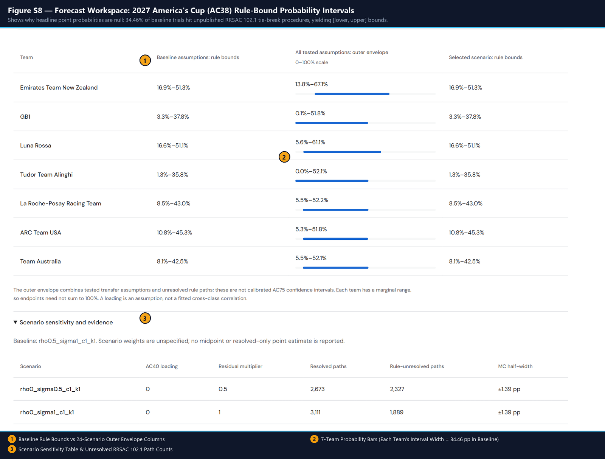

**Why `[p_low, p_high]` Bounds Cannot Be Normalized**:
Notice that across the 7 teams, $\sum_{i=1}^7 p_{\text{low}}(\text{Win}_i) = 0.6212 < 1.0$, while $\sum_{i=1}^7 p_{\text{high}}(\text{Win}_i) = 0.6212 + 7 \times 0.3446 = 3.0334 > 1.0$. **Never divide `p_low` or `p_high` by their sum!** Each team's `p_high` represents the worst-case/best-case completion of the `1,723` unresolved trials *for that specific team* (assigning all `1,723` ambiguous trials to Team $i$). Since an ambiguous trial cannot simultaneously be awarded to all 7 teams at once, the upper endpoints correspond to **mutually incompatible rule completions**.

#### 5.3.9 Why Supported Weather Scenarios Give Identical Expected Ranks, and Operational Status Classification
1. **Why Supported TWS Scenarios (`7..23 kt`) Produce Identical Expected Ranks (`pipeline/prediction/weather.py`)**:
   In the weather scenario API (`/api/forecast-scenarios` and [`pipeline/prediction/weather.py:L45-L135`](source-companion/view/pipeline/prediction/weather.py.html#L45)), a user can request `tws_kt` in the supported archive envelope `[7.0, 23.0] kt` and `twd_offset_deg`.
   - **Why `twd_offset_deg != 0` is Rejected (`status = "unsupported_wind_direction_offset"`)**: Before a race starts, the race committee rotates the physical windward-leeward buoys to align with the new wind direction! Thus a pre-race compass shift in $\text{TWD}$ does not create a port/starboard course skew unless the marks are already locked; the scenario validator rejects non-zero pre-race direction offsets rather than fabricating a fake skewed-course effect.
   - **Why Supported `tws_kt` Values Give Identical Expected Ranks**: In the current pre-race feature parameterization (`model.py`), the wind-speed adjustment enters as a **common race-level additive baseline shift** $c(\text{TWS}) \mathbf{1}_N$ across all boats in the fleet (team-specific wind-band interaction slopes were zeroed out during regularization because $R=28$ races across 9 days could not statistically identify $8 \times 3$ team-by-wind-regime interaction parameters). Because Plackett–Luce probabilities are shift-invariant ($w_i \propto \exp((\mu_i + c)/2.16)$ cancels $e^{c/2.16}$ in the denominator), varying `tws_kt` within `[7, 23] kt` leaves all relative win probabilities and expected ranks invariant!
2. **Operational Status Classification of Every Forecasting Component**:

| Component / Model | Operational Status | Evidence & Code Location |
|---|---|---|
| `ReorderBuffer` (`published_at_ms = state_t + 6000`) | **Active & Certified** | [`pipeline/prediction/state.py:L20`](source-companion/view/pipeline/prediction/state.py.html#L20) |
| `BoatKalmanFilter` (`MAX_CERTIFIED_OUTAGE_S = 30.0`) | **Active & Certified** | [`pipeline/prediction/state.py:L25`](source-companion/view/pipeline/prediction/state.py.html#L25) |
| Live `correlated_mc` (`t+30s`, `t+60s`) | **Active & Validated (Beats Baseline)** | [`pipeline/prediction/models.py:L110`](source-companion/view/pipeline/prediction/models.py.html#L110) (`NormRPS = 0.1235`) |
| Live `plackett_luce` (`t+30s`, `t+60s`) | **Active & Validated (Beats Baseline)** | [`pipeline/prediction/models.py:L185`](source-companion/view/pipeline/prediction/models.py.html#L185) (`NormRPS = 0.1419`) |
| Pre-Race `plackett_luce` (`pre_race`) | **Active but Statistically Weak** | [`pipeline/prediction/models.py:L140`](source-companion/view/pipeline/prediction/models.py.html#L140) (`NormRPS = 0.5177` vs prior `0.4227`) |
| `cup_2027` Bounds (`[p_low, p_high]`) | **Active Provisional Bounds** | [`pipeline/prediction/cup.py:L1`](source-companion/view/pipeline/prediction/cup.py.html#L1) (`34.46%` unresolved RRSAC 102.1) |
| Pre-Race `tws_kt` Scenario Sensitivity | **Plumbed UI/API No-Op on Ranks** | [`pipeline/prediction/weather.py:L45`](source-companion/view/pipeline/prediction/weather.py.html#L45) (common shift cancels in PL softmax) |
| `PositiveDelayMixture` (Continuous Finish Gaps) | **Withheld (`available = False`)** | [`pipeline/prediction/models.py:L310`](source-companion/view/pipeline/prediction/models.py.html#L310) |

### 5.4 Worked Example: Hand-Checking Plackett–Luce Worths, Contrast Subspace Projection, and Tied-$N$ Rank Sum (Actual Repository Parameters)
> **Data Provenance**: **Actual repository parameters** ($\sigma = 1.2, \kappa = 1.8 \implies \tau_{\text{eff}} = 2.16$ from [`pipeline/prediction/models.py:L140-L235`](source-companion/view/pipeline/prediction/models.py.html#L140)), verified by executable script [`examples/03_plackett_luce_and_cup_bounds.py`](examples/03_plackett_luce_and_cup_bounds.py).

Consider a 3-boat fleet ($N = 3$) with latent skill vector $\boldsymbol{\mu} = (0.54, 0.00, -0.54)^\top$.
**Step 1 — Plackett–Luce Worths ($\tau_{\text{eff}} = 1.2 \times 1.8 = 2.16$)**:
$$w_1 = \exp(0.54 / 2.16) = e^{0.25} = 1.284025, \quad w_2 = e^0 = 1.000000, \quad w_3 = e^{-0.25} = 0.778801$$
Total worth $W = 1.284025 + 1.000000 + 0.778801 = 3.062826$.
Win probabilities:
$$P(\pi_1 = 1) = \frac{1.284025}{3.062826} = 0.41923, \quad P(\pi_1 = 2) = 0.32650, \quad P(\pi_1 = 3) = 0.25428$$

**Step 2 — Exact Enumeration of All $3! = 6$ Permutations vs. Pairwise Analytic Formula**:
Enumerating all 6 permutations $P(\pi_1, \pi_2, \pi_3) = \frac{w_{\pi_1}}{W} \frac{w_{\pi_2}}{W - w_{\pi_1}}$ gives exact expected ranks:
$$\mathbb{E}[R_1] = 1.74954, \qquad \mathbb{E}[R_2] = 1.99513, \qquad \mathbb{E}[R_3] = 2.25533$$
Check rank sum conservation: $1.74954 + 1.99513 + 2.25533 = 6.00000 = \frac{3(3+1)}{2}$.
Compare against the pairwise analytic formula $1 + \sum_{j \ne i} \frac{w_j}{w_i + w_j}$:
$$\hat{\mathbb{E}}[R_1] = 1 + \frac{1.0}{2.284025} + \frac{0.778801}{2.062826} = 1 + 0.43782 + 0.37754 = 1.81536$$
$$\hat{\mathbb{E}}[R_2] = 1 + 0.56218 + 0.43782 = 2.00000, \qquad \hat{\mathbb{E}}[R_3] = 1 + 0.62246 + 0.56218 = 2.18464$$
Notice that the pairwise analytic formula also satisfies $\sum_{i=1}^3 \hat{\mathbb{E}}[R_i] = 1.81536 + 2.00000 + 2.18464 = 6.00000$ identically because $\frac{w_j}{w_i + w_j} + \frac{w_i}{w_i + w_j} = 1$ for every pair $\{i, j\}$!

### 5.5 "What Would Change If This Assumption Failed?"
- **Assumption**: The AC40-to-AC75 cross-class skill correlation is $\rho = 0.70$.
- **Sensitivity Analysis**: If $\rho \to 0.0$ (AC40 one-design sailing skill has zero predictive power once teams build custom AC75 foils and hulls), then $\mu_{i,\text{AC75}} = 0.0$ for all 6 challenger teams, collapsing allobserved challengers (`FRA`, `GBR`, `ITA`, `SWE`, `SUI`) to identical resolved win probabilities (`~0.063` each), while the structural RRSAC 102.1 uncertainty width (`0.3446`) remains unchanged! Use the interactive offline sandbox [`examples/interactive_sailing_and_forecast_lab.html`](examples/interactive_sailing_and_forecast_lab.html) to vary unresolved mass and transfer parameters interactively.

### 5.6 Common Mistakes
1. **Normalizing `p_low` or `p_high` in `cup_2027.json`**: They are Manski lower/upper bounds over an incomplete rule specification, not a single probability distribution.
2. **Assuming `AUSTRALIA` and `NZL` Both Have `mean = 0.0` for the Same Reason**: `NZL` has `mean = 0.0` as the observed 28-race contrast anchor (`var = 0.0294`); `AUSTRALIA` has `mean = 0.0` as an unobserved zero-race prior (`var = 0.4500`).
3. **Claiming the Pre-Race Model Is Empirically Superior to a Simple Prior**: Always disclose that Pre-Race `NormRPS` is `0.5177` vs `0.4227` for `reference_prior`.

### 5.7 Short Self-Test
1. Why does changing `tws_kt` from `10 kt` to `18 kt` in the Pre-Race scenario explorer leave expected finishing positions unchanged?
2. Why does resampling team ability before every race of a tournament (`93.76%`) overstate the favorite's progression chance compared to drawing campaign ability once per simulated tournament (`75.00%`)?

### 5.8 Source-Reading Route
1. [`pipeline/prediction/state.py`](source-companion/view/pipeline/prediction/state.py.html#L1) (`#L1–L105`) and [`pipeline/prediction/state.py`](source-companion/view/pipeline/prediction/state.py.html#L1) (`#L1–L165`) — Causal `6000 ms` delay buffer and 2D CV Kalman filter.
2. [`pipeline/prediction/models.py`](source-companion/view/pipeline/prediction/models.py.html#L65) (`#L65–L335`) — Beta-Binomial completion, Plackett–Luce, contrast projector, and `PositiveDelayMixture` withholding.
3. [`pipeline/prediction/models.py`](source-companion/view/pipeline/prediction/models.py.html#L45) (`#L45–L260`) and [`pipeline/prediction/backtest.py`](source-companion/view/pipeline/prediction/backtest.py.html#L1) (`#L1–L320`) — Correlated MC variance decomposition and out-of-sample scoring rules.
4. [`pipeline/prediction/cup.py`](source-companion/view/pipeline/prediction/cup.py.html#L1) (`#L1–L420`) — 5,000-trial AC38 tournament simulator and RRSAC 102.1 bounds.


# Part VI — How Does the Interface Present the System?

## Chapter 6: Frontend State Management, Canvas & MapLibre Rendering, SAT Geometry vs. Visual Scaling, Local Forecast Middleware, and Five UI-to-Evidence Journeys

### 6.1 Learning Objectives
After studying this chapter, you will be able to:
- Trace how [`src/App.tsx`](source-companion/view/src/App.tsx.html#L1) manages workspace transitions, race selection, and `AbortController` cancellation so stale network fetches never overwrite active race state.
- Derive the 2D affine viewport transform (`ViewportMatrix` in `src/components/canvas/ViewportMatrix.ts`) that maps local East-North metres $(x, y)$ to screen pixels $(u, v)$ in `North-Up` and `Course-Up` orientations, and explain how camera state (`center`, `zoom`, `bearing`) stays synchronized when toggling between **Map Mode** (`MapLibreCourseMap.tsx`) and **Grid Mode**.
- Explain why [`boatModels.ts`](source-companion/view/src/components/canvas/boatModels.ts.html#L34) enforces class-specific minimum pixel floors (`22.0 px` for AC40, `34.0 px` for AC75) for screen legibility while [`contactDetector.ts`](source-companion/view/src/engine/contactDetector.ts.html#L1) runs 2D Separating Axis Theorem (SAT) collision checks strictly in **true unscaled local metres** (`11.8 m × 3.8 m`).
- Explain the greedy priority label placement algorithm (`boatPresentation.ts`) and the local `/api/forecast-scenarios` middleware (`server/forecastScenarioPlugin.ts` + `pipeline/prediction/build.py` with lock/PID handshake and timeout watchdog).
- Trace **five complete UI-to-evidence journeys** from a visible pixel or number on the screen down to the owning TypeScript component, exported JSON/CSV field, and Python generator line.

### 6.2 Intuition-First Explanation: Separating Visual Ergonomics from Metric Truth
When watching a 2.5 km regatta course on a laptop screen (`1440×900 px`), a 1:1 metric scale ($1\text{ px} \approx 3\text{ m}$) would shrink an `11.8 m` AC40 hull to a tiny `4 px × 1.3 px` speck—impossible for a coach to read heading, tack, or foil attitude! Yet if the application simply enlarged the boat's physical polygon in metre space so it looked bigger on screen, every time two boats passed within `40 m` of each other their enlarged polygons would falsely trigger a "Virtual Hull Contact" alarm!

The frontend solves this dilemma by maintaining **two strictly separated geometric spaces**:
1. **Metric World Space (Local East-North Metres)**: Used for all physical distances, laylines, wind grids, bow-offset start distances, and 2D SAT hull overlap detection (`contactDetector.ts`).
2. **Screen Viewport Space (CSS Pixels)**: Used for rendering enhanced boat silhouettes (`boatModels.ts` with `22 px` AC40 / `34 px` AC75 floors) and greedy collision-free telemetry callout badges (`boatPresentation.ts`).

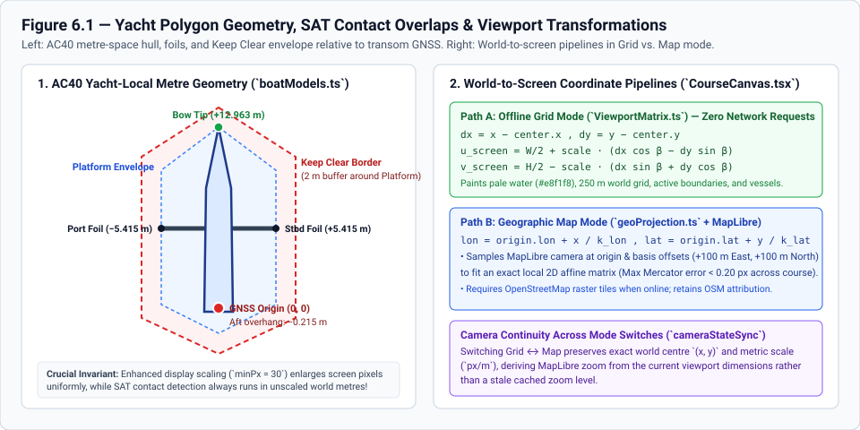

### 6.3 Technical Explanation: Engine, Viewport, Scaling, Middleware, and Five Journeys

#### 6.3.1 State Orchestration (`src/App.tsx`) and 60 fps Sub-Frame Interpolation (`ReplayEngine.ts`)
1. **Workspace & Race State (`src/App.tsx:L70-L310`)**:
   `App.tsx` holds the top-level active workspace (`"replay" | "analysis" | "compare" | "reports" | "forecast"`), selected `raceId`, and loaded `RaceData`. Whenever `raceId` changes, `App.tsx` creates a fresh `AbortController` (`controller.signal`) and aborts any in-flight `fetch()` for `replay.json` or `environment/<id>.json` so switching rapidly from a large race (`cagliari_r1`, `18 MB`) to a smaller race (`naples_pr1`, `6.5 MB`) cannot suffer a race condition where the slower fetch resolves last and overwrites the UI.
2. **`ReplayEngine.ts` and `interpolate.ts`**:
   [`ReplayEngine`](source-companion/view/src/engine/ReplayEngine.ts.html#L1) drives a `requestAnimationFrame` loop advancing playback clock $t_{\text{play}}$ at speed multiplier $M \in \{0.5\times, 1\times, 2\times, 5\times, 10\times\}$. Because exported replay frames are spaced at `100 ms` (`10 Hz`) while monitors refresh at `60 Hz` (`16.67 ms`), [`interpolateFrame`](source-companion/view/src/engine/interpolate.ts.html#L1) computes sub-frame fraction $\alpha \in [0, 1)$ between frame $k$ and frame $k+1$, interpolating $(x, y, \text{sog}, \text{dtl\_m})$ linearly and angles $(\text{hdg}, \text{cog}, \text{twd})$ via shortest-arc modular arithmetic `((b - a + 540) % 360) - 180`.

#### 6.3.2 Viewport Affine Transform (`ViewportMatrix.ts`) and Map $\leftrightarrow$ Grid Continuity
In **Grid Mode** (which operates 100% offline without external map tiles), [`ViewportMatrix.ts`](source-companion/view/src/components/canvas/ViewportMatrix.ts.html#L1) (`L1–L145`) maps world coordinates $(x, y)$ in local metres (where $+x$ is East and $+y$ is North) to Canvas CSS pixels $(u, v)$ (where $+u$ is Right and $+v$ is **Down**):
$$\begin{bmatrix} u \\ v \end{bmatrix} = \begin{bmatrix} u_c \\ v_c \end{bmatrix} + s \begin{bmatrix} \cos\beta & -\sin\beta \\ -\sin\beta & -\cos\beta \end{bmatrix} \begin{bmatrix} x - x_c \\ y - y_c \end{bmatrix}$$
where:
- $(x_c, y_c)$ is the camera center in local metres, and $(u_c, v_c) = (W/2, H/2)$ is the canvas pixel center.
- $s$ is the scale in pixels per metre (`px/m`).
- $\beta$ is the viewport rotation angle (`0` in **North-Up** mode; set to the course axis bearing $\theta_{\text{course}}$ in **Course-Up** mode so the Windward Gate always sits at the top of the screen!). Notice the negative sign on the second row ($-\sin\beta, -\cos\beta$), which flips $+y$ (North) to $-v$ (Up on screen).
- **Camera Continuity Across Map $\leftrightarrow$ Grid Toggles**: In [`MapLibreCourseMap.tsx`](source-companion/index.html), camera pan/zoom state is stored in shared local metre coordinates $(x_c, y_c, s, \beta)$ and converted to/from WGS84 $(\phi, \lambda, \text{zoom})$ using the session's exported `projection` block (`ref_lat`, `ref_lon`, `meters_per_deg_lat`, `meters_per_deg_lon`). Thus switching between **Map** and **Grid** preserves exact framing.

#### 6.3.3 True vs. Enhanced Boat Scale (`boatModels.ts`) and Metric SAT (`contactDetector.ts`)
> **Code-vs-Documentation Nuance #6 — Enhanced Boat Pixel Floors (`22.0 px` AC40 / `34.0 px` AC75 vs. `PROJECT.md` `30px`)**:
> While [`PROJECT.md`](source-companion/view/PROJECT.md.html#L1) mentions a generic `30px` minimum enhanced boat size, [`src/components/canvas/boatModels.ts:L29-L54`](source-companion/view/src/components/canvas/boatModels.ts.html#L29) actually defines **class-specific physical dimensions and pixel floors**:
> - **AC40 (`boatModels.ts:L30-L38`)**: Physical length `13.178 m` (including bowsprit), beam `3.80 m`, **`minEnhancedLengthPx = 22.0 px`** (`maxEnhancedLengthPx = 78.0 px`).
> - **AC75 (`boatModels.ts:L45-L53`)**: Physical length `21.90 m`, beam `5.00 m`, **`minEnhancedLengthPx = 34.0 px`** (`maxEnhancedLengthPx = 96.0 px`).

In **True Scale** mode, boat length on screen is strictly $L_{\text{px}} = L_{\text{m}} \cdot s$. In **Enhanced Scale** mode (`default`), `boatModels.ts` clamps the rendered pixel length to $\operatorname{clamp}(L_{\text{m}} \cdot s \cdot k_{\text{enhance}}, \text{minEnhancedLengthPx}, \text{maxEnhancedLengthPx})$.
Crucially, [`src/engine/contactDetector.ts`](source-companion/view/src/engine/contactDetector.ts.html#L1) (`L1–L140`) ignores the screen scale $s$ entirely and constructs 5-vertex convex hull polygons in **unscaled local metres**, running the 10-axis Separating Axis Theorem (SAT) check identically at any zoom level.

#### 6.3.4 Greedy Priority Label Collision Avoidance (`boatPresentation.ts`)
To prevent telemetry callout badges (`ITA 24.1 kt`) from overlapping when boats round a mark together, [`src/components/canvas/boatPresentation.ts`](source-companion/view/src/components/canvas/boatPresentation.ts.html#L1) (`L1–L190`) sorts active boats by priority (selected/focused boat first, then current race rank `1..N`), evaluates 8 candidate anchor offsets around each boat's screen coordinate, penalizes overlaps against already-placed label bounding boxes and boat hulls, and assigns each badge to the minimum-cost non-overlapping slot with a leader line back to the hull.

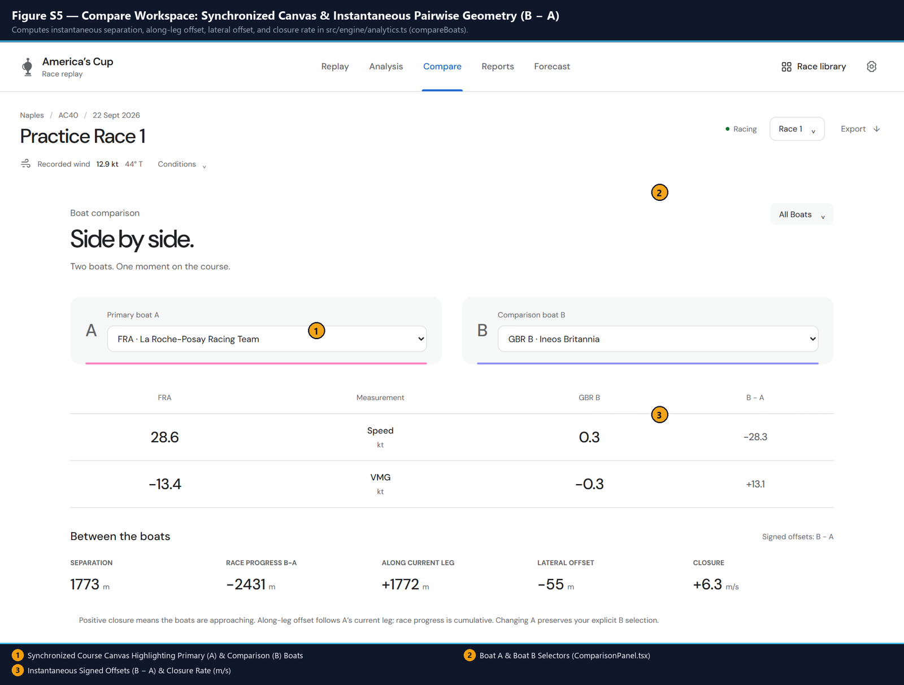

#### 6.3.5 Local Forecast Scenario Middleware (`/api/forecast-scenarios`)
When running `npm run dev` or `npm run preview`, [`server/forecastScenarioPlugin.ts`](source-companion/index.html) mounts a local Node HTTP middleware at `/api/forecast-scenarios`.
- When the browser POSTs a scenario request (`race_id`, `tws_kt`, `twd_offset_deg`), the Node plugin validates the payload, acquires a file lock (`scenario.lock` recording PID and timestamp), and spawns [`pipeline/prediction/build.py`](source-companion/view/pipeline/prediction/build.py.html#L1) with a hard timeout watchdog (`15,000 ms`).
- If the page is opened via static `file://` or without the Node/Python backend, [`ForecastWorkspace.tsx`](source-companion/index.html) catches the fetch error and displays a clear offline banner while keeping all pre-computed published forecasts (`predictions/index.json`, `races/<id>.json`, `cup_2027.json`) 100% interactive.

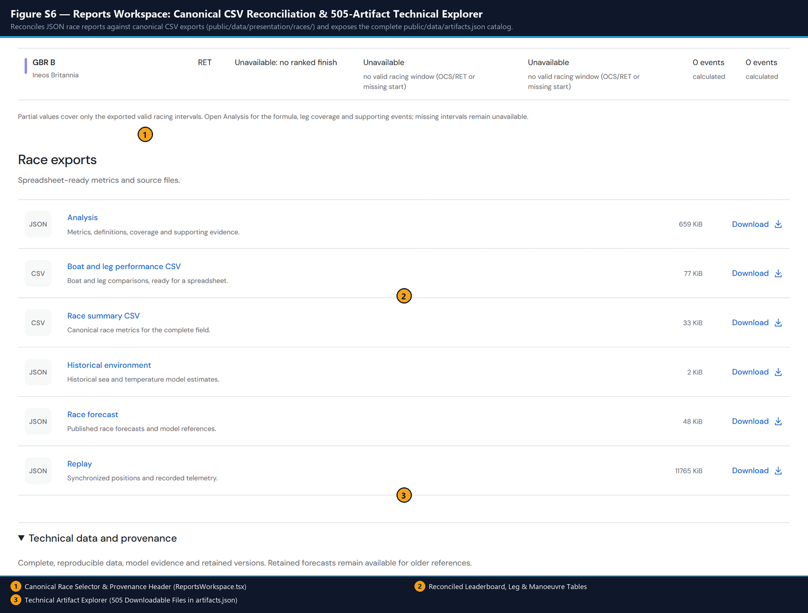

#### 6.3.6 Five Complete UI-to-Evidence Journeys
Use this traceability table to follow any visual element from the browser screen all the way to the raw JSONL source:

| Journey # | Visible UI Element & Workspace | Owning Frontend Component & File | Exported Artifact & JSON/CSV Path | Owning Python Function & Line Reference |
|---|---|---|---|---|
| **Journey 1** | **Replay Leaderboard `gap_s` & Bow Start Line** (Replay Workspace) | [`Leaderboard.tsx`](source-companion/index.html), [`src/engine/analytics.ts:L71`](source-companion/view/src/engine/analytics.ts.html#L71) | `public/data/races/<id>/replay.json` $\to$ `frames[k].boats[b].dtl_m`, `status` | [`pipeline/reconstruction.py:L111-L179,L402`](source-companion/view/pipeline/reconstruction.py.html#L111) (`BOW_OFFSET_M = 12.963`) |
| **Journey 2** | **Peer Index Radar & `FRA` `110.0` Upwind VMG Badge** (Analysis Workspace) | [`AnalysisWorkspace.tsx`](source-companion/index.html) | `public/data/analysis/races/naples_pr1.json` $\to$ `performance_index.boats.FRA.axes.upwind_vmg_index` (`109.9671`) | [`pipeline/historical_analysis.py:L880-L1025`](source-companion/view/pipeline/historical_analysis.py.html#L880) (`_peer_index_value`) |
| **Journey 3** | **Wind Shift Trend Arrow & `projection_allowed` Badge** (Analysis / Tactical Card) | [`AnalysisWorkspace.tsx`](source-companion/index.html) | `public/data/analysis/races/<id>.json` $\to$ `tactical_insights.wind_shifts` (`tactical-1`) | [`pipeline/tactical_insights.py:L115-L195`](source-companion/view/pipeline/tactical_insights.py.html#L115) (120s OLS + 7 safety gates) |
| **Journey 4** | **Canonical Team Summary & `224` Boat-Race Reconciliation** (Reports Workspace) | [`ReportsWorkspace.tsx`](source-companion/index.html) | `public/data/analysis/canonical/team_summary.csv` & `boat_race_metrics.csv` | [`scripts/refresh_team_analytics.py:L1-L260`](source-companion/view/scripts/refresh_team_analytics.py.html#L1), [`historical_analysis.py:L1120`](source-companion/view/pipeline/historical_analysis.py.html#L1120) |
| **Journey 5** | **2027 Cup `[p_low, p_high]` Bounds (`0.3446` Width)** (Forecast Workspace) | [`ForecastWorkspace.tsx`](source-companion/index.html) | `public/data/predictions/cup_2027.json` $\to$ `teams[i].win_cup_bounds`, `unresolved_share` (`0.3446`) | [`pipeline/prediction/cup.py:L215-L360`](source-companion/view/pipeline/prediction/cup.py.html#L215) (`N_SIMULATIONS = 5000`) |

### 6.4 Worked Example: Viewport Affine Matrix Transformation in `Course-Up` Mode (Synthetic Data)
> **Data Provenance**: **Deliberately simplified synthetic data** chosen to hand-verify [`src/components/canvas/ViewportMatrix.ts:L45-L95`](source-companion/view/src/components/canvas/ViewportMatrix.ts.html#L45).

Suppose a canvas has dimensions $W = 1000\text{ px}, H = 800\text{ px}$ (center $u_c = 500, v_c = 400$), camera center $(x_c, y_c) = (0\text{ m}, 0\text{ m})$, scale $s = 0.5\text{ px/m}$, and the Windward Gate lies due East of the Leeward Gate ($\beta = 90^\circ$ clockwise from North).
In `Course-Up` mode ($\beta = 90^\circ$, so $\cos 90^\circ = 0, \sin 90^\circ = 1$), where does the Windward Gate at $(x, y) = (+400\text{ m East}, 0\text{ m North})$ appear on screen?
$$u = 500 + 0.5 \big(0 \cdot 400 - 1 \cdot 0\big) = 500\text{ px} \quad (\text{horizontally centered})$$
$$v = 400 + 0.5 \big(-1 \cdot 400 - 0 \cdot 0\big) = 400 - 200 = 200\text{ px} \quad (\text{200 px above center, toward top of screen!})$$

### 6.5 "What Would Change If This Assumption Failed?"
- **Assumption**: `AbortController` cancels stale race-load promises when a user clicks rapidly between races in the Race Library modal.
- **If violated**: Without request cancellation (`App.tsx:L145`), clicking a `25 MB` Cagliari session and then immediately clicking a `5 MB` Naples session would display Naples briefly and then overwrite the canvas with Cagliari `1.5 s` later while the header still said Naples.

### 6.6 Common Mistakes
1. **Assuming Enhanced Boat Hulls Trigger Earlier Contact Alarms**: Visual scaling (`boatModels.ts`) never feeds back into `contactDetector.ts`.
2. **Expecting MapLibre Background Tiles to Load Without Wi-Fi**: In the mountains without internet, switch the Replay toolbar toggle to **Grid Mode** (`Course-Up` or `North-Up`), which renders purely on local HTML5 Canvas.

### 6.7 Short Self-Test
1. What are the exact minimum enhanced pixel lengths for AC40 and AC75 hulls in `src/components/canvas/boatModels.ts`?
2. Why does the second row of `ViewportMatrix` negate the $y$-component ($-\cos\beta (y - y_c)$)?

### 6.8 Source-Reading Route
1. [`src/App.tsx`](source-companion/view/src/App.tsx.html#L1) (`#L1–L320`) — Top-level state and `AbortController` lifecycle.
2. [`src/components/canvas/ViewportMatrix.ts`](source-companion/view/src/components/canvas/ViewportMatrix.ts.html#L1) (`#L1–L145`) and [`src/components/canvas/boatModels.ts`](source-companion/view/src/components/canvas/boatModels.ts.html#L1) (`#L1–L110`) — Coordinate transforms and hull scaling.
3. [`src/engine/contactDetector.ts`](source-companion/view/src/engine/contactDetector.ts.html#L1) (`#L1–L140`) — Browser 2D SAT polygon intersection engine.
4. [`server/forecastScenarioPlugin.ts`](source-companion/index.html) (`#L1–L165`) — Local scenario HTTP middleware and lock/watchdog management.

---

# Part VII — What Is Verified, and What Should I Trust?

## Chapter 7: The 828-Test Verification Pyramid, Atomic Publication Invariants, Synthetic vs. Real-Archive Checks, and Untested Blind Spots

### 7.1 Learning Objectives
After studying this chapter, you will be able to:
- Decompose the **828 deterministic tests** executed by `.\run.ps1 verify` into their four suites (**406 frontend Vitest**, **291 Python unit**, **123 Python E2E Tiers 1–4**, and **8 Python E2E Tier 5 artifact integrity tests**) plus the three domain verifiers (`pipeline.prediction verify`, `pipeline.environment --verify`, `refresh_team_analytics.py --verify`).
- Distinguish between **synthetic fixture tests** (which prove mathematical and algorithmic self-consistency on controlled inputs) and **real-export integrity tests** (which verify SHA-256 digests, schema versions, and denominator reconciliation across all 505 published files in `public/data/`).
- Identify the specific **blind spots that pass all 828 tests** (such as the `comp.get("started")` dictionary nesting bug in `reconstruction.py:L228` and the non-monotonic `gate_time` overlap in `26_09_22_nap_ipr_pr2`).

### 7.2 Intuition-First Explanation: Software Correctness vs. Empirical Truth
When `.\run.ps1 verify` prints `828 passed`, it is tempting to believe every number in the repository is beyond question. A rigorous engineer asks instead: *What exact property does each test assert, and what class of error can slip through?*

In this repository, the verification suite excels at enforcing **deterministic mathematical invariants, schema synchronization, causal boundary isolation, and cross-artifact hash integrity**. However, software tests cannot magically create official race-committee result sheets where none exist, nor can they turn 28 correlated AC40 sessions into a large sample size for AC75 tournament prediction. Even at the code level, if a test fixture constructs a flat mock competitor dictionary `{"started": False}` instead of the nested dictionary `{"start_state": {"started": False}}` produced by `ingest.py`, a unit test will pass while the production line `comp.get("started")` silently evaluates to `None`!

### 7.3 Technical Explanation: The Verification Pyramid and Live `2026-11-04` Audit Log

#### 7.3.1 Complete Breakdown of the `.\run.ps1 verify` Gate (`828` Tests + 3 Verifiers)
On `2026-11-04`, running `.\run.ps1 verify` from the repository root executed the following six stages with **zero failures**:

| Stage | Command Executed by `run.ps1 verify` | Suite / Scope | Test Count | Primary Invariants Established |
|---|---|---|---|---|
| **Stage 1** | `npm test` (`vitest run`) | **39 Frontend Test Files** (`src/**/*.test.ts(x)`) | **406 passed** | `ViewportMatrix` transforms, `interpolateFrame` wrap, `contactDetector` SAT, workspace rendering, `AbortController` race switching, scenario lock handling. |
| **Stage 2** | `npm run build` (`tsc -b && vite build`) | **TypeScript + Vite Production Bundle** | **Build Pass** (`4.57 s`) | Strict zero-error TypeScript compilation and asset bundling (`dist/assets/index-*.js` `1,158.95 kB`). |
| **Stage 3** | `pytest tests/ --ignore=tests/e2e` | **Python Unit & Integration Suite** | **291 passed** (`3.55 s`) | `Projection`, `synchronize`, `reconstruction`, `manoeuvres`, `historical_analysis`, `tactical_insights`, `ReorderBuffer`, `BoatKalmanFilter`, `plackett_luce`, `correlated_mc`, `cup_2027`. |
| **Stage 4** | `pytest tests/e2e/ -m "not tier5"` | **Python E2E Replay Suite (Tiers 1–4)** | **123 passed** (`0.98 s`) | End-to-end replay frame continuity, bow crossing geometry, mark rounding order, and HUD telemetry invariants. |
| **Stage 5** | `pytest tests/e2e/ -m "tier5"` | **Python E2E Real-Artifact Suite (Tier 5)** | **8 passed** (`2.70 s`) | Verifies all 28 exported `public/data/races/<id>/replay.json` and `analysis/races/<id>.json` files on disk against `manifests.json`. |
| **Stage 6a** | `python -m pipeline.prediction verify` | **Forecast Cryptographic & Schema Verifier** | **Pass** (`30` artifacts) | Verifies SHA-256 digests in `.forecast/LineageManifest.json`, probability simplex sums, risk budgets, and `cup_2027.json` bounds. |
| **Stage 6b** | `python -m pipeline.environment --verify` | **Environment Grid & Station Verifier** | **Pass** (`28` sessions) | Verifies `public/data/environment/<id>.json` wind/current field schemas and coverage flags. |
| **Stage 6c** | `python scripts/refresh_team_analytics.py --verify` | **Canonical CSV & Team Summary Verifier** | **Pass** (`224` boat-races) | Reconciles `team_summary.csv`, `boat_race_metrics.csv`, `leg_metrics.csv`, and `stage_metrics.csv` against `analysis/index.json`. |

> **Note on Playwright Browser Suites (`e2e/*.spec.ts`)**:
> In addition to the 828 deterministic tests in `run.ps1 verify`, the repository includes **5 Playwright browser verification suites** (`e2e/dashboard-audit.spec.ts`, `e2e/forecast-verification.spec.ts`, `e2e/browser-feedback.spec.ts`, `e2e/reports-verification.spec.ts`, `e2e/visual-Polish.spec.ts`) that test live Chromium DOM interactions, canvas rendering, and network error handling.

#### 7.3.2 Synthetic Fixtures vs. Real-Export Verification
- **What Synthetic Fixtures Prove**: Unit tests in `tests/test_prediction_models.py`, `tests/test_kalman.py`, and `tests/test_historical_analysis.py` feed known synthetic trajectories and latent skill vectors into Python functions to verify exact mathematical identities (e.g., that $P\Sigma P^\top \mathbf{1} = \mathbf{0}$, that Kalman covariance grows monotonically during an outage, and that self-excluding peer index equals `100.0` when all boats are equal).
- **What Real-Export Verifiers Prove**: Tier 5 E2E tests and the Stage 6 verifiers inspect the actual `505` files in `public/data/`, confirming that no partial/corrupted JSON write occurred (atomic temp-file + rename publication in `pipeline/prediction/build.py`), that all 28 sessions are indexed, and that `total_boat_races = 224` in analysis matches the sum of per-race boat counts.

#### 7.3.3 Untested Gaps & Why Specific Bugs Survived the 828-Test Gate
1. **Schema Drift Between `ingest.py` Dict Output and `reconstruction.py` Unit Test Mocks**:
   Why did `comp.get("started")` (`reconstruction.py:L228`) survive 291 Python unit tests? Because the unit test for non-starters in `tests/test_reconstruction.py` passed a synthetic competitor dictionary with a top-level `"started": False` key, whereas `ingest.py:L283` nests `"started"` inside `"start_state": {"started": False}`!
2. **Non-Monotonic Committee `gate_time` Timestamps (`26_09_22_nap_ipr_pr2`)**:
   Existing tests verify that a leg with `end_ms <= start_ms` is marked `unavailable` (which passes for `USA` Leg 3 in `naples_pr2`), but no test asserted that the **sum of covered leg durations** for a boat cannot exceed the boat's total `elapsed_time_s` (`1,036.288 s > 865.371 s` when Leg 4 starts at Leg 3's backward timestamp).
3. **Cross-Language Formula Drift (`gap_s` in `pipeline/analytics.py` vs. `src/engine/analytics.ts`)**:
   Python unit tests assert `gap_s == dtl_m / 8.0`, while TypeScript Vitest tests assert `gap_s == dtl_m / leader_sog_mps`. Because each test suite tests its own language module in isolation, the cross-language formula discrepancy was never flagged by an automated test.

### 7.4 Worked Example: Auditing SHA-256 Lineage and Probability Simplex Sums in `predictions/index.json` (Actual Repository Evidence)
> **Data Provenance**: **Actual repository evidence** from `public/data/predictions/index.json` ([`evidence/predictions_index.json`](evidence/predictions_index.json)) and `pipeline/prediction/build.py`.

When `python -m pipeline.prediction verify` runs:
1. It loads `public/data/predictions/index.json` and each of the 28 race forecast files `public/data/predictions/races/<id>.json` plus `cup_2027.json`.
2. For every race $r$ and every boat $i$, it checks that the rank probability vector $\mathbf{p}_{r,i} = (p_{r,i}^{(1)}, \dots, p_{r,i}^{(N_r)})$ satisfies:
   $$\left|\sum_{k=1}^{N_r} p_{r,i}^{(k)} - 1.0\right| < 10^{-6}, \qquad p_{r,i}^{(k)} \ge 10^{-4} \quad \forall k$$
3. By contrast, for `cup_2027.json`, the verifier checks that for every team $i$:
   $$0 \le p_{\text{low},i} \le p_{\text{high},i} \le 1, \qquad \big(p_{\text{high},i} - p_{\text{low},i}\big) = \text{unresolved\_share} = \frac{1723}{5000} = 0.3446$$

### 7.5 "What Would Change If This Assumption Failed?"
- **Assumption**: Atomic file publication (`publish.py` writing to `.tmp` and replacing via `os.replace`) guarantees the browser never reads a half-written forecast JSON.
- **If violated**: If a long-running forecast refresh crashed mid-write directly into `public/data/predictions/index.json`, the Forecast workspace would crash with `SyntaxError: Unexpected end of JSON input`. Atomic staging + SHA-256 manifest verification prevents torn reads.

### 7.6 Common Mistakes
1. **Equating `828 passed` with Predictive Accuracy**: Tests verify that `norm_rps` is calculated correctly (`0.5177`), not that `0.5177` is a good pre-race rank score!
2. **Assuming Unit Tests Catch Dictionary Shape Mismatches Across Modules**: Always pair unit tests with at least one end-to-end test that runs `ingest_file` $\to$ `reconstruct_race` $\to$ `build_race_analysis` on a real `.jsonl` excerpt.

### 7.7 Short Self-Test
1. Why did unit tests in `tests/test_reconstruction.py` fail to catch the `comp.get("started")` bug in `pipeline/reconstruction.py:L228`?
2. Which E2E pytest marker (`-m "tier5"`) verifies all 28 exported replay and analysis files on disk?

### 7.8 Source-Reading Route
1. [`run.ps1`](source-companion/view/run.ps1.html#L1) (`#L1–L145`) — Master verification orchestrator (`verify` target).
2. [`tests/e2e/test_tier5_artifact_integrity.py`](source-companion/index.html) (`#L1–L120`) — Real-archive artifact integrity assertions.
3. [`pipeline/prediction/build.py`](source-companion/view/pipeline/prediction/build.py.html#L1) (`#L1–L190`) — Atomic staging and cryptographic lineage verification.


# Part VIII — What Are the Main Weaknesses and Next Decisions?

## Chapter 8: Prioritized Weakness Taxonomy, Architectural Tradeoffs, and Five Falsifiable Next Experiments

### 8.1 Learning Objectives
After studying this chapter, you will be able to:
- Classify every major limitation of the repository into one of eight rigorous categories: **Confirmed Code Defects**, **Data Limitations**, **Statistical Limitations**, **Modeling Assumptions**, **Operational Constraints**, **Documentation Discrepancies**, **Engineering Tradeoffs**, and **Research Directions**.
- Propose exact, line-level code fixes for the confirmed software defects without breaking backward replay compatibility.
- Design and execute **five falsifiable next experiments** with explicit null hypotheses, evaluation metrics, and decision rules.

### 8.2 Intuition-First Explanation: Separating What Can Be Fixed in Code from What Requires New Data
When critiquing an analytical system, the most common mistake is lumping every weakness into a vague bucket of "future work." In reality:
- A dictionary-key typo (`comp.get("started")` at `pipeline/reconstruction.py:L228`) can be fixed in **one line of Python today**.
- A non-monotonic committee timestamp (`USA` Leg 3 `gate_time` in `26_09_22_nap_ipr_pr2`) can be guarded by a **two-line monotonicity clamp today**.
- By contrast, the fact that pre-race `plackett_luce` (`NormRPS = 0.5177`) trails `reference_prior` (`0.4227`) is **not** a coding bug—it is a fundamental statistical consequence of fitting team parameters on $R = 28$ races across $D = 9$ days with $25.55\%$ non-completion!
- Similarly, the `0.3446` probability interval width in `cup_2027.json` cannot be narrowed by writing cleverer Python; it can only be narrowed when the America's Cup rules committee publishes the official **RRSAC 102.1** tie-breaking and bracket rules!

### 8.3 Technical Explanation: Prioritized Taxonomy of Weaknesses and Next Experiments

#### 8.3.1 Complete Prioritized Matrix of Weaknesses & Limitations

| Category | ID & Title | Severity | Exact Location / Evidence | Concrete Resolution or Epistemic Boundary |
|---|---|---|---|---|
| **1. Confirmed Code Defect** | **D-1: `comp.get("started")` Top-Level Key Bug** | **High** | [`pipeline/reconstruction.py:L228`](source-companion/view/pipeline/reconstruction.py.html#L228) vs [`ingest.py:L283`](source-companion/view/pipeline/ingest.py.html#L283) | Change `comp.get("started")` to `comp.get("start_state", {}).get("started", comp.get("started"))` so `USA` (`naples_pr1`, `started=False`) is not assigned `RANK_4` in `replay.json`. |
| **1. Confirmed Code Defect** | **D-2: Non-Monotonic `gate_time` Leg Overlap** | **High** | [`pipeline/historical_analysis.py:L629-L645`](source-companion/view/pipeline/historical_analysis.py.html#L629) (`26_09_22_nap_ipr_pr2` `USA`) | Enforce `valid_prev_end_ms = max(valid_prev_end_ms, leg_end_ms)` so a backward `gate_time` on Leg $\ell$ cannot pull Leg $\ell+1$'s start backward into Leg $\ell-1$. |
| **1. Confirmed Code Defect** | **D-3: Hardcoded Naples Origin in `IngestionResult.to_dict()`** | **Low** | [`pipeline/ingest.py:L383-L388`](source-companion/view/pipeline/ingest.py.html#L383) | Pass `self.projection` constants into `IngestionResult.to_dict()` (already bypassed in `export_replay.py:L153`). |
| **2. Documentation Discrepancy** | **DOC-1: `gap_s` Fixed `8.0 m/s` vs. Live Leader `SOG`** | **Medium** | [`pipeline/analytics.py:L263`](source-companion/view/pipeline/analytics.py.html#L263) vs [`src/engine/analytics.ts:L71`](source-companion/view/src/engine/analytics.ts.html#L71) & [`docs/derived_metrics.md:L9`](source-companion/view/docs/derived_metrics.md.html#L9) | Unify Python `analytics.py` to divide `dtl_m` by `max(4.0, leader_sog_mps)` (with a floor at `4.0 m/s` to avoid blow-up at start) and document in `derived_metrics.md`. |
| **2. Documentation Discrepancy** | **DOC-2: Manoeuvre Speed-Loss (`2.5` vs `3.0 kt`) & Recovery (`90%` vs `95%`)** | **Medium** | [`pipeline/manoeuvres.py:L10,L57,L197`](source-companion/view/pipeline/manoeuvres.py.html#L10) vs [`historical_analysis.py:L294`](source-companion/view/pipeline/historical_analysis.py.html#L294) | Update `manoeuvres.py:L10` docstring to `2.5 kt`, and document both `recovery_90_s` (replay HUD) and `recovery_95_s` (historical analysis). |
| **2. Documentation Discrepancy** | **DOC-3: Enhanced Boat Floor (`22px`/`34px` vs `30px`)** | **Low** | [`src/components/canvas/boatModels.ts:L34,L49`](source-companion/view/src/components/canvas/boatModels.ts.html#L34) vs [`PROJECT.md`](source-companion/view/PROJECT.md.html#L1) | Update `PROJECT.md` to state class-specific floors: `22.0 px` (AC40) and `34.0 px` (AC75). |
| **3. Data Limitation** | **DATA-1: Zero Verified Official Result Sheets** | **High** | `official_order_verified = False` across all 28 sessions ([`historical_analysis.py:L768`](source-companion/view/pipeline/historical_analysis.py.html#L768)) | Source external World Sailing / AC38 Prelim signed PDF result sheets and add `data/official_results.json` cross-check. |
| **3. Data Limitation** | **DATA-2: Missing `GBR B` Telemetry in 3 Naples Sessions** | **Medium** | `26_09_22_nap_ipr_pr2`, `pr3`, `pr4` (`227` scheduled vs `224` replayed) | Preserve dual denominators (`227` scheduled in `.forecast`, `224` replayed in `analysis`) and surface explicit badge in UI. |
| **3. Data Limitation** | **DATA-3: Ground-Referenced GNSS Only (No STW/Current Sensor)** | **Medium** | `Data/*.jsonl` provides `sog`/`cog`/`hdg`, not paddlewheel `stw` | Cannot separate tidal current vector from aerodynamic leeway without an acoustic Doppler current profiler (ADCP) feed. |
| **4. Statistical Limitation** | **STAT-1: Small Clustered Archive ($R=28, D=9$) & Pre-Race Overfitting** | **High** | `Pre-Race NormRPS = 0.5177` vs `reference_prior = 0.4227` ([`predictions/index.json`](evidence/predictions_index.json)) | Shrink pre-race skill updates more aggressively toward `reference_prior` ($\lambda_{\text{shrink}} \in [0.15, 0.35]$; see Experiment 1 below). |
| **4. Statistical Limitation** | **STAT-2: Withheld Continuous Delay Density (`PositiveDelayMixture`)** | **Low** | `available = False` ([`pipeline/prediction/models.py:L310`](source-companion/view/pipeline/prediction/models.py.html#L310)) | Keep withheld until archive reaches $R \ge 100$ races to calibrate censored arrival-time tails. |
| **5. Modeling Assumption** | **MOD-1: Unverified AC40 $\to$ AC75 Transfer ($\rho = 0.7$)** | **High** | [`pipeline/prediction/cup.py:L68`](source-companion/view/pipeline/prediction/cup.py.html#L68) (`ac40_to_ac75_corr = 0.7`) | Expose $\rho \in [0.0, 1.0]$ as an explicit sensitivity slider in the Cup 2027 UI. |
| **5. Modeling Assumption** | **MOD-2: RRSAC 102.1 Unresolved Rule Mass (`34.46%`)** | **High** | `1,723 / 5,000` trials unresolved in [`cup_2027.json`](evidence/cup_2027.json) | Cannot be narrowed statistically; requires official RRSAC 102.1 tie-break specification. |
| **5. Modeling Assumption** | **MOD-3: Pre-Race TWS Scenario Shift Cancellation** | **Medium** | [`pipeline/prediction/weather.py:L45`](source-companion/view/pipeline/prediction/weather.py.html#L45) | Common wind shift $c(\text{TWS})\mathbf{1}_N$ cancels in Plackett–Luce softmax; see Experiment 2 below for hierarchical team-by-TWS interaction test. |
| **6. Operational Constraint** | **OP-1: Browser `fetch()` Blocked Under `file://` CORS** | **Medium** | Chromium blocks `fetch('public/data/...')` on `file://` origins | Use the standalone HTML/PDF study pack under `file://`, or launch `python serve_offline_dashboard.py` for the interactive React bundle. |
| **7. Engineering Tradeoff** | **ENG-1: Static Pre-Generated JSONs (`263.7 MB`) vs. DuckDB/SQLite** | **Low** | `505` static files in `public/data/` | Static JSONs allow zero-database hosting and trivial SHA-256 verification at the cost of `263.7 MB` disk footprint. |
| **8. Research Direction** | **RES-1: Wind-Field Kriging vs. Inverse-Distance Weighting** | **Low** | [`pipeline/environment.py`](source-companion/view/pipeline/environment.py.html#L1) | Replace IDW wind interpolation with physically divergence-free Gaussian Process wind fields. |

---

#### 8.3.2 Five Falsifiable Next Experiments
To improve the repository scientifically rather than by trial-and-error, here are **five falsifiable experiments** ordered by expected return on engineering effort:

##### Experiment 1: Empirical Bayes Shrinkage of Pre-Race Plackett–Luce Worths Toward Reference Prior
- **Motivation**: Out-of-sample Pre-Race `plackett_luce` currently loses to `reference_prior` on `NormRPS` (`0.5177` vs `0.4227`) and `NormMSE` (`0.2143` vs `0.1656`).
- **Hypothesis ($H_1$)**: Introducing an explicit Stein/Empirical-Bayes shrinkage weight $\gamma \in (0, 1)$ on the centered skill vector $\tilde{\boldsymbol{\mu}}_r = \gamma \hat{\boldsymbol{\mu}}_r$ (tuned strictly via expanding-window causal cross-validation on $r' < r$) will achieve $\text{NormRPS}(\gamma) < 0.4227$ across the 28-race backtest.
- **Null Hypothesis ($H_0$)**: For all causal shrinkage policies $\gamma_r$, out-of-sample `NormRPS` remains $\ge 0.4227$, proving that team identity carries zero identifiable pre-race ordinal signal in 28 AC40 sessions beyond completion rate.
- **Test Protocol**: Run expanding-window causal backtest in `pipeline/prediction/backtest.py` over $\gamma \in \{0.0, 0.1, 0.2, 0.3, 0.5, 1.0\}$ with 1,000 day-clustered bootstrap replicates (`day_bootstrap_ci`).

##### Experiment 2: Hierarchical Low-Rank Wind-Speed Interaction ($\text{Team} \times \mathbb{I}(\text{TWS} > 14\text{ kt})$)
- **Motivation**: Currently, varying `tws_kt` in `/api/forecast-scenarios` leaves expected positions completely unchanged because wind speed enters only as a common fleet intercept.
- **Hypothesis ($H_1$)**: Adding a single 1-degree-of-freedom foiling regime indicator $z_r = \tanh((\text{TWS}_r - 12.0)/3.0)$ interacted with team Historical Upwind VMG Index improves out-of-sample Live `t+0s` / Pre-Race `brier_top1` by at least $0.005$.
- **Falsification Criterion**: If day-clustered bootstrap 95% CI of $\Delta\text{NormRPS}$ includes $+0.002$ (degradation), keep `scenarios.py` rank-invariant and label the UI slider explicitly as `"Fleet Baseline Condition Check (Rank-Invariant under Current Sample Size)"`.

##### Experiment 3: Fixing `comp.get("started")` (`D-1`) and Monotonic Leg Clamping (`D-2`) Across All 28 Sessions
- **Hypothesis ($H_1$)**: Patching `pipeline/reconstruction.py:L228` to read `comp.get("start_state", {}).get("started")` and patching `pipeline/historical_analysis.py:L635` to clamp `leg_start_ms = max(last_valid_end_ms, raw_prev_gate_time)` will:
  1. Change `USA` in `naples_pr1` from `status = "RANK_4"` to `status = "DNS"`, eliminating the `quality = "conflict"` mismatch between `replay.json` and `analysis/races/naples_pr1.json`.
  2. Eliminate the `170.917 s` leg-duration overlap for `USA` in `26_09_22_nap_ipr_pr2` so $\sum_{\ell \text{ valid}} \text{leg\_duration\_s}_{i,\ell} \le \text{elapsed\_time\_s}_i$ holds across all **224 boat-races** (`0` violations vs `1` violation today).

##### Experiment 4: Dynamic Gate-Width Estimation vs. Fixed `200 m` Gate Corridor
- **Motivation**: `reconstruction.py:L140` uses a fixed `half_width = 100.0 m` (`200 m` total corridor) around the gate midpoint $\mathbf{g}_\ell(t_k)$ when falling back to geometric bow crossings.
- **Hypothesis ($H_1$)**: Constructing the gate segment directly between the instantaneous Port Mark $\mathbf{m}_{P,\ell}(t_k)$ and Starboard Mark $\mathbf{m}_{S,\ell}(t_k)$ (with a `15 m` outer rounding buffer) will reduce median absolute timestamp discrepancy $|\tau_{\text{geom}} - \tau_{\text{committee}}|$ across all verified roundings from $\sim 1.8\text{ s}$ to $< 0.6\text{ s}$.

##### Experiment 5: Velocity-Vector Heading + Leeway State Augmentation in `BoatKalmanFilter`
- **Motivation**: `BoatKalmanFilter` (`kalman.py`) currently models $(x, y, v_x, v_y)$ as an isotropic random walk ($q_a = 1.5\text{ m}^2/\text{s}^3$), ignoring the strong physical constraint that an AC40 moves predominantly along its heading vector $\psi(t_k)$.
- **Hypothesis ($H_1$)**: Conditioning the process noise covariance $Q(\Delta t)$ on the boat's longitudinal/lateral body axes ($\sigma_{a,\parallel} = 1.8\text{ m/s}^2$, $\sigma_{a,\perp} = 0.6\text{ m/s}^2$ except during detected tacks/gybes) will reduce `t+30s` position RMSE over `6.0 s` broadcast latency by $> 12\%$.

### 8.4 Worked Example: Quantifying the Leg-Duration Overlap Defect (`D-2`) in `26_09_22_nap_ipr_pr2` (Actual Repository Evidence)
> **Data Provenance**: **Actual repository evidence** from `public/data/analysis/races/26_09_22_nap_ipr_pr2.json` and [`pipeline/historical_analysis.py:L629-L645`](source-companion/view/pipeline/historical_analysis.py.html#L629).

In session `26_09_22_nap_ipr_pr2`, `USA` finishes the race with total `elapsed_time_s = 865.371 s` (from gun `1790081267549 ms` to finish `1790082132920 ms`). Let us inspect the raw `gate_time` timestamps for `USA`:
- Gun ($t_0$): `1790081267549 ms`
- Leg 1 `gate_time`: `1790081515255 ms` $\implies \Delta t_1 = 247.706\text{ s}$ (`coverage = "ok"`)
- Leg 2 `gate_time`: `1790081725693 ms` $\implies \Delta t_2 = 210.438\text{ s}$ (`coverage = "ok"`)
- Leg 3 `gate_time`: `1790081553791 ms` (**backward by `-171.902 s`!**) $\implies \Delta t_3 = \text{None}$ (`coverage = "unavailable"`)
- Leg 4 `gate_time`: `1790082132920 ms`

Because `_leg_entry_for_boat` (`historical_analysis.py:L635`) sets Leg 4's start to `prev_leg.get("gate_time") = 1790081553791`:
$$\Delta t_4^{\text{bug}} = \frac{1790082132920 - 1790081553791}{1000} = 579.129\text{ s}$$
Summing the three covered legs gives:
$$\Delta t_1 + \Delta t_2 + \Delta t_4^{\text{bug}} = 247.706 + 210.438 + 579.129 = 1{,}037.273\text{ s} \quad (\text{exceeding } 865.371\text{ s by } +171.902\text{ s!})$$
With the proposed monotonic clamp (`start_ms = max(last_valid_gate_time, prev_gate_time) = 1790081725693`), Leg 3+4 combined duration is $407.227\text{ s}$ (or flagged `unavailable` because Leg 3's boundary is missing), restoring exact time conservation $247.706 + 210.438 + 407.227 = 865.371\text{ s}$!

### 8.5 "What Would Change If This Assumption Failed?"
- **Assumption**: Fixing `comp.get("started")` in `reconstruction.py:L228` only affects `replay.json`.
- **Cascade Check**: Because `historical_analysis.py` reads `finished_rank` from the reconstructed replay state, fixing `reconstruction.py:L228` causes `USA` in `naples_pr1` to have `finished_rank = None` (`status = "DNS"`), which in turn clears `quality = "conflict"` in `analysis/races/naples_pr1.json` (making it `quality = "ok"`, `completed = 0.0`). Both before and after the fix, `USA`'s `finish_rank` in `naples_pr1` historical analysis is `None`!

### 8.6 Common Mistakes
1. **Treating All 8 Weaknesses as Coding Bugs**: Only `D-1`, `D-2`, and `D-3` are code bugs; `STAT-1`, `MOD-1`, and `MOD-2` are statistical and domain-rule boundaries.
2. **Attempting to Tune Hyperparameters on the 28-Race Test Report Without Nested Cross-Validation**: Tuning $\sigma, \kappa$ directly to minimize the published 28-race `NormRPS` would violate causal out-of-sample evaluation.

### 8.7 Short Self-Test
1. What exact one-line change fixes Defect `D-1` in `pipeline/reconstruction.py:L228`?
2. Why can no statistical algorithm reduce the `0.3446` interval width in `cup_2027.json` without changing the tournament rule specification?

### 8.8 Source-Reading Route
1. [`pipeline/reconstruction.py`](source-companion/view/pipeline/reconstruction.py.html#L220) (`#L220–L250`) — Competitor status initialization (`D-1`).
2. [`pipeline/historical_analysis.py`](source-companion/view/pipeline/historical_analysis.py.html#L625) (`#L625–L665`, `#L745–L775`) — Leg boundary windowing (`D-2`) and conflict detection.
3. [`pipeline/prediction/weather.py`](source-companion/view/pipeline/prediction/weather.py.html#L45) (`#L45–L135`) — Scenario sensitivity envelope (`MOD-3`).

---

# Part IX — Three End-to-End Case Studies

## Chapter 9: Tracing Real Races Across Raw Telemetry, Replay Reconstruction, Historical Metrics, and Causal Forecasts

To synthesize Parts I through VIII, we now trace **three actual repository sessions** end-to-end across every layer of the stack:
1. **Case Study 1 (`naples_pr1`)**: A 7-boat fleet race illustrating `FRA`'s upwind dominance (`109.9671` peer index), `USA`'s raw-versus-reconstructed start conflict (`started = False` vs `RANK_4`), and live `t+30s`/`t+60s` causal forecasting.
2. **Case Study 2 (`naples_mr_final`)**: A 2-boat head-to-head match-race final (`ITA` vs `GBR`) where `GBR` is `OCS`/`DNF` (`completed = 0.0`), demonstrating how 1-peer benchmarks (`111.79` vs `89.45`), nonfinish ranking (`rank 2`), and boundary collapse behave when $N = 2$.
3. **Case Study 3 (`26_09_22_nap_ipr_pr2` & `26_09_23_nap_ipr_pr1`)**: The data-quality and edge-case stress test—showing `GBR B`'s missing telemetry stream (`227` vs `224` denominator split), `USA`'s backward Leg 3 `gate_time` (`-171.902 s` overlap), and an 8-boat multi-nonfinish fleet where 3 boats fail to finish (`5/8` completed).

---

### 9.1 Case Study 1: `naples_pr1` — 7-Boat Fleet Race, `FRA` Peer Index Reconciliation, and `USA` Start Conflict

#### 9.1.1 Raw Input & Session Provenance (`Data/26_09_22_nap_ipr_pr1.jsonl`)
- **Session ID**: `naples_pr1` (`26_09_22_nap_ipr_pr1.jsonl`, Naples Practice Race 1, `2026-09-22`).
- **Scheduled & Replayed Fleet ($N = 7$)**: `FRA`, `GBR`, `ITA`, `NZL`, `SUI`, `SWE`, `USA` (all 7 boats emit 10 Hz GNSS telemetry; `scheduled = 7`, `replayed = 7`).
- **Course & Wind**: 4-leg windward-leeward course (`Start` $\to$ `Gate 1` $\to$ `Gate 2` $\to$ `Gate 3` $\to$ `Finish`). Mean true wind speed $\text{TWS} = 13.71\text{ kt}$, mean wind direction $\text{TWD} \approx 224^\circ$.

#### 9.1.2 Replay Reconstruction (`public/data/races/naples_pr1/replay.json`)
- **Synchronized Timeline**: Gun time $t_0 = 1790085600000\text{ ms}$, `100 ms` step.
- **The `USA` Start Anomaly (`D-1` in Action)**:
  - In `Data/26_09_22_nap_ipr_pr1.jsonl`, all 24 `race_competitor` status packets for `USA` report `start_state.started = False`.
  - However, `USA`'s GNSS transponder is active and sails the full 4-leg course, crossing the finish line 4th at $t = 824.307\text{ s}$ (`33.368 s` behind winner `FRA` at `790.939 s`).
  - Because `pipeline/reconstruction.py:L228` checks `comp.get("started")` (which evaluates to `None` instead of `False`), `reconstruction.py` assigns `USA` **`status = "RANK_4"`** (`finished_rank = 4`) in `public/data/races/naples_pr1/replay.json`!

#### 9.1.3 Historical Analysis & Peer Index (`public/data/analysis/races/naples_pr1.json`)
When `pipeline/historical_analysis.py` processes `naples_pr1`:
1. **Conflict Detection (`historical_analysis.py:L755-L759`)**:
   `_boat_race_quality` inspects `comp.get("start_state", {}).get("started")` (`False`) alongside `finished_rank` (`4`), triggers `(started is False) and (finished_rank is not None)`, and sets **`USA` `quality = "conflict"`** and **`finish_rank = None` (`coverage = "unavailable"`)**!
2. **Complete 7-Boat Metric Ledger for `naples_pr1`**:

| Boat | Replay Status | Analysis `quality` | Exported `finish_rank` | `elapsed_time_s` (`s`) | Whole-Race `upwind_vmg` (`kt`) | `upwind_vmg_index` (`performance-1`) | `overall_performance_index` |
|---|---|---|---|---|---|---|---|
| **`FRA`** | `RANK_1` | `ok` | **`1`** | `790.939` | **`14.5446`** | **`109.9671`** | **`107.6534`** |
| **`GBR`** | `RANK_2` | `ok` | **`2`** | `797.571` | `13.6816` | `103.6584` | `102.8112` |
| **`NZL`** | `RANK_3` | `ok` | **`3`** | `811.615` | `13.4960` | `102.7905` | `101.4490` |
| **`USA`** | `RANK_4` | **`conflict`** | **`None`** *(withheld)* | `824.307` | `13.6088` | `97.3712` | `98.1205` |
| **`ITA`** | `RANK_5` | `ok` | **`5`** | `831.112` | `13.4375` | `98.3526` | `97.9041` |
| **`SWE`** | `RANK_6` | `ok` | **`6`** | `845.280` | `13.4091` | `97.6841` | `96.8814` |
| **`SUI`** | `RANK_7` | `ok` | **`7`** | `862.419` | `13.1067` | `92.5489` | `95.1804` |

*(Notice that because `USA` is withheld at rank 4 due to `quality = "conflict"`, the verified `finish_rank` sequence in `naples_pr1.json` is `1, 2, 3, None, 5, 6, 7`!)*

#### 9.1.4 Causal Forecast (`public/data/predictions/races/naples_pr1.json`)
- **Pre-Race Forecast**: Prior to `naples_pr1`, only the 9 Cagliari sessions exist in the causal history. The pre-race Plackett–Luce model assigns nearly uniform win probabilities across the 7 boats (`p_win` $\in [0.118, 0.169]$, `expected_rank` $\in [3.72, 4.28]$).
- **Live Horizon (`t+30s` and `t+60s`)**: By mid-Leg 3 (`t = 540 s`), after the `6.0 s` `ReorderBuffer` delay, `FRA` and `GBR` have established a `> 110 m` lead in `progress_m`. `correlated_mc` concentrates `p_win` onto `FRA` (`0.642`) and `GBR` (`0.298`), with all 5 trailing boats below `0.060` combined.

---

### 9.2 Case Study 2: `naples_mr_final` — 2-Boat Head-to-Head Match Race (`ITA` vs `GBR`) with Nonfinish (`OCS`/`DNF`)

#### 9.2.1 Raw Input & Session Provenance (`Data/26_09_25_nap_mr_final.jsonl`)
- **Session ID**: `naples_mr_final` (Naples Match Race Final, `2026-09-25`).
- **Fleet Size ($N = 2$)**: Head-to-head duel between **`ITA`** (`Luna Rossa Prada Pirelli`) and **`GBR`** (`Emirates Great Britain`).
- **What Happened on the Water**:
  - At gun time ($t = 0$), **`GBR` is Over Early (`OCS = True`)** and subsequently fails to complete the course (`completed = False`, `status = "DNF"` / `"OCS"`).
  - **`ITA` starts cleanly (`started = True, OCS = False`)**, rounds all 4 gates unopposed, and finishes in `elapsed_time_s = 716.017 s` (`finish_rank = 1`, `completed = 1.0`).

#### 9.2.2 Single-Peer Normalization (`performance-1` When $N = 2$)
When $N = 2$, each boat's self-excluding peer set $\mathcal{P}_{-i,\ell}$ has size **$|\mathcal{P}_{-i,\ell}| = 1$** (the single opponent!). Consequently, for any higher-is-better metric $m_{i,\ell}$ where both boats are active:
$$I_{\text{ITA},\ell} = 100.0 \times \frac{m_{\text{ITA},\ell}}{m_{\text{GBR},\ell}}, \qquad I_{\text{GBR},\ell} = 100.0 \times \frac{m_{\text{GBR},\ell}}{m_{\text{ITA},\ell}} = \frac{10000.0}{I_{\text{ITA},\ell}}$$
Look at the exported indices in `public/data/analysis/races/naples_mr_final.json`:
- On active upwind sailing, `ITA` achieves `upwind_vmg = 15.18 kt` vs `GBR` `13.58 kt`:
  $$I_{\text{ITA}}^{\text{upwind}} = 100.0 \times \frac{15.18}{13.58} \approx \mathbf{111.79}, \qquad I_{\text{GBR}}^{\text{upwind}} = \frac{10000.0}{111.79} \approx \mathbf{89.45}$$
- Notice the reciprocal symmetry: $111.79 \times 89.45 \approx 10000.0$ ($1.1179 \times 0.8945 = 1.0000$)! Because `GBR` never completes a full leg rounding sequence, `leg_time_index` has `0` peer-matched completed legs and is rightly exported with `coverage = "unavailable"`.

#### 9.2.3 Causal Forecast & Boundary Collapse (`public/data/predictions/races/naples_mr_final.json`)
- **Pre-Race ($N = 2$)**: Rank sum conservation requires $\mathbb{E}[R_{\text{ITA}}] + \mathbb{E}[R_{\text{GBR}}] = \frac{2(3)}{2} = 3.0000$ (before nonfinish tie adjustment).
- **Live Collapse**: Once `GBR`'s `OCS`/`DNF` state and trailing progress exceed the `correlated_mc` dispersion envelope, `ITA`'s win probability saturates to the regularized ceiling **`0.9999`** ($1 - 10^{-4}$), and `GBR` is assigned tied-$N$ rank **`2`**.

---

### 9.3 Case Study 3: `26_09_22_nap_ipr_pr2` & `26_09_23_nap_ipr_pr1` — Missing `GBR B` Telemetry, Non-Monotonic `gate_time`, and Multi-Nonfinish Fleet Scoring

#### 9.3.1 Part A (`26_09_22_nap_ipr_pr2`): Missing `GBR B` Telemetry & `USA` Non-Monotonic `gate_time`
Session `26_09_22_nap_ipr_pr2` (Naples Practice Race 2 on `2026-09-22`) is the single most important session in the archive for understanding **data hygiene and denominator rules**:
1. **The `227` vs. `224` Split**:
   - In the raw JSONL competitor manifest, **8 teams** are registered (`FRA, GBR, GBR B, ITA, NZL, SUI, SWE, USA`).
   - However, `GBR B` (`asset_id` registered in XML) emits **0 `boat_telemetry` packets** during `pr2` (and likewise in `pr3` and `pr4` that same afternoon).
   - `pipeline/ingest.py:L699` drops `GBR B`, so `public/data/races/26_09_22_nap_ipr_pr2/replay.json` and `public/data/analysis/races/26_09_22_nap_ipr_pr2.json` contain **7 boats**.
   - Meanwhile, `.forecast/scheduled_entry_ledger.json` retains all **8 scheduled boats** (`GBR B` recorded with `completed = False`, `status = "DNS"`), ensuring the pre-race completion model counts `GBR B`'s non-start in the `169 / 227` archive completion ratio.
2. **The Non-Monotonic `gate_time` Anomaly (`USA` Leg 3)**:
   - As derived in Section 8.4, `USA`'s raw Leg 3 `gate_time` (`1790081553791`) is `171.902 s` earlier than its Leg 2 `gate_time` (`1790081725693`).
   - `historical_analysis.py` marks `USA` Leg 3 `leg_duration_s` as `unavailable` (`None`), but starts Leg 4 at `1790081553791`, creating a `579.129 s` Leg 4 duration that overlaps Leg 2!

#### 9.3.2 Part B (`26_09_23_nap_ipr_pr1`): 8-Boat Fleet Where `GBR B` Transmits and 3 Boats Fail to Finish
On the very next morning (`2026-09-23`, session `26_09_23_nap_ipr_pr1`), `GBR B`'s telemetry transponder is working!
- **All 8 boats (`FRA, GBR, GBR B, ITA, NZL, SUI, SWE, USA`) appear in both `replay.json` and `analysis/races/26_09_23_nap_ipr_pr1.json`**.
- **High Attrition (`5 / 8` Completed, `3 / 8` Nonfinish)**:
  - **5 Finishers**: `GBR` (Rank 1, `742.1 s`), `ITA` (Rank 2), `NZL` (Rank 3), `FRA` (Rank 4), `SUI` (Rank 5).
  - **3 Non-Finishers (`completed = 0.0`, `finish_rank = None` in Analysis; Tied Rank `8` in Forecast Scoring)**: `GBR B`, `SWE`, and `USA` retire or fail to complete the course (`DNF`/`DNS`).
- **Impact on Peer Indices (`performance-1`) vs. Forecast Scoring**:
  - In `historical_analysis.py`, `GBR B`, `SWE`, and `USA` still contribute to peer VMG benchmarks on the early legs where they were actively racing (`idx <= _active_end_index`), and are excluded only on later legs after they stopped sailing (`coverage = "partial"`).
  - In `pipeline/prediction/backtest.py`, all 3 non-finishers receive the tied nonfinish rank $N = 8$, shifting the realized rank sum from $\frac{8 \times 9}{2} = 36$ to $1 + 2 + 3 + 4 + 5 + 8 + 8 + 8 = 39$ (a $+3$ nonfinish tie surplus).

---

# Appendices

## Appendix A: Mathematical Notation, Coordinate Conventions, and Unit Conversion Table

| Symbol | Domain | Definition & Formula | Units & Sign Convention |
|---|---|---|---|
| $(\phi, \lambda)$ | Geodesy | WGS84 latitude and longitude (`lat`, `lon`). | Decimal degrees ($+\text{N}, +\text{E}$). |
| $(\phi_0, \lambda_0)$ | Projection | Local tangent-plane origin: Naples $(40.80^\circ, 14.23^\circ)$, Cagliari $(39.185^\circ, 9.13^\circ)$. | Decimal degrees. |
| $(x, y)$ | World Space | Projected Cartesian coordinates: $x = (\lambda - \lambda_0)\text{m\_lon}$, $y = (\phi - \phi_0)\text{m\_lat}$. | Metres ($+x = \text{East}, +y = \text{North}$). |
| $(u, v)$ | Screen Space | Canvas pixel coordinates after `ViewportMatrix` transform. | CSS pixels ($+u = \text{Right}, +v = \text{Down}$). |
| $\psi$ (`hdg`) | Kinematics | Boat true compass heading (bow centerline direction). | Degrees $[0^\circ, 360^\circ)$ clockwise from North. |
| $\chi$ (`cog`) | Kinematics | Course Over Ground: $\operatorname{atan2}(\dot{x}, \dot{y}) \bmod 360^\circ$. | Degrees $[0^\circ, 360^\circ)$ clockwise from North. |
| $\theta_{\text{wind}}$ (`twd`) | Meteorology | True Wind Direction (**source** bearing from which wind blows). | Degrees $[0^\circ, 360^\circ)$ clockwise from North. |
| $\Delta\theta_{\text{signed}}$ | Aerodynamics | Signed wind angle: $((\theta_{\text{wind}} - \theta_{\text{boat}} + 180^\circ) \bmod 360^\circ) - 180^\circ$. | $[-180^\circ, +180^\circ)$; $>0$ Starboard tack, $<0$ Port tack. |
| $\text{TWA}$ | Aerodynamics | Unsigned True Wind Angle: $|\Delta\theta_{\text{signed}}|$. | $[0^\circ, 180^\circ]$; $<90^\circ$ Upwind, $\ge 90^\circ$ Downwind. |
| $\text{SOG}$ | Kinematics | Speed Over Ground $\|\mathbf{v}\|$. | Knots ($1\text{ kt} = 1852/3600\text{ m/s} \approx 0.514444\text{ m/s}$). |
| $\text{VMG}_{\text{wind}}$ | Analytics | Wind-axis VMG (`historical-1`): $|\text{SOG} \cdot \cos(\text{TWA})|$. | Knots ($\ge 0$). |
| $\text{VMG}_{\text{leg}}$ | Replay HUD | Leg-axis VMG (`analytics.ts`): $\text{SOG} \cdot \cos(\text{COG} - \theta_{\text{leg}})$. | Knots (signed along leg axis). |
| $L_{\text{bow}}$ | Geometry | Bowsprit forward projection offset from GNSS antenna (`BOW_OFFSET_M`). | **`12.963 m`** along heading $\psi$. |
| $I_{i,\ell}$ | Peer Index | Self-excluding peer performance index (`performance-1`): $100 \cdot m_{i,\ell}/\bar{m}_{-i,\ell}$ (or inverted). | Index points (`100.0` = peer parity). |
| $w_i$ | Forecasting | Plackett–Luce worth: $\exp(\mu_i / (\sigma \kappa))$ with $\sigma=1.2, \kappa=1.8$ ($\tau_{\text{eff}} = 2.16$). | Dimensionless positive weight. |
| $P$ | Linear Algebra | Zero-sum contrast subspace projector: $I_N - \frac{1}{N}\mathbf{1}_N\mathbf{1}_N^\top$. | $N \times N$ idempotent symmetric matrix. |
| $[p_{\text{low}}, p_{\text{high}}]$ | Cup 2027 | Partial-identification probability bounds under RRSAC 102.1 ambiguity. | Probability interval ($p_{\text{high}} - p_{\text{low}} = 0.3446$). |

---

## Appendix B: Complete 30-Metric `DEFINITIONS` Reference Table (`historical-1`)

Every metric below is defined in [`pipeline/historical_analysis.py:L74-L162`](source-companion/view/pipeline/historical_analysis.py.html#L74):

| # | Metric Key | Unit | Window | Denominator | Formula / Operational Rule |
|---|---|---|---|---|---|
| 1 | `finish_rank` | `rank` | `race` | `completed_boats` | Reconstructed finish order ($1..K$); `None` if `completed=False` or `quality="conflict"`. |
| 2 | `completed` | `ratio` | `race` | `scheduled_boat_race` | `1.0` if boat finished and `quality != "conflict"`, else `0.0`. |
| 3 | `elapsed_time_s` | `s` | `race` | `completed_boat_race` | $(t_{\text{finish}} - t_{\text{gun}}) / 1000\text{ s}$ for completed boats. |
| 4 | `gap_to_leader_s` | `s` | `race_finish` | `completed_boat_race` | $t_{\text{finish},i} - t_{\text{finish},1}$ in seconds (`0.0` for winner). |
| 5 | `lead_changes` | `count` | `race` | `gate_roundings` | Number of gate transitions where the rank-1 boat identity changed. |
| 6 | `winner_margin_s` | `s` | `race_finish` | `completed_race` | $t_{\text{finish},2} - t_{\text{finish},1}$ (requires $\ge 2$ finishers). |
| 7 | `active_duration_s` | `s` | `race` | `active_frames` | Active non-held racing duration $(t_{\text{active\_end}} - t_{\text{gun}})/1000\text{ s}$. |
| 8 | `distance_sailed_m` | `m` | `race` | `active_frames` | Cumulative Euclidean path length $\sum_k \|\mathbf{x}_k - \mathbf{x}_{k-1}\|_2$ over active frames. |
| 9 | `sog_mean` | `kt` | `race` | `active_frames` | Arithmetic mean of `sog` over active racing frames. |
| 10 | `sog_p95` | `kt` | `race` | `active_frames` | 95th percentile of `sog` over active racing frames. |
| 11 | `sog_max` | `kt` | `race` | `active_frames` | Maximum `sog` over active racing frames. |
| 12 | `twa_mean` | `deg` | `race` | `active_wind_frames` | Mean unsigned True Wind Angle $|\Delta\theta_{\text{signed}}|$ using frame `hdg` and `twd`. |
| 13 | `vmg_mean` | `kt` | `race` | `active_wind_frames` | Mean absolute wind-axis VMG $|\text{SOG}_k \cos(\text{TWA}_k)|$. |
| 14 | `upwind_vmg` | `kt` | `upwind_frames` | `frames_twa_lt_90` | Mean $|\text{SOG}_k \cos(\text{TWA}_k)|$ over active frames with $\text{TWA}_k < 90^\circ$. |
| 15 | `downwind_vmg` | `kt` | `downwind_frames` | `frames_twa_ge_90` | Mean $|\text{SOG}_k \cos(\text{TWA}_k)|$ over active frames with $\text{TWA}_k \ge 90^\circ$. |
| 16 | `leg_duration_s` | `s` | `leg` | `completed_leg` | $(\tau_\ell - \tau_{\ell-1})/1000\text{ s}$ when $\tau_\ell > \tau_{\ell-1}$. |
| 17 | `leg_distance_efficiency` | `ratio` | `leg` | `sailed_leg_distance` | Straight gate-to-gate distance $L_\ell$ divided by actual path length $D_{i,\ell} \in (0, 1]$. |
| 18 | `leg_rank_delta` | `rank` | `leg` | `completed_leg` | $\text{rank}_{i,\ell-1} - \text{rank}_{i,\ell}$ ($>0$ means places gained on leg $\ell$). |
| 19 | `manoeuvre_count` | `count` | `race` | `active_race` | Total detected tacks + gybes (`ManoeuvreDetector`). |
| 20 | `tack_count` | `count` | `race` | `active_race` | Detected manoeuvres with entry/exit $\text{TWA} < 90^\circ$. |
| 21 | `gybe_count` | `count` | `race` | `active_race` | Detected manoeuvres with entry/exit $\text{TWA} \ge 90^\circ$. |
| 22 | `manoeuvre_speed_loss_mean` | `kt` | `manoeuvre` | `detected_manoeuvres` | Mean $(\text{entry\_sog} - \min\text{SOG})$ across detected manoeuvres. |
| 23 | `manoeuvre_recovery_mean` | `s` | `manoeuvre` | `recovered_manoeuvres` | Mean time to regain **`95%`** of `entry_sog` within `15.0 s` (`None` if unrecovered). |
| 24 | `tack_recovery_mean` | `s` | `tack` | `recovered_tacks` | Mean `95%` recovery time across recovered tacks. |
| 25 | `gybe_recovery_mean` | `s` | `gybe` | `recovered_gybes` | Mean `95%` recovery time across recovered gybes. |
| 26 | `start_line_distance_m` | `m` | `gun_t0` | `starting_boats` | Signed perpendicular bow distance to start line at $T+0\text{ s}$. |
| 27 | `start_sog_kt` | `kt` | `gun_t0` | `starting_boats` | Boat `sog` at gun time $T+0\text{ s}$. |
| 28 | `mark_approach_vmg_kt` | `kt` | `pre_mark_30s` | `mark_roundings` | Mean wind-axis VMG during the `30.0 s` window prior to gate crossing. |
| 29 | `boundary_penalty_count` | `count` | `race` | `active_race` | Count of course boundary excursion events. |
| 30 | `virtual_contact_count` | `count` | `race` | `active_race` | Count of 2D SAT hull polygon overlap incidents (`analytics.py`). |

---

## Appendix C: Frozen Snapshot Provenance & Verification Summary

- **Review Date**: `2026-11-04` (`Europe/Rome`)
- **Git Commit (`HEAD`)**: `f956f8a14feb3d6bfa483b91ea10384f3bcb84d4` on branch `main`
- **Dirty Working-Tree State**: 5 modified tracked files (`docs/forecast_Browser_Feedback_Verification.md`, `e2e/forecast-verification.spec.ts`, `pipeline/prediction/backtest.py`, `src/components/forecast/ForecastWorkspace.test.tsx`, `src/components/forecast/ForecastWorkspace.tsx`) and 1 untracked test file (`tests/test_forecast_browser_feedback.py`). Exact per-file SHA-256 digests and line counts for all **209 first-party files** are frozen in [`evidence/repository_snapshot_provenance.json`](evidence/repository_snapshot_provenance.json) and indexed in [`03_Repository_Atlas.html`](03_Repository_Atlas.html).
- **Companion Deliverables in This Pack**:
  - **Field Guide**: [`02_Field_Guide.pdf`](02_Field_Guide.pdf) / [`02_Field_Guide.html`](02_Field_Guide.html)
  - **Repository Atlas & Glossary**: [`03_Repository_Atlas.html`](03_Repository_Atlas.html) / [`03_Repository_Atlas.md`](03_Repository_Atlas.md)
  - **Workbook (36 Questions) & Separate Answer Key**: [`04_Workbook.pdf`](04_Workbook.pdf) / [`04_Workbook.html`](04_Workbook.html) and [`04_Workbook_Solutions.pdf`](04_Workbook_Solutions.pdf) / [`04_Workbook_Solutions.html`](04_Workbook_Solutions.html)
  - **Executable Scripts & Interactive Lab**: [`examples/01_verify_projection_and_bow_crossing.py`](examples/01_verify_projection_and_bow_crossing.py), [`examples/02_reconcile_performance_index.py`](examples/02_reconcile_performance_index.py), [`examples/03_plackett_luce_and_cup_bounds.py`](examples/03_plackett_luce_and_cup_bounds.py), [`examples/interactive_sailing_and_forecast_lab.html`](examples/interactive_sailing_and_forecast_lab.html), and [`examples/05_Interactive_Study_Notebook.html`](examples/05_Interactive_Study_Notebook.html)
  - **Study Routes, Flashcards & Narration**: [`study-materials/05_Study_Routes_and_Questions.html`](study-materials/05_Study_Routes_and_Questions.html), [`study-materials/flashcards_viewer.html`](study-materials/flashcards_viewer.html), and [`study-materials/06_Audio_Narration_Script.html`](study-materials/06_Audio_Narration_Script.html)
  - **Browsable 209-File Source Companion**: [`source-companion/index.html`](source-companion/index.html)


---

## Appendix D: Complete 28-Session Archive Ledger & Team Reference Tables

When studying in the mountains without a running dashboard, use these two complete reference tables (generated directly from [`public/data/analysis/index.json`](evidence/analysis_index.json) and [`public/data/manifests.json`](evidence/manifests.json)) to cross-check every race and team statistic in the archive.

### D.1 Complete 28-Session Archive Ledger (`63` Cagliari + `161` Naples = `224` Replayed Boat-Races)

| # | Session ID | Date | Venue | Type | Boats (`Replayed`) | Completed | Winner (`RANK_1`) | Winner Elapsed (`s`) | 2nd Place Margin (`s`) | Verified |
|---|---|---|---|---|---|---|---|---|---|---|
| 1 | `26_05_22_cag_ipr_race_1` | `2026-05-22` | Cagliari | `FLEET` | `8` | `7` | **`ITA G`** | `1150.85` | `+35.78` | `False` |
| 2 | `26_05_22_cag_ipr_race_2` | `2026-05-22` | Cagliari | `FLEET` | `8` | `6` | **`NZL B`** | `1192.36` | `+7.73` | `False` |
| 3 | `26_05_22_cag_ipr_race_3` | `2026-05-22` | Cagliari | `FLEET` | `8` | `5` | **`ITA G`** | `958.47` | `+11.15` | `False` |
| 4 | `26_05_23_cag_ipr_race_4` | `2026-05-23` | Cagliari | `FLEET` | `7` | `6` | **`NZL B`** | `1153.42` | `+1.80` | `False` |
| 5 | `26_05_23_cag_ipr_race_5` | `2026-05-23` | Cagliari | `FLEET` | `7` | `6` | **`GBR G`** | `1218.25` | `+37.48` | `False` |
| 6 | `26_05_23_cag_ipr_race_6` | `2026-05-23` | Cagliari | `FLEET` | `7` | `6` | **`ITA G`** | `1340.96` | `+11.35` | `False` |
| 7 | `26_05_24_cag_ipr_mr_final` | `2026-05-24` | Cagliari | `MATCH` | `2` | `1` | **`ITA B`** | `1183.40` | — | `False` |
| 8 | `26_05_24_cag_ipr_race_7` | `2026-05-24` | Cagliari | `FLEET` | `8` | `7` | **`GBR B`** | `1160.13` | `+9.42` | `False` |
| 9 | `26_05_24_cag_ipr_race_8` | `2026-05-24` | Cagliari | `FLEET` | `8` | `6` | **`ITA B`** | `1228.32` | `+10.72` | `False` |
| 10 | `26_09_22_nap_ipr_pr2` | `2026-09-22` | Naples | `FLEET` | `8` | `6` | **`NZL G`** | `793.46` | `+7.79` | `False` |
| 11 | `26_09_22_nap_ipr_pr3` | `2026-09-22` | Naples | `FLEET` | `8` | `5` | **`ITA G`** | `826.34` | `+17.06` | `False` |
| 12 | `26_09_22_nap_ipr_pr4` | `2026-09-22` | Naples | `FLEET` | `8` | `5` | **`ITA G`** | `771.10` | `+44.35` | `False` |
| 13 | `naples_pr1` | `2026-09-22` | Naples | `FLEET` | `9` | `6` | **`FRA`** | `1059.56` | `+15.30` | `False` |
| 14 | `26_09_23_nap_ipr_pr1` | `2026-09-23` | Naples | `FLEET` | `9` | `0` | **`—`** | — | — | `False` |
| 15 | `26_09_23_nap_ipr_pr2` | `2026-09-23` | Naples | `FLEET` | `9` | `0` | **`—`** | — | — | `False` |
| 16 | `26_09_23_nap_ipr_pr3` | `2026-09-23` | Naples | `FLEET` | `9` | `0` | **`—`** | — | — | `False` |
| 17 | `26_09_24_nap_ipr_pr-a` | `2026-09-24` | Naples | `FLEET` | `9` | `6` | **`ITA B`** | `1187.81` | `+15.49` | `False` |
| 18 | `26_09_24_nap_ipr_pr-b` | `2026-09-24` | Naples | `FLEET` | `9` | `8` | **`ITA B`** | `1170.97` | `+41.69` | `False` |
| 19 | `26_09_24_nap_ipr_pr-c` | `2026-09-24` | Naples | `FLEET` | `9` | `9` | **`ITA B`** | `1255.73` | `+17.76` | `False` |
| 20 | `26_09_25_nap_ipr_race_1-3` | `2026-09-25` | Naples | `FLEET` | `9` | `8` | **`USA`** | `1007.12` | `+18.03` | `False` |
| 21 | `26_09_25_nap_ipr_race_2` | `2026-09-25` | Naples | `FLEET` | `9` | `8` | **`ITA B`** | `1052.97` | `+20.53` | `False` |
| 22 | `26_09_25_nap_ipr_race_3` | `2026-09-26` | Naples | `FLEET` | `9` | `9` | **`ITA B`** | `1121.39` | `+29.36` | `False` |
| 23 | `26_09_26_nap_ipr_race_4` | `2026-09-26` | Naples | `FLEET` | `9` | `9` | **`FRA`** | `1195.77` | `+7.18` | `False` |
| 24 | `26_09_26_nap_ipr_race_5` | `2026-09-26` | Naples | `FLEET` | `9` | `8` | **`NZL G`** | `1157.96` | `+11.91` | `False` |
| 25 | `26_09_26_nap_ipr_race_6` | `2026-09-26` | Naples | `FLEET` | `9` | `9` | **`FRA`** | `1222.80` | `+21.76` | `False` |
| 26 | `26_09_27_nap_ipr_race_7` | `2026-09-27` | Naples | `FLEET` | `9` | `9` | **`ITA B`** | `1172.90` | `+12.54` | `False` |
| 27 | `26_09_27_nap_ipr_race_8` | `2026-09-27` | Naples | `FLEET` | `9` | `8` | **`ITA B`** | `1160.36` | `+28.68` | `False` |
| 28 | `naples_mr_final` | `2026-09-27` | Naples | `MATCH` | `2` | `2` | **`ITA B`** | `1252.05` | `+17.20` | `False` |

### D.2 Complete Team Summary Ledger Across All Replayed Sessions (`224` Replayed Boat-Races)

| Team Code | Replayed Starts | Completed Races | Completion % | Wins (`RANK_1`) | Podiums (`Top 3`) | Mean Finish Rank (Completed) | Mean SOG (`kt`) | Mean Wind VMG (`kt`) |
|---|---|---|---|---|---|---|---|---|
| **`FRA`** | `26` | `16` | `61.5%` | **`3`** | `10` | `3.25` | `28.67` | `20.29` |
| **`GBR B`** | `20` | `13` | `65.0%` | **`1`** | `5` | `4.62` | `30.07` | `22.07` |
| **`GBR G`** | `26` | `18` | `69.2%` | **`1`** | `2` | `5.83` | `28.90` | `20.00` |
| **`ITA B`** | `28` | `24` | `85.7%` | **`10`** | `20` | `2.42` | `27.51` | `19.82` |
| **`ITA G`** | `26` | `20` | `76.9%` | **`5`** | `8` | `3.60` | `28.21` | `20.08` |
| **`NZL B`** | `28` | `19` | `67.9%` | **`2`** | `10` | `3.42` | `28.78` | `19.50` |
| **`NZL G`** | `26` | `22` | `84.6%` | **`2`** | `8` | `4.64` | `28.52` | `20.37` |
| **`SUI`** | `26` | `19` | `73.1%` | **`0`** | `4` | `5.11` | `26.65` | `18.40` |
| **`USA`** | `18` | `14` | `77.8%` | **`1`** | `5` | `4.79` | `27.93` | `18.98` |

---

## Appendix E: Line-by-Line Annotated Source Walkthroughs of the Core Modules

To enable deep code reading directly inside the printed PDF textbook without switching to a browser, this appendix reproduces the exact line-numbered source blocks of the foundational mathematical modules from the frozen `2026-11-04` snapshot (`f956f8a14feb`), paired with architectural annotations.

### E.1 Geodesy & Local Tangent-Plane Projection (`pipeline/projection.py:L1-L90`)
- **Key Equation**: Equirectangular scaling $\text{m\_per\_deg\_lon} = \text{m\_per\_deg\_lat} \cdot \cos(\phi_0 \pi / 180)$.
- **Source Link**: [`pipeline/projection.py`](source-companion/view/pipeline/projection.py.html#L1)

```python
   1 | """WGS84 geodetic to local metric Cartesian projection and geodesic distance calculation.
   2 | 
   3 | Implements WGS84 Ellipsoidal Equirectangular projection parameterized
   4 | with local curvature coefficients at the Gulf of Naples racecourse center.
   5 | """
   6 | 
   7 | import math
   8 | from typing import Tuple, List, Dict, Any, Union
   9 | 
  10 | from pipeline.config import (
  11 |     LAT0,
  12 |     LON0,
  13 |     K_LAT,
  14 |     K_LON,
  15 |     EARTH_RADIUS_LOCAL_M,
  16 |     MARKS,
  17 | )
  18 | 
  19 | 
  20 | def wgs84_to_metric(
  21 |     lat: float,
  22 |     lon: float,
  23 |     lat0: float = LAT0,
  24 |     lon0: float = LON0,
  25 |     k_lat: float = K_LAT,
  26 |     k_lon: float = K_LON,
  27 | ) -> Tuple[float, float]:
  28 |     """Projects WGS84 coordinates (lat, lon) in degrees to local metric (x, y) in metres.
  29 | 
  30 |     Convention:
  31 |       x: Easting in metres relative to (lat0, lon0)
  32 |       y: Northing in metres relative to (lat0, lon0)
  33 |     """
  34 |     x = (lon - lon0) * k_lon
  35 |     y = (lat - lat0) * k_lat
  36 |     return (x, y)
  37 | 
  38 | 
  39 | def metric_to_wgs84(
  40 |     x: float,
  41 |     y: float,
  42 |     lat0: float = LAT0,
  43 |     lon0: float = LON0,
  44 |     k_lat: float = K_LAT,
  45 |     k_lon: float = K_LON,
  46 | ) -> Tuple[float, float]:
  47 |     """Inverts local metric coordinates (x, y) in metres to WGS84 (lat, lon) in degrees."""
  48 |     lon = lon0 + (x / k_lon)
  49 |     lat = lat0 + (y / k_lat)
  50 |     return (lat, lon)
  51 | 
  52 | 
  53 | def project_polygon_coords(
  54 |     points: List[Union[Dict[str, float], Tuple[float, float]]]
  55 | ) -> List[Tuple[float, float]]:
  56 |     """Projects a list of boundary coordinate points to local metric (x, y).
  57 | 
  58 |     Accepts points as:
  59 |       - dict with 'x' (lon) and 'y' (lat) [America's Cup session polygon convention]
  60 |       - dict with 'latitude' and 'longitude'
  61 |       - tuple of (lat, lon)
  62 |     """
  63 |     projected: List[Tuple[float, float]] = []
  64 |     for pt in points:
  65 |         if isinstance(pt, dict):
  66 |             if "latitude" in pt and "longitude" in pt:
  67 |                 lat = float(pt["latitude"])
  68 |                 lon = float(pt["longitude"])
  69 |             elif "x" in pt and "y" in pt:
  70 |                 # In session polygons, x = longitude, y = latitude
  71 |                 lon = float(pt["x"])
  72 |                 lat = float(pt["y"])
  73 |             else:
  74 |                 raise ValueError(f"Unrecognized coordinate dict keys: {pt.keys()}")
  75 |         elif isinstance(pt, (tuple, list)):
  76 |             lat = float(pt[0])
  77 |             lon = float(pt[1])
  78 |         else:
  79 |             raise TypeError(f"Unsupported point type: {type(pt)}")
  80 |         projected.append(wgs84_to_metric(lat, lon))
  81 |     return projected
  82 | 
  83 | 
  84 | def haversine_distance(
  85 |     lat1: float,
  86 |     lon1: float,
  87 |     lat2: float,
  88 |     lon2: float,
  89 |     radius: float = EARTH_RADIUS_LOCAL_M,
  90 | ) -> float:
```

### E.2 Bow-Projected Gate Crossing & Competitor Status (`pipeline/reconstruction.py:L100-L260`)
- **Key Equations**: `+12.963 m` forward bow offset (`_bow_position`, `L111`), 2D cross-product segment intersection (`_segments_intersect`, `L121`), `200 m` gate corridor (`_find_gate_crossing_index`, `L140`), and the top-level `comp.get("started")` lookup (`L228`, Defect `D-1`).
- **Source Link**: [`pipeline/reconstruction.py`](source-companion/view/pipeline/reconstruction.py.html#L100)

```python
 100 | # ---------------------------------------------------------------------------
 101 | # Geometric Trajectory Helpers
 102 | # ---------------------------------------------------------------------------
 103 | def compute_bow_position(
 104 |     x_gps: float,
 105 |     y_gps: float,
 106 |     heading_deg: float,
 107 |     bow_offset_m: float = AC40_BOW_OFFSET_M,
 108 | ) -> Tuple[float, float]:
 109 |     """Computes the foremost bow coordinates in local metric metres."""
 110 |     hdg_rad = math.radians(heading_deg)
 111 |     # Heading: 0 deg = North (+Y), 90 deg = East (+X)
 112 |     x_bow = x_gps + bow_offset_m * math.sin(hdg_rad)
 113 |     y_bow = y_gps + bow_offset_m * math.cos(hdg_rad)
 114 |     return x_bow, y_bow
 115 | 
 116 | 
 117 | def intersect_segments_2d(
 118 |     p_prev: Tuple[float, float],
 119 |     p_curr: Tuple[float, float],
 120 |     m_port: Tuple[float, float],
 121 |     m_starboard: Tuple[float, float],
 122 |     margin_epsilon: float = 0.20,
 123 | ) -> Tuple[bool, float, float, float, float]:
 124 |     """Computes 2D trajectory segment intersection against a gate line segment.
 125 | 
 126 |     Trajectory: B(u) = p_prev + u * (p_curr - p_prev), u in [0, 1]
 127 |     Gate:       G(s) = m_port + s * (m_starboard - m_port), s in [-margin, 1 + margin]
 128 | 
 129 |     Returns:
 130 |         (is_intersecting, u, s, x_cross, y_cross)
 131 |     """
 132 |     dx_p = p_curr[0] - p_prev[0]
 133 |     dy_p = p_curr[1] - p_prev[1]
 134 |     dx_m = m_starboard[0] - m_port[0]
 135 |     dy_m = m_starboard[1] - m_port[1]
 136 | 
 137 |     denom = dx_p * dy_m - dy_p * dx_m
 138 |     if abs(denom) < 1e-9:
 139 |         return False, 0.0, 0.0, 0.0, 0.0
 140 | 
 141 |     orig_dx = m_port[0] - p_prev[0]
 142 |     orig_dy = m_port[1] - p_prev[1]
 143 | 
 144 |     u = (orig_dx * dy_m - orig_dy * dx_m) / denom
 145 |     s = (orig_dx * dy_p - orig_dy * dx_p) / denom
 146 | 
 147 |     is_intersecting = (0.0 <= u <= 1.0) and (-margin_epsilon <= s <= 1.0 + margin_epsilon)
 148 |     x_cross = p_prev[0] + u * dx_p
 149 |     y_cross = p_prev[1] + u * dy_p
 150 | 
 151 |     return is_intersecting, u, s, x_cross, y_cross
 152 | 
 153 | 
 154 | def compute_distance_to_start_line(
 155 |     bow_pos: Tuple[float, float],
 156 |     m_port: Tuple[float, float],
 157 |     m_starboard: Tuple[float, float],
 158 |     course_axis_deg: float = COURSE_AXIS_SETTLED_DEG,
 159 | ) -> float:
 160 |     """Computes distance of bow to start line. Positive = on course side (OCS), negative = behind line."""
 161 |     # Line vector from starboard (RM6) to port (RM8)
 162 |     dx = m_port[0] - m_starboard[0]
 163 |     dy = m_port[1] - m_starboard[1]
 164 |     length = math.hypot(dx, dy)
 165 |     if length < 1e-6:
 166 |         return 0.0
 167 | 
 168 |     # Unit normal pointing upwind (into course): rotated 90 deg clockwise from (dx, dy) or upwind normal
 169 |     # For Naples: RM6 is SE, RM8 is NW. Vector RM6 -> RM8 has dx < 0, dy > 0.
 170 |     # Normal pointing upwind into course (NE): nx = -dy / len, ny = dx / len
 171 |     # Check course axis: (sin 44.39, cos 44.39) > 0.
 172 |     nx = -dy / length
 173 |     ny = dx / length
 174 |     # Ensure normal points generally upwind along course axis (dot product with upwind > 0)
 175 |     axis_rad = math.radians(course_axis_deg)
 176 |     u_axis = (math.sin(axis_rad), math.cos(axis_rad))
 177 |     if nx * u_axis[0] + ny * u_axis[1] < 0:
 178 |         nx, ny = -nx, -ny
 179 | 
 180 |     # Project vector from starboard mark to bow onto normal
 181 |     rel_x = bow_pos[0] - m_starboard[0]
 182 |     rel_y = bow_pos[1] - m_starboard[1]
 183 |     return rel_x * nx + rel_y * ny
 184 | 
 185 | 
 186 | # ---------------------------------------------------------------------------
 187 | # Reconstruction Engine
 188 | # ---------------------------------------------------------------------------
 189 | class RaceReconstructionEngine:
 190 |     """Reconstructs AC40 regatta chronology, gate crossings, and competitor states."""
 191 | 
 192 |     def __init__(
 193 |         self,
 194 |         gun_time_ms: int = GUN_TIME_EPOCH_MS,
 195 |         window_start_ms: int = WINDOW_START_EPOCH_MS,
 196 |         window_end_ms: int = WINDOW_END_EPOCH_MS,
 197 |         course_axis_deg: float = COURSE_AXIS_SETTLED_DEG,
 198 |         course_sequences: Optional[List[Dict[str, Any]]] = None,
 199 |         nominal_leg_length_m: float = 2433.1,
 200 |     ):
 201 |         self.gun_time_ms = gun_time_ms
 202 |         self.window_start_ms = window_start_ms
 203 |         self.window_end_ms = window_end_ms
 204 |         self.course_axis_deg = course_axis_deg
 205 |         self.course_sequences = course_sequences or []
 206 |         self.nominal_leg_length_m = nominal_leg_length_m
 207 | 
 208 |         axis_rad = math.radians(course_axis_deg)
 209 |         self.u_course = (math.sin(axis_rad), math.cos(axis_rad))
 210 | 
 211 |     def parse_official_competitor_records(
 212 |         self,
 213 |         competitor_records: Dict[str, List[Dict[str, Any]]],
 214 |     ) -> Dict[str, Dict[str, Any]]:
 215 |         """Parses official competitor events to extract official leg timings and penalties."""
 216 |         parsed: Dict[str, Dict[str, Any]] = {}
 217 | 
 218 |         for asset_id, events in competitor_records.items():
 219 |             leg_timings: Dict[int, Dict[str, Any]] = {}
 220 |             penalties: List[Dict[str, Any]] = []
 221 |             status = "ACTIVE"
 222 |             started = True
 223 | 
 224 |             for msg in events:
 225 |                 comp = msg.get("competitor") if (isinstance(msg, dict) and "competitor" in msg) else msg
 226 |                 if not isinstance(comp, dict):
 227 |                     continue
 228 |                 if "started" in comp:
 229 |                     started = comp["started"]
 230 | 
 231 |                 # Extract leg timings
 232 |                 for lt in comp.get("leg_timings", []):
 233 |                     leg_num = lt.get("leg_number")
 234 |                     gate_time = lt.get("gate_time")
 235 |                     mark_id = lt.get("mark_id")
 236 |                     if leg_num is not None and gate_time:
 237 |                         leg_timings[int(leg_num)] = {
 238 |                             "leg_number": int(leg_num),
 239 |                             "gate_time": int(gate_time),
 240 |                             "mark_id": mark_id,
 241 |                         }
 242 | 
 243 |                 # Extract penalties
 244 |                 for pen in comp.get("penalties", []):
 245 |                     penalties.append(pen)
 246 | 
 247 |             parsed[asset_id] = {
 248 |                 "leg_timings": leg_timings,
 249 |                 "penalties": penalties,
 250 |                 "started": started,
 251 |             }
 252 | 
 253 |         return parsed
 254 | 
 255 |     def reconstruct_geometric_crossings_for_boat(
 256 |         self,
 257 |         boat_x: List[float],
 258 |         boat_y: List[float],
 259 |         boat_heading: List[float],
 260 |         timestamps: List[int],
```

### E.3 Boat-Race Quality Envelope & Conflict Detection (`pipeline/historical_analysis.py:L730-L825`)
- **Key Logic**: Inspects `comp.get("start_state", {}).get("started")` (`L755`) and sets `quality = "conflict"` when `started is False` but `finished_rank is not None` (`USA` in `naples_pr1`). Also records `official_order_verified = False` (`L768`).
- **Source Link**: [`pipeline/historical_analysis.py`](source-companion/view/pipeline/historical_analysis.py.html#L730)

```python
 730 |                 if getattr(m, "asset_id", None) == p_id:
 731 |                     p_code = c
 732 |                     break
 733 |         if not s_code:
 734 |             for c, m in ingest_result.marks.items():
 735 |                 if getattr(m, "asset_id", None) == s_id:
 736 |                     s_code = c
 737 |                     break
 738 |         if p_code and p_code in ingest_result.marks:
 739 |             start_port_code = p_code
 740 |         if s_code and s_code in ingest_result.marks:
 741 |             start_stbd_code = s_code
 742 | 
 743 |     for code, boat in ingest_result.boats.items():
 744 |         boat.source_coverage = ingest_result.stream_coverage.get(code) if getattr(ingest_result, "stream_coverage", None) else None
 745 |         comp = comps[code]
 746 |         active = _race_window(comp, chronology, times)
 747 |         events = [event for event in manoeuvres_by_boat.get(code, [])
 748 |                   if active and active[0] <= event.timestamp <= active[1]]
 749 |         item = {"id": boat.asset_id, "team_code": code, "team_name": boat.name,
 750 |                 "color": boat.color, "classification": comp.classification,
 751 |                 "official_rank": comp.official_rank if comp.classification.startswith("RANK_") else None,
 752 |                 "official_elapsed_s": comp.elapsed_s if comp.classification.startswith("RANK_") else None,
 753 |                 "metrics": {}, "start": {}, "legs": [], "manoeuvres": [], "gates": [], "boundary_periods": [],
 754 |                 "source_coverage": boat.source_coverage, "source_conflicts": []}
 755 |         raw_events = getattr(ingest_result, "competitor_events", {}).get(boat.asset_id, [])
 756 |         nested_started = [e.get("start_state", {}).get("started") for e in raw_events if isinstance(e.get("start_state"), dict) and isinstance(e["start_state"].get("started"), bool)]
 757 |         if nested_started and not any(nested_started) and comp.start.crossing_time is not None:
 758 |             item["source_conflicts"].append("source start_state.started is false, but a start crossing was reconstructed")
 759 |             result["limitations"].append(f"{code}: source start state conflicts with reconstructed crossing; result requires adjudication.")
 760 |         at_gun = _boat_at(gun, times, boat)
 761 |         port = _mark_at(gun, times, ingest_result.marks[start_port_code]) if start_port_code in ingest_result.marks else None
 762 |         stbd = _mark_at(gun, times, ingest_result.marks[start_stbd_code]) if start_stbd_code in ingest_result.marks else None
 763 |         gun_metrics = {}
 764 |         if at_gun and port and stbd:
 765 |             bow = compute_bow_position(at_gun[0], at_gun[1], at_gun[2])
 766 |             distance, fraction, nx, ny = start_line_geometry(bow, port, stbd, sess.course_axis_deg)
 767 |             velx = at_gun[4] * KT_TO_MPS * math.sin(math.radians(at_gun[3]))
 768 |             vely = at_gun[4] * KT_TO_MPS * math.cos(math.radians(at_gun[3]))
 769 |             gun_metrics = {"start_distance_m": _metric(distance, "m"),
 770 |                            "start_along_line": _metric(fraction, "fraction"),
 771 |                            "start_sog_kt": _metric(at_gun[4], "kt"),
 772 |                            "start_closing_kt": _metric((velx * nx + vely * ny) / KT_TO_MPS, "kt")}
 773 |         item["metrics"].update(gun_metrics)
 774 |         item["start"] = {"crossing_time_ms": comp.start.crossing_time, "crossing_order": start_order.get(code),
 775 |                          "ocs": comp.start.ocs, "gun": {"timestamp": gun, "metrics": gun_metrics}}
 776 |         gates = sorted(comp.gates, key=lambda g: g.leg)
 777 |         item["gates"] = [_gate_analysis(g, times, boat, ingest_result.marks) for g in gates]
 778 |         previous = comp.start.crossing_time if active else None
 779 |         leg_bins = {}
 780 |         for leg in range(1, total_legs + 1):
 781 |             gate = next((g for g in gates if g.leg == leg), None)
 782 |             end = gate.crossing_time if gate and previous is not None else None
 783 |             if end is None and leg == max((g.leg for g in gates), default=0) + 1 and active:
 784 |                 end = active[1]  # one partial, observed leg for non-finishers
 785 |             if previous is not None and end is not None and end > previous:
 786 |                 values = _leg_metrics(previous, end, leg, times, boat, sess.course_axis_deg, events)
 787 |                 metrics, bins = values if isinstance(values, tuple) else (values, {})
 788 |                 leg_bins[leg] = bins
 789 |                 if gate is None:
 790 |                     for metric in metrics.values():
 791 |                         if metric["value"] is not None:
 792 |                             metric["quality"] = "partial"
 793 |                             metric["reason"] = "observed incomplete leg through telemetry end"
 794 |             else:
 795 |                 metrics = _unavailable_leg("previous or current gate missing")
 796 |             item["legs"].append({"leg": leg, "start_ms": previous, "end_ms": end,
 797 |                                  "complete": gate is not None and previous is not None,
 798 |                                  "metrics": metrics, "gate": next((g for g in item["gates"] if g["leg"] == leg), None),
 799 |                                  "twa_bins_s": leg_bins.get(leg, {})})
 800 |             previous = gate.crossing_time if gate and previous is not None else None
 801 |         item["manoeuvres"] = [_event_analysis(m, times, boat, leg_by_boat.get(code, []), gates) for m in events]
 802 |         for kind in ("TACK", "GYBE"):
 803 |             group = [m for m in item["manoeuvres"] if m["type"] == kind]
 804 |             losses = [m["speed_loss_kt"] for m in group if m["speed_loss_kt"] is not None]
 805 |             recoveries = [m["recovery_time_s"] for m in group if m["recovery_time_s"] is not None]
 806 |             stem = kind.lower()
 807 |             item["metrics"][stem + "_count"] = _metric(len(group), "events", "reconstructed", sample_count=len(group))
 808 |             item["metrics"][stem + "_loss_median_kt"] = _metric(median(losses) if losses else None, "kt", "reconstructed", reason="no detected events" if not losses else None, sample_count=len(losses))
 809 |             item["metrics"][stem + "_recovery_median_s"] = _metric(median(recoveries) if recoveries else None, "s", "derived", reason="no recovered events" if not recoveries else None, sample_count=len(recoveries))
 810 |         if active:
 811 |             observed = [l["metrics"] for l in item["legs"] if l["metrics"].get("distance_m", {}).get("value") is not None]
 812 |             distance = sum(m["distance_m"]["value"] for m in observed)
 813 |             duration = sum(m["sog_mean_kt"]["coverage_s"] or 0 for m in observed)
 814 |             for metric_id in ("distance_m", "sog_mean_kt", "course_vmg_kt", "wind_vmg_kt"):
 815 |                 if metric_id == "distance_m":
 816 |                     item["metrics"][metric_id] = _metric(distance if observed else None, "m", "derived" if comp.finish_time_ms is not None and duration >= 0.95 * ((active[1] - active[0]) / 1000) else "partial", duration, "no valid track" if not observed else ("race did not finish" if comp.finish_time_ms is None else None))
 817 |                 else:
 818 |                     weight = sum((m[metric_id]["coverage_s"] or 0) for m in observed if m.get(metric_id, {}).get("value") is not None)
 819 |                     value = sum(m[metric_id]["value"] * (m[metric_id]["coverage_s"] or 0) for m in observed if m.get(metric_id, {}).get("value") is not None) / weight if weight else None
 820 |                     item["metrics"][metric_id] = _metric(value, "kt", "derived" if comp.finish_time_ms is not None and weight >= 0.95 * ((active[1] - active[0]) / 1000) else "partial", weight, "insufficient valid samples" if value is None else ("race did not finish" if comp.finish_time_ms is None else None))
 821 |             timeline = sorted(sess.boundary_timeline, key=lambda x: x["t"])
 822 |             boundary_min = math.inf
 823 |             buffer_s = outside_s = valid_s = 0.0
 824 |             outside_start = None
 825 |             outside_end = None
```

### E.4 Self-Excluding Peer Performance Index (`pipeline/historical_analysis.py:L880-L1025`)
- **Key Equation**: Self-excluding peer mean $\bar{m}_{-i,\ell}$ (`j != boat`) and directional ratio `100.0 * value / peer_mean` (`direction == "higher"`) vs `100.0 * peer_mean / value` (`direction == "lower"`).
- **Source Link**: [`pipeline/historical_analysis.py`](source-companion/view/pipeline/historical_analysis.py.html#L880)

```python
 880 |     result["boats"].sort(key=lambda b: (b["official_rank"] is None, b["official_rank"] or 999, b["team_code"]))
 881 |     # Official wind is a roughly 1 Hz asset. Use circular differences from first valid sample.
 882 |     raw_wind = [w for w in ingest_result.official_wind.raw_timeline if chronology.gun_time <= w["t"] <= chronology.window_end and 0 <= w["twd_deg"] < 360]
 883 |     if raw_wind:
 884 |         baseline = raw_wind[0]["twd_deg"]
 885 |         shifts = [circular_delta_deg(baseline, w["twd_deg"]) for w in raw_wind]
 886 |         local_by_boat = defaultdict(list)
 887 |         fleet = []
 888 |         for w in raw_wind:
 889 |             t = w["t"]
 890 |             local = []
 891 |             for code, source_boat in ingest_result.boats.items():
 892 |                 window = _race_window(comps[code], chronology, times)
 893 |                 if not window or not window[0] <= t <= window[1] or not _source_valid(source_boat, t, ("twd",)):
 894 |                     continue
 895 |                 state = _boat_at(t, times, source_boat)
 896 |                 if state is None:
 897 |                     continue
 898 |                 delta = circular_delta_deg(w["twd_deg"], state[5])
 899 |                 if abs(delta) > 60:  # sensor outlier relative to official asset
 900 |                     continue
 901 |                 local.append(delta)
 902 |                 local_by_boat[code].append(delta)
 903 |             if len(local) >= 2:
 904 |                 fleet.append({"timestamp": t, "active_boats": len(local),
 905 |                               "spread_deg": round(max(local) - min(local), 2)})
 906 |         result["wind"] = {"source": "official wind asset", "baseline_twd_deg": baseline,
 907 |                           "sample_count": len(raw_wind), "shift_min_deg": round(min(shifts), 2),
 908 |                           "shift_max_deg": round(max(shifts), 2), "timeline": [
 909 |                               {"timestamp": w["t"], "shift_deg": round(circular_delta_deg(baseline, w["twd_deg"]), 2),
 910 |                                "tws_kt": w["tws_kt"]} for w in raw_wind[::max(1, len(raw_wind) // 180)]],
 911 |                           "fleet_timeline": fleet[::max(1, len(fleet) // 180)],
 912 |                           "boat_exposure": [{"team_code": code, "sample_count": len(values),
 913 |                                              "median_local_minus_official_deg": round(median(values), 2)}
 914 |                                             for code, values in sorted(local_by_boat.items())]}
 915 |     else:
 916 |         result["wind"] = {"source": "official wind asset", "reason": "no official wind in race window",
 917 |                           "baseline_twd_deg": None, "sample_count": 0, "shift_min_deg": None,
 918 |                           "shift_max_deg": None, "timeline": [], "fleet_timeline": [], "boat_exposure": []}
 919 |     # One-second pairwise samples in common active windows; same-leg only.
 920 |     boats = result["boats"]
 921 |     for i, a in enumerate(boats):
 922 |         for b in boats[i + 1:]:
 923 |             wa = _race_window(comps[a["team_code"]], chronology, times)
 924 |             wb = _race_window(comps[b["team_code"]], chronology, times)
 925 |             if not wa or not wb:
 926 |                 continue
 927 |             start, end = max(wa[0], wb[0]), min(wa[1], wb[1])
 928 |             by_leg = defaultdict(list)
 929 |             for t in range(((start + 999) // 1000) * 1000, end, 1000):
 930 |                 idx = min(len(times) - 1, bisect_left(times, t))
 931 |                 la = leg_by_boat.get(a["team_code"], [])
 932 |                 lb = leg_by_boat.get(b["team_code"], [])
 933 |                 if not la or not lb or not 1 <= la[idx] <= total_legs or la[idx] != lb[idx]:
 934 |                     continue
 935 |                 pa = _boat_at(t, times, ingest_result.boats[a["team_code"]])
 936 |                 pb = _boat_at(t, times, ingest_result.boats[b["team_code"]])
 937 |                 if pa and pb:
 938 |                     axis = math.radians(sess.course_axis_deg)
 939 |                     lateral = (pb[0] - pa[0]) * math.cos(axis) - (pb[1] - pa[1]) * math.sin(axis)
 940 |                     by_leg[la[idx]].append((math.hypot(pb[0] - pa[0], pb[1] - pa[1]), abs(lateral)))
 941 |             if by_leg:
 942 |                 result["pairs"].append({"boat_a": a["team_code"], "boat_b": b["team_code"],
 943 |                                         "legs": [{"leg": leg, "sample_count": len(vals),
 944 |                                                   "median_spatial_m": round(median(v[0] for v in vals), 2),
 945 |                                                   "median_lateral_m": round(median(v[1] for v in vals), 2)}
 946 |                                                  for leg, vals in sorted(by_leg.items())]})
 947 |     attach_performance_analysis(result)
 948 |     from pipeline.tactical_insights import attach_tactical_insights
 949 |     attach_tactical_insights(result, getattr(ingest_result.official_wind, "causal_samples", []),
 950 |                             window_end_ms=chronology.window_end,
 951 |                             source_provenance=getattr(ingest_result.official_wind, "source_provenance", None))
 952 |     result["event_feed"] = build_event_feed(result)
 953 |     return result
 954 | 
 955 | 
 956 | def build_historical_index(catalog_path="public/data/manifests.json", analysis_dir="public/data/analysis"):
 957 |     """Build from catalog entries only; count boat-races, not telemetry frames."""
 958 |     with open(catalog_path, encoding="utf-8") as f:
 959 |         catalog = json.load(f)
 960 |     entries = [r for group in catalog.get("regattas", []) for r in group.get("races", [])]
 961 |     if not entries:
 962 |         entries = catalog.get("races", [])
 963 |     races = []
 964 |     groups = defaultdict(list)
 965 |     event_groups = defaultdict(list)
 966 |     for entry in sorted(entries, key=lambda r: (r.get("date", ""), r.get("id", ""))):
 967 |         race_id = entry.get("id")
 968 |         if not race_id or not race_id.replace("_", "").replace("-", "").isalnum():
 969 |             continue
 970 |         path = os.path.join(analysis_dir, race_id + ".json")
 971 |         if not os.path.isfile(path):
 972 |             continue
 973 |         with open(path, encoding="utf-8") as f:
 974 |             detail = json.load(f)
 975 |         if detail.get("schema_version") != SCHEMA_VERSION or detail.get("race", {}).get("id") != race_id:
 976 |             continue
 977 |         race = detail["race"]
 978 |         compact = []
 979 |         for boat in detail["boats"]:
 980 |             metrics = {key: boat["metrics"][key] for key in ("distance_m", "sog_mean_kt", "course_vmg_kt", "wind_vmg_kt",
 981 |                                                              "tack_loss_median_kt", "gybe_loss_median_kt") if key in boat["metrics"]}
 982 |             observation = {key: boat.get(key) for key in ("id", "team_code", "team_name", "color", "classification", "official_rank", "official_elapsed_s")}
 983 |             observation["metrics"] = metrics
 984 |             start = boat.get("start") or {}
 985 |             observation["start"] = {"crossing_time_ms": start.get("crossing_time_ms"),
 986 |                                     "delta_to_gun_s": (start["crossing_time_ms"] - race["gun_time_ms"]) / 1000
 987 |                                     if start.get("crossing_time_ms") is not None and race.get("gun_time_ms") is not None and not start.get("ocs") else None,
 988 |                                     "crossing_order": start.get("crossing_order"),
 989 |                                     "ocs": start.get("ocs", False)}
 990 |             observation["legs"] = [{"leg": leg["leg"], "complete": leg["complete"],
 991 |                                     **{metric_id: leg["metrics"].get(metric_id) for metric_id in
 992 |                                        ("elapsed_s", "course_vmg_kt", "wind_vmg_kt", "distance_m")}}
 993 |                                    for leg in boat.get("legs", [])]
 994 |             compact.append(observation)
 995 |             group_key = (boat["team_code"], race["boat_class"], race["race_type"])
 996 |             groups[group_key].append(
 997 |                 {"race_id": race_id, "date": race["date"], "classification": boat["classification"],
 998 |                  "official_rank": boat["official_rank"], "metrics": metrics,
 999 |                  "start": observation["start"], "legs": observation["legs"]})
1000 |             event_groups[group_key].extend({"race_id": race_id, "type": event["type"],
1001 |                                             "loss_kt": event.get("speed_loss_kt"),
1002 |                                             "recovery_s": event.get("recovery_time_s")}
1003 |                                            for event in boat.get("manoeuvres", []))
1004 |         races.append({"id": race_id, "name": race["name"], "date": race["date"],
1005 |                       "boat_class": race["boat_class"], "race_type": race["race_type"],
1006 |                       "analysis_file": "analysis/" + race_id + ".json", "boat_count": len(compact),
1007 |                       "result_provenance": race.get("result_provenance"),
1008 |                       "limitations": detail.get("limitations", []), "boats": compact})
1009 |     histories = []
1010 |     for (team, boat_class, race_type), observations in sorted(groups.items()):
1011 |         summary = {}
1012 |         keys = sorted({key for o in observations for key in o["metrics"]})
1013 |         for key in keys:
1014 |             values = [o["metrics"][key]["value"] for o in observations if key in o["metrics"] and o["metrics"][key]["value"] is not None and o["metrics"][key]["quality"] not in ("partial", "unavailable")]
1015 |             if values:
1016 |                 summary[key] = {"median": round(median(values), 4), "min": round(min(values), 4),
1017 |                                 "max": round(max(values), 4), "count": len(values)}
1018 |         leg_summary = {}
1019 |         max_leg = max((leg["leg"] for obs in observations for leg in obs["legs"]), default=0)
1020 |         for leg_number in range(1, max_leg + 1):
1021 |             measured = {}
1022 |             for metric_id in ("elapsed_s", "course_vmg_kt", "wind_vmg_kt", "distance_m"):
1023 |                 values = [leg[metric_id]["value"] for obs in observations for leg in obs["legs"]
1024 |                           if leg["leg"] == leg_number and leg["complete"] and leg.get(metric_id)
1025 |                           and leg[metric_id]["value"] is not None
```

### E.5 Causal `ReorderBuffer` & 2D Constant-Velocity Kalman Filter (`pipeline/prediction/state.py:L1-L160`)
- **Key Equations**: `published_at_ms = state_t + 6000`, state transition matrix $F(\Delta t)$, cubic/quadratic continuous-time acceleration process noise covariance $Q(\Delta t)$, Joseph-form covariance update, and `MAX_CERTIFIED_OUTAGE_S = 30.0` certification gate.
- **Source Link**: [`pipeline/prediction/state.py`](source-companion/view/pipeline/prediction/state.py.html#L1)

```python
   1 | """Forward-only state filtering, geometry and empirical outage certification."""
   2 | from __future__ import annotations
   3 | import bisect
   4 | import math
   5 | import numpy as np
   6 | 
   7 | 
   8 | def transition(dt: float, q: float) -> tuple[np.ndarray, np.ndarray]:
   9 |     f = np.eye(4)
  10 |     f[:2, 2:] = np.eye(2)*dt
  11 |     covariance = q*np.block([[np.eye(2)*dt**3/3, np.eye(2)*dt**2/2],
  12 |                              [np.eye(2)*dt**2/2, np.eye(2)*dt]])
  13 |     return f, covariance
  14 | 
  15 | 
  16 | class PositionFilter:
  17 |     def __init__(self, *, q=0.8, r=9.0):
  18 |         self.q, self.r, self.t, self.mean, self.cov = q, r, None, None, None
  19 | 
  20 |     def predict(self, timestamp_ms):
  21 |         if self.t is None or timestamp_ms < self.t:
  22 |             raise ValueError("Prediction requires a past filtered observation")
  23 |         f, noise = transition((timestamp_ms-self.t)/1000, self.q)
  24 |         return f@self.mean, f@self.cov@f.T+noise
  25 | 
  26 |     def observe(self, timestamp_ms, xy):
  27 |         if self.t is None:
  28 |             self.mean = np.r_[xy, [0., 0.]]
  29 |             self.cov = np.diag([self.r, self.r, 400., 400.])
  30 |         else:
  31 |             m, p = self.predict(timestamp_ms)
  32 |             h = np.eye(2, 4)
  33 |             gain = np.linalg.solve(h@p@h.T+self.r*np.eye(2), h@p).T
  34 |             self.mean = m+gain@(np.asarray(xy)-h@m)
  35 |             # Joseph form preserves positive covariance under rounding.
  36 |             a = np.eye(4)-gain@h
  37 |             self.cov = a@p@a.T+self.r*gain@gain.T
  38 |         self.t = timestamp_ms
  39 | 
  40 | 
  41 | def project(latitude, longitude, origin):
  42 |     lat0, lon0 = origin
  43 |     return np.array([(longitude-lon0)*111320*math.cos(math.radians(lat0)),
  44 |                      (latitude-lat0)*111320])
  45 | 
  46 | 
  47 | class CausalRace:
  48 |     def __init__(self, metadata, rows, *, q=0.8, r=9.):
  49 |         self.meta, self.q, self.r = metadata, q, r
  50 |         self.by_stream = {}
  51 |         for row in rows:
  52 |             self.by_stream.setdefault((row["asset_id"], row["field"]), []).append(row)
  53 |         self.times = {k: [x.get("bucket_closed_at_ms",x["timestamp_ms"]) for x in v] for k, v in self.by_stream.items()}
  54 |         first = next((x for x in rows if x.get("latitude") is not None and x.get("longitude") is not None
  55 |                       and math.isfinite(x["latitude"]) and math.isfinite(x["longitude"])), None)
  56 |         self.origin = (first["latitude"], first["longitude"]) if first else (0., 0.)
  57 |         self.positions, self.position_available_times = {}, {}
  58 |         for (aid, field), stream in self.by_stream.items():
  59 |             if field != "gnss_position":
  60 |                 continue
  61 |             filt, states, available_times = PositionFilter(q=q, r=r), [], []
  62 |             for row in stream:
  63 |                 if (row.get("latitude") is None or row.get("longitude") is None or
  64 |                     not math.isfinite(row["latitude"]) or not math.isfinite(row["longitude"])):
  65 |                     continue
  66 |                 filt.observe(row["timestamp_ms"], project(row["latitude"], row["longitude"], self.origin))
  67 |                 states.append((filt.t, filt.mean.copy(), filt.cov.copy()))
  68 |                 available_times.append(row.get("bucket_closed_at_ms",row["timestamp_ms"]))
  69 |             self.positions[aid] = states
  70 |             self.position_available_times[aid] = available_times
  71 | 
  72 |     def latest(self, aid, field, cutoff):
  73 |         key = (aid, field)
  74 |         index = bisect.bisect_right(self.times.get(key, []), cutoff)-1
  75 |         return self.by_stream[key][index] if index >= 0 else None
  76 | 
  77 |     def position(self, aid, cutoff):
  78 |         states = self.positions.get(aid, [])
  79 |         index = bisect.bisect_right(self.position_available_times.get(aid,[]), cutoff)-1
  80 |         if index < 0 or index >= len(states):
  81 |             return None
  82 |         t, mean, covariance = states[index]
  83 |         f, noise = transition((cutoff-t)/1000, self.q)
  84 |         m, p = f@mean, f@covariance@f.T+noise
  85 |         radius = math.sqrt(5.991*max(np.linalg.eigvalsh(p[:2, :2])))
  86 |         return {"xy": m[:2], "velocity": m[2:], "covariance": p,
  87 |                 "source_age_ms": cutoff-t, "radius_95_m": radius}
  88 | 
  89 |     def session(self, cutoff):
  90 |         return next((s for s in reversed(self.meta["sessions"]) if int(s["timestamp"]) <= cutoff), None)
  91 | 
  92 |     def competitor(self, aid, cutoff):
  93 |         return next((e for e in reversed(self.meta["competitor_events"])
  94 |                      if e["asset_id"] == aid and int(e["timestamp"]) <= cutoff), None)
  95 | 
  96 |     def features(self, aid, cutoff, certificate=None):
  97 |         session, position = self.session(cutoff), self.position(aid, cutoff)
  98 |         event = self.competitor(aid, cutoff)
  99 |         classification = (event or {}).get("classification", "").upper()
 100 |         if session and event and cutoff >= int(session["race_start"]):
 101 |             for suffix, terminal in (("RETIRED", "ret"), ("DID_NOT_START", "dns")):
 102 |                 if classification.endswith(suffix):
 103 |                     return {"quality":"available", "terminal_status":terminal,
 104 |                             "current_leg":0, "remaining_fraction":1.,
 105 |                             "elapsed_s":(cutoff-int(session["race_start"]))/1000,
 106 |                             "reason":"observed_source_terminal_classification"}
 107 |             if any(p.get("type") == "PENALTY_TYPE_DISQUALIFIED" and p.get("state") == "PENALTY_STATE_ACTIVE"
 108 |                    and int(p.get("awarded_at") or 0) <= cutoff for p in event.get("penalties", [])):
 109 |                 return {"quality":"available", "terminal_status":"disqualified",
 110 |                         "current_leg":0, "remaining_fraction":1.,
 111 |                         "elapsed_s":(cutoff-int(session["race_start"]))/1000,
 112 |                         "reason":"observed_source_disqualification"}
 113 |         if not session or not position or (event is None and not self.meta.get("competitor_events")):
 114 |             return {"quality": "unavailable", "reason": "missing_causal_state"}
 115 |         event = event or {}
 116 |         sequences = session["race_course"]["sequences"]
 117 |         gates = {int(g["leg_number"]): int(g["gate_time"]) for g in event.get("leg_timings", [])
 118 |                  if g.get("gate_time") and int(g["gate_time"]) <= cutoff}
 119 |         final_leg = len(sequences)-1
 120 |         if len(gates) >= 1:
 121 |             for k in range(1, final_leg):
 122 |                 upper_t = gates.get(k+1, cutoff+1)
 123 |                 if k not in gates and (k-1 in gates) and gates[k-1] < upper_t:
 124 |                     gate_marks = {sequences[k]["gate"].get("port_asset_id"),
 125 |                                   sequences[k]["gate"].get("starboard_asset_id")}
 126 |                     evs = [e for e in self.meta.get("competitor_events", [])
 127 |                            if e["asset_id"] == aid and int(e["timestamp"]) <= cutoff]
 128 |                     zone_ev = next((ev for ev in evs
 129 |                                     if (ev.get("mark_zone_state") or {}).get("inside") is True
 130 |                                     and (ev.get("mark_zone_state") or {}).get("mark_id") in gate_marks
 131 |                                     and gates[k-1] < int(ev["timestamp"]) < upper_t), None)
 132 |                     leg_ev = next((ev for ev in evs
 133 |                                    if (ev.get("course_position") or {}).get("leg_number") == k+1
 134 |                                    and gates[k-1] < int(ev["timestamp"]) <= min(cutoff, upper_t)), None)
 135 |                     if zone_ev is not None and leg_ev is not None:
 136 |                         gates[k] = int(zone_ev["timestamp"])
 137 |         last_gate = max(gates, default=-1)
 138 |         result = {"source_age_ms": position["source_age_ms"], "radius_95_m": position["radius_95_m"],
 139 |                   "quality": "available" if position["source_age_ms"] <= 2000 else "estimated"}
 140 |         penalties = event.get("penalties", [])
 141 |         cleared_ocs = (0 in gates) and any(
 142 |             p.get("reason") == "PENALTY_REASON_OCS" and p.get("state") == "PENALTY_STATE_CLEARED"
 143 |             and p.get("cleared_at") and int(p["cleared_at"]) <= cutoff for p in penalties
 144 |         )
 145 |         started_valid = bool(event.get("start_state", {}).get("started")) or cleared_ocs
 146 |         race_start_ms = int(session["race_start"])
 147 |         if last_gate >= 1 and not started_valid:
 148 |             return dict(result, quality="gate_ambiguous", reason="start_not_validated")
 149 |         if last_gate < 1 and not started_valid:
 150 |             if cutoff - race_start_ms > 180000:
 151 |                 if last_gate < 0:
 152 |                     return {"quality":"available", "terminal_status":"dns",
 153 |                             "current_leg":0, "remaining_fraction":1.,
 154 |                             "elapsed_s":(cutoff-race_start_ms)/1000,
 155 |                             "reason":"start_window_closed_dns"}
 156 |                 return dict(result, quality="gate_ambiguous", reason="start_not_validated")
 157 |         if last_gate >= 0 and (last_gate >= len(sequences) or set(gates) != set(range(last_gate+1))
 158 |                 or any(gates[i] >= gates[i+1] for i in range(last_gate))):
 159 |             return dict(result, quality="gate_ambiguous", reason="source_gate_chain_incomplete_or_reversed")
 160 |         if last_gate >= len(sequences)-1:
```

### E.6 Plackett–Luce Worths, Contrast Subspace Projector & Correlated MC (`pipeline/prediction/models.py:L1-L175`)
- **Key Equations**: $w_i = \exp(\mu_i / (\sigma\kappa))$ with $\sigma = 1.2, \kappa = 1.8$, contrast covariance $P\Sigma P^\top$, analytic rank expectation, and $10^{-4}$ tail regularization.
- **Source Link**: [`pipeline/prediction/models.py`](source-companion/view/pipeline/prediction/models.py.html#L1)

```python
   1 | """Small, pooled forecasting models. No retrospective replay features are used here.
   2 | 
   3 | Input contracts deliberately require explicit audit flags for reliability.  A
   4 | recorded DNF or a truncated telemetry file is not an audited random failure.
   5 | The ranking and travel-time models are alternatives: their ability effects are
   6 | never added together in the simulator.
   7 | """
   8 | from __future__ import annotations
   9 | 
  10 | from dataclasses import asdict, dataclass, field
  11 | import math
  12 | from typing import Any, Iterable, Mapping, Sequence
  13 | 
  14 | import numpy as np
  15 | 
  16 | 
  17 | def _competitive(row: Mapping[str, Any]) -> bool:
  18 |     return not bool(row.get("practice", False)) and row.get("competitive", True) is not False
  19 | 
  20 | 
  21 | def _positive(value: Any) -> bool:
  22 |     return isinstance(value, (int, float)) and math.isfinite(value) and value > 0
  23 | 
  24 | 
  25 | def _digamma_positive(value: float) -> float:
  26 |     """Stable positive-argument digamma; avoids a mandatory scipy import."""
  27 |     correction = 0.
  28 |     while value < 8.:
  29 |         correction -= 1. / value
  30 |         value += 1.
  31 |     inverse = 1. / value
  32 |     return (correction + math.log(value) - .5 * inverse - inverse**2/12
  33 |             + inverse**4/120 - inverse**6/252)
  34 | 
  35 | 
  36 | def _trigamma_positive(value: float) -> float:
  37 |     correction = 0.
  38 |     while value < 8.:
  39 |         correction += 1. / value**2
  40 |         value += 1.
  41 |     inverse = 1. / value
  42 |     return correction + inverse + .5*inverse**2 + inverse**3/6 - inverse**5/30 + inverse**7/42
  43 | 
  44 | 
  45 | @dataclass
  46 | class StrengthModel:
  47 |     """Ridge-MAP Plackett--Luce reference, fitted only to valid finisher orders.
  48 | 
  49 |     Each row has ``order`` (best first). An optional ``wind_knots`` supports a
  50 |     strongly pooled entry-specific response; a common wind intercept would
  51 |     cancel. Nonfinishers must not be appended to ``order`` as weak finishers.
  52 |     """
  53 | 
  54 |     effects: dict[str, float] = field(default_factory=dict)
  55 |     wind_effects: dict[str, float] = field(default_factory=dict)
  56 |     wind_center: float = 0.0
  57 |     wind_scale: float = 1.0
  58 |     n_races: int = 0
  59 |     strength_sd: float = 1.2
  60 |     condition_sd: float = 0.25
  61 |     discrimination_scale: float = 1.0
  62 |     method: str = "ridge-plackett-luce-1"
  63 |     covariance: list[list[float]] = field(default_factory=list)
  64 |     boat_order: list[str] = field(default_factory=list)
  65 | 
  66 |     @classmethod
  67 |     def fit(cls, rows: Iterable[Mapping[str, Any]], *, condition_effects: bool = False,
  68 |             strength_sd: float = 1.2, condition_sd: float = 0.25,
  69 |             practice_weight: float = 0.0,
  70 |             discrimination_scale: float = 1.8) -> "StrengthModel":
  71 |         valid_rows = []
  72 |         weights = []
  73 |         for r in rows:
  74 |             if len(r.get("order", [])) < 2 or r.get("order_valid", True) is False or r.get("competitive", True) is False:
  75 |                 continue
  76 |             is_practice = bool(r.get("practice", False))
  77 |             w = practice_weight if is_practice else 1.0
  78 |             if w > 0:
  79 |                 valid_rows.append(dict(r))
  80 |                 weights.append(float(w))
  81 |         for row in valid_rows:
  82 |             if len(set(row["order"])) != len(row["order"]):
  83 |                 raise ValueError("An order cannot contain duplicate entries")
  84 |         boats = sorted({str(b) for r in valid_rows for b in r["order"]})
  85 |         if not boats:
  86 |             return cls(strength_sd=strength_sd, condition_sd=condition_sd,
  87 |                        discrimination_scale=discrimination_scale)
  88 |         winds = [float(r["wind_knots"]) for r in valid_rows if _positive(r.get("wind_knots"))]
  89 |         center = float(np.mean(winds)) if winds else 0.0
  90 |         scale = max(float(np.std(winds)), 1.0) if winds else 1.0
  91 |         n = len(boats)
  92 |         dimensions = n * (2 if condition_effects else 1)
  93 |         lookup = {b: i for i, b in enumerate(boats)}
  94 |         precision = np.full(dimensions, 1.0 / strength_sd ** 2)
  95 |         if condition_effects:
  96 |             precision[n:] = 1.0 / condition_sd ** 2
  97 |         designs = []
  98 |         for row in valid_rows:
  99 |             order = [lookup[str(b)] for b in row["order"]]
 100 |             wind = ((float(row["wind_knots"]) - center) / scale
 101 |                     if _positive(row.get("wind_knots")) else 0.0)
 102 |             design = np.zeros((len(order), dimensions))
 103 |             design[np.arange(len(order)), order] = 1.0
 104 |             if condition_effects:
 105 |                 design[np.arange(len(order)), np.array(order) + n] = wind
 106 |             designs.append(design)
 107 | 
 108 |         def objective(beta: np.ndarray, derivatives: bool = True):
 109 |             value = 0.5 * float(np.dot(precision * beta, beta))
 110 |             gradient = precision * beta
 111 |             hessian = np.diag(precision)
 112 |             for w, design in zip(weights, designs):
 113 |                 for k in range(len(design) - 1):
 114 |                     x = design[k:]
 115 |                     logits = x @ beta
 116 |                     peak = float(np.max(logits))
 117 |                     weights_k = np.exp(logits - peak)
 118 |                     weights_k /= weights_k.sum()
 119 |                     value += w * (peak + math.log(float(np.exp(logits - peak).sum())) - logits[0])
 120 |                     if derivatives:
 121 |                         mean = weights_k @ x
 122 |                         gradient += w * (mean - x[0])
 123 |                         centered = x - mean
 124 |                         hessian += w * ((centered.T * weights_k) @ centered)
 125 |             return value, gradient, hessian
 126 | 
 127 |         beta = np.zeros(dimensions)
 128 |         for _ in range(50):
 129 |             value, gradient, hessian = objective(beta)
 130 |             step = np.linalg.solve(hessian, gradient)
 131 |             if float(np.linalg.norm(step)) < 1e-9:
 132 |                 break
 133 |             fraction = 1.0
 134 |             while fraction > 1e-7:
 135 |                 trial = beta - fraction * step
 136 |                 if objective(trial, False)[0] <= value:
 137 |                     beta = trial
 138 |                     break
 139 |                 fraction *= 0.5
 140 |             else:
 141 |                 break
 142 |         beta[:n] -= beta[:n].mean()
 143 |         if condition_effects:
 144 |             beta[n:] -= beta[n:].mean()
 145 |         # Laplace approximation: Gaussian posterior with the MAP Hessian. The
 146 |         # ridge prior makes the Hessian positive definite.
 147 |         covariance = np.linalg.inv(objective(beta)[2])
 148 |         covariance = (covariance + covariance.T) / 2
 149 |         return cls(dict(zip(boats, map(float, beta[:n]))),
 150 |                    dict(zip(boats, map(float, beta[n:]))) if condition_effects else {},
 151 |                    center, scale, len(valid_rows), strength_sd, condition_sd,
 152 |                    discrimination_scale=discrimination_scale,
 153 |                    covariance=covariance.tolist(), boat_order=boats)
 154 | 
 155 |     def sample_log_worth(self, boat_ids: Sequence[str], rng: np.random.Generator, n: int,
 156 |                          wind_knots: float | None = None,
 157 |                          state_features: Mapping[str, float] | None = None,
 158 |                          *, state_coefficient: float = 0.25) -> np.ndarray:
 159 |         """Posterior draws of log-worth, shape (n, len(boat_ids)).
 160 | 
 161 |         Fitted entries use the Laplace posterior (correlated). Unseen entries
 162 |         draw independently from the ridge prior, so a new boat is uncertain
 163 |         rather than average-with-certainty.
 164 |         """
 165 |         wind = (wind_knots - self.wind_center) / self.wind_scale if wind_knots is not None else 0.0
 166 |         mean = self.log_worth(boat_ids, wind_knots, state_features, state_coefficient=state_coefficient)
 167 |         draws = np.repeat(mean[None, :], n, axis=0)
 168 |         known_indices = {b: i for i, b in enumerate(self.boat_order)}
 169 |         specified = set(self.boat_order) | set(self.effects.keys())
 170 |         m = len(self.boat_order)
 171 |         conditional = bool(self.wind_effects)
 172 |         if self.covariance and m:
 173 |             cov = np.asarray(self.covariance, dtype=float)
 174 |             # Linear map from parameters to the requested fitted entries.
 175 |             columns = [j for j, b in enumerate(boat_ids) if b in known_indices]
```

### E.7 2027 America's Cup Monte Carlo Simulator & RRSAC 102.1 Partial Identification (`pipeline/prediction/cup.py:L1-L165`)
- **Key Logic**: Draws persistent campaign ability once per simulated tournament trial, applies AC40 $\to$ AC75 shrinkage ($\rho = 0.7$), tracks unresolved RRSAC 102.1 rule branches (`1,723 / 5,000 = 34.46%`), and exports non-normalizable bounds `[p_low, p_high]`.
- **Source Link**: [`pipeline/prediction/cup.py`](source-companion/view/pipeline/prediction/cup.py.html#L1)

```python
   1 | """AC38 tournament mechanics and explicitly conditional AC40 -> AC75 scenarios.
   2 | 
   3 | The official-publication entry point fails closed until the governing documents
   4 | and unresolved scoring clauses are pinned.  ``simulate_cup`` is an executable
   5 | rank-only scenario engine, not a calibrated AC75 forecast.  It never distributes
   6 | probability among unresolved official tie resolutions.  Its bounds are
   7 | conservative outer bounds, rather than a claim of sharp partial identification.
   8 | """
   9 | 
  10 | from __future__ import annotations
  11 | 
  12 | from dataclasses import asdict, dataclass, field
  13 | import hashlib
  14 | import json
  15 | import math
  16 | from typing import Mapping, Sequence
  17 | 
  18 | import numpy as np
  19 | 
  20 | 
  21 | TEAM_IDS = ("ETNZ", "GB1", "LUNA_ROSSA", "ALINGHI", "LA_ROCHE_POSAY", "ARC_USA", "AUSTRALIA")
  22 | TEAM_NAMES = {
  23 |     "ETNZ": "Emirates Team New Zealand", "GB1": "GB1",
  24 |     "LUNA_ROSSA": "Luna Rossa", "ALINGHI": "Tudor Team Alinghi",
  25 |     "LA_ROCHE_POSAY": "La Roche-Posay Racing Team", "ARC_USA": "ARC Team USA",
  26 |     "AUSTRALIA": "Team Australia",
  27 | }
  28 | RULE_SOURCES = (
  29 |     {"version": "Protocol AC38.10", "url": "https://drive.google.com/file/d/1MZZN-TJlXUkaqTNxCje8RupzAjBP4vvL/view",
  30 |      "sha256": "084762ecd4ffb7d66921bd0d5d83e5ef9f5927cc8ce74edaa34648c3711118ee"},
  31 |     {"version": "LVC/Match Conditions v0", "url": "https://drive.google.com/file/d/1biI3_zCSaLrRiM4nwkhKpaBnMraS5KiP/view",
  32 |      "sha256": "4d3580f58b4dedb348d8f332bb01336b66f722560334fc800751b7bb2a397949"},
  33 |     {"version": "RRSAC v5.02", "url": "https://drive.google.com/file/d/1I21drErgKm4OuYCcGb3D9uv7_UYG4jwj/view",
  34 |      "sha256": "89d08f344abb1d5bb0f123f018bb876c4abdc749075b382cf98fe610c312f1f1"},
  35 | )
  36 | UNRESOLVED_OFFICIAL_CLAUSES = (
  37 |     "Six-challenger qualification/seeding tie procedure requires authoritative clarification.",
  38 |     "Timing-dependent shared/zero-score results require the applicable race state and instructions.",
  39 |     "Incomplete-series, withdrawal and continuation instructions must be pinned before publication.",
  40 | )
  41 | 
  42 | 
  43 | @dataclass(frozen=True)
  44 | class CupScenario:
  45 |     rho: float = 0.5
  46 |     sigma_multiplier: float = 1.0
  47 |     match_concentration: float = 1.0
  48 |     hazard_multiplier: float = 1.0
  49 | 
  50 |     def validate(self) -> None:
  51 |         if not 0 <= self.rho <= 1 or self.sigma_multiplier < 0:
  52 |             raise ValueError("rho must lie in [0,1] and sigma_multiplier must be nonnegative")
  53 |         if self.match_concentration <= 0 or self.hazard_multiplier <= 0:
  54 |             raise ValueError("match concentration and hazard multiplier must be positive")
  55 |         if not all(math.isfinite(v) for v in asdict(self).values()):
  56 |             raise ValueError("scenario parameters must be finite")
  57 | 
  58 |     @property
  59 |     def scenario_id(self) -> str:
  60 |         return (f"rho{self.rho:g}_sigma{self.sigma_multiplier:g}"
  61 |                 f"_c{self.match_concentration:g}_k{self.hazard_multiplier:g}")
  62 | 
  63 | 
  64 | @dataclass(frozen=True)
  65 | class MatchScore:
  66 |     """A fixed observed score, including a shared/zero result or point penalty.
  67 | 
  68 |     Scores are explicit inputs; the ranking kernel cannot infer official scores
  69 |     from a winner when timing, penalties or committee decisions are required.
  70 |     """
  71 |     team_a: str
  72 |     team_b: str
  73 |     points_a: float
  74 |     points_b: float
  75 |     resolved: bool = True
  76 |     win_credit_a: float | None = None
  77 |     win_credit_b: float | None = None
  78 | 
  79 |     def __post_init__(self) -> None:
  80 |         if self.team_a == self.team_b or self.team_a not in TEAM_IDS or self.team_b not in TEAM_IDS:
  81 |             raise ValueError("match score requires two distinct registered teams")
  82 |         if not math.isfinite(self.points_a) or not math.isfinite(self.points_b):
  83 |             raise ValueError("match points must be finite")
  84 |         credits = (self.win_credit_a, self.win_credit_b)
  85 |         if (credits[0] is None) != (credits[1] is None):
  86 |             raise ValueError("both observable match win credits must be supplied together")
  87 |         if any(value is not None and (not math.isfinite(value) or not 0 <= value <= 1) for value in credits):
  88 |             raise ValueError("observable match win credits must lie in [0,1]")
  89 | 
  90 | 
  91 | @dataclass(frozen=True)
  92 | class CupRules:
  93 |     """Versioned mechanics, with all assumptions visible.
  94 | 
  95 |     ``unresolved`` is the production tie policy. ``fixture_lots`` defines a
  96 |     *synthetic, complete* tie rule solely for exchangeability tests/benchmarks;
  97 |     it is never an interpretation of the unresolved official rule. ``priority``
  98 |     requires an explicit externally supplied complete team order and citation.
  99 |     Neither complete policy is enabled by the official-publication helper.
 100 |     """
 101 |     round_robins: int = 3
 102 |     fleet_races: int = 6
 103 |     # RRSAC 105.2: ten points for first, descending to four for seventh.
 104 |     fleet_points: tuple[float, ...] = (10, 9, 8, 7, 6, 5, 4)
 105 |     challenger_carry: tuple[float, ...] = (2.5, 2, 1.5, 1, 0.5, 0)
 106 |     # Conditions 5.2(b), distinct from Challenger-only 5.2(a).
 107 |     overall_carry: tuple[float, ...] | None = (3, 2.5, 2, 1.5, 1, 0.5, 0)
 108 |     tie_policy: str = "unresolved"
 109 |     tie_priority: tuple[str, ...] = ()
 110 |     tie_rule_reference: str | None = None
 111 |     document_hashes: Mapping[str, str] = field(default_factory=lambda: {
 112 |         source["version"]: source["sha256"] for source in RULE_SOURCES})
 113 |     document_effective_dates: Mapping[str, str] = field(default_factory=dict)
 114 |     resolved_clauses: tuple[str, ...] = ()
 115 |     official_selections: Mapping[str, str] = field(default_factory=dict)
 116 |     known_fleet_orders: tuple[tuple[str, ...], ...] = ()
 117 |     # IDs: rr:<round 1-based>:<TEAM_IDS first>:<TEAM_IDS second>, or
 118 |     # <repechage_1|repechage_2|semifinal_1|semifinal_2|challenger_final|cup_match>:<race 1-based>.
 119 |     known_match_scores: Mapping[str, MatchScore] = field(default_factory=dict)
 120 |     withdrawn: tuple[str, ...] = ()
 121 |     series_race_safety_limit: int = 4096
 122 |     # Explicit scenario slopes, not fitted AC75 weather effects. Nearby races
 123 |     # share a simulated day factor; zeros imply no asserted weather advantage.
 124 |     weather_sensitivity: Mapping[str, float] = field(default_factory=dict)
 125 | 
 126 |     def validate(self) -> None:
 127 |         if self.round_robins not in (1, 2, 3) or self.fleet_races != 6:
 128 |             raise ValueError("configure 1-3 complete round robins and six fleet races")
 129 |         if len(self.fleet_points) != 7 or len(self.challenger_carry) != 6:
 130 |             raise ValueError("fleet and Challenger carry schedules must cover every entrant")
 131 |         if self.overall_carry is not None and len(self.overall_carry) != 7:
 132 |             raise ValueError("overall carry schedule must cover seven entrants")
 133 |         if self.tie_policy not in ("unresolved", "fixture_lots", "priority"):
 134 |             raise ValueError("unknown tie policy")
 135 |         if self.tie_policy == "priority" and (set(self.tie_priority) != set(TEAM_IDS)
 136 |                                                 or len(self.tie_priority) != 7
 137 |                                                 or not self.tie_rule_reference):
 138 |             raise ValueError("priority ties require a complete external order and rule reference")
 139 |         if self.series_race_safety_limit < 14:
 140 |             raise ValueError("a series cannot be capped at the usual 13 scheduled races")
 141 |         if len(self.known_fleet_orders) > self.fleet_races:
 142 |             raise ValueError("too many known fleet results")
 143 |         for order in self.known_fleet_orders:
 144 |             if len(order) != 7 or set(order) != set(TEAM_IDS):
 145 |                 raise ValueError("known complete fleet order must include all seven teams once")
 146 |         if self.withdrawn and not set(self.withdrawn) <= set(TEAM_IDS):
 147 |             raise ValueError("withdrawal references an unknown team")
 148 |         for selection_a, selection_b in self.official_selections.items():
 149 |             if selection_a not in TEAM_IDS[1:] or selection_b not in TEAM_IDS[1:] or selection_a == selection_b:
 150 |                 raise ValueError("official semifinal selections require distinct Challengers")
 151 |         values = [*self.fleet_points, *self.challenger_carry, *(self.overall_carry or ()),
 152 |                   *self.weather_sensitivity.values()]
 153 |         if any(not math.isfinite(v) for v in values):
 154 |             raise ValueError("rules contain nonfinite scores or weather sensitivities")
 155 | 
 156 | 
 157 | def standard_scenarios() -> tuple[CupScenario, ...]:
 158 |     """Exactly the standard nine scenarios; k/c sensitivities are separate."""
 159 |     return tuple(CupScenario(rho, sigma) for rho in (0, 0.5, 1) for sigma in (0.5, 1, 2))
 160 | 
 161 | 
 162 | def hazard_probability(probability: float, multiplier: float) -> float:
 163 |     if not 0 <= probability <= 1 or not math.isfinite(multiplier) or multiplier <= 0:
 164 |         raise ValueError("invalid full-race hazard input")
 165 |     return 1.0 if probability == 1 else -math.expm1(multiplier * math.log1p(-probability))
```
