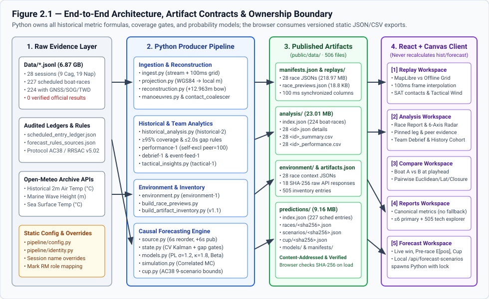
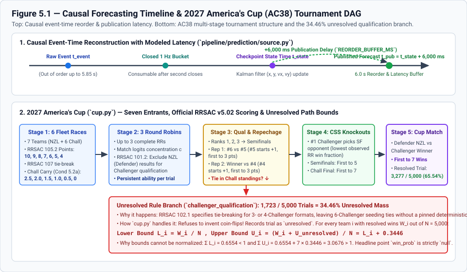
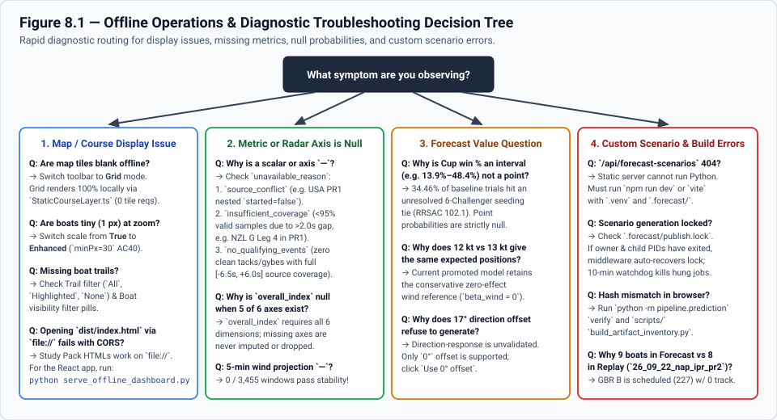

# 02 — Field Guide: System On One Page, Formula Reference & Offline Playbook

**Repository**: `2D_regatta_replay` | **Snapshot**: `2026-11-04` | **Commit**: `f956f8a14feb` (dirty working tree) | **Archive**: 28 Sessions (`6.87 GB` raw `.jsonl`), 224 Replayed Boat-Races / 227 Scheduled Boat-Races

> **How to Use This Field Guide**: Keep this 10-page companion open alongside the code or dashboard when you need to recall an architectural boundary, verify a formula or sign convention, distinguish the three forecasting targets, avoid a common interpretation trap, or diagnose an offline issue without reopening the main textbook (`01_Repository_Explained.pdf`).

---

## 1. The Entire System on One Page

### 1.1 The Cardinal Ownership Invariant (`AGENTS.md`, `PROJECT.md`)

| Domain | Owner | Key Modules | Hard Boundary Rule |
| :--- | :--- | :--- | :--- |
| **Raw Telemetry Parsing & Projection** | **Python** | `pipeline/ingest.py`, `pipeline/projection.py` | Browser never reads `Data/*.jsonl` or projects WGS84 `(lat, lon)` to metric `(x, y)` for replay calculation. |
| **10 Hz Resampling & Event Reconstruction** | **Python** | `pipeline/synchronize.py`, `pipeline/reconstruction.py`, `pipeline/manoeuvres.py` | Start times, gate roundings, leg assignments, monotonic `progress_m`, and manoeuvres are fixed at export time. |
| **Historical Metrics & Peer Indices (`historical-2`, `performance-1`)** | **Python** | `pipeline/historical_analysis.py`, `pipeline/tactical_insights.py` | **The UI reads exported metrics; never recalculate historical metrics or peer baselines in TypeScript.** |
| **Causal Live, Pre-Race & 2027 Cup Forecasts (`prediction-1`, `cup-1`)** | **Python** | `pipeline/prediction/{state,models,simulation,cup,evaluation,build}.py` | Browser validates SHA-256 hashes & probability sum invariants (`predictionCatalog.ts`) and enforces `published_at_ms <= playhead`. |
| **Display-Rate (60 fps) Interpolation & Instantaneous Geometry** | **TypeScript** | `src/engine/ReplayEngine.ts`, `src/engine/interpolate.ts`, `src/engine/analytics.ts`, `src/engine/contactDetector.ts` | Browser interpolates between adjacent 100 ms frames, computes live metre/second lead gaps (`getStandings`), pairwise offsets (`compareBoats`), and real-time SAT hull polygons. |

### 1.2 Archive Scale at a Glance

* **Raw Sessions**: **28** `.jsonl` files (`6,866,006,601` bytes $\approx 6.87\text{ GB}$) across **9 race days** in 2026:
  - **Cagliari (`cagliari_2026`, May 22–24, 2026)**: 9 sessions (`63` replayed boat-races, `63` scheduled).
  - **Naples (`naples_2026`, Sep 22–27, 2026)**: 19 sessions (`161` replayed boat-races, `164` scheduled).
* **Why `224` vs `227` Boat-Races?**: In 3 Naples practice races on Sep 22 (`26_09_22_nap_ipr_pr2`, `pr3`, `pr4`), `GBR B` appears in the scheduled race roster (`race_start_status` / `boat_Schedule`) with `0` `boat_state` telemetry packets. `pipeline/ingest.py:L699-L700` drops boats with empty telemetry from replay/analysis exports (`224` replayed boat-races), whereas `pipeline/prediction/labels.py` retains all scheduled starters (`227` scheduled boat-races) so non-starters are properly counted in completion modeling ($175 / 227 = 77.09\%$ raw completion rate) and scored under the tied-$N$ convention.
* **Official Results Verification**: `official_order_verified = False` across **all 28 sessions**. Every finishing order is either `derived` from reconstructed gate crossings (`27` sessions) or `unavailable` (`1` session: `26_09_23_nap_ipr_pr1`, where the recording window ends `359 s` before the scheduled gun).

---

## 2. Data Flow & Component Responsibilities

| Stage | Input Artifact / Stream | Processing Module & Entry Function | Output Artifact (`public/data/` or `.forecast/`) | Primary UI / CLI Consumer |
| :--- | :--- | :--- | :--- | :--- |
| **1. Ingest** | `Data/<session>.jsonl` | `pipeline/ingest.py` → `IngestionPipeline.ingest_file()` | In-memory `IngestionResult` | `pipeline/__main__.py`, `scripts/ingest_regattas.py` |
| **2. Project** | WGS84 `(lat, lon)` | `pipeline/projection.py` → `LocalCoordinateConverter` | Local metric `(x, y)` in metres from venue origin | All downstream Python & TS geometry |
| **3. Sync** | Irregular ~10 Hz boats, ~1 Hz marks | `pipeline/synchronize.py` → `TimelineSynchronizer.synchronize()` | `SynchronizedTimeline` (uniform `100 ms` grid) | `reconstruction.py`, `manoeuvres.py`, `export_replay.py` |
| **4. Reconstruct** | 10 Hz `(x, y, heading)` + course | `pipeline/reconstruction.py` → `CourseReconstructor.reconstruct()` | Start/gate crossings, `leg`, monotonic `progress_m`, ranks | `export_replay.py`, `historical_analysis.py` |
| **5. Manoeuvres & Contacts** | 10 Hz `(heading, twa, sog, vmg)` | `pipeline/manoeuvres.py` (`ManoeuvreDetector`), `pipeline/analytics.py` (`detect_virtual_contacts`) | `competitors[].manoeuvres`, `virtual_contact_incidents` | `export_replay.py`, `historical_analysis.py` |
| **6. Replay & Catalog Export** | Stages 1–5 outputs | `pipeline/export_replay.py`, `pipeline/canonical_tables.py` | `replays/<id>.json`, `manifests.json`, `race_previews.json`, `presentation/**` | `Replay`, `Compare`, `Reports` workspaces |
| **7. Historical & Tactical Analysis** | `replays/<id>.json` + raw `.jsonl` | `pipeline/historical_analysis.py`, `pipeline/tactical_insights.py` | `analysis/index.json`, `analysis/<id>.json`, `artifacts.json` | `Analysis`, `Replay` (Tactical card), `Reports` |
| **8. Environment Provenance** | `replays/<id>.json` + Open-Meteo cache | `pipeline/environment.py` → `build_environment_dataset()` | `environment/index.json`, `environment/<id>.json` | Weather provenance verification (`--verify`) |
| **9. Causal Forecast Build** | Raw `.jsonl` + `replays/` + `analysis/` | `pipeline/prediction/build.py` → `build_all()` | `.forecast/**`, `predictions/index.json`, `predictions/races/*.json`, `predictions/cup_2027.json` | `Forecast` workspace, `LiveStrategyCard.tsx` |
| **10. Lazy Wind Scenario** | `POST /api/forecast-scenarios` | `scripts/forecastScenarios.ts` → `python -m pipeline.prediction scenario` | `predictions/scenarios/<id>_<sha256>.json` | `ForecastWorkspace.tsx` (custom wind controls) |

---

## 3. Important Quantities, Formulas, Units & Sign Conventions

### 3.1 Coordinate Systems, Projection & Vessel Geometry

1. **WGS84 Ellipsoidal Radii of Curvature** ([`pipeline/projection.py:L29-L68`](source-companion/view/pipeline/projection.py.html#L29)):
   With semi-major axis $a = 6{,}378{,}137.0\text{ m}$, flattening $f = 1/298.257223563$, $e^2 = 2f - f^2$, and reference latitude $\phi_0$:
   $$M(\phi_0) = \frac{a(1 - e^2)}{(1 - e^2 \sin^2\phi_0)^{3/2}}, \qquad N(\phi_0) = \frac{a}{\sqrt{1 - e^2 \sin^2\phi_0}}$$
   $$x = (\lambda - \lambda_0)\frac{\pi}{180}\, N(\phi_0)\cos\phi_0 \quad (\text{m East}), \qquad y = (\phi - \phi_0)\frac{\pi}{180}\, M(\phi_0) \quad (\text{m North})$$
   * **Naples Origin (`NAPLES_REFERENCE`)**: $(\phi_0, \lambda_0) = (40.80875^\circ\text{ N},\; 14.21565^\circ\text{ E}) \implies 84{,}282.58\text{ m/deg lon},\; 111{,}050.25\text{ m/deg lat}$.
   * **Cagliari Origin (`CAGLIARI_REFERENCE`)**: $(\phi_0, \lambda_0) = (39.19000^\circ\text{ N},\; 9.14250^\circ\text{ E}) \implies 86{,}383.48\text{ m/deg lon},\; 111{,}019.66\text{ m/deg lat}$.

2. **Nautical Compass vs Standard Math Angles**:
   * All bearings (`heading` $\psi$, `cog`, `twd`, `axis_deg`) are **degrees clockwise from True North** ($0^\circ = \text{North}, 90^\circ = \text{East}$).
   * Unit vector along bearing $\theta$: $(\sin\theta,\; \cos\theta)$ in $(x\text{ East}, y\text{ North})$, **not** $(\cos\theta, \sin\theta)$!

3. **Vessel-Local to World Transform** ([`src/engine/contactDetector.ts:L101-L118`](source-companion/view/src/engine/contactDetector.ts.html#L101)):
   For local starboard coordinate $u$ and forward coordinate $v$ relative to the transom GNSS origin $(x_0, y_0)$ at heading $\psi$:
   $$x_{\text{world}} = x_0 + u\cos\psi + v\sin\psi, \qquad y_{\text{world}} = y_0 - u\sin\psi + v\cos\psi$$
   In particular, the AC40 bowsprit tip ($u = 0, v = L_{\text{bow}} = +12.963\text{ m}$) is at:
   $$\vec{p}_{\text{bow}}(t) = \bigl(x(t) + 12.963\sin\psi(t),\; y(t) + 12.963\cos\psi(t)\bigr)$$

### 3.2 Interpolation, Crossings & Critical Sign Conventions

4. **Shortest-Arc Circular Interpolation** ([`pipeline/synchronize.py:L29-L48`](source-companion/index.html), [`src/engine/interpolate.ts:L7-L10`](source-companion/view/src/engine/interpolate.ts.html#L7)):
   $$\Delta\theta = \bigl((\theta_1 - \theta_0 + 540^\circ) \bmod 360^\circ\bigr) - 180^\circ \in [-180^\circ, +180^\circ), \qquad \theta(\alpha) = (\theta_0 + \alpha\,\Delta\theta) \bmod 360^\circ$$

5. **Sub-Frame Line-Segment Intersection** ([`pipeline/reconstruction.py:L39-L73`](source-companion/view/pipeline/reconstruction.py.html#L39)):
   For bow motion $\vec{p}_0 \to \vec{p}_1$ ($\vec{r} = \vec{p}_1 - \vec{p}_0$) and gate segment $\vec{q}_0 \to \vec{q}_1$ ($\vec{s} = \vec{q}_1 - \vec{q}_0$) with 2D cross product $\vec{a} \times \vec{b} = a_x b_y - a_y b_x$:
   $$u = \frac{(\vec{q}_0 - \vec{p}_0) \times \vec{s}}{\vec{r} \times \vec{s}} \in [0, 1], \qquad v = \frac{(\vec{q}_0 - \vec{p}_0) \times \vec{r}}{\vec{r} \times \vec{s}} \in [0, 1], \qquad t_{\text{cross}} = \operatorname{round}\bigl(t_0 + u(t_1 - t_0)\bigr)$$

6. **CRITICAL SIGN CONVENTION — Two Different Definitions of VMG**:
   * **Replay Telemetry `vmg`** (`replay.telemetry.boats[id].vmg`): Wind-referenced projection $\text{SOG}\cos(\text{TWA})$. **Positive upwind ($|\text{TWA}| < 90^\circ$), NEGATIVE downwind ($|\text{TWA}| > 90^\circ$)**.
   * **Historical Analysis `avg_vmg_kt` & `upwind_vmg`/`downwind_vmg`** (`public/data/analysis/*.json`): Mark/axis-referenced projection along the active leg unit vector $\hat{u}_{\text{leg}}$. **POSITIVE on both upwind and downwind legs** whenever the boat makes progress toward the target gate!

7. **6-Axis Self-Excluding Peer-Normalized Index (`performance-1`)** ([`pipeline/historical_analysis.py:L580-L746`](source-companion/view/pipeline/historical_analysis.py.html#L580)):
   For boat $b$ on matched leg $\ell \in L_b$ with valid peer set $P_{b,\ell} = \{p \ne b : x_{p,\ell} \text{ valid}\}$ ($|P_{b,\ell}| \ge 1$):
   $$\bar{x}_{-b,\ell} = \frac{1}{|P_{b,\ell}|}\sum_{p \in P_{b,\ell}} x_{p,\ell}, \qquad I_{b,\ell} = 100 \cdot \frac{x_{b,\ell}}{\bar{x}_{-b,\ell}}, \qquad I_{b,d} = \frac{1}{|L_{b,d}|}\sum_{\ell \in L_{b,d}} I_{b,\ell}$$
   $$\text{overall\_index}_b = \frac{1}{|D_b|}\sum_{d \in D_b} I_{b,d}$$
   *Note*: Because $I_{b,d}$ is the **mean of per-leg ratios** ($\frac{1}{|L|}\sum_\ell 100 \frac{x_{b,\ell}}{\bar{x}_{-b,\ell}}$), it does **not** equal $100 \times \frac{\text{value}_b}{\text{peer\_mean}_b}$ (the ratio of cross-leg means) when leg speeds vary across legs!

---

## 4. Three Forecasting Targets and Their Differences

| Attribute | Target 1: Pre-Race Expected Finish Position | Target 2: Live In-Race Win Probability | Target 3: 2027 America's Cup Winner (AC38) |
| :--- | :--- | :--- | :--- |
| **Method Version** | `pre-race-pl-mc-1` | `live-mc-kalman-1` | `cup-ac38-conditional-2` (`cup-1`) |
| **Mathematical Target** | $\mathbb{E}[R_i] \in [1, K]$ under tied-$N$ scoring | $\mathbb{P}(\text{Boat } i \text{ finishes 1st} \mid \mathcal{F}_{t - 6\text{s}})$ plus $\mathbb{P}(\text{no finisher})$ | Interval bounds $[\underline{P}_i, \overline{P}_i]$ across tournament trials & 24 transfer scenarios |
| **Observation Universe** | **227 scheduled entries** across 28 races | Active starters at checkpoint $t$ ($t_{\text{pub}} = t + 6000\text{ ms}$) | **7 AC38 entries** (`NZL`, `GBR`, `ITA`, `SUI`, `FRA`, `USA`, `AUS`) |
| **Core Statistical Models** | Empirical Bayes Beta-Binomial completion ($\alpha_0 + \beta_0 = 8$) + MAP Plackett–Luce ($\sigma=1.2, \kappa=1.8$) | 6 s `ReorderBuffer` + `CVKalmanFilter` + `LegTimeModel` ($\rho_{\text{cal}}=0.65$) + $10^{-4}$ uniform tail mix | Cross-class skill transfer $\theta^{\text{AC75}}_i = \rho \hat{\theta}^{\text{AC40}}_i + \sqrt{1 - \rho^2 + \tau^2}\epsilon_i$ + full AC38 bracket MC |
| **Sum / Normalization Invariant** | $\sum_{i=1}^K \mathbb{E}[R_i] \ge \frac{K(K+1)}{2}$ (strictly $>$ whenever $p_{\text{nonfinish}} > 0$ under tied-$N$) | $\sum_{i=1}^K p_i + p_{\text{no\_finisher}} = 1.0 \pm 10^{-5}$ | **Headline `probabilities` are `null`**; lower bounds sum to $1 - u$ ($0.6554$ in baseline) and upper bounds sum to $1 + (K-1)u$; **never normalize endpoints!** |
| **Weather Sensitivity** | Currently **invariant** across `tws_kt` $\in [8, 22]\text{ kt}$; `direction_offset_deg != 0` returns `unavailable` | Uses live checkpoint wind + `LegTimeModel` TWS slope $\beta_1$ | Integrates over Naples late-summer wind/wave empirical distributions |

---

## 5. The Most Consequential Assumptions & Limitations

1. **Zero Official Finishing Orders (`official_order_verified = False`)**: Every race result, finishing rank, and elapsed time in the archive is reconstructed from GNSS telemetry and autonomous mark streams, not signed race-committee sheets.
2. **Small Effective Sample Size ($28$ Sessions / $9$ Race Days vs $331{,}089$ Frames)**: High-frequency 10 Hz sampling reduces measurement noise *within* a leg, but provides zero additional degrees of freedom for cross-race team skill estimation or weather regression.
3. **Unidentifiable 2027 AC38 Rules (`34.46%` Unresolved Baseline Trials)**: Because AC38 Notice of Race / RRSAC 102.1 multi-way tie-break procedures and AC40-to-AC75 correlation $\rho$ are unobserved, `1,723 / 5,000` baseline Cup trials cannot be uniquely resolved without inventing rules.
4. **Two-Boat Fleet Collapse (`GBR` and `ITA` Red/Black Hulls)**: In 2026 AC40 preliminary sessions, Great Britain (`GBR B`, `GBR G`), Italy (`ITA B`, `ITA G`), and New Zealand (`NZL B`, `NZL G`) fielded two hulls simultaneously, whereas the 2027 Cup is a single-hull AC75 event per syndicate.
5. **Pre-Race Wind Invariance & Inactive Delay Mixture**: In `pipeline/prediction/models.py`, `PlackettLuceModel` and `CompletionModel` do not include a `tws_kt` covariate (so pre-race expected positions are identical across `8..22 kt`), and `PositiveDelayMixture` is fit on empty delay lists (`available = False`).
6. **Conservative Tactical Projection Suppression (`0 / 3,455` Projections Emitted)**: `pipeline/tactical_insights.py` applies 7 sequential quality gates before emitting a 5-minute wind-shift projection; in the current archive, 100% of snapshots are suppressed at the projection stage (`projection_change_deg = null`).

---

## 6. Common Interpretation Mistakes (And How to Avoid Them)

| # | Common Mistake | Why It Is False | Correct Interpretation |
| ---: | :--- | :--- | :--- |
| **1** | Treating `331,089` synchronized frames as `331,089` independent samples. | Consecutive 100 ms frames are strongly autocorrelated (and interpolated from ~10 Hz boat / ~1 Hz mark packets). | Always count **boat-races (`224` replayed / `227` scheduled)** or **matched legs** as the statistical denominator. |
| **2** | Expecting `100 * value / peer_mean` to equal `dimension.index` in `performance-1`. | `dimension.index` is the **mean of per-leg ratios**, whereas `value` and `peer_mean` are cross-leg means. | By Jensen's inequality / covariance of ratios, $\frac{1}{|L|}\sum \frac{x_\ell}{y_\ell} \ne \frac{\bar{x}}{\bar{y}}$ (e.g., `ITA G` downwind VMG in `naples_pr1` is `109.97` vs `108.09`). |
| **3** | Assuming a peer index of `110` means "10% faster than the entire 9-boat fleet". | The baseline excludes non-finishers on unmatched legs (`matched_legs` scope) and excludes the subject boat itself ($P_{b,\ell}$). | Read `scope.matched_legs` and `leg_evidence[].peer_count`: in a 2-boat match race (`naples_mr_final`), `peer_count = 1`, so index is simply $100 \times x_A / x_B$ on completed legs `1..4`. |
| **4** | Averaging raw telemetry `vmg` across upwind and downwind legs. | Telemetry `vmg` is negative downwind ($\text{SOG}\cos(\text{TWA})$). | Use mark/axis-referenced VMG from `analysis/<race_id>.json` (`avg_vmg_kt`), which is positive toward the active mark on all legs. |
| **5** | Expecting pre-race expected positions to sum to $\frac{K(K+1)}{2} = 45$ in a 9-boat race. | The forecast uses the **tied-$N$ convention** (`nonfinish_score = "N"`), assigning rank $K$ to every non-finisher. | Whenever $\mathbb{P}(\text{nonfinish}) > 0$, non-finishers receive rank $K$ instead of the average of bottom ranks, strictly increasing $\sum \mathbb{E}[R_i]$ above $\frac{K(K+1)}{2}$. |
| **6** | Normalizing the 2027 Cup `rule_bounds_by_team` midpoints or upper bounds to sum to 100%. | The width $u = \text{upper}_i - \text{lower}_i = 0.3446$ is shared epistemic mass from unresolved RRSAC 102.1 tie-break trials. | Never normalize interval endpoints; doing so secretly imposes an arbitrary tie-break rule that the repository explicitly refuses to fabricate. |
| **7** | Treating `virtual_contact_incidents` (`COLLISION` / `PROXIMITY`) as official umpire penalties. | Contacts are pure 2D convex-polygon SAT overlaps of 10 Hz GNSS hulls (`keep_clear_border` / `platform_border`). | Telemetry has $\sim 1\text{–}2\text{ m}$ GNSS/heading jitter and no umpire protest flags; treat contacts as geometric proximity candidates. |
| **8** | Assuming constant coordinates at the end of a replay mean the boat anchored on the course. | `TimelineSynchronizer` clamps timestamps after a boat's last packet to its final coordinate (`held tail`). | Check `tail_held_s` in `analysis/<race_id>.json` (e.g., `GBR B` in `naples_pr1` has a `951.55 s` held tail after retiring). |

---

## 7. Startup & Offline-Use Instructions

### 7.1 What Works With Zero Installed Runtimes (`file://` Direct Double-Click)

Open [`START_HERE.html`](START_HERE.html) directly in any browser (Chrome, Edge, Firefox, Safari) by double-clicking it in File Explorer / Finder:
* **All Study Pack HTML Editions**: `01_Repository_Explained.html`, `02_Field_Guide.html`, `03_Repository_Atlas.html`, `04_Workbook.html`, `04_Workbook_Solutions.html`, `study-materials/05_Study_Routes_and_Questions.html`, `study-materials/06_Audio_Narration_Script.html`, `MANIFEST.html`.
* **All PDFs**: `01_Repository_Explained.pdf`, `02_Field_Guide.pdf`, `04_Workbook.pdf`, `04_Workbook_Solutions.pdf`.
* **Interactive Offline Tools**:
  - [`study-materials/flashcards_viewer.html`](study-materials/flashcards_viewer.html) (64 interactive flashcards with instant filtering & keyboard flip).
  - [`examples/interactive_sailing_and_forecast_lab.html`](examples/interactive_sailing_and_forecast_lab.html) (interactive VMG, circular interpolation, peer radar, and Plackett–Luce/Cup bounds calculator).
  - [`examples/05_Interactive_Study_Notebook.html`](examples/05_Interactive_Study_Notebook.html) (pre-rendered notebook with outputs).
  - [`source-companion/index.html`](source-companion/index.html) (all 209 first-party source files with line-number anchors `#L1..#LN`).

### 7.2 What Requires a Local Runtime (When on Your Laptop in the Mountains)

| Task | Command | Required Local Runtime | Internet Required? |
| :--- | :--- | :--- | :--- |
| **Run Study Pack Executable Python Examples** | `python offline-study-pack/2026-11-04-edition/examples/01_verify_projection_and_bow_crossing.py` (and `02_...`, `03_...`) | Python 3.10+ (standard library only!) | **No** |
| **Launch Bundled Offline Dashboard (`offline-dashboard/`)** | `python offline-study-pack/2026-11-04-edition/offline-dashboard/serve_offline_dashboard.py` → open `http://127.0.0.1:4173` | Python 3.10+ (serves static `fetch('/data/...')` over loopback) | **No** (use **Grid** view) |
| **Inspect Archive Coverage from Repo Root** | `.venv\Scripts\python.exe scripts/analysis_snapshot.py` (or `--race naples_pr1`) | Repo `.venv` Python | **No** |
| **Run Full 828-Test Verification Suite** | `.\run.ps1 verify` | Node.js + `.venv` Python | **No** |
| **Generate Custom Pre-Race Wind Scenarios in UI** | `npm run dev` (activates `scripts/forecastScenarios.ts` middleware) | Node.js + `.venv` Python | **No** |

---

## 8. Troubleshooting Decision Tree

